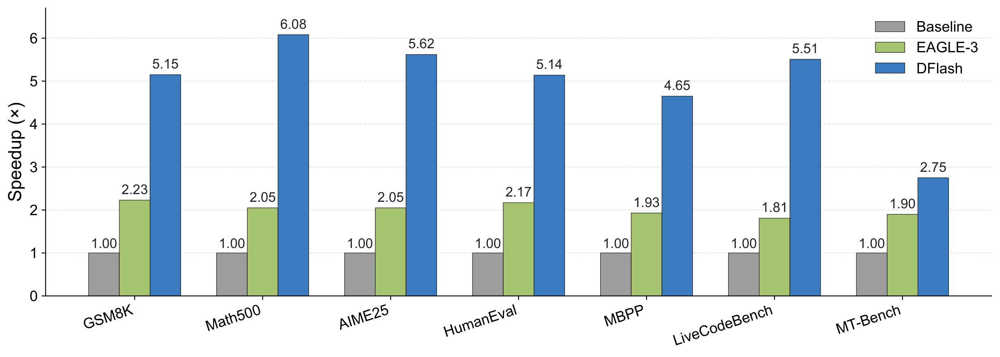
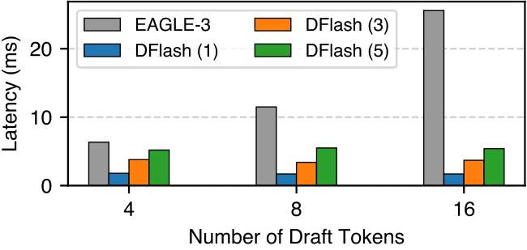
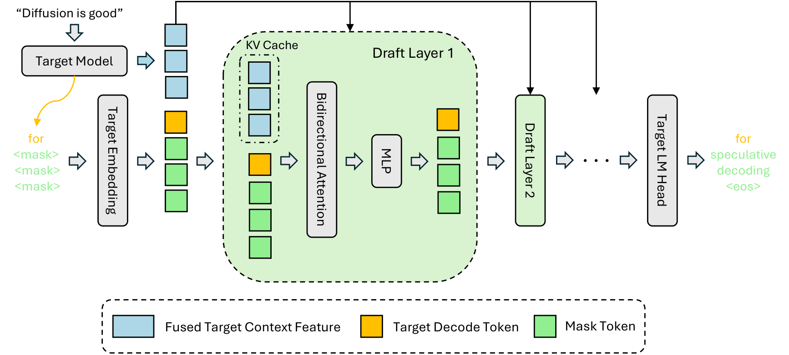
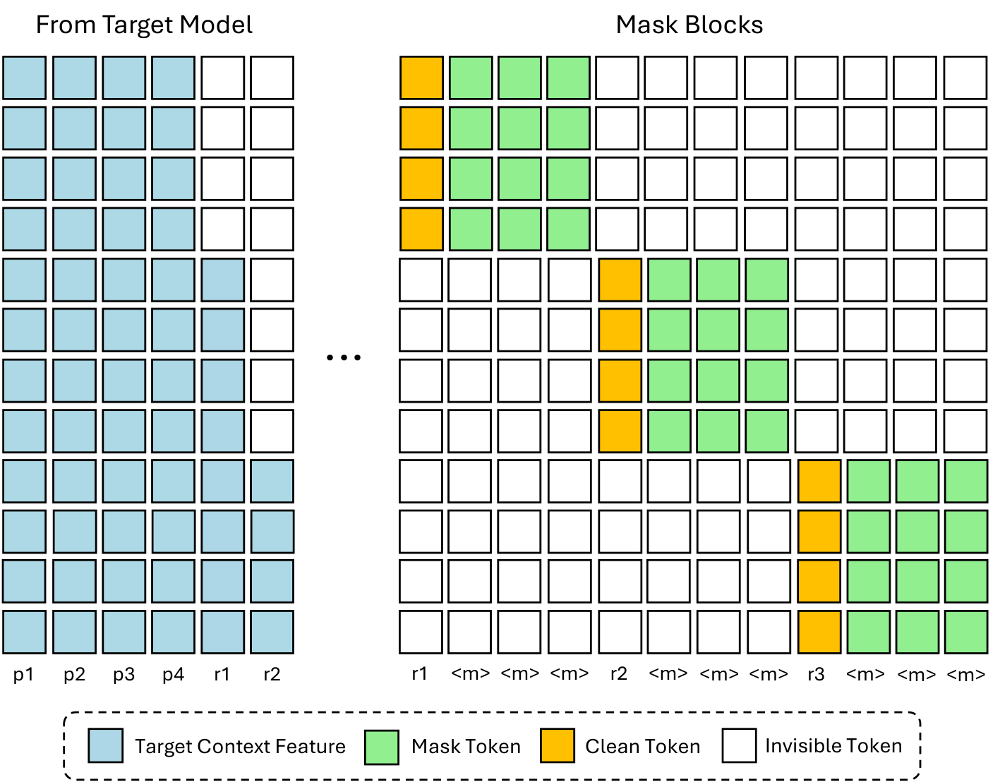
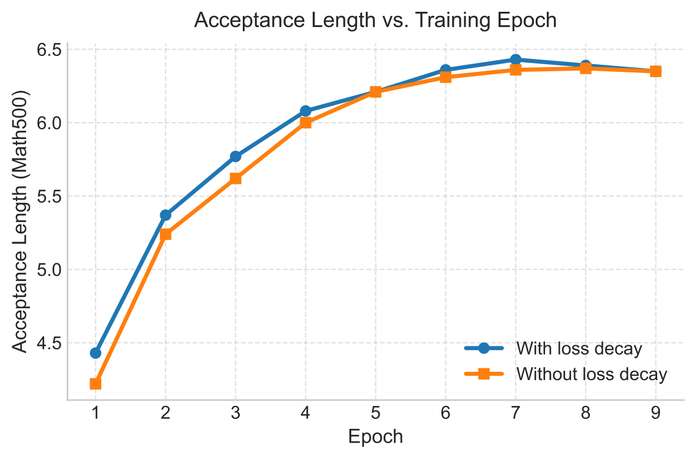

> Paper: [https://arxiv.org/abs/2602.06036](https://arxiv.org/abs/2602.06036)  
> Code: [https://github.com/z-lab/dflash](https://github.com/z-lab/dflash) / Models: [HuggingFace z-lab/dflash](https://hf.co/collections/z-lab/dflash)  
> ICML 2026

## Introduction

Autoregressive LLM은 강력한 성능을 내지만 token-by-token으로 순차 생성해야 하므로 inference latency가 크고 GPU utilization이 낮음. 특히 최근 long CoT reasoning 모델의 등장으로 generation 길이가 길어지면서 이 병목은 더 심각해짐.

Speculative decoding이 대표적인 해결책임. 가벼운 **draft model**이 미래 토큰 여러 개를 추측(speculate)하고, 큰 **target model**이 이를 한 번의 forward pass로 병렬 검증(verify)하는 방식으로, 출력 분포가 바뀌지 않는 **lossless 가속**을 제공함. 하지만 EAGLE-3 같은 SOTA 방법조차 draft 자체는 여전히 autoregressive라서 순차적으로 생성해야 하고, error accumulation에도 취약함. 이 때문에 실질 speedup이 2~3배 수준에서 막혀 있었음.

한편 Diffusion LLM(dLLM)은 병렬 생성이 가능하다는 장점이 있지만, 현재 open-source dLLM들은 autoregressive 모델 대비 생성 품질이 떨어지고, 품질을 유지하려면 denoising step을 많이 돌려야 해서 정작 속도 이점이 줄어듦. 즉 "AR은 품질↑ 속도↓, diffusion은 속도↑ 품질↓"의 trade-off가 존재함.

DFlash의 아이디어는 이 둘을 결합하는 것임. **draft는 diffusion으로 병렬 생성하고, 검증은 고품질 AR target model에게 맡겨 lossless를 보장**함. 핵심 인사이트는 "**the target knows best**" — 큰 AR 모델의 hidden feature에는 이미 미래 토큰들에 대한 정보가 암묵적으로 담겨 있으므로, 이 feature를 조건으로 주면 아주 작은 diffusion drafter도 높은 품질의 draft를 만들 수 있다는 것임. draft model이 사실상 target model의 깊은 context feature를 활용하는 **diffusion adapter**로 동작하게 됨.

위 그림은 Qwen3-8B (Transformers backend)에서 autoregressive decoding 대비 speedup을 비교한 것임. EAGLE-3가 벤치마크 전반에서 1.8~2.2배 수준에 머무는 반면, DFlash는 Math500에서 6.08배 등 대부분의 태스크에서 5배 이상을 기록하며 EAGLE-3보다 약 2.5배 높은 가속을 보여줌.

**이 논문의 novel한 점**

- 경량(5-layer 수준) **block diffusion draft model**로 한 번의 forward pass에 draft block 전체를 병렬 생성 → drafting latency가 draft 토큰 수 $\gamma$에 거의 무관해짐.
- target model의 여러 layer에서 뽑은 hidden feature를 융합해 draft model의 **모든 layer의 KV cache에 직접 주입(KV injection)**하는 conditioning 방식 제안 — 기존 EAGLE류의 input fusion보다 강한 conditioning을 제공하고, draft layer를 늘릴수록 acceptance length가 잘 늘어남(acceptance scaling).
- speculative decoding 상황에 맞춘 학습 기법들(random anchor 기반 masked block sampling, position별 exponential loss decay, embedding/LM head 공유)을 설계.
- Qwen3-8B에서 최대 **6.1배 lossless speedup**, EAGLE-3 대비 최대 **2.5배** 개선. SGLang, vLLM 같은 실제 serving framework에서도 효과를 검증함.

## Preliminary

**Speculative decoding.** target model $\mathcal{M}_t$의 inference를 작은 draft model $\mathcal{M}_d$로 가속함. 매 decoding cycle마다 draft model이 $\gamma$개의 토큰을 제안하고 target model이 병렬로 검증함. 평균 per-token latency는

$$L = \frac{T_{\text{draft}} + T_{\text{verify}}}{\tau}$$

로 표현됨. 여기서 $\tau \in [1, \gamma+1]$은 cycle당 수락되는 토큰 수(verification에서 target이 만들어주는 bonus token 포함)의 기댓값, 즉 **acceptance length**임. target의 AR per-token latency를 $L_{\text{target}}$이라 하면 speedup은 $\eta = L_{\text{target}} / L$. 결국 speedup을 올리는 길은 두 가지 — $\tau$를 키우거나 $T_{\text{draft}}$를 줄이거나.

**Autoregressive vs Diffusion drafting.** AR drafter는 토큰을 하나씩 뽑으므로 $T_{\text{draft}} = \gamma \cdot t_{\text{step}}$, 즉 drafting 비용이 $\gamma$에 선형으로 증가함. latency를 감당하려면 draft model을 극단적으로 얕게(EAGLE-3는 transformer 1개 layer) 만들 수밖에 없고, 그 결과 capacity 부족으로 $\gamma$를 늘려도 $\tau$가 금방 saturate됨. 반면 diffusion drafter는 block 안의 masked token 전부를 한 번의 forward pass로 병렬 예측하므로 $T_{\text{draft}} = t_{\text{parallel}}$이고, 적당한 block size에서는 $\gamma$에 거의 무관함. GPU는 순차 forward 여러 번보다 병렬 연산 한 번을 훨씬 효율적으로 처리하므로 $t_{\text{parallel}} \ll \gamma \cdot t_{\text{step}}$.

위 그래프는 draft 토큰 수에 따른 drafting 비용 비교임. EAGLE-3(1-layer)는 draft 토큰이 4→16개로 늘면 latency가 선형 이상으로 치솟는 반면, DFlash는 1/3/5-layer 어느 구성이든 거의 일정함. 이 병렬성 덕분에 diffusion drafter는 **latency 손해 없이 더 깊고 표현력 있는 구조**를 쓸 수 있고, 실제로 16개 토큰을 뽑는 5-layer DFlash가 8개를 뽑는 EAGLE-3보다 latency는 낮고 acceptance length는 높음.

**Diffusion LLM과 block diffusion.** LLaDA가 dLLM을 수십억 파라미터로 처음 스케일링했지만, fully parallel diffusion은 고정 길이 생성과 KV cache 미지원 문제가 있음. Block diffusion(BD3-LM 등)은 시퀀스를 block 단위로 나눠 block끼리는 autoregressive하게, block 내부는 diffusion으로 병렬 denoising하는 절충 구조로 이 문제를 해결함. 그래도 기존 dLLM들은 SOTA AR 모델보다 품질이 떨어지고 denoising step이 많이 필요함. diffusion을 drafting에 쓰려는 선행 시도들도 있었음 — DiffuSpec, SpecDiff-2는 7B급 대형 dLLM을 drafter로 써서 acceptance는 높였지만 drafting 비용 탓에 실질 speedup이 3~4배에 그쳤고, PARD는 작은 AR 모델에 diffusion식 병렬 생성을 흉내내게 했지만 target 정보 없이 처음부터(from scratch) 예측해야 하는 한계로 3배 수준에 머묾. DFlash는 "**작으면서도 정확한** diffusion drafter"가 가능함을 보이는 것이 목표임.

## Method

### Inference

위 그림이 DFlash의 전체 inference 구조임. target model이 prefill/decode 과정에서 만든 hidden feature(파란색)를 융합해 각 draft layer의 KV cache에 주입하고, draft model은 target이 마지막으로 확정한 토큰(노란색) 뒤에 mask 토큰들(초록색)을 붙여 bidirectional attention으로 한 번에 denoise함. 그 결과 나온 draft block을 target LM head가 있는 target model이 병렬 검증하는 구조임.

**Context features from the target model.** 저자들은 먼저 target conditioning 없이 5-layer block diffusion drafter를 학습해봤는데, speedup이 2~3배 수준에 그침(PARD와 같은 한계). 작은 모델이 rich context 없이 미래를 예측해야 하기 때문임. 반면 target model의 hidden representation은 token-level logits보다 훨씬 많은 정보 — long-range dependency, 태스크 semantic, 그리고 결정적으로 **미래 토큰에 대한 암묵적 정보** — 를 담고 있음. DFlash는 target model의 얕은 layer부터 깊은 layer까지 균등하게 뽑은 고정된 layer 집합(기본 5개)에서 hidden state를 추출·concat하고, 가벼운 projection layer로 융합해 compact한 **target context feature**를 만들어 draft model을 conditioning함.

**Conditioning via KV injection.** EAGLE-3도 target의 hidden feature를 쓰지만, feature를 draft model의 token embedding과 섞어 **입력으로만** 넣음. 그래서 draft layer가 깊어질수록 target 정보가 희석되고, layer를 추가해도 acceptance 이득이 줄어듦. DFlash는 근본적으로 다르게, 융합된 target context feature를 **모든 draft layer의 Key/Value projection에 직접 주입**함. 구체적으로 선택된 target layer들의 hidden state를 projection $W_c$로 융합하고

$$\mathbf{H}_{t} = \mathrm{RMSNorm}\left(W_c[\mathbf{H}^{(l_1)};\ldots;\mathbf{H}^{(l_5)}]\right)$$

각 draft layer $i$에서 draft 토큰은 query를 만들고, target feature는 K/V로만 projection되어 draft 토큰의 K/V 앞에 이어 붙음:

$$\mathbf{Q}_i = W_i^Q \mathbf{H}_d, \quad \mathbf{K}_i = [W_i^K \mathbf{H}_t;\, W_i^K \mathbf{H}_d], \quad \mathbf{V}_i = [W_i^V \mathbf{H}_t;\, W_i^V \mathbf{H}_d]$$

즉 target feature는 draft model의 KV cache에 들어가 drafting iteration 간에 재사용되는 **persistent contextual memory** 역할을 함. 추가 파라미터는 공유 projection $W_c$ 하나뿐이라 memory overhead도 수십 MB 수준으로 미미함. 이 설계 덕분에 draft layer 수를 늘릴수록 acceptance length가 실제로 늘어나는 **acceptance scaling**이 가능해짐.

**Parallel diffusion drafting.** draft는 block-level diffusion으로 수행됨. block 내 모든 masked position을 단 한 번의 forward pass로 병렬 decode하므로, AR drafter처럼 여러 번의 순차 forward가 필요 없음. 깊은 draft model을 쓰더라도 drafting latency가 낮고 hardware utilization이 높음.

### Training

위 그림은 DFlash의 training attention 구조임. 왼쪽(파란색)이 target model에서 추출한 context feature, 오른쪽이 masked block들임. 각 block은 랜덤하게 샘플링된 clean anchor 토큰(노란색) 1개 + mask 토큰들(초록색)로 구성되고, block 내부는 bidirectional로 attend하되 block 간 attention은 차단(흰색)해 정보 누출을 막음. 이 sparse attention mask 덕분에 여러 block을 한 번의 forward/backward로 함께 학습할 수 있음(Flex Attention 활용).

frozen target model의 출력에 draft model의 block diffusion 예측을 정렬시키는 학습이며, 표준 block diffusion 학습에 몇 가지 수정을 가함:

- **KV injection (training)** — inference와 동일하게, prompt+response 전체 clean sequence를 target model에 통과시켜 hidden feature를 추출·융합한 뒤 draft model에 K/V로 주입함.
- **Random sampling of masked blocks** — 표준 block diffusion처럼 response를 균등 분할해 랜덤 마스킹하는 대신, response에서 **anchor 토큰을 랜덤 샘플링**해 각 anchor를 block의 첫 위치로 삼고 나머지 $\text{block\_size}-1$개를 마스킹함. inference 시 draft model이 항상 "target이 확정한 clean token(직전 verification의 bonus token)" 뒤를 예측한다는 점과 정확히 일치시키는 설계임. anchor 위치를 랜덤화하면 다양한 target context feature에 노출되어 data efficiency도 좋아짐.
- **Efficient long-context training** — sequence당 masked block 수를 고정하고 epoch마다 anchor 위치를 다시 샘플링함. EAGLE-3류의 비싼 training-time test 없이 학습 비용을 bound시키면서 data augmentation 효과를 얻음.
- **Loss weighting for faster convergence** — speculative decoding에서는 block 앞쪽 토큰이 틀리면 뒤 토큰이 전부 무효가 되므로, 앞 위치가 훨씬 중요함. block 내 위치 $k$의 cross-entropy loss에 지수 감쇠 가중치를 적용함:

$$w_k = \exp\!\left(-\frac{k-1}{\gamma}\right)$$

- **Shared embedding and LM head** — token embedding과 LM head는 target model 것을 그대로 공유·freeze하고 draft transformer layer만 학습함. 학습 파라미터가 줄고, draft model이 target representation space에 밀착된 경량 adapter로 기능하게 됨.

위 그래프는 loss decay의 효과로, 동일 epoch 기준 loss decay를 쓴 쪽(파란색)이 Math500 acceptance length에 더 빨리 도달함 — 수렴 가속 효과를 보여줌.

## Experiments

**Setup.** LLaMA-3.1-8B-Instruct, Qwen3(4B, 8B, Coder-30B-A3B-Instruct)를 target으로 Math(GSM8K, MATH-500, AIME25), Code(HumanEval, MBPP, LiveCodeBench), Chat(MT-Bench, Alpaca)에서 평가. 지표는 평균 acceptance length $\tau$와 AR baseline 대비 end-to-end speedup. 학습 데이터는 Nemotron Post-Training Dataset V2 + CodeAlpaca 약 80만 샘플이며, 원본 응답 대신 **target model이 직접 생성한 응답**으로 학습 셋을 구성해 target alignment를 높임. draft model은 기본 5-layer(block size 16), target hidden feature는 5개 layer에서 추출. H200 GPU 기준.

### Main Results (Qwen3, thinking off)

Temperature 0 기준 주요 결과 (speedup / $\tau$):

| Model | Method | GSM8K | MATH-500 | HumanEval | LCB | MT-Bench | **Avg.** |
|---|---|---|---|---|---|---|---|
| Q3-4B | EAGLE-3 (16) | 1.99× / 3.30 | 1.83× / 3.08 | 1.84× / 3.05 | 1.73× / 2.91 | 1.74× / 3.02 | 1.81× / 3.05 |
| Q3-4B | EAGLE-3 (60) | 2.27× / 3.77 | 2.10× / 3.52 | 2.12× / 3.47 | 1.90× / 3.22 | 2.04× / 3.49 | 2.08× / 3.48 |
| Q3-4B | **DFlash (16)** | **5.15× / 6.53** | **6.09× / 7.84** | **5.21× / 6.64** | **5.41× / 7.09** | **2.85× / 4.35** | **4.91× / 6.54** |
| Q3-8B | EAGLE-3 (16) | 1.94× / 3.23 | 1.81× / 3.02 | 1.89× / 3.17 | 1.57× / 2.65 | 1.63× / 2.83 | 1.76× / 2.96 |
| Q3-8B | EAGLE-3 (60) | 2.23× / 3.71 | 2.05× / 3.49 | 2.17× / 3.65 | 1.81× / 3.03 | 1.90× / 3.26 | 2.02× / 3.40 |
| Q3-8B | **DFlash (16)** | **5.15× / 6.54** | **6.08× / 7.87** | **5.14× / 6.50** | **5.51× / 7.27** | **2.75× / 4.24** | **4.86× / 6.49** |

괄호는 EAGLE-3의 draft tree size / DFlash의 diffusion block size. 모든 태스크·모델에서 DFlash가 일관되게 우세함. 평균적으로 greedy(T=0)에서 4.9배, sampling(T=1)에서도 4.1배 speedup으로 EAGLE-3 대비 각각 2.4배/2.2배 개선. 특히 tree size 60짜리 EAGLE-3(더 큰 verification 비용을 지불)보다도 acceptance length가 높으면서 verification overhead는 더 낮음.

### Reasoning Models (thinking on)

thinking mode를 켠 Qwen3에서도 GPQA / MATH-500 / AIME25 기준 T=0에서 약 4.2~4.6배, T=1에서 3.6~4.0배 speedup을 유지함. reasoning 모델은 generation이 특히 길어서 이 가속의 실용적 가치가 큼.

### Serving Framework (SGLang)

단일 B200 GPU, FlashAttention-4 backend의 SGLang에서 concurrency 1~32로 평가. Qwen3-8B Math500에서 concurrency 1일 때 5.1배(230→1175 tok/s), concurrency 32에서도 2.8배를 유지함. Qwen3-Coder-30B-A3B 같은 MoE 모델에서도 3배 이상 가속. LLaMA-3.1-8B-Instruct에서 EAGLE-3와 동일 학습 데이터(UltraChat + ShareGPT)로 학습해 비교했을 때도, EAGLE-3는 concurrency가 높아지면 speedup이 1배 밑으로 떨어지는(0.5~0.6배) 반면 DFlash는 모든 concurrency에서 우위를 유지함. tree 기반 AR drafting은 verification 비용이 커서 batch가 커지면 오히려 손해가 나는데, DFlash는 그 부담이 훨씬 적기 때문임.

### Ablations

- **Draft layer 수** — 3/5/8-layer 비교 시 acceptance length는 8-layer가 가장 높지만($\tau$ 6.33 on Math500) drafting 비용과의 균형 때문에 전체 speedup은 5-layer가 최적. KV injection 덕에 layer를 늘리면 $\tau$가 실제로 계속 늘어난다는 점이 핵심(EAGLE류는 희석 때문에 saturate).
- **Target hidden feature 수** — 3개보다 5개 layer에서 뽑는 쪽이 일관되게 좋음. 다만 offline 학습 시 hidden state 캐싱 스토리지가 선형 증가하는 비용이 있음.
- **Block size 일반화** — block size 16으로 학습한 모델은 inference에서 block size 8로 줄여도 성능이 거의 유지되지만 그 역은 성립하지 않음(비대칭). 큰 block으로 학습해두면 compute-bound 상황(대형 batch)에서 block을 동적으로 줄이는 식의 스케줄링이 가능함.
- **KV injection vs Input fusion** — 같은 조건에서 conditioning 방식만 바꿔 비교하면, AR drafting에서든 block diffusion drafting에서든 KV injection이 input fusion보다 acceptance length가 높음 (예: diffusion drafting GSM8K에서 $\tau$ 3.5→4.2). 모든 draft layer가 target feature를 직접 보게 하는 것이 입력에서 한 번 섞는 것보다 효과적임을 보여줌.
- **Naive diffusion drafter** — target conditioning을 뺀 동일 구조는 2.8~3.7배에 그침. DFlash 성능의 상당 부분이 target context feature conditioning에서 온다는 방증.
- **Long context 적응** — 4K context로 학습한 base drafter는 그 이상에서 $\tau$가 감소하지만, LongAlign 1.6K 샘플로 3 epoch만 fine-tuning하면 16K에서도 $\tau$가 오히려 개선됨(hotpotqa 3.61→6.05). target feature 자체는 long context에서도 유효하며 drafter만 가볍게 적응시키면 됨.

## Conclusion

DFlash는 diffusion 모델의 역할을 "AR 모델과 end-to-end 품질로 경쟁"이 아니라 "**speculative decoding의 drafting 전담**"으로 재정의함. drafting에만 한정하면 diffusion의 병렬성은 온전히 취하면서, 품질 저하 문제는 target model의 verification이 lossless로 보장해줌. denoising step을 공격적으로 줄여도(1 step) 품질 걱정이 없다는 점이 특히 실용적임. target context feature의 KV injection이라는 conditioning 설계와 결합해, 6배 이상의 lossless 가속과 EAGLE-3 대비 2.5배 개선이라는 결과를 실제 serving 환경에서까지 입증했음. dLLM의 새로운 활용 패러다임을 제시한 논문이라고 생각함.
