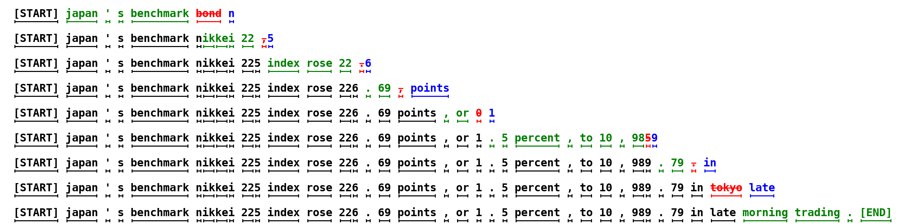
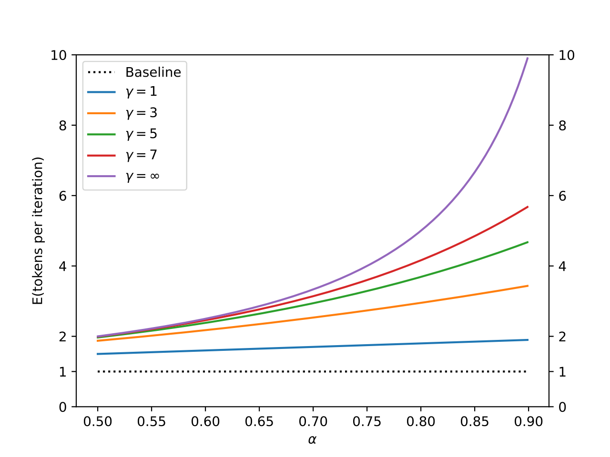
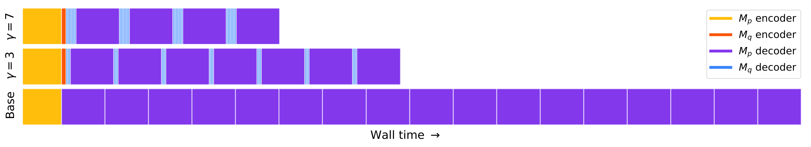
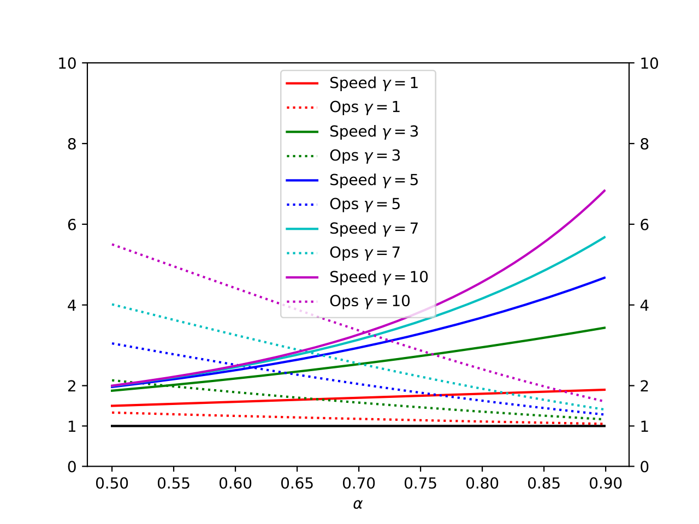
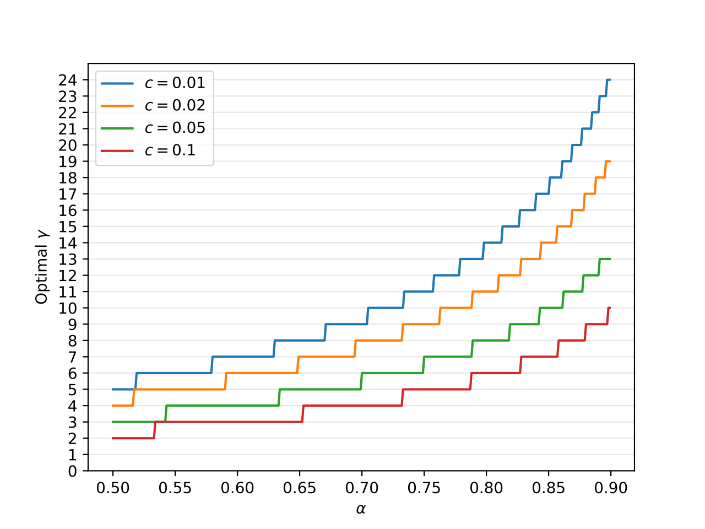

> Paper: [https://arxiv.org/abs/2211.17192](https://arxiv.org/abs/2211.17192)  
> Yaniv Leviathan, Matan Kalman, Yossi Matias (Google Research), ICML 2023

Speculative decoding이라는 용어를 처음 만든 원조 논문임. 이후 EAGLE 시리즈, Medusa, 그리고 최근 리뷰한 DFlash까지 전부 이 논문의 draft-then-verify 프레임 위에서 발전한 것이라, speculative decoding 계열을 읽을 때 가장 먼저 봐야 할 논문이라고 생각함.

## Introduction

큰 autoregressive 모델(GPT-3, LaMDA, PaLM 등)은 작은 모델보다 훨씬 강력하지만, 한 번의 decode step이 훨씬 느리고, 그마저도 순차적으로 수행됨 — $K$개 토큰을 생성하려면 모델을 $K$번 직렬 실행해야 함.

이 논문의 출발점이 되는 관찰은 두 가지임:

1. **어려운 language modeling task 안에도 쉬운 subtask가 섞여 있다** — 어떤 inference step은 큰 모델이 꼭 필요하지만, 어떤 step(관용구, 문장의 뻔한 다음 단어 등)은 훨씬 작은 모델로도 충분히 잘 근사됨.
2. **큰 모델의 inference는 arithmetic operation이 아니라 memory bandwidth에 병목이 걸려 있다** — 즉 연산 자원은 놀고 있는 경우가 많으므로, 병렬성(concurrency)을 늘릴 여유가 있음.

기존에도 distillation, sparsification, quantization 같은 "모든 토큰을 균일하게 싸게" 만드는 접근과, early exit 같은 adaptive computation("쉬운 step엔 적은 연산") 접근이 있었지만, 대부분 아키텍처 변경·재학습이 필요하고 **출력이 달라짐**.

이 논문은 CPU의 branch prediction으로 익숙한 **speculative execution**(어떤 작업이 필요한지 검증하는 것과 병렬로 그 작업을 미리 수행하는 최적화)을 **확률적(stochastic) 세팅으로 일반화**함. 빠른 approximation model $M_q$가 미래 토큰들을 추측 생성하고, 느린 target model $M_p$가 이 추측들을 **병렬로** 평가·검증함. 여기에 **speculative sampling**이라는 새로운 샘플링 기법을 결합해, 최종 출력 분포가 $M_p$ 단독 샘플링과 **수학적으로 완전히 동일**함을 보장함.



위 그림(Figure 1)이 알고리즘의 동작을 가장 직관적으로 보여줌. 각 줄이 알고리즘 1회 반복(= target model 1회 실행)이고, **초록색**은 approximation model(6M)의 제안 중 target model(97M)이 수락한 토큰, **빨간색**은 거부된 제안, **파란색**은 거부 후 target이 수정한 토큰임. 38개 토큰짜리 문장이 target model 단 **9번의 직렬 실행**으로 생성됐고, 첫 줄에서는 한 번의 실행으로 5개 토큰이 나옴. 그러면서도 이 문장이 생성될 확률은 $M_p$ 단독일 때와 완전히 같음.

**이 논문의 novel한 점**

- **Speculative sampling** — 임의의 두 분포 $p, q$에 대해, $q$에서 뽑은 샘플을 확률적으로 수락/거부·보정하여 결과가 정확히 $p$를 따르게 만드는 샘플링 기법. speculative execution을 확률적 세팅으로 일반화한 것.
- **Speculative decoding** — 이를 autoregressive decoding에 적용한 메커니즘. **아키텍처 변경 없음, 재학습 없음, 출력 분포 변화 없음(lossless)**. 기존(off-the-shelf) 모델 조합만으로 동작함.
- 최악의 경우에도 표준 decoding보다 느려지지 않는다는 보장(매 반복마다 최소 1 토큰 생성), 그리고 $\alpha$(수락률)와 $c$(비용 비율)로 speedup을 예측하는 깔끔한 이론 분석.
- T5-XXL(11B)에서 T5X 대비 **2~3배** walltime 가속을 출력 변화 없이 실측으로 입증.

## Related Work

Inference 가속 연구는 크게 두 갈래였음. (1) distillation, sparsification, quantization, 아키텍처 개선처럼 **모든 토큰의 비용을 균일하게 줄이는** 방법과, (2) early exit 계열처럼 **문제 난이도에 따라 연산량을 조절하는** adaptive computation. 두 갈래 모두 실전에서 효과적이지만 대개 아키텍처·학습 절차 변경과 재학습이 필요하고, 결정적으로 target model과 동일한 출력을 보장하지 못함. 참고로 이 방법들은 memory/연산 비율을 개선하므로, 그 비율이 여전히 높다면 speculative decoding과 **병행 사용**이 가능함.

Speculative execution을 decoding에 활용한 직접적 선행 연구로는 Blockwise Parallel Decoding과 Shallow Aggressive Decoding(SAD)이 있음. Blockwise Parallel Decoding은 여러 토큰을 병렬 생성하지만 greedy(temperature=0)만 지원하고 커스텀 모델 학습이 필요하며 출력 동일성이 아닌 downstream 품질 보존을 목표로 함. SAD는 입력을 출력으로 복사하는 것만 지원해 문법 교정처럼 입·출력이 유사한 태스크에만 쓸 수 있고 역시 stochastic sampling을 지원하지 않음. 본 논문은 **일반적인 stochastic sampling 세팅에서, 임의의 approximation model로, 출력 분포를 정확히 보존**한다는 점에서 이들과 구분됨. (논문 공개 후 DeepMind에서 독립 구현으로 Chinchilla 70B에 대해 2~2.5배 개선을 재현하기도 했음.)

## Method: Speculative Decoding

### Overview

- $M_p$: 가속하려는 **target model**, prefix $x_{<t}$에 대한 분포 $p(x_t \mid x_{<t})$
- $M_q$: 같은 태스크에 대한 더 효율적인 **approximation model**, 분포 $q(x_t \mid x_{<t})$

핵심 아이디어는 세 단계임:

1. $M_q$를 autoregressive하게 $\gamma$번 돌려 추측 토큰 $x_1, \ldots, x_\gamma$를 생성
2. $M_p$를 **한 번에 병렬로** 돌려 $\gamma+1$개 분포 $p_1, \ldots, p_{\gamma+1}$을 모두 계산 — 즉 $M_p(prefix)$, $M_p(prefix+[x_1])$, …, $M_p(prefix+[x_1,\ldots,x_\gamma])$
3. 앞에서부터 각 추측을 speculative sampling 규칙으로 수락/거부. 첫 거부 지점에서 보정된 분포로 토큰 1개를 다시 뽑고, 전부 수락되면 $p_{\gamma+1}$에서 bonus token을 1개 추가

이 구조 덕분에 target model 1회 병렬 실행마다 **최소 1개, 최대 $\gamma+1$개** 토큰이 확정됨. 최소 1개가 보장되므로 최악의 경우에도 직렬 실행 횟수가 표준 autoregressive decoding보다 많아질 수 없음.

한 가지 전처리 트릭: argmax, top-k, nucleus, temperature 같은 다양한 sampling 방식은 전부 "조정된 분포에서의 표준 sampling"으로 환원 가능함(예: argmax는 최댓값 외 원소를 0으로 만들고 normalize한 분포에서의 sampling). 따라서 이후 논의는 표준 sampling 하나만 다루면 됨.

### Speculative Sampling

$x \sim p(x)$를 뽑고 싶은데, 대신 $x \sim q(x)$를 뽑는다고 하자. 규칙은:

- $q(x) \le p(x)$이면 **수락**
- $q(x) > p(x)$이면 확률 $1 - \frac{p(x)}{q(x)}$로 **거부**하고, 다음의 조정된 분포(residual distribution)에서 다시 샘플링:

$$p'(x) = \mathrm{norm}(\max(0,\; p(x) - q(x)))$$

이렇게 하면 임의의 $p, q$에 대해 최종 샘플이 정확히 $p(x)$를 따름. 증명이 짧고 아름다워서 옮겨둠. 수락 확률을 $\beta$라 하면 $p'(x)$의 정규화 상수가 $1-\beta$가 되고,

$$P(x = x') = P(\text{accepted},\, x = x') + P(\text{rejected},\, x = x')$$

에서 각 항이

$$P(\text{accepted},\, x=x') = q(x')\min\left(1, \frac{p(x')}{q(x')}\right) = \min(q(x'), p(x'))$$

$$P(\text{rejected},\, x=x') = (1-\beta)\,p'(x') = p(x') - \min(q(x'), p(x'))$$

이므로 둘을 더하면 정확히 $p(x')$가 됨. $\square$

전체 스텝을 의사코드로 쓰면 다음과 같음 (Algorithm 1):

```text
SpeculativeDecodingStep(Mp, Mq, prefix):
  # 1. Mq로 γ개 추측을 autoregressive하게 생성
  for i = 1 .. γ:
      qᵢ(x) ← Mq(prefix + [x₁..xᵢ₋₁]);  xᵢ ~ qᵢ(x)

  # 2. Mp를 병렬로 1회 실행해 γ+1개 분포를 동시에 계산
  p₁(x), .., p_{γ+1}(x) ← Mp(prefix), .., Mp(prefix + [x₁..x_γ])

  # 3. 수락 개수 n 결정 (r₁..r_γ ~ U(0,1))
  n ← min({ i−1 | rᵢ > pᵢ(xᵢ)/qᵢ(xᵢ) } ∪ {γ})

  # 4. 거부가 있으면 residual 분포로 보정
  p′(x) ← p_{n+1}(x)
  if n < γ:  p′(x) ← norm(max(0, p_{n+1}(x) − q_{n+1}(x)))

  # 5. Mq의 토큰 n개 + Mp의 토큰 1개 반환
  t ~ p′(x)
  return prefix + [x₁..x_n, t]
```

**Rejection sampling과의 차이.** 겉보기엔 고전적 rejection sampling($M = \max_x p(x)/q(x)$로 나눠 수락 판정)과 비슷하지만, rejection sampling의 기대 수락 확률은 $\sum_x p(x)\min_{x'}\frac{q(x')}{p(x')}$로 speculative sampling의 $\alpha = \sum_x \min(p(x), q(x))$보다 (경우에 따라 크게) 낮음. 거부 시 반복 재샘플링 대신 residual 분포에서 **한 번에** 보정한다는 점도 다름 — 그래서 스텝당 진행이 보장됨.

## Analysis

이 논문의 백미는 성능이 단 두 개의 스칼라 — **$\alpha$** (approximation 품질)와 **$c$** (비용 비율) — 로 깔끔하게 예측된다는 분석임.

### 기대 생성 토큰 수

prefix가 주어졌을 때 $x \sim q$가 수락될 확률을 $\beta$라 하고, $\beta$들이 i.i.d.라고 단순화하면($\alpha = E(\beta)$), 알고리즘 1회 실행이 생성하는 토큰 수는 성공 확률 $1-\alpha$, 상한 $\gamma+1$의 capped geometric 변수가 되어:

$$E(\#\,\text{generated tokens}) = \frac{1 - \alpha^{\gamma+1}}{1 - \alpha}$$



위 그래프(Figure)는 $\alpha$에 따른 반복당 기대 생성 토큰 수임. $\alpha$가 0.9면 $\gamma=7$일 때 반복당 5~6개, $\gamma=\infty$면 10개 가까이 나옴 — target model 호출 횟수가 그만큼 줄어든다는 뜻임. 반대로 $\alpha$가 0.5 근처면 $\gamma$를 아무리 키워도 2개 언저리에서 saturate됨. **draft 품질($\alpha$)이 결국 상한을 결정**한다는, 이후 EAGLE·DFlash까지 이어지는 핵심 구도가 이 그래프 하나에 담겨 있음.

### α는 어떻게 계산하나

divergence $D_{LK}(p,q) = 1 - \sum_x \min(p(x), q(x))$를 정의하면 ($[0,1]$ 값의 대칭 divergence로, $p=q$일 때 0, support가 disjoint일 때 1), 수락률이 정확히

$$\beta = 1 - D_{LK}(p, q), \qquad \alpha = E(\min(p, q))$$

로 떨어짐. 즉 $\alpha$는 하드웨어와 무관한 **두 모델·태스크의 내재적 속성**이고, 실제로 $M_p$가 생성한 토큰들 위에서 기댓값을 측정하면 구현 없이도 speedup을 미리 예측할 수 있음.

### Walltime Improvement

$M_q$ 1회 실행 시간 / $M_p$ 1회 실행 시간을 **cost coefficient $c$**라 정의함. $\gamma+1$개의 병렬 평가가 walltime을 늘리지 않을 만큼 연산 자원이 있다고 가정하면, 알고리즘 1회 비용은 $Tc\gamma + T$이고 기대 생성 토큰 수로 나누면:

$$\text{Speedup} = \frac{1 - \alpha^{\gamma+1}}{(1-\alpha)(\gamma c + 1)}$$

여기서 바로 유용한 따름정리가 나옴 — **$\alpha > c$이기만 하면** 개선이 존재하고, 그 개선율은 최소 $\frac{1+\alpha}{1+c}$임. 실험에서 $M_q$가 $M_p$보다 두 자릿수쯤 작으면 $c < 0.05$였으므로, 웬만한 approximation model이면 조건이 성립함.



위 trace diagram이 이 수식의 물리적 의미를 보여줌. 보라색이 $M_p$ decoder 호출, 파란 실선들이 $M_q$ decoder 호출($\gamma$번)임. 아래 줄(Base)은 표준 decoding으로 $M_p$를 토큰 수만큼 직렬 호출하는 반면, 위 두 줄($\gamma=7$, $\gamma=3$)은 저렴한 $M_q$ 호출 뭉치 뒤에 $M_p$ 호출 1번이 오는 패턴이 반복되며 같은 시퀀스를 훨씬 짧은 wall time에 끝냄.

### 연산량 트레이드오프

공짜는 아님. $M_p$를 $\gamma+1$개 입력에 대해 병렬 실행하므로 **총 arithmetic operation은 늘어남**:

$$\text{Ops increase} = \frac{(1-\alpha)(\gamma\hat{c} + \gamma + 1)}{1 - \alpha^{\gamma+1}}$$

($\hat{c}$는 토큰당 연산량 비율.) 추측이 수락되면 늘어난 병렬 연산이 "공짜"지만, 거부되면 그만큼 낭비됨. $\alpha$가 낮을수록 연산 낭비가 커짐. 반면 **memory access는 오히려 줄어듦** — target model의 weight와 KV cache를 반복당 한 번만 읽으므로 읽기 횟수가 $\frac{1-\alpha^{\gamma+1}}{1-\alpha}$배 감소함. memory-bound인 LLM inference에서 이 방법이 잘 먹히는 이유가 정확히 이것임.



위 그래프에서 실선이 speedup, 점선이 연산량 증가 배수임. $\alpha$가 커질수록 speedup은 오르고 연산량 증가는 줄어드는 반비례 구도가 보임. $\gamma$를 키우면 speedup 상한도 오르지만 낮은 $\alpha$ 구간에서의 연산 낭비도 커짐.

| $\alpha$ | $\gamma$ | Operations | Speed |
|---|---|---|---|
| 0.6 | 2 | 1.53× | 1.96× |
| 0.7 | 3 | 1.58× | 2.53× |
| 0.8 | 2 | 1.23× | 2.44× |
| 0.8 | 5 | 1.63× | 3.69× |
| 0.9 | 2 | 1.11× | 2.71× |
| 0.9 | 10 | 1.60× | 6.86× |

위 표($c = \hat{c} = 0$ 가정)를 보면 같은 $\alpha=0.8$이라도 $\gamma$를 2→5로 올리면 연산량 1.23×→1.63×를 대가로 속도가 2.44×→3.69×가 됨. 자원 여유에 따라 operating point를 고를 수 있다는 뜻임.

### Optimal γ

$c$와 $\alpha$가 주어지면 speedup 식을 최대화하는 정수 $\gamma$를 수치적으로 쉽게 찾을 수 있음.



위 그래프는 $\alpha$와 $c$에 따른 최적 $\gamma$임. approximation model이 좋을수록($\alpha\uparrow$), 그리고 쌀수록($c\downarrow$) 더 긴 추측이 이득임 — $\alpha=0.9$, $c=0.01$이면 최적 $\gamma$가 24까지 올라감. 또한 $\beta$가 일정하지 않으므로 $\beta$를 예측해 $\gamma$를 런타임에 가변으로 조절하면(oracle 가정 시) 최대 ~60% 추가 개선 여지가 있다고 분석함 (future work).

### Approximation Model의 선택

speculative sampling은 **어떤 $M_q$를 쓰든** 출력 분포를 보장하므로 선택지가 넓음:

- **Off-the-shelf 소형 Transformer** — 논문의 기본 설정. target보다 **약 두 자릿수(100배) 작은** 모델이 $\alpha$와 $c$의 균형상 최적이었음.
- **Negligible-cost model ($c \approx 0$)** — n-gram 모델(table lookup 수준). 놀랍게도 bigram만 돼도 EnDe 번역에서 $\alpha \approx 0.2$가 나와 $\gamma=3$으로 1.25× 가속이 됨.
- **휴리스틱** — 요약·챗봇처럼 긴 시퀀스가 반복되기 쉬운 태스크에선 "context에서 매칭되는 prefix를 복사"하는 파라미터 없는 approximation도 높은 $\alpha$를 낼 수 있음.
- **Non-autoregressive model** — autoregressive 루프 대신 한 번에 $\gamma$개를 뽑는 모델도 가능. (바로 이 지점을 20여 년 뒤가 아니라 3년 뒤에 DFlash가 block diffusion으로 파고듦.)

## Experiments

### T5-XXL Walltime 실측

T5 v1.1 기준, $M_p$ = T5-XXL(11B), $M_q$ = T5-large(800M)/T5-base(250M)/T5-small(77M), 모두 기존 checkpoint 그대로 사용. WMT EnDe 번역과 CNN/DM 요약, batch size 1, TPU-v4 단일 칩, T5X 구현과 비교.

| Task | $M_q$ | Temp | $\gamma$ | $\alpha$ | Speed |
|---|---|---|---|---|---|
| EnDe | **T5-small** ★ | 0 | 7 | 0.75 | **3.4×** |
| EnDe | T5-base | 0 | 7 | 0.80 | 2.8× |
| EnDe | T5-large | 0 | 7 | 0.82 | 1.7× |
| EnDe | **T5-small** ★ | 1 | 7 | 0.62 | **2.6×** |
| EnDe | T5-base | 1 | 5 | 0.68 | 2.4× |
| EnDe | T5-large | 1 | 3 | 0.71 | 1.4× |
| CNNDM | **T5-small** ★ | 0 | 5 | 0.65 | **3.1×** |
| CNNDM | T5-base | 0 | 5 | 0.73 | 3.0× |
| CNNDM | T5-large | 0 | 3 | 0.74 | 2.2× |
| CNNDM | **T5-small** ★ | 1 | 5 | 0.53 | **2.3×** |
| CNNDM | T5-base | 1 | 3 | 0.55 | 2.2× |
| CNNDM | T5-large | 1 | 3 | 0.56 | 1.7× |

읽는 포인트 세 가지. (1) $\alpha$는 $M_q$가 클수록 높지만(T5-large가 0.82로 최고) **speedup은 가장 작은 T5-small이 최고** — $c$가 커지는 손해가 $\alpha$ 이득을 압도하기 때문. $\alpha$ 좋은 drafter가 아니라 $\alpha/c$ 균형 좋은 drafter가 이긴다는 것. (2) argmax(temp=0)가 standard sampling(temp=1)보다 $\alpha$가 높음 — 분포가 sharp할수록 두 모델이 일치하기 쉬움. (3) 최고 성적은 번역 3.4×, 요약 3.1×.

### 다양한 모델에서의 empirical α

구현 없이 $\alpha = E(\min(p,q))$만 측정한 결과 (10K 토큰 기준, 일부 발췌):

| $M_p$ | $M_q$ | Sampling | $\alpha$ |
|---|---|---|---|
| GPT-like (97M) | Unigram | t=0 | 0.03 |
| GPT-like (97M) | Bigram | t=0 | 0.05 |
| GPT-like (97M) | GPT-like (6M) | t=0 | 0.88 |
| T5-XXL (EnDe) | Bigram | t=0 | 0.20 |
| T5-XXL (EnDe) | T5-small | t=0 | 0.75 |
| T5-XXL (CNNDM) | T5-small | t=0 | 0.65 |
| LaMDA (137B) | LaMDA (100M) | t=0 | 0.61 |
| LaMDA (137B) | LaMDA (2B) | t=0 | 0.71 |
| LaMDA (137B) | LaMDA (8B) | t=0 | 0.75 |

두 자릿수 작은 approximation model이면 $\alpha$가 대략 0.5~0.9 범위에 들어옴. 137B LaMDA조차 1000배 이상 작은 100M 모델로 $\alpha=0.61$이 나온다는 게 인상적임 — "쉬운 subtask가 많다"는 서두의 관찰을 정량적으로 뒷받침함.

### 이론 예측 vs 실측

profiler로 추정한 $c$를 넣은 이론값(Exp)과 실측(Emp) 비교 (일부):

| Task | $M_q$ | Temp | $\alpha$ | $c$ | Exp | Emp |
|---|---|---|---|---|---|---|
| EnDe | T5-small | 0 | 0.75 | 0.02 | 3.2× | 3.4× |
| EnDe | T5-large | 0 | 0.82 | 0.11 | 2.5× | 1.7× |
| CNNDM | T5-small | 0 | 0.65 | 0.02 | 2.4× | 3.1× |
| CNNDM | T5-small | 1 | 0.53 | 0.02 | 1.9× | 2.3× |

대체로 이론과 실측이 잘 맞음. 차이는 구현 최적화 수준 차이와, $\beta$ i.i.d. 가정이 근사라는 데서 옴.

### Lenience — 분포 변화를 조금 허용한다면

출력 보존을 조금 양보하면 얼마나 빨라질까에 대한 appendix 분석도 흥미로움. lenience 파라미터 $l \in [0,1]$을 도입해 수락 판정 시 $q(x)$에 $l$을 곱하면, 어떤 토큰도 원래 확률의 $\frac{1}{l}$배를 넘게 샘플링되지 않는다는 보장은 유지하면서 $\alpha$가 오름:

| $M_q$ | $l=1$ | $l=0.5$ | $l=0.3$ | $l=0.1$ |
|---|---|---|---|---|
| Bigram | 0.19 | 0.23 | 0.25 | 0.32 |
| T5-small (77M) | 0.62 | 0.71 | 0.76 | 0.84 |
| T5-base (250M) | 0.68 | 0.80 | 0.83 | 0.90 |

T5-small 기준 $l$을 1→0.1로 낮추면 speedup이 2.5×→**5×**까지 오름. lossless가 필요 없다면 같은 프레임으로 더 밀어붙일 수 있다는 것. (본문 결과는 전부 lenience 없는 strict 버전임.)

## Conclusion

Speculative sampling으로 stochastic 세팅의 speculative execution을 가능하게 했고, 이를 통해 아키텍처·학습·출력 분포를 전혀 건드리지 않고 T5X 대비 2~3배 실측 가속을 얻음. 한계도 명확함 — latency를 연산량 증가와 맞바꾸는 구조라, 추가 연산 자원이 없는 환경(compute-bound)에서는 도움이 안 됨. memory bandwidth가 병목인 일반적인 상황에서 좋은 default라는 게 저자들의 결론임.

Discussion에서 제시한 future work 목록이 지금 보면 예언에 가까움 — custom approximation model(distillation으로 $\alpha$ 직접 최적화 → EAGLE 계열), non-autoregressive drafter(→ DFlash의 block diffusion drafting), 가변 $\gamma$, 계층적 speculative decoding 등이 전부 이후 후속 연구로 실현됨. 방법 자체의 단순함(수락 규칙 한 줄 + residual 분포 한 줄)과 분석의 깔끔함($\alpha$, $c$ 두 변수로 전부 설명) 때문에, 3년이 지난 지금도 speculative decoding 계열 논문을 읽는 기본기가 되어주는 논문임.
