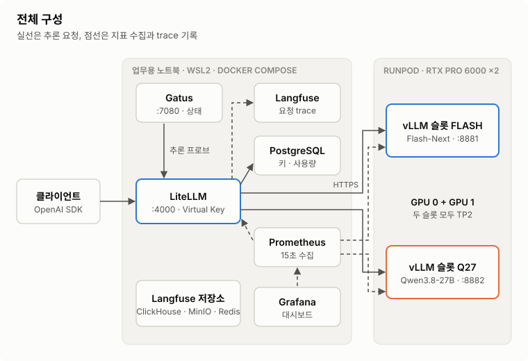
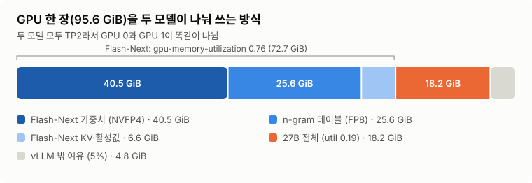
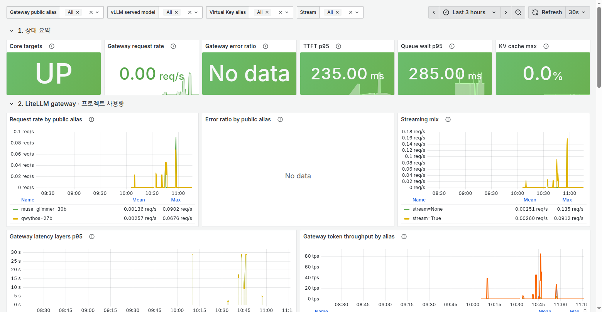
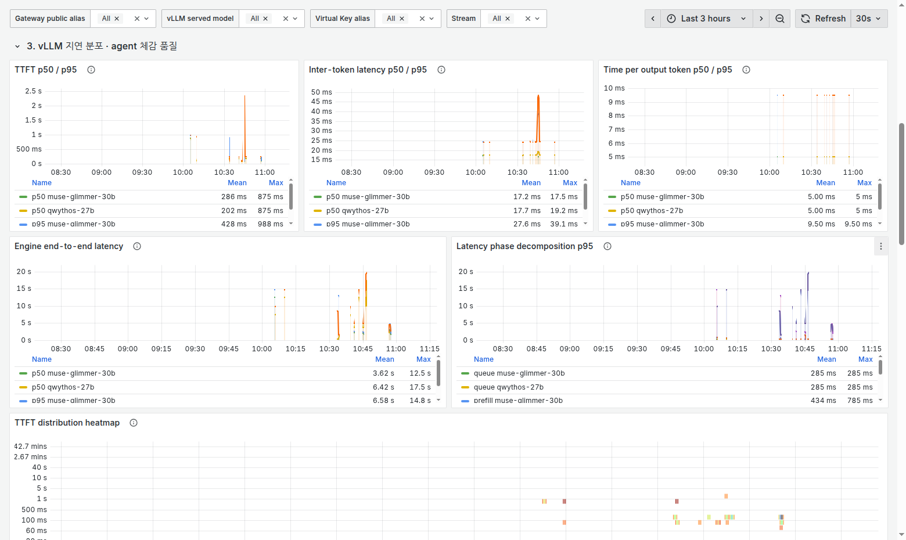
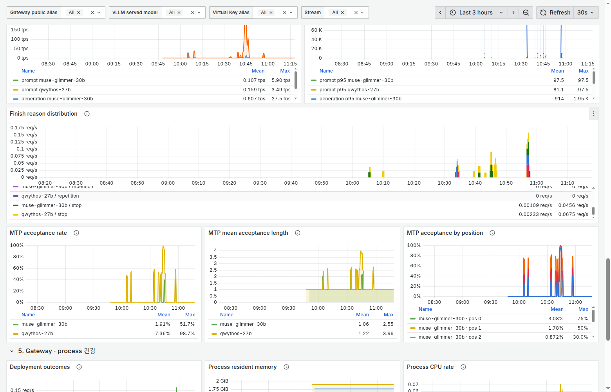
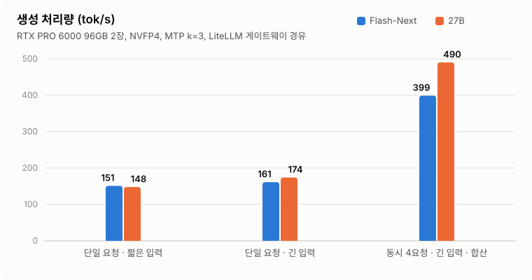
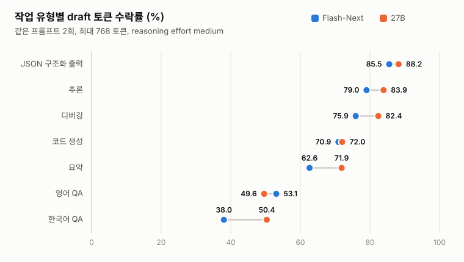
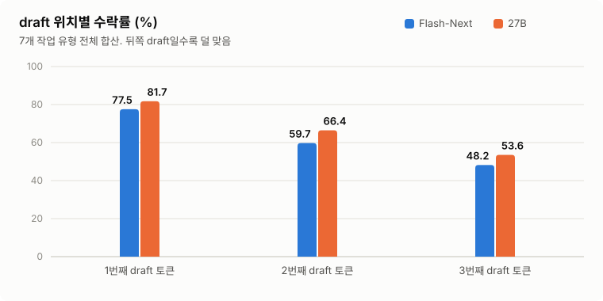

팀에서 에이전트를 개발하다 보니 자체 호스팅 LLM을 OpenAI SDK로 바로 부를 수 있는 엔드포인트가 필요했음. 사내에 GPU 서버는 없고 사용자는 5명 정도라, GPU는 RunPod에서 업무 시간에만 빌리고 나머지는 내 업무용 노트북에서 돌리는 구조로 만들었음. 올해 8월 중순부터 3주 정도 붙잡고 있었던 내용을 뒤늦게 정리해 둠.

결과만 먼저 적으면 아래와 같음.

- RTX PRO 6000 Blackwell 96GB 2장에 Qwen3.8-Flash-Next(125B MoE)와 Qwen3.8-27B를 둘 다 NVFP4로 올려서 같이 서빙함
- 단일 요청 기준 Flash-Next 151~161 tok/s, 27B 148~174 tok/s. 긴 입력으로 동시 4요청을 걸면 합산 399 tok/s, 490 tok/s
- 클라이언트는 게이트웨이 주소와 API 키만 알면 되고, 모델을 바꿔도 클라이언트 코드는 안 바뀜
- GPU Pod는 평일 아침에 자동으로 켜지고 저녁에 꺼짐

## 요구사항

처음에 정한 조건은 네 가지였음.

1. OpenAI 호환 API. 팀원들이 쓰던 SDK 코드를 그대로 쓸 수 있어야 함
2. 사용자별 키 발급과 사용량 추적
3. 누가 어떤 프롬프트를 보냈고 뭐가 나왔는지 요청 단위로 볼 수 있을 것
4. 업무 시간 외에는 GPU 비용이 나가지 않을 것

4번 때문에 GPU 서버는 매일 켰다 끄는 걸 전제로 설계했음. 뒤에 나오는 자동화 작업은 거의 다 이 조건 때문에 생긴 것임.

## 전체 구성



추론(GPU)과 운영(CPU)을 분리했음. GPU가 필요한 건 vLLM뿐이라 RunPod에는 vLLM만 올리고, 게이트웨이와 인증, 관측, 저장은 전부 노트북 WSL2의 Docker Compose 스택에서 돌림. Compose 서비스는 11개임.

| 구성요소 | 역할 |
|---|---|
| LiteLLM | OpenAI 호환 게이트웨이. 키 인증, rate limit, 모델 라우팅 |
| PostgreSQL | LiteLLM 키와 사용량, Langfuse 메타데이터 |
| Langfuse (web, worker) | 요청 단위 trace. 프롬프트와 응답 원문 |
| ClickHouse, MinIO, Redis | Langfuse 저장소와 큐 |
| Prometheus, Grafana | 지표 수집(15초 주기, 15일 보존)과 대시보드 |
| Gatus | 상태 페이지. 모델별로 실제 추론을 5분마다 한 번씩 던져봄 |
| Adminer | DB 확인용 |

요청은 클라이언트 → LiteLLM → RunPod HTTPS 프록시 → vLLM 순서로 흐름. 키는 세 종류로 나눴음. 게이트웨이 관리자 키, vLLM 서버 키, 사용자에게 나눠주는 Virtual Key. 사용자는 Virtual Key만 알고 vLLM에는 직접 못 붙음.

밖으로 여는 포트는 게이트웨이(4000)와 상태 페이지(7080) 두 개뿐이고 Grafana, Langfuse, DB는 전부 `127.0.0.1`에만 바인딩함. LiteLLM의 관리자 UI와 Swagger 문서 페이지도 꺼둠.

Langfuse가 죽어도 추론은 계속 돼야 해서, Langfuse 컨테이너만 내린 상태로 스모크 테스트를 돌리는 스크립트를 따로 만들어 확인했음. 반대로 GPU Pod가 꺼져 있어도 게이트웨이와 상태 페이지는 뜨고, 상태 페이지에 모델이 DOWN으로 표시됨.

## 모델 구성은 파일 하나로

초기에는 모델을 바꿀 때마다 vLLM 기동 스크립트, LiteLLM 설정, Prometheus 수집 대상, Gatus 프로브를 따로 챙겨야 했음. Pod를 새로 만든 뒤 Prometheus만 reload가 빠져서 옛 Pod 주소를 보고 있던 적도 있었음. 이런 불일치를 없애려고 모델 구성을 프로필 YAML 하나로 모았음.

```yaml
# profiles/rtx6000-2x-flash-next-27b.yaml (발췌, 8월 말 기준)
gpu_type_ids:
- NVIDIA RTX PRO 6000 Blackwell Server Edition
- NVIDIA RTX PRO 6000 Blackwell Workstation Edition
image: vllm/vllm-openai:qwen38-flash-next
slots:
  FLASH:
    served_model_name: qwen3.8-flash-next
    hf_repo_id: RadixArk/Qwen3.8-Flash-Next-NVFP4
    port: 8881
    gpus: [0, 1]
    gpu_util: 0.76
    max_model_len: 131072
    speculative:
      method: mtp
      num_speculative_tokens: 3
  Q27:
    served_model_name: qwen3.8-27b
    hf_repo_id: unsloth/Qwen3.8-27B-NVFP4
    port: 8882
    gpus: [0, 1]
    gpu_util: 0.19
    max_model_len: 65536
    speculative:
      method: mtp
      num_speculative_tokens: 3
aliases:
  internal-default: FLASH
  internal-sub: Q27
```

슬롯 하나가 vLLM 프로세스 하나, 모델 하나, 포트 하나에 대응함. Pod 쪽 스크립트는 이 파일을 읽어서 `vllm serve` 인자를 만들고, 노트북 쪽 스크립트는 같은 파일로 LiteLLM 라우팅, Prometheus 수집 대상, Gatus 프로브를 한 번에 렌더링함. 같은 GPU에 올라가는 슬롯들의 `gpu_util` 합이 0.95를 넘으면 검증 단계에서 막음.

`aliases`는 클라이언트가 부르는 이름임. 팀원들은 모델명 대신 `internal-default`, `internal-sub`으로 호출하고, 그 뒤에 어떤 모델이 붙을지는 프로필이 정함. 실제로 운영 중에 주력 모델을 27B에서 Flash-Next로 바꿨는데 클라이언트 코드는 아무도 안 고쳤음.

```python
from openai import OpenAI

client = OpenAI(base_url="http://<게이트웨이 주소>:4000/v1", api_key="<발급받은 키>")
resp = client.chat.completions.create(
    model="internal-default",
    messages=[{"role": "user", "content": "안녕"}],
)
```

프로필은 GPU 종류별로 여러 개를 두고(RTX PRO 6000, H100, A100) 순서를 매겨놨음. 아침에 1순위 GPU가 매진이면 다음 프로필로 넘어가서 다른 GPU를 빌리고, 성공한 프로필이 그날의 구성이 됨.

## Flash-Next 올리기

처음 2주는 GPU 한 장에 모델 하나씩, 27B급 모델과 Muse-Glimmer-30B를 올려서 썼음. 그러다 8월 26일에 Qwen3.8-Flash-Next가 나왔고, 이걸 주력으로 올려보기로 함. 제일 많이 막혔던 부분임.

### 모델이 큼

Flash-Next는 125B MoE(활성 파라미터 6B, expert 512개 중 10개 라우팅)에 51B짜리 n-gram 임베딩 테이블(PLE)과 4B MTP 헤드가 붙은 구조임. 셋을 합치면 파라미터가 180B고, 체크포인트 크기는 BF16이 약 355GB, FP8이 약 173 GiB임.

GPU 2장(각 95.6 GiB)에 넣을 수 있는 조합을 계산해보면 아래와 같음.

| 구성 | GPU당 상주 | 판단 |
|---|---|---|
| FP8, 한 장(TP1) | 122 GiB | 안 들어감 |
| NVFP4, 한 장(TP1) | 약 82 GiB | 들어가긴 하는데 KV 여유가 4~9 GiB라 서비스 불가 |
| FP8 + PLE를 호스트 RAM으로 오프로드, TP2 | 약 61 GiB | 가능 |
| NVFP4 + PLE 오프로드, TP2 | 약 41 GiB | 가능 |
| NVFP4 + PLE를 GPU에, TP2 | 약 66 GiB | 가능 |

PLE 테이블 51B를 어디에 두느냐가 갈림길이었음. vLLM에는 이 테이블을 호스트 RAM에 두고 비동기로 가져오는 옵션(`VLLM_PLE_CPU_OFFLOAD`)이 있어서, 처음에는 당연히 이걸 쓸 생각이었음.

### vLLM 릴리스에는 아직 없었음

당시 pip로 받는 vLLM 0.28.0은 이 아키텍처(`Qwen4ExpForConditionalGeneration`)를 몰랐음. 지원 코드는 PR [#53896](https://github.com/vllm-project/vllm/pull/53896)(파일 120개, +20,290줄)에만 있었고, 공식 레시피는 PR 빌드가 들어간 도커 이미지를 쓰라고 안내함.

기존 Pod는 RunPod 기본 이미지 위에 pip로 vLLM을 까는 방식이라, 처음에는 필요한 파이썬 파일만 0.28.0 위에 덮어쓰는 방법을 시도했음. import까지는 다 통과했는데 PR이 CUDA 커널(`fused_gdn_decode`)도 바꾸고 있어서 `.so`까지 PR 빌드가 있어야 했음. 파이썬만 패치하는 건 안 됨.

그다음 계획은 PR head를 소스 빌드하는 거였는데, 컴파일만 40분 넘게 걸릴 걸로 예상됐고 head도 계속 바뀌고 있어서 빌드가 깨질 위험이 있었음. 그 사이에 같은 하드웨어(RTX PRO 6000 2장)에서 도커 이미지로 성공했다는 보고가 PR 코멘트에 올라왔고, 소스 빌드는 접고 그 이미지를 Pod 이미지로 직접 쓰기로 바꿨음.

이미지에는 sshd가 없어서 내 자동화(SSH로 붙어서 프로비저닝)가 안 붙었는데, 이건 컨테이너 시작 명령에서 openssh-server를 설치하고 띄우는 걸로 해결함.

### RunPod에서는 PLE 오프로드가 안 됨

이미지를 올리고 나서 진짜 문제가 나왔음. PLE 오프로드는 CPU 서브프로세스와 GPU 워커가 CUDA IPC로 텐서를 주고받는데, 이때 `pidfd_getfd` 시스템 콜을 씀. Docker 기본 seccomp 프로필은 `CAP_SYS_PTRACE` 없이는 이 콜을 막음. 커뮤니티 레시피가 `--cap-add=SYS_PTRACE`를 요구하는 이유가 이거였고, 공식 레시피가 컨테이너를 `--privileged`로 띄우는 것도 같은 이유로 보임.

RunPod Pod는 사용자가 capability를 추가할 수 없음. 그래서 부트스트랩 초반에 `pidfd_open`과 `pidfd_getfd`를 직접 호출해보는 검사를 넣었고, 결과는 `EPERM`이었음. vLLM 설정으로 피해 갈 수 있는 문제가 아니라서 RunPod에서는 PLE 오프로드를 못 씀.

남은 방법은 PLE 테이블을 GPU에 올리는 것임. NVFP4 체크포인트는 MoE expert만 4비트고 PLE 테이블은 FP8 샤드로 들어 있어서, TP2로 나누면 GPU당 25.6 GiB임. NVFP4 가중치 40.5 GiB와 합쳐 GPU당 66.1 GiB.

하나 더 챙겨야 할 게 있었음. 이미지의 PLE 로딩 코드가 `Fp8Config`일 때만 FP8 경로를 타게 돼 있어서, NVFP4 체크포인트 안의 FP8 PLE 샤드를 BF16으로 빌드하려다 실패한다는 보고가 PR 코멘트에 있었음. 커뮤니티 레시피에 있던 패치를 미리 가져와 환경변수로 FP8 경로를 강제하게 했고, PLE를 GPU에 올리는 구성에서도 이 패치는 그대로 필요했음.

```diff
+    import os
+
+    if os.environ.get("VLLM_PLE_FORCE_FP8") == "1":
+        return Qwen3_8FlashNextPLEFp8EmbeddingMethod()
     if not isinstance(quant_config, Fp8Config):
         return None
```

패치는 프로필에 파일명을 적어두면 부트스트랩이 이미지 안 vLLM 패키지에 적용함. 이미 적용돼 있으면 건너뜀.

### 메모리 배분

PLE를 GPU에 올리고 나니 27B를 같이 넣을 자리가 빠듯해졌음. 최종 배분은 Flash-Next 0.76, 27B 0.19임.



두 모델 다 TP2라서 GPU 두 장이 같은 비율로 나뉨. `gpu_util`을 0.01 움직일 때마다 KV 캐시 용량이 눈에 띄게 달라져서 몇 번 조정했음.

| 슬롯 | gpu_util | KV 캐시 용량 | 결과 |
|---|---|---|---|
| Flash-Next | 0.78 | 353k 토큰 | 정상 |
| Flash-Next | 0.77 | 296k 토큰 | 정상 |
| Flash-Next | 0.76 | 239k 토큰 | 정상 (최종) |
| 27B | 0.15 | KV에 0.15 GiB만 남음 | 기동 실패 (64K 요청 하나에 1.15 GiB 필요) |
| 27B | 0.18 | 153k 토큰 | 정상 |
| 27B | 0.19 + MTP | 143k 토큰 | 정상 (최종) |

Flash-Next는 0.01당 KV가 약 57k 토큰씩 변함. 27B는 처음에 MTP 없이 올렸다가, 체크포인트에 MTP 헤드가 들어 있는 걸 확인하고 켰음. MTP가 draft용 KV를 따로 쓰기 때문에 27B 몫을 0.19로 올리고 Flash-Next를 0.76으로 내렸음. 최종 상태에서 GPU당 약 91 GB를 씀.

기동 시간은 Flash-Next가 8~12분(가중치 적재만 285초), 27B가 5분 정도임.

## 호스트를 바꿀 때마다 나온 문제

RunPod은 Pod를 멈췄다 다시 켤 때 같은 호스트의 GPU가 비어 있어야 재개됨. 다른 사용자가 가져가면 새 Pod를 만들어야 하고, 그러면 호스트가 바뀜. 호스트가 바뀔 때마다 새로운 문제가 하나씩 나왔음.

### CUDA 버전 필터가 정확 일치였음

어느 월요일 아침에 콘솔에서는 RTX PRO 6000 재고가 보이는데 API로 생성하면 계속 매진 응답이 왔음. 조건을 하나씩 빼가며 확인해보니 원인은 `allowedCudaVersions`였음.

vLLM의 torch가 cu130이라 `["13.0"]`을 넣어뒀는데, 이 필터는 "13.0 이상"이 아니라 정확 일치 목록이었음. 그날 비어 있던 호스트는 CUDA 13.2였고 전부 걸러진 것. `"13.1"`이나 `"13.2"`를 넣으면 enum에 없는 값이라 HTTP 400이 돌아옴. 콘솔의 같은 필터는 "이상"으로 동작해서 더 헷갈렸음.

필터를 비우고, 대신 Pod를 빌린 직후 SSH로 `nvidia-smi`를 읽어서 드라이버 CUDA가 13.0보다 낮으면 그 Pod를 지우고 다른 호스트로 다시 빌리게 했음(최대 5회).

### NCCL 초기화에서 무한 대기

같은 날 새로 받은 호스트에서 vLLM이 가중치 적재 전에 멈췄음. 워커 2개가 CPU 100%로 돌고 GPU 메모리는 1GB에서 안 올라감. 금요일까지 쓰던 호스트에서는 없던 증상임.

`NCCL_P2P_DISABLE=1`을 넣으니 통과했고, 나중에 vLLM 이슈 [#30682](https://github.com/vllm-project/vllm/issues/30682)에서 같은 증상을 찾았음. 호스트에서 IOMMU가 꺼져 있으면 PCIe 경유 GPU 간 P2P가 멈춘다는 내용이고, `NCCL_P2P_DISABLE=1`과 `--disable-custom-all-reduce`를 같이 쓰라고 돼 있음. 실제로 NCCL만 끄고 올린 27B 슬롯은 custom all-reduce 단계에서 다시 멈췄음.

문제는 이 설정을 정상 호스트에서 켜면 TP 통신이 느려진다는 것임. 그래서 고정값으로 넣지 않고 부트스트랩이 매번 실측하게 했음. `torch.cuda.can_device_access_peer`는 막힌 호스트에서도 True를 돌려줘서 쓸 수 없었고, vLLM과 같은 경로인 NCCL all_reduce를 짧게 돌려보고 시간 안에 안 끝나면 막힌 걸로 판정함.

```python
def _worker(rank: int, init_file: str) -> None:
    import torch
    import torch.distributed as dist

    torch.cuda.set_device(rank)
    dist.init_process_group("nccl", init_method=f"file://{init_file}", rank=rank, world_size=2)
    tensor = torch.ones(256, device=f"cuda:{rank}")
    dist.all_reduce(tensor)
    torch.cuda.synchronize()
    if int(tensor[0].item()) != 2:
        raise SystemExit(f"all_reduce 결과가 잘못됐다: {tensor[0].item()}")
    dist.destroy_process_group()
```

90초 안에 두 프로세스가 끝나지 않으면 종료 코드 3을 돌려주고, 부트스트랩이 그 결과로 Pod의 `.env`에 `NCCL_P2P_DISABLE`을 켜거나 끔. 슬롯 기동 스크립트는 이 값이 1이고 TP가 2 이상이면 `--disable-custom-all-reduce`를 자동으로 붙임.

P2P가 막힌 호스트에서는 속도도 낮게 나왔음. 기동 직후 512 토큰 단일 요청으로 대충 재본 값이 P2P 정상 호스트에서 122~126 tok/s, P2P가 막힌 호스트에서 98~108 tok/s였음. 호스트 종류와 드라이버도 달랐기 때문에 전부 P2P 탓이라고 단정할 수는 없지만, all-reduce가 공유 메모리 경유로 바뀐 영향이 크다고 보고 있음. 출력이 짧은 간이 측정이라 뒤에 나오는 벤치마크 수치와 직접 비교하면 안 됨.

## 아침에 켜고 저녁에 끄기

GPU 2장 Pod가 시간당 4달러 조금 넘음(RTX PRO 6000 2장 기준 $4.18, H100 2장은 $6.58). 24시간 켜두면 하루 100달러고 업무 시간만 켜면 40달러 안쪽이라, 자동으로 켜고 끄는 건 처음부터 필수였음.

Windows 작업 스케줄러가 평일 아침에 WSL의 `runpod-up.sh`를, 저녁에 `runpod-down.sh`를 부름. `runpod-up`이 하는 일은 이 순서임.

1. 어제 멈춘 Pod를 재개해봄
2. 재개가 안 되면(호스트 GPU를 다른 사용자가 가져간 경우) 프로필 순서대로 새 Pod 생성을 시도함. 전부 매진이면 10분 쉬고 다시, 최대 12번
3. SSH가 열리면 드라이버 CUDA를 확인함
4. `pod/` 디렉터리를 tar로 묶어 올리고 부트스트랩을 실행함. P2P 검사, 패치 적용, 가중치 다운로드, vLLM 기동까지
5. 노트북 쪽 LiteLLM, Prometheus, Gatus 설정을 새 Pod 주소로 다시 렌더링하고 재시작함
6. 두 슬롯의 `/health`가 뜰 때까지 기다림

정지는 두 겹으로 했음. 노트북 스케줄러가 17:50에 정지 요청을 보내고, Pod 안에서도 watchdog이 18:00에 `runpodctl`로 스스로 멈춤. 노트북이 꺼져 있거나 네트워크가 안 되는 날을 대비한 것임.

RunPod API는 SDK 없이 `urllib`로 REST를 직접 호출했음. 재개가 거부되면("not enough free GPUs on the host machine") 새 Pod 생성으로 넘어가고, 생성이 재고 부족("no instances currently available")으로 실패하면 기다렸다 재시도함. 인증 오류나 요청 형식 오류는 기다려도 안 풀리니까 바로 중단함.

## 관측

집계 지표는 Grafana, 요청 원문은 Langfuse로 나눴음. Grafana 대시보드는 패널 36개를 다섯 섹션으로 묶었음. 상태 요약, 게이트웨이 사용량, vLLM 지연 분포, 스케줄러와 캐시, 게이트웨이 프로세스 상태.

아래 캡처 세 장은 Flash-Next로 바꾸기 전, Qwythos-27B와 Muse-Glimmer-30B를 돌리던 초기 구성 때 찍은 것임. 범례의 모델명이 본문과 다른 건 그래서임.

[](/img/inner-inference/grafana-overview.png)

맨 위 줄에서 수집 대상 UP 여부, 요청률, TTFT p95, 대기열 대기시간 p95, KV 캐시 사용률을 한 번에 봄. 팀원이 "지금 느린데요"라고 하면 제일 먼저 여는 화면임.

[](/img/inner-inference/grafana-latency.png)

에이전트는 한 작업에 LLM 호출을 여러 번 하기 때문에 평균보다 p95가 체감에 더 가까움. TTFT와 토큰 간 지연을 백분위로 보고, 한 요청의 지연을 대기열, 프리필, 디코드 단계로 쪼갠 패널도 넣었음.

[](/img/inner-inference/grafana-mtp.png)

speculative decoding 수락률은 따로 패널을 만들었음. vLLM이 `vllm:spec_decode_*` 카운터를 내보내서 수락률, draft당 평균 수락 길이, 위치별 수락 확률을 모델별로 그릴 수 있음. 벤치마크에서 본 수치가 실제 트래픽에서도 나오는지 확인하는 용도임.

Gatus 상태 페이지는 팀원들 보라고 만들었음. 게이트웨이가 살아 있는지만 보는 게 아니라 모델별로 실제 chat completion을 5분마다 던져보기 때문에, vLLM 프로세스는 떠 있는데 추론이 안 되는 상황도 잡힘.

배포 전 확인은 스모크 테스트 스크립트 하나로 함. `/v1/models`에 모델과 별칭이 다 있는지, 스트리밍과 비스트리밍 응답이 오는지, 없는 모델 요청이 4xx로 떨어지는지, Prometheus 타깃이 UP인지, Langfuse에 trace가 들어오는지까지 8개 항목을 봄.

## 벤치마크

RTX PRO 6000 2장에서 운영 구성 그대로(NVFP4, MTP draft 3개) 측정했음. 8월 28일, GPU 간 P2P가 정상인 호스트에서 잰 값임.

- 경로: 사용자와 같은 경로. LiteLLM 게이트웨이를 거치고 RunPod HTTPS 프록시 왕복이 포함됨. 스트리밍
- 입력: 한 문장 질문(21 토큰)과 문서 요약(3,035 토큰)
- reasoning effort medium, 최대 출력 1,024 토큰
- 예열 1회 후 3회(동시 4요청은 4개) 측정한 평균. 수락률은 예열 요청까지 포함한 카운터 차이로 계산

### 처리량과 지연



| 구성 | 입력 토큰 | TTFT (ms) | TPOT (ms) | tok/s | 수락률 (%) |
|---|---|---|---|---|---|
| Flash-Next, 짧은 입력 | 21 | 805 | 5.8 | 151.0 | 57.1 |
| Flash-Next, 긴 입력 | 3,035 | 1,076 | 5.2 | 161.1 | 69.8 |
| 27B, 짧은 입력 | 21 | 840 | 6.0 | 147.8 | 52.0 |
| 27B, 긴 입력 | 3,035 | 1,016 | 4.8 | 173.9 | 71.0 |

tok/s는 프리필과 프록시 왕복까지 포함한 클라이언트 체감 속도임. 디코드 구간만 보면 Flash-Next가 171~193 tok/s, 27B가 168~209 tok/s 나옴.

긴 입력이 짧은 입력보다 빠른 게 처음에는 이상했는데, 수락률을 보면 설명이 됨. 긴 문서를 앞에 두고 쓰는 출력은 입력에 있는 표현을 다시 쓰는 경우가 많아서 draft가 잘 맞는 것으로 보이고(70% 안팎), 한 문장 질문에 대한 자유 서술은 덜 맞음(52~57%).

긴 입력으로 동시 4요청을 보내면 요청당 속도가 Flash-Next 111 tok/s, 27B 129 tok/s로 떨어지고 TTFT는 1.8~2.1초로 늘어남. 합산 처리량은 399 tok/s와 490 tok/s.

125B MoE인 Flash-Next가 27B와 비슷한 속도를 내는 건 활성 파라미터가 6B라서임. 같은 하드웨어에서 PLE를 오프로드한 구성으로 161 tok/s가 나왔다는 커뮤니티 보고가 있는데, 측정 방식이 달라서 그대로 비교하기는 어렵지만 비슷한 수준임.

### 작업 유형별 수락률

speculative decoding의 이득은 draft 토큰이 얼마나 받아들여지느냐에 달려 있음. 작업 유형 7개로 프롬프트를 만들어서 유형별 수락률을 따로 쟀음. 요청 전후로 vLLM의 카운터를 읽어 차이를 계산하는 방식임. 이 측정은 예열 없이 유형당 2회, 최대 768 토큰으로 돌렸음.



JSON 출력이 85~88%로 제일 높고 자유 서술 QA(한국어, 영어)가 38~53%로 제일 낮음. 형식이 정해진 출력일수록 다음 토큰이 뻔해서 draft가 잘 맞음. 예상했던 대로임. 에이전트 워크로드는 tool call과 JSON 출력 비중이 높아서 이 구성과 잘 맞는 편임.

Flash-Next는 한국어 QA가 38%로 유독 낮았음. 같은 조건에서 27B는 50%가 나왔음. 한국어 자유 서술에서 Flash-Next의 MTP 헤드가 덜 맞는 걸로 보이는데, 프롬프트가 유형당 하나라 일반화하기는 이름.

### 위치별 수락률

draft 3개 중 몇 번째까지 맞는지도 카운터로 볼 수 있음.



첫 번째 draft는 78~82%가 맞고 세 번째는 48~54%까지 떨어짐. 세 번째도 절반 가까이는 맞기 때문에 draft 3개가 과하지는 않다고 봤음. 어차피 Flash-Next는 draft 4개까지만 기동돼서 더 늘릴 여지도 별로 없음.

speculative decoding 자체는 예전에 [원조 논문]()과 [DFlash]()를 리뷰하면서 정리한 적이 있음. MTP는 별도 draft 모델 없이 체크포인트에 내장된 헤드가 다음 토큰 여러 개를 한 번에 예측하는 방식이라, draft 모델을 따로 받아 올릴 필요가 없다는 게 운영 입장에서 편했음.

### 측정의 한계

- 반복 횟수가 3~4회라 분산을 말하기 어려움. 경향을 보는 정도로 읽어야 함
- reasoning이 켜진 상태라 출력의 상당 부분이 추론 텍스트임. 긴 입력에서는 1,024 토큰 중 930~950 토큰이 reasoning이었음. 수락률도 최종 답변만의 수치가 아님
- 호스트에 따라 속도가 다름. 앞에서 적었듯 P2P가 막힌 호스트에서는 Flash-Next가 15% 정도 낮게 나온 적이 있음
- 작업 유형별 측정은 유형당 프롬프트 하나를 예열 없이 두 번 보낸 것임

## KV cache 오프로딩은 안 하기로 함

KV cache를 CPU 메모리로 내리는 기능도 검토했음. 구성값 산정(슬롯당 166 GiB)까지 해놓고 적용은 안 했음. 이 검토는 H100에 27B 계열과 Muse-Glimmer를 올려 쓰던 초기 구성(컨텍스트 16k) 때 한 것임.

동시 4요청, 입력 4k, 출력 최대 8k 부하를 걸어도 GPU KV 사용률이 최대 6.2%였고 preemption은 0건이었기 때문임. 오프로딩은 KV가 가득 차서 블록이 밀려날 때 쓸모가 있는 기술인데, 94%가 비어 있으면 내릴 대상이 없음.

간헐적으로 TTFT가 5~9초까지 튀는 현상이 있어서 처음에 KV를 의심했던 건데, 원인은 재시작 직후의 JIT 컴파일, 프리필이 겹치는 순간, 프록시 경로 지연 쪽으로 보였음. KV 용량과는 관계가 없었음.

대신 다시 검토할 조건을 적어뒀음. 슬롯별 KV 사용률 p99가 60%를 넘거나, preemption이 한 건이라도 나오거나, 사용자가 늘어서 긴 컨텍스트를 상시로 쓰게 되면 그때 카나리 테스트부터 함.

## 돌아보며

돌아보면 별칭으로 호출하게 한 것과 설정을 프로필 하나로 모은 게 제일 덕을 봤음. 주력 모델을 통째로 바꾸는 동안 클라이언트 쪽은 아무것도 안 고쳤고, 프로필 하나를 고치면 Pod와 게이트웨이, 수집 대상, 상태 페이지가 같이 바뀌었음. CUDA 버전 확인과 P2P 검사도 한 번 겪고 바로 코드로 옮겨둔 덕에 다음부터는 사람이 안 봐도 됐음.

아쉬운 것도 있음.

- 자동화가 실패했을 때 알려주는 장치가 없음. 로그 파일에만 남아서, RunPod API 호출이 계속 실패하고 있던 걸 한참 뒤에 알았음. 실패하면 메신저로 알림을 보내는 게 다음 작업임
- Pod를 만든 뒤 프로비저닝 단계에서 실패하면 Pod가 켜진 채로 남을 수 있음. 실패 경로에서도 Pod를 정리하도록 고쳐야 함
- 게이트웨이가 한 대에 몰려 있음. 5명이 쓰는 PoC로는 충분했지만 이중화와 백업은 다음 단계에서 챙겨야 함

GPU를 사지 않고 이 정도 구성을 굴릴 수 있었던 건 좋았는데, 빌린 호스트가 매번 달라진다는 점이 생각보다 큰 변수였음. 같은 GPU 모델이어도 드라이버, CUDA 버전, IOMMU 설정이 호스트마다 다르고 그게 기동 성공 여부와 속도를 바꿈. 다음에 클라우드 GPU로 TP2 이상을 돌릴 일이 있으면 기동 스크립트에 호스트 검사부터 넣을 생각임.

## 참고

- vLLM PR [#53896](https://github.com/vllm-project/vllm/pull/53896) Support Qwen3.8-Flash-Next, PR [#53899](https://github.com/vllm-project/vllm/pull/53899) Support PLE-Offload
- vLLM 이슈 [#30682](https://github.com/vllm-project/vllm/issues/30682) (IOMMU 비활성 호스트의 P2P 정지)
- vLLM 레시피: [recipes.vllm.ai/Qwen/Qwen3.8-Flash-Next](https://recipes.vllm.ai/Qwen/Qwen3.8-Flash-Next)
- 모델 카드: [Qwen/Qwen3.8-Flash-Next](https://huggingface.co/Qwen/Qwen3.8-Flash-Next)
- RTX PRO 6000 2장 레시피: [SirTificate/qwen38-flash-next-2x-rtx6000-sm120](https://github.com/SirTificate/qwen38-flash-next-2x-rtx6000-sm120)
- MTP: Gloeckle et al., [Better & Faster Large Language Models via Multi-token Prediction](https://arxiv.org/abs/2404.19737), 2024
