We built a book-spine reader that runs in a phone browser. It detects and counts the spines in a shelf photo, reads each title and looks it up in a list of 50,000 books. Detection and OCR use three ONNX models (28.3 MB in total) under ONNX Runtime Web, and the lookup uses character n-gram search.

Four times, a number or a test we relied on did not reflect how the system actually runs. Measuring the system as it runs reversed two of our conclusions: segmentation was not the reason tilted spines were missed, and the matcher, which looked safe while the answer was always in the dictionary, confirmed wrong books once it was not. The other two were problems that appeared only at scale or on a real phone (a default resize that left narrow crops only 32 px wide at the text detector, and inference that blocked the page's main thread). This post describes the system and these four cases, with the numbers measured both ways.

## TL;DR {#tldr}

- With identical weights, the detector's count error on a 30-photo real holdout ranges from 6.4 to 7.7 books depending only on which detection head, padding and downscaling the evaluation used, and one photo's count moves by up to 18 books. An early finding that segmentation fails on tilted shelves (7 of 20 spines found) came from the default non-maximum suppression (NMS) post-processing; with the NMS-free head the same weights find 18 to 20.
- More OCR failures came from the text detector's input resize than from the recognizer. With the detection module's default resize, crops narrower than 48 px reach the detector 32 px across, and in 72% of them it finds no text box at all. Upscaling narrow crops and scaling the detector input to a short side of at least 96 px cut the share of crops with no text box from 34.2% to 2.5% on the same 1,648 synthetic spines, with no model change. Match@1 (the share of spines whose top candidate is the right title with a score of at least 85) rose from 0.43 to 0.74.
- An evaluation in which the answer was always in the dictionary hid false confirmations. With the right title removed from the dictionary, the first reranker confirmed a wrong book for 51.3% of spines. Handling containment, volume numbers and short titles explicitly brings this to 0.4%, at the cost of fewer correct confirmations when the right title is in the dictionary (71.8% to 66.3%).
- The first deployment froze on a real phone although every desktop test had passed. Under a throttled phone profile, inference and index building blocked the main thread for 10.4 s in total; moving inference into ONNX Runtime's proxy worker, building the index in slices and turning off automatic WebGPU cut this to between 1.2 and 1.6 s, after which the page ran on the phone.
- The current system counts with an MAE of 1.22 books on the 4TU validation set and 7.10 on the real holdout, where 168 books of the net shortfall of 191 come from 12 photos whose ground truth also counts books outside the main shelf. It processes 24 spines in 1,858 ms in a desktop browser (median of 7 runs); one phone run took about as long (1,856 ms) for only 5 spines, with OCR at 309 ms per spine against about 70 ms on the desktop.

Four caveats apply throughout. OCR and matching rates are measured on synthetic spines, because apart from one phone photo of five books we had no real photos of Korean spines to evaluate on. OCR accuracy is measured with Python PaddleOCR on crops cut from the ground-truth spine polygons, not in the browser (Section 2.2). The real holdout has 30 photos, noisy labels and no Korean titles. Phone timings come from one device and one run.

## 1. The system {#system}

[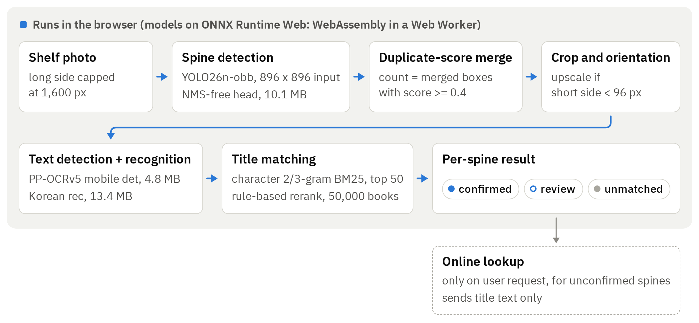](../assets/research/in-browser-spine-reader/figures/fig01_pipeline.png)

*Figure 1. The pipeline. Everything inside the large box runs in the browser; the optional online lookup is described in Section 5.5.*

A photo is first downscaled so that its long side is at most 1,600 px. A one-class oriented bounding box (OBB) detector finds the spines. Near-duplicate boxes are merged (Section 3.5), and the number of boxes scoring 0.4 or more is the book count. Each box is then cut out with a margin of 8% of its short side, rotated so that its long side is vertical, and upscaled if its short side is below 96 px. Inside the crop, PP-OCRv5 finds text lines and the Korean PP-OCRv5 recognizer reads them; the reading direction is decided from recognition confidence (Section 4.3). Lines that match one of 34 publisher names are dropped, and the line with the tallest glyphs becomes the title query.

Matching normalizes the query, retrieves 50 candidates from a 50,000-book dictionary with character 2-gram and 3-gram BM25, and rescores them with string similarity plus a few rules (Section 5). Each spine ends in one of three states: confirmed (the dictionary entry is taken as the answer), review (candidates are shown and the user picks), or unmatched.

| Stage | Model or method | Size (ONNX FP32 for models) | Weights |
|---|---|---|---|
| Spine detection | YOLO26n-obb, one class, 896 x 896 input, NMS-free head | 10.1 MB | trained here |
| Text detection | PP-OCRv5 mobile det | 4.8 MB | public, unchanged |
| Text recognition | Korean PP-OCRv5 mobile rec | 13.4 MB | public, unchanged |
| Title matching | character 2/3-gram BM25 and a rule-based reranker | 4.8 MB dictionary (1.5 MB gzipped) | none |

All three models run in ONNX Runtime Web 1.31.1 on the multithreaded WebAssembly backend inside a Web Worker. The app is a static site made of plain ES modules with no build step. Besides serving its files, the server has one optional endpoint, which forwards the title text of unconfirmed spines to a book-search API when the user asks for it (Section 5.5).

[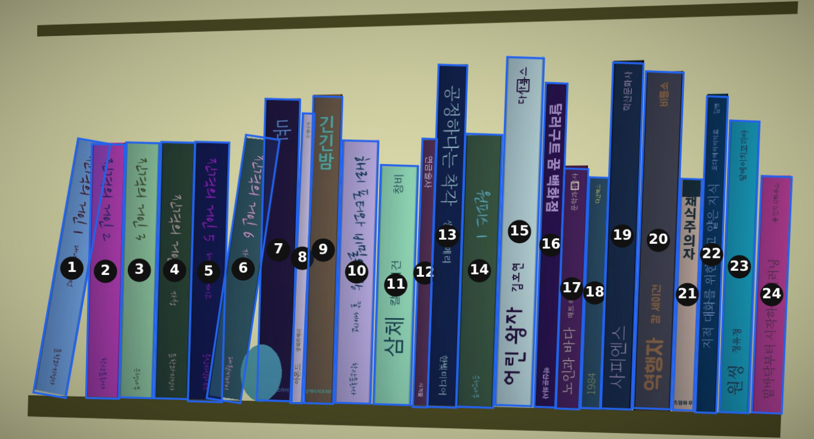](../assets/research/in-browser-spine-reader/figures/fig02_sample_result.png)

*Figure 2. Spines found on the synthetic sample shelf used for the timings in Section 6.4 (24 spines). All boxes are drawn in one color; in Chromium the run ends with 20 spines confirmed, 2 in review (spines 2 and 14) and 2 unmatched (spines 1 and 7).*

## 2. Data and evaluation {#data}

### 2.1 Datasets {#datasets}

| Set | Source and license | Size | Used for |
|---|---|---|---|
| 4TU book spines | 4TU.ResearchData (Zhong and Yang, 2019), CC0; phone photos of library shelves with Chinese titles | 661 images (597 train, 64 validation), 15,454 spine polygons | detector training and validation |
| Synthetic shelves v2 | our generator, 16 OFL Korean fonts | 2,000 images (1,800 train, 200 validation), 33,529 spines | detector training; OCR and matching evaluation (the 200 validation images, 3,249 spines) |
| Synthetic shelves v3 | v2 plus eight new effects | 2,000 images, 48,082 spines | detector ablation |
| Commons pseudo-labels | Wikimedia Commons, free licenses; polygons from an earlier detector | 194 images, 4,902 polygons | detector ablation |
| Real holdout | Wikimedia Commons, free licenses | 30 images, 1,048 books | book counts; audit of matching confirmations (Section 5.4) |
| Title dictionary | a library linked-data SPARQL endpoint, a book-search API, Open Library | 161,399 records; 50,000 shipped to the browser | matching |

*Table 1. Datasets.*

We could not obtain freely licensed photos of Korean book spines. Of 1,731 freely licensed photos collected from shelf, bookshop and library categories on Wikimedia Commons, none showed Korean spines that could be counted, so apart from one phone photo of five books, every Korean spine in our data is synthetic.

The generator renders title, author and publisher text with 16 OFL fonts in four layouts: horizontal text rotated 90 degrees clockwise, horizontal text rotated 90 degrees counterclockwise, glyphs stacked one under another down the spine, and horizontal text on thick spines. It adds runs of volumes from the same series, tilts of up to 9 degrees, occluding ornaments, spine widths from 22 to 130 px, perspective, lighting changes, blur, noise and JPEG artifacts, and writes the labels and title metadata for every spine. Version 3 adds eight effects: wood grain and other shelf textures, gloss reflections, gaps with books leaning into them, books lying flat, plastic wrap, call-number and barcode stickers, mixed-language titles and two-row shelves. OBB labels were not drawn by hand; each polygon was converted to a rotated box with `cv2.minAreaRect`.

The real holdout has 30 shelf photos, mostly from homes and libraries, with some from bookstores and 2 of private collections; 9 have Japanese and 1 has Chinese titles. They hold 8 to 94 books each, median 27.5. The counts include books lying flat and books shown face-out but not books less than half visible at the edge. One annotator, an AI agent, made them in a single pass by correcting the boxes that our 4TU-only segmentation model had drawn on each photo, so on photos with 30 to 90 books they may be off by 2 to 6 and may lean toward that model.

For 29 photos we also recorded a main-shelf count, which covers only the main shelf in focus and leaves out books such as those lying flat or on other shelves; it differs from the full count on 12 photos (Section 3.6). Only 6 photos have complete polygons, so detection on this set is scored by counts only. None of the photos was used for training or for choosing thresholds, but the v3 generator effects and the single-character and Latin-script matching rules (Sections 5.3 and 5.4) were designed after we inspected failures on them.

### 2.2 Metrics {#metrics}

In the PyTorch evaluations the count is the number of boxes whose score exceeds 0.4; the browser counts boxes scoring 0.4 or more after merging near-duplicates (Section 3.5). The browser also drops boxes with an aspect ratio below 1.8 unless they score 0.7 or more. The PyTorch counts in Table 2 and Figures 4 to 6 leave this rule out; on the browser path (Section 3.2) it changes no count for the adopted model on either evaluation set at any threshold from 0.1 to 0.8, and at threshold 0.4 it moves the MAE of the other OBB models by at most 0.07 books. Count MAE is the mean absolute difference between predicted and true counts per photo, and bias is the mean signed difference, negative when the model undercounts. mAP50 is box mAP at IoU 0.5 on the 4TU validation set.

For OCR we report Match@1, the share of spines whose top candidate is the right title with a score of at least 85. The candidates are the 90 distinct titles in the synthetic validation images, and the score is that of the first reranker (Section 5.2). CER (character error rate) is the edit distance between the title line and the true title, both with spaces and punctuation removed, divided by the length of the true title and averaged over spines; each Hangul syllable counts as one character. These numbers are measured with Python PaddleOCR on crops cut from the ground-truth spine polygons, not from detected boxes and not with the browser port (Section 6.1), and both reading directions are always tried unless we say otherwise (Section 4.3). The synthetic matching results in Section 5 run the browser's matcher on these same OCR strings.

For matching we use two dictionaries. The closed-set dictionary is the 50,000 shipped books plus the 21 answer titles they lack (16 synthetic titles and the five books in the phone photo of Section 5.2), 50,021 in all. The open-set dictionary is the 50,000 shipped books minus every book whose normalized title, or main title without the subtitle, equals one of the answers, 49,185 in all, so any confirmation there is wrong. A candidate counts as right when its normalized title equals the answer's, so any edition will do. We report the share of spines confirmed with the right book (closed set), the share confirmed with a wrong book (open set), the share of confirmations that are right (closed set), and top-1 accuracy, the share of spines whose highest-scoring candidate is right whatever its score (closed set).

All p-values come from a two-sided sign-flip permutation test on the per-photo differences in absolute count error, with 20,000 random sign flips and no correction for multiple comparisons. Each detector was trained once, so these tests cover variation between photos, not between training runs.

### 2.3 Training and software {#setup}

Every detector in Table 2 was trained the same way. The OBB models started from the public `yolo26n-obb.pt` weights and the segmentation models from `yolo26n-seg.pt`, and each was trained at 896 px for 80 epochs with batch size 8. Ultralytics' automatic optimizer setting picked AdamW with a learning rate of 0.002; mosaic augmentation was switched off for the last 10 epochs, early-stopping patience was 25, the seed was 0 and training used mixed precision. On one RTX 5080 the adopted run took 43 min and used up to 3.6 GB of VRAM.

Software: Ultralytics 8.4.208, PyTorch 2.15, PaddleOCR 3.7.0 with paddlepaddle 3.3.1, paddle2onnx 2.1.0, ONNX Runtime 1.31 (Python, Node and Web) and RapidFuzz. Desktop browser timings come from headless Chromium on a desktop CPU with WASM SIMD and 4 threads.

## 3. Spine detection {#detection}

### 3.1 A COCO detector misses colorful spines {#coco}

We first tried the `book` class of a COCO-trained YOLO11n. On a shelf of plain hardcovers it found 21 of about 24 spines. On a shelf of comics with colorful spines it found 2 of about 30 and labeled 3 boxes as `toothbrush`, and on a two-row home shelf with dozens of books it found 11. We did not test it further and switched to a one-class spine detector.

Spines, long rectangles packed side by side, are an easy shape to learn. A YOLO26n-seg model trained for 3 epochs (about 22 s) on the 597 4TU training images already reached a box mAP50 of 0.908 on the 64 validation images.

### 3.2 Finding 1: the evaluation path decided the architecture {#eval-path}

Our first full model was the segmentation variant. Its validation mAP50 was 0.99, but on two validation photos of tilted shelves it found 7 of 20 and 13 of 24 spines, while the OBB model we later adopted, run the same way, returned 22 and 26 boxes, close to the true counts. We concluded that segmentation copes poorly with tilted spines and moved to OBB.

Later we noticed that two of our evaluation scripts gave different counts on 18 of the 30 holdout photos, with the same weights, images and threshold. Aligning the scripts' settings one at a time traced the whole difference to padding. In Ultralytics 8.4.208, `predict` on a single image path letterboxes to a rectangle rounded to multiples of 32 (`rect=True`), while a list of paths with mixed resolutions is batched and padded to an 896 x 896 square. Padding alone changed a photo's count by up to 16 books.

YOLO26 has two heads: a one-to-one head that needs no NMS and a one-to-many head that does (below, the NMS-free head and the NMS head). `predict` and `val` use the one-to-many head with NMS unless `nms=False` is passed (`end2end=self.args.nms is False` at `engine/predictor.py` line 537 and `engine/validator.py` line 264). Our browser model had been exported with `nms=False`, which keeps the one-to-one head. Every detection number from our evaluation scripts so far had been measured with a different head from the one we shipped. We call the page's detector setup the browser path: the NMS-free head, with the photo downscaled to a long side of at most 1,600 px and letterboxed to an 896 x 896 square.

[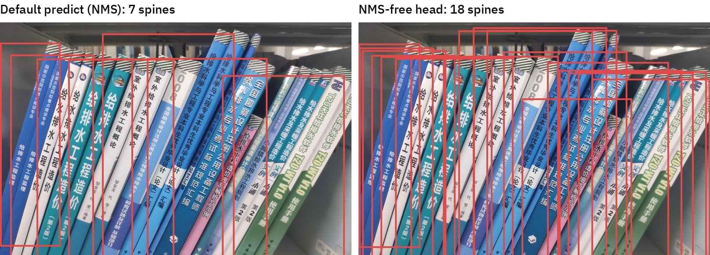](../assets/research/in-browser-spine-reader/figures/fig03_nms_vs_nmsfree.jpg)

*Figure 3. The same segmentation weights (YOLO26n-seg trained on 4TU) on a tilted 4TU validation shelf with 20 spines, confidence 0.4, boxes drawn axis-aligned. Left: default `predict`, which applies NMS at IoU 0.5 to the one-to-many head. Right: the NMS-free one-to-one head. Both use rectangular padding. The bottom of the photo is cropped for display; the model saw the whole photo.*

The tilted shelf shows why the head mattered for segmentation. Around a tilted spine the axis-aligned box is much wider than the spine, so the boxes of neighboring spines overlap above IoU 0.5 and NMS keeps only the highest-scoring of them. Rotated boxes stay about as narrow as the spines and overlap far less, and the OBB model, whose NMS works on rotated boxes, kept 22 and 26 boxes on these two photos. With the NMS-free head, the same segmentation weights return 20 and 26 boxes on the browser path (the photos have 20 and 24 spines), and 18 on the Figure 3 photo with rectangular padding. We withdrew the conclusion about segmentation.

[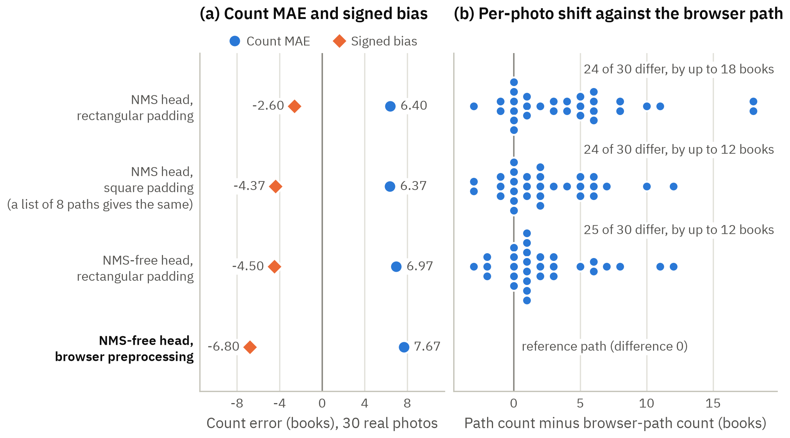](../assets/research/in-browser-spine-reader/figures/fig04_eval_paths.png)

*Figure 4. One set of weights (the adopted OBB model), the 30-photo real holdout, threshold 0.4, four evaluation paths, all computed with PyTorch. (a) Count MAE and bias. (b) Each photo's count under a path minus its count under the browser path.*

Figure 4 shows the size of the effect for the adopted OBB model. Holdout MAE ranges from 6.37 books (NMS head, square padding) to 7.67 (the browser path), bias ranges from -2.6 to -6.8 books, and a single photo's count moves by up to 18 books between paths. On this set the browser path is the least favorable of the four, so our earlier numbers had been optimistic. On the 4TU validation set, where three of the paths were run, they agree more closely: MAE 1.66 with the NMS head and rectangular padding, 1.84 with the NMS-free head and rectangular padding, and 1.62 on the browser path. From here on, counts are measured on the browser path.

### 3.3 Seven detectors measured the same way {#ablation}

| Training data | Model | 4TU val count MAE (bias) | Holdout count MAE (bias) | 4TU val mAP50 | Training time |
|---|---|---|---|---|---|
| 4TU + synthetic v2 | OBB, adopted | 1.62 (+1.3) | 7.7 (-6.8) | 0.987 | 43 min |
| 4TU + synthetic v2 | seg | 1.69 (+0.6) | 8.1 (-7.0) | 0.991 | 63 min |
| 4TU | OBB | 2.31 (+1.7) | 7.0 (-6.6) | 0.976 | 13 min |
| 4TU | seg | 1.83 (+1.4) | 11.6 (-10.7) | 0.988 | 15 min |
| 4TU + synthetic v3 | OBB | 1.84 (+1.4) | 7.8 (-6.4) | 0.987 | 41 min |
| 4TU + synthetic v3 + pseudo-labels | OBB | 2.19 (+1.6) | 7.1 (-5.5) | 0.984 | 43 min |
| synthetic v2 only | OBB | 3.77 (+1.3) | 10.0 (-8.4) | 0.870 | 31 min |

*Table 2. Counts on the browser path (NMS-free head, long side 1,600 px, square padding) at threshold 0.4, computed with PyTorch on the 4TU validation set (64 photos) and the holdout (30 photos); MAE and bias are in books per photo. mAP50 comes from `val` with `nms=False`, which pads to a rectangle; with square input the adopted model scores about 0.976. Segmentation mAP is measured on axis-aligned boxes and OBB mAP on rotated boxes, so the two are not directly comparable. Training times are wall-clock for 80 epochs on one RTX 5080; each OBB run shared the GPU with another training run for most of its time.*

[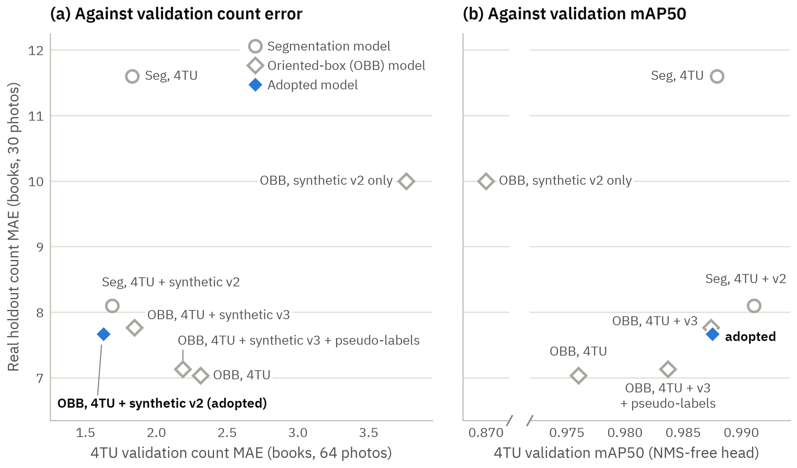](../assets/research/in-browser-spine-reader/figures/fig05_detector_ablation.png)

*Figure 5. Seven detectors on the browser path. (a) Holdout count error against 4TU validation count error. (b) Holdout count error against 4TU validation mAP50 (from `val` with `nms=False`, as in Table 2); the x-axis is broken between 0.870 and 0.975. The adopted model has the lowest validation count error but not the lowest holdout error.*

We chose the OBB model trained on 4TU plus synthetic v2 because it has the lowest 4TU validation count error (1.62). On the holdout, the 4TU-only OBB (7.0) and the pseudo-label model (7.1) do slightly better than the adopted one (7.7). The gap is under one book on 30 photos whose labels may be off by several books, and under the NMS head the ranking changes (4TU-only 6.3, adopted 6.4, pseudo-label 7.0), so we did not use the holdout to choose. Trained on synthetic shelves only, the OBB model reaches 0.870 mAP50 on the real 4TU photos, compared with 0.976 to 0.987 for the OBB models that saw them. Mixing synthetic v2 into 4TU lowered the validation count error from 2.31 to 1.62 but did not improve the holdout (7.0 to 7.7). Neither synthetic v3 nor the 194 pseudo-labeled photos gave a clear improvement.

Segmentation and OBB do not differ significantly on the holdout when trained on the same data (OBB 7.7 vs. segmentation 8.1 books, p = 0.83; 7.0 vs. 11.6, p = 0.058). We kept OBB for two practical reasons. In the browser its detection stage takes 144 ms, compared with 224 ms for segmentation (median over 5 photos and 3 runs), and the four corners of a rotated box go straight into the crop, with no mask post-processing.

### 3.4 The threshold was not tuned on the holdout {#threshold}

[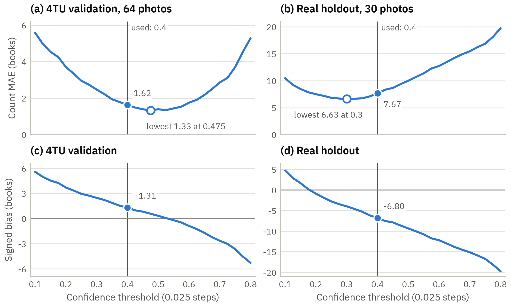](../assets/research/in-browser-spine-reader/figures/fig06_threshold_sweep.png)

*Figure 6. Count MAE and bias of the adopted model on 4TU validation (64 photos) and the real holdout (30 photos) as the confidence threshold varies (browser path, PyTorch). The threshold was set to 0.4 early on and left there.*

On the 4TU validation set a slightly higher threshold would give a lower count error (MAE 1.33 at 0.475 and 1.39 at 0.5, against 1.62 at 0.4), and on the holdout a lower one would (6.63 at 0.3, against 7.67 at 0.4). Choosing it on 30 photos would turn the holdout into a tuning set, so we kept 0.4.

### 3.5 Split scores on a thin spine {#score-split}

In one phone run on the five books of Section 5.2, the detector missed a thin pink spine at the right edge, although an earlier run had found all five. We took a screenshot of the result, painted out the box overlay and ran the detector on that image again on the browser path. A box was there, scoring 0.385, just below the threshold, and two nearly identical boxes sat on the same spine with scores of 0.219 and 0.155. The one-to-one head appeared to have split one spine's score across several nearly identical predictions.

The top score was also unstable. Shifting the photo by 4, 8 or 16 px gave 0.507, 0.634 and 0.650, and re-saving it as JPEG at quality 95, 85 or 75 gave 0.25 to 0.30. The same weights with the NMS head scored the spine between 0.57 and 0.66 on all seven inputs, the screenshot and the six variations above. Since only the head differed, we treat this as a property of the head rather than of training.

Instead of retraining, we added one post-processing step to the browser decoder: collect the boxes scoring 0.05 or more, group boxes that nearly coincide (probabilistic IoU of the two rotated boxes above 0.7), combine each group's scores as `1 - prod(1 - s)`, and only then apply the 0.4 threshold. The three scores above combine to about 0.59. This is the merge function from the browser's JavaScript decoder:

```js
export function mergeDuplicates(cands, iouThr = 0.7) {
  const order = cands.slice().sort((p, q) => q.score - p.score); const used = new Uint8Array(order.length); const out = [];
  for (let i = 0; i < order.length; i++) {
    if (used[i]) continue; used[i] = 1; let keep = 1 - order[i].score; let n = 1;
    for (let j = i + 1; j < order.length; j++) {
      if (!used[j] && probiou(order[i], order[j]) > iouThr) { used[j] = 1; keep *= 1 - order[j].score; n++; }
    }
    out.push({ ...order[i], score: 1 - keep, merged: n });
  }
  return out;
}
```

[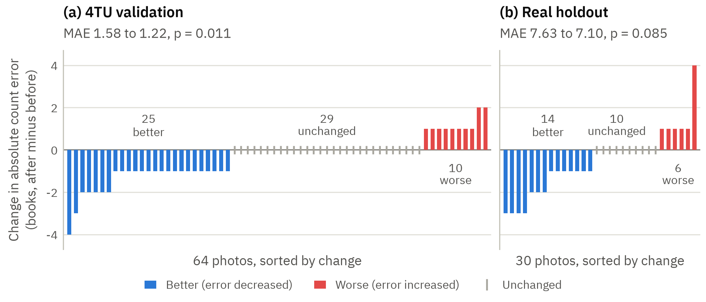](../assets/research/in-browser-spine-reader/figures/fig07_merge_effect.png)

*Figure 7. Change in each photo's absolute count error after the merge, with the shipped ONNX model and the browser decoder at threshold 0.4. (a) 4TU validation, 64 photos. (b) Real holdout, 30 photos. p-values from the permutation test of Section 2.2.*

On 4TU validation, MAE fell from 1.58 to 1.22 (25 photos better, 10 worse, p = 0.011). On the holdout it fell from 7.63 to 7.10 (14 better, 6 worse, p = 0.085), the same direction but not significant. These pre-merge values (1.58 and 7.63) differ slightly from those behind Table 2 (1.62 and 7.67) because Table 2 was computed with PyTorch and these with the ONNX model and the browser's decoding code.

Merging happened in 89 of the 94 photos (455 groups), so near-duplicate boxes are common and not a quirk of one photo. On 4TU validation the merge mostly removed double detections (53 boxes removed, 20 added), and the bias fell from +1.27 to +0.75. On the holdout it added more boxes than it removed (40 added, 28 removed). Against the main-shelf counts, which exist for 29 of the 30 photos, overcounting grew a little, with the bias going from +1.03 to +1.45. The detection stage took 148 to 150 ms with merging, compared with 146 ms without, a difference within the spread between runs.

The two parameters (0.7 and 0.05) were fixed before evaluation, but the method came from looking at a single photo, and the 4TU validation set is the same set we used to pick the checkpoint, the detector and, early on, the threshold.

### 3.6 Where the holdout error comes from {#holdout-errors}

[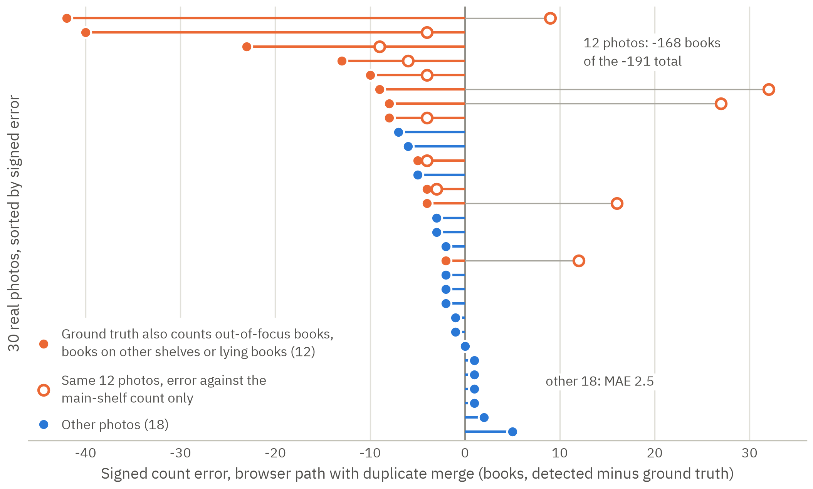](../assets/research/in-browser-spine-reader/figures/fig08_real30_errors.png)

*Figure 8. Signed count error for each holdout photo after merging. Orange: the 12 photos whose ground truth also counts books outside the main shelf (mostly out of focus, on other shelves, or lying flat). Hollow markers show the error for those photos against a main-shelf-only count.*

After merging, the count MAE is 1.22 books on 4TU validation but 7.10 on the holdout, where the detector undercounts by 6.4 books on average. We first read this as thin spines missed on dense shelves. Broken down by photo, though, 168 books of the net shortfall of 191 come from the 12 photos whose ground truth includes books outside the main shelf, and the other 18 photos have an MAE of 2.5. Against the main-shelf count those 12 photos are still off by 10.8 books on average, with a bias of +5.2. Most of the gap therefore comes from photos where it is unclear which books should be counted, and on those photos the detector's count matches neither definition.

The clear failure is books lying flat. The detector finds none of the 36 in the holdout; books lying flat make up 0.16% of the 4TU training spines, and the v2 synthetic shelves contain none. Synthetic v3 adds books lying flat, in piles of 1 to 3 (1,555 books in 618 of its 2,000 images), but the model trained with it did not do better on the holdout either (Table 2).

## 4. Reading the spine {#ocr}

### 4.1 Choosing an OCR engine {#ocr-engine}

We compared EasyOCR with the Korean PP-OCRv5 mobile recognizer on 24 synthetic spines. On 17 spines with horizontal text rotated by 90 degrees, EasyOCR matched 17 titles and PP-OCRv5 matched 13. On 7 spines with stacked glyphs, EasyOCR matched 2 and PP-OCRv5 all 7. PP-OCRv5's four misses came from picking the wrong rotation, not from misreading. It reads stacked Korean without rotating it and is much smaller (EasyOCR's CRAFT text detector alone is 83 MB; Baek et al., 2019), so we used it.

In PaddleOCR, naming a text detection or recognition model explicitly (by name or directory) makes it ignore `lang="korean"` with only a warning, so if only the detection model is named, the recognizer falls back to the pipeline's default model, whose character set has no Hangul. Passing `text_recognition_model_name="korean_PP-OCRv5_mobile_rec"` as well avoids this.

### 4.2 Finding 2: the text detector saw spines 32 px wide {#ocr-scale}

When we scaled the evaluation up to the first 100 validation images (1,648 spines), Match@1 was only 0.43. The 24-spine comparison in Section 4.1 had not shown this because it used wider spines from an earlier version of our generator and read every crop in three rotations. Splitting the failures by stage showed that the recognizer misread the title on 19% of spines, while on 34% the text detector returned no text box at all.

The cause was the resize in front of the detector. Called directly, the `TextDetection` module only shrinks images whose long side exceeds 960 px (`limit_type=max`, `limit_side_len=960`) and then rounds both sides to the nearest multiple of 32, with a minimum of 32. (The full `PaddleOCR` pipeline defaults to `limit_type=min` and `limit_side_len=64` instead.) A spine crop is hundreds of pixels long but only tens of pixels wide, so a crop narrower than 48 px reaches the detector 32 px across. Figure 9a shows the break at 48 px: the detector found no text box at all in 72% of the narrower crops and in 2.6% of the wider ones.

[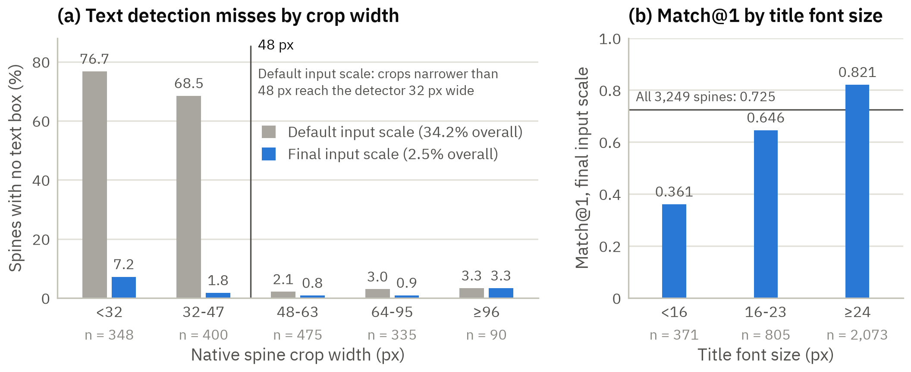](../assets/research/in-browser-spine-reader/figures/fig09_ocr_width_glyph.png)

*Figure 9. (a) Share of crops in which the text detector finds no text box, by crop width, with the default resize and with the short side raised to 96 px, on the same 1,648 synthetic spines. (b) Match@1 by title font size with the final resize settings and both orientations always read, 3,249 spines.*

We now scale the detector input so that its short side is at least 96 px (`limit_type=min`, `limit_side_len=96`) and upscale crops narrower than 96 px before that. On the same 1,648 spines, with both models unchanged, the share of crops with no text box fell from 34.2% to 2.5%, Match@1 rose from 0.43 to 0.74, and CER fell from 0.62 to 0.26.

[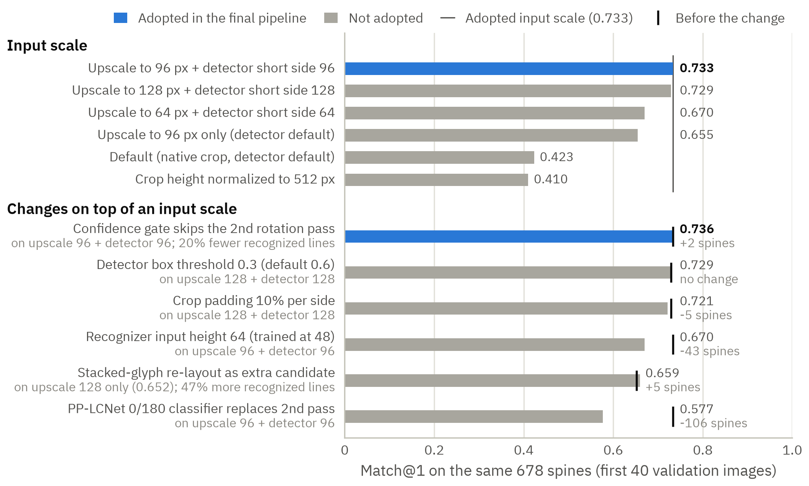](../assets/research/in-browser-spine-reader/figures/fig10_ocr_ablation.png)

*Figure 10. Match@1 on the first 40 validation images (678 spines) for each setting. Blue bars mark the settings we use. Settings in the lower group are applied on top of the setting named under their label; the black tick marks that setting's Match@1, and the small label gives the change in correctly matched spines.*

Upscaling the crop alone recovers only part of the gain (0.655), because the detector shrinks crops that have become longer than 960 px back down. A short side of 128 px matches 96 px (0.729 vs. 0.733) but doubles detection time, so we use 96. A lower `box_thresh` changed nothing, and crop padding and a taller recognizer input lowered Match@1 (Figure 10). The browser still pads each crop by 8% of its short side, which these OCR numbers do not include. All Match@1 values in this section use a closed list of 90 titles and the first reranker, so they are not comparable with the matching results in Section 5.

### 4.3 Orientation without a classifier {#orientation}

After a crop is rotated so that its long side is vertical, the text can still run top to bottom or bottom to top, and the reading direction has to be decided. PaddleOCR's text-line orientation classifier (PP-LCNet) got this wrong on 24% of spines and lowered Match@1 from 0.733 to 0.577. We decide the direction from recognition confidence instead.

One orientation is read first. If its character-weighted mean confidence is at least 0.90 over at least 3 characters, that reading is kept; otherwise the opposite orientation is read as well, and the more confident reading wins. Our Python evaluation picked the reading with the larger length-weighted confidence sum, while the browser compares the weighted means; we did not re-measure the browser's rule at this scale. Compared with always reading both, Match@1 stays the same (0.736 vs. 0.733) and the number of recognized lines drops by 20% on the 678-spine subset. With both orientations always read, 4.1% of all 3,249 spines still fail because the orientation is wrong, and more than half of these are titles of 1 to 3 characters, since a short Korean title read upside down can still produce plausible syllables.

### 4.4 OCR speed depends on the runtime {#ocr-speed}

PaddleOCR on CPU took 235 ms per spine, which suggested about 5.6 s for the 24-spine sample. Much of that came from the runtime. The CPU build of paddlepaddle 3.3.1 failed in its oneDNN path, so we ran it with `enable_mkldnn=False`, which is slow. The same models converted with paddle2onnx and run in ONNX Runtime on one CPU thread took 7.7 ms for text detection and 8.1 to 12.4 ms per recognized line (320 to 480 px wide) with fixed-size random inputs; with one detection call and about three lines per spine, that is roughly 32 to 45 ms per spine. In the browser, with WASM and 4 threads, OCR took about 70 ms per spine (68 to 72 ms over 7 runs).

### 4.5 Remaining OCR errors {#ocr-errors}

After the fix, 27.5% of the 3,249 spines still fail Match@1. Font size is the strongest factor (Figure 9b): Match@1 is 0.82 for titles set at 24 px or larger and 0.36 below 16 px, and 58% of the failures have titles set below 24 px. Digits inside stacked titles are a specific weakness. The recognizer reads 2 as 그 and 1 as ㅣ, and only 18 of 159 stacked titles containing a number had the number read correctly.

## 5. Matching titles {#matching}

### 5.1 Retrieval {#retrieval}

OCR output often differs from the dictionary in spacing and punctuation. Stacked titles lose their spaces, and "총,균,쇠" against the dictionary's "총, 균, 쇠" (Guns, Germs, and Steel) scores only 50 with RapidFuzz's `token_set_ratio`. Both sides are therefore NFKC-normalized, lower-cased and stripped of spaces and punctuation.

The query's character 2-grams and 3-grams retrieve 50 candidates with BM25 (k1 = 1.2, b = 0.75), and only those 50 are rescored. Character n-grams tolerate missing spaces and one or two wrong characters; on the synthetic spines the right title is among the 50 candidates for 83.6% of spines.

### 5.2 Finding 3: the matcher looked safe because the answer was always there {#open-set}

The first reranker scored each candidate with the maximum of three RapidFuzz similarities: `token_set_ratio`, `ratio` on space-free strings, and `partial_ratio`. It had been evaluated only against the closed list of 90 titles used in Section 4, where the answer is always among the candidates.

Then we photographed five real books with a phone. OCR read all five titles correctly, none of the five was in the dictionary, and the matcher confirmed a different book for two of them. "빛 혹은 그림자" (Light or Shadow) was confirmed as a book titled "그림자" (Shadow) with a score of 100. `token_set_ratio` returns 100 whenever one side's tokens are a subset of the other's. When the correct book is in the dictionary, that book scores 100 as well, which is why the problem had not shown up.

To check whether this was a fluke, we built the open-set evaluation of Section 2.2, in which no book with the answer's title is left in the dictionary. In the closed set 94.0% of the first reranker's confirmations were right, but in the open set it confirmed a wrong book for 51.3% of the 3,249 synthetic spines (1,667). In 76% of those cases the wrong book had a longer title containing the one we read; "채식주의자" (The Vegetarian), for example, was confirmed as "불완전 채식주의자" (Imperfect Vegetarian). Most of the rest were another volume or year of the same series, such as volume 9 instead of "진격의 거인 2" (Attack on Titan, volume 2), or a similar title.

### 5.3 A reranker that handles containment explicitly {#reranker}

The revised score starts from RapidFuzz `ratio` on the whole normalized strings and adds rules for containment and numbers. A score of 85 or more confirms, 70 or more asks for review, and anything lower is unmatched.

| Case | Rule |
|---|---|
| The OCR line contains the title and is at least 2 characters longer, and the extra characters match the book's author or publisher, a known author or publisher name, or a common spine word such as 장편소설 (novel) or 개정판 (revised edition) | accepted as that title |
| The OCR line contains the title, but 2 or more extra characters are explained by none of these | capped at 59 (unmatched) |
| The dictionary title contains the OCR line and is at least 2 characters longer | capped at 84 (review at most) |
| Volume numbers or years differ | capped at 59 |
| A number appears on one side only | capped at 84 |

*Table 3. Rules of the revised reranker. "Contains" allows small misreads, as long as the best same-length window scores at least 80, and a single unexplained character on each side of the title is ignored.*

The core of the containment rules, from the browser matcher (JavaScript; `qn` is the normalized OCR line and `tn` the normalized dictionary title):

```js
if (qn.length >= tn.length + 2 && tn.length >= 2) {            // OCR line = title + extra text?
  const w = bestWindow(tn, qn);
  if (w.sim >= 80) {
    // ...
    if (before.length + after.length >= 2) { s = Math.min(s, 59); why = 'title inside OCR, extra text unexplained'; }
    else if (s2 > s) { s = s2; why = 'title inside OCR, extra text = author/publisher'; }
  }
} else if (tn.length >= qn.length + 2 && qn.length >= 2) {     // title = OCR line + words the OCR did not show
  if (bestWindow(qn, tn).sim >= 80 && s > 84) { s = 84; why = 'OCR inside longer title'; }
}
```

The decision step is stricter too. If the OCR line or the title has 4 characters or fewer, only a score of 100 is confirmed, because a short title is often one character away from another title. A score of 100 requires every title character to be read correctly and any extra characters to be explained as in Table 3. A single-character read is never confirmed, and a read that is at least half Latin letters is confirmed only if it equals the full title.

[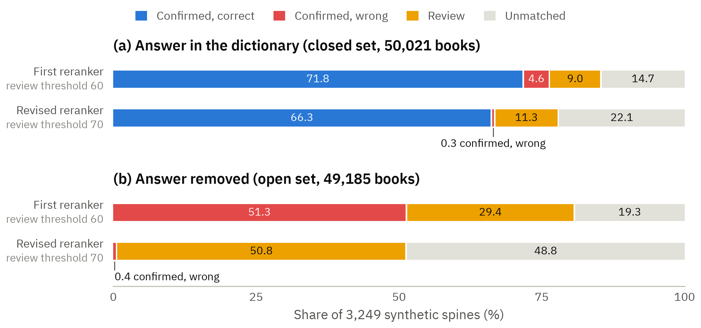](../assets/research/in-browser-spine-reader/figures/fig11_matching_outcomes.png)

*Figure 11. Outcomes for 3,249 synthetic spines with the first and the revised reranker. Both confirm at a score of 85 or more; the first sends 60 or more to review, the revised one 70 or more. (a) The answer is in the dictionary. (b) The answer has been removed, so every confirmation is wrong and every review offers only wrong candidates.*

| Reranker | Correct confirmations (closed) | False confirmations (open) | Confirmations that are right (closed) | Top-1 correct (closed) |
|---|---|---|---|---|
| First (max of three similarities) | 71.8% | 51.3% | 94.0% | 78.3% |
| Revised | 66.3% | 0.4% | 99.5% | 77.9% |

*Table 4. Matching on the 3,249 synthetic validation spines (90 distinct titles), with the OCR output of Section 4 and the browser's matcher. Closed set: 50,021 books; open set: 49,185 (Section 2.2). The "Confirmations that are right" column is a share of confirmations; the other percentages are shares of all spines.*

False confirmations in the open set fell from 51.3% to 0.4% (14 spines), and the share of confirmations that are right rose from 94.0% to 99.5%. The price is fewer correct confirmations, 66.3% instead of 71.8%. Top-1 accuracy barely moved (78.3% vs. 77.9%), so almost all of the change is in which top candidates get confirmed. Spines whose title was read with small errors, read only in part, or read together with extra characters now go to review or stay unmatched instead of being confirmed. In the open set 50.8% of spines still end in review, where every candidate offered is wrong, which is why review only lists candidates and leaves the choice to the user.

On the sample shelf, the recognizer read "진격의 거인 그 학사문화사", Attack on Titan with the volume digit 2 read as the syllable 그 and the publisher name slightly off. One of the six title characters is wrong, the best score is 83, and the spine goes to review. Volumes 1 to 9 all score 83 for this reading, so the right volume is listed first only because of the order of the ties.

We also tried two ways of confirming more often: accepting the top candidate when its margin over the second is large, and comparing titles at the level of Hangul jamo, the consonant and vowel letters that make up each syllable block. Both increased false confirmations two- to five-fold, and we dropped them.

### 5.4 Real photos and browser engines {#real-matching}

We ran the 30 holdout photos, all with non-Korean titles, through the browser and checked every confirmation. Of 30 confirmations, 13 were wrong and one could not be judged. Single-character reads such as "그" or "성" had matched one-character titles, English titles had matched approximately or as a word inside a longer line ("HOLLY BLACK" as "Holly"), and one confirmation was a year printed on an encyclopedia spine ("1984"). The 16 correct confirmations were all editions of Frankenstein in a single photo. With the single-character and Latin-script rules of Section 5.3, 1 of 12 confirmations was wrong (the "1984" spine), and the 11 correct ones were again Frankenstein editions from that photo.

Browser engines differ as well. On the sample shelf, Chromium ended with 20 spines confirmed, 2 sent to review and 2 unmatched, and WebKit with 18, 2 and 4. Canvas resampling differs between the two engines, and in WebKit that was enough for the two-character author name "자청" printed next to the title to be read as "자정" on one spine and "가청" on another. The leftover characters no longer matched an author, so those spines ended up unmatched.

We now accept a one-jamo error in two-character names, but only next to titles of 5 or more characters, because allowing it everywhere created new false confirmations next to short titles. Both engines now give 20, 2 and 2. The revised row of Table 4 includes these later rules; before them, its first three numbers were 66.6%, 0.5% (16 spines) and 99.4%.

### 5.5 The dictionary and the online fallback {#dictionary}

The dictionary combines 60,240 records from a library linked-data SPARQL endpoint, 103,936 unique ISBNs from a book-search API and 3,000 records from Open Library, merged by ISBN-13 into 161,399 entries (160,932 unique ISBNs). The browser file keeps four fields: title, author, publisher and ISBN. The SPARQL endpoint caps results at 100 rows and times out on paged scans, so we enumerated resource URIs, which follow a year-plus-serial pattern, and queried 100 at a time.

The browser receives 50,000 entries as one JSON file (4.8 MB, 1.5 MB gzipped) and builds its index on the device. The 50,000 were chosen by source and recency, not by popularity, so widely owned books may be missing.

When a spine is not confirmed, the user can press a button to look it up online. Only the recognized title text of unconfirmed spines is sent; photos and crops are not. The server cleans the text, forwards it to a book-search API (with up to two shorter queries if nothing is found) and returns candidates. The browser scores them with the same reranker and decision rule as candidates from the local dictionary and keeps an online answer only when it is better than the local one. Feeding the five OCR strings from the phone photo in Section 5.2 to the same code on a desktop gave five unmatched spines locally and five correct confirmations after the online lookup; we did not verify this on the phone screen itself. In a headless run on the synthetic sample with an earlier build, the lookup did not fix any of the three spines that OCR errors had left unconfirmed.

## 6. Running in the browser {#browser}

### 6.1 Export {#export}

Exported with `nms=False`, YOLO26n-obb outputs its final 300 boxes directly as `[1, 300, 7]` (cx, cy, w, h, score, class, angle), so the browser only has to decode them. The two PP-OCRv5 models were converted with paddle2onnx 2.1.0 and keep a dynamic input width. Dynamic INT8 quantization shrank the segmentation model from 11.3 MB to 3.5 MB, but on CPU (onnxruntime-node) it ran at 125 ms, compared with 61 ms for FP32, and found fewer spines, so we ship FP32. We did not repeat this for the OBB model and did not try static quantization or FP16.

PaddleOCR's pre- and post-processing had to be rewritten in JavaScript: the resize rule, normalization, differentiable binarization (DB) post-processing (binarize at 0.3, connected components, minimum-area rectangles, box score threshold 0.6, unclip ratio 1.5) and greedy CTC decoding. A Node test compares the port with Python PaddleOCR outputs on 18 synthetic crops. The port is not bit-exact. With its text detection resize set to match the Python reference, 9 of the 18 strings matched PaddleOCR's upright run exactly, and 3 more matched its run in another orientation because the port had flipped those crops; the other 6 differed by one or two characters. We attribute those to small box differences between our connected-component search and `cv2.findContours`, and to resampling.

### 6.2 Threads need cross-origin isolation {#threads}

Multithreaded WASM needs `SharedArrayBuffer`, which browsers expose only to cross-origin isolated pages, so every response carries these two headers:

```text
Cross-Origin-Opener-Policy: same-origin
Cross-Origin-Embedder-Policy: require-corp
```

Without them the runtime falls back to one thread; in a single run the sample then took 5.3 s instead of 1.9 s.

### 6.3 Finding 4: the first deployment froze on a phone {#freeze}

Every headless desktop test passed, but on a real phone the page froze while processing the sample. Headers, MIME types and caching were all correct. To reproduce the problem, we drove Playwright Chromium with a phone profile and 4x CPU throttling and recorded every main-thread long task with a `PerformanceObserver`. The main thread was blocked for 10.4 s in total and for up to 1.7 s at a time, because ONNX inference and the building of the 50,000-book index both ran on it.

We made three changes:

1. Setting `ort.env.wasm.proxy` to `true` makes ONNX Runtime run inference in its own Web Worker. No worker code is needed, and `session.run()` is awaited as before.
2. WebGPU is no longer selected automatically; it is used only when `?backend=webgpu` is in the URL.
3. The index is built in slices of 2,500 entries, with a zero-delay `setTimeout` between slices.

Measured the same way, total blocking dropped to between 1.2 and 1.6 s, the longest single block stayed under 0.29 s, and the page then ran to completion on the phone. Chromium's CPU throttling barely slows ONNX Runtime's inference worker, so these numbers measure main-thread blocking, not phone speed. We disabled automatic WebGPU because we had seen a software adapter freeze the page while creating a session. We do not know whether the phone had selected WebGPU, and since the three changes shipped together, we cannot tell which of them the phone needed.

### 6.4 Latency {#latency}

[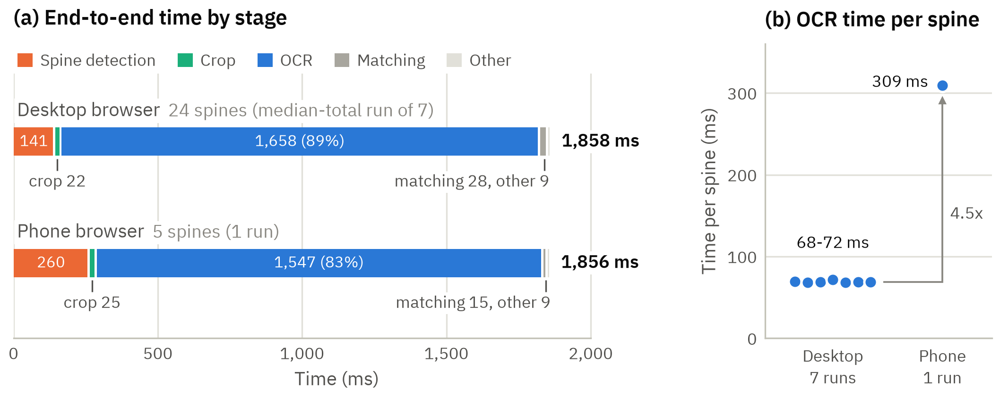](../assets/research/in-browser-spine-reader/figures/fig12_latency.png)

*Figure 12. (a) End-to-end time by stage: desktop headless Chromium on the 24-spine synthetic sample (of 7 runs, the one with the median total; WASM with 4 threads) and one phone on a photo of 5 real books (one run, WASM with 3 threads, read from the page's statistics panel). (b) OCR time per spine; 4.5x is the phone's time divided by the desktop median of 69 ms.*

| Stage | Desktop, 24 spines (7 runs) | Phone, 5 spines (1 run) |
|---|---|---|
| Spine detection | 141 to 156 ms | 260 ms |
| Crops | 21 to 23 ms | 25 ms |
| OCR | 68 to 72 ms per spine (1,633 to 1,721 ms) | 309 ms per spine (1,547 ms) |
| Matching | 27 to 42 ms | 15 ms |
| Total | 1,840 to 1,935 ms (median 1,858 ms) | 1,856 ms |

*Table 5. Stage times in the browser, without model loading and index building (757 ms and 342 ms on the phone). Desktop: range over 7 runs of the 24-spine synthetic sample in headless Chromium, WASM SIMD with 4 threads. Phone: one run on a photo of 5 real books, WASM with 3 threads.*

OCR takes about 89% of the time on the desktop and 83% on the phone. Detection is a fixed cost per photo, while OCR grows with the number of spines. Per spine, OCR on the phone took 309 ms, about 4.3 to 4.5 times the desktop's 68 to 72 ms; the photos differ (5 real books vs. 24 synthetic spines), so the ratio is rough. Scaled from this one 5-book run, the 24-spine sample would take about 7.9 s on the phone (260 ms for detection plus 317 ms per spine for cropping, OCR and matching).

### 6.5 First visit {#first-visit}

[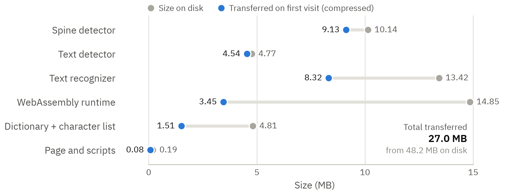](../assets/research/in-browser-spine-reader/figures/fig13_first_visit.png)

*Figure 13. Size on disk and bytes transferred on a first visit, by component (1 MB = 1,000,000 bytes). Transferred sizes are compressed bytes from a cold page load; the WebAssembly runtime is fetched by the inference worker, outside the page-level capture, and was measured separately.*

A first visit downloads about 27 MB, all compressed in transit: 22.0 MB of models (28.3 MB uncompressed), 3.45 MB of WebAssembly runtime and about 1.5 MB of dictionary data. Later visits read the models from the Cache API and the rest from the HTTP cache. The progress display had a bug. It awaited `cache.put()` before reading the response stream, and `put` does not resolve until the whole file has arrived, so on a connection throttled to 9 Mbps the page showed no progress for 15 s and then jumped to 100%. The fix was to call `cache.put(url, res.clone())` without awaiting it and to read progress from the original stream.

## 7. Related work {#related}

Reading book spines from shelf images has mostly been studied for library inventory. Smart Library (Yang et al., 2017) segments spines in shelf photos, reads them with scene-text recognition and matches the text against a library catalog. When its upside-down classifier is unsure, it keeps both orientations of a text line, close to our rule in Section 4.3. Ma et al. (2024) detect spines with rotated boxes, as we do, using an oriented R-CNN trained on the same 4TU shelf photos.

Our setting differs in that the titles are Korean and every model runs in a phone browser. We also evaluate matching with the answer removed from the dictionary, whereas the Smart Library retrieval test searched a database that contained every queried book. That check is standard in open-set recognition (Scheirer et al., 2013), and we had not run it at first.

The components are standard. YOLO26 (Jocher et al., 2026) trains its NMS-free one-to-one head alongside a one-to-many head, following YOLOv10 (Wang et al., 2024). PaddleOCR configures the PP-OCRv5 mobile text detector (Cui et al., 2025) with the head, loss and post-processing of DB (Liao et al., 2020). Candidate retrieval uses BM25 (Robertson and Zaragoza, 2009). We group rotated boxes with the probabilistic IoU of Llerena et al. (2021). Our merge step is related to Soft-NMS (Bodla et al., 2017), which lowers the scores of overlapping boxes instead of removing them, and to weighted boxes fusion (Solovyev et al., 2021), which averages overlapping boxes and their scores; ours keeps the highest-scoring box and combines the scores with a noisy-OR.

## 8. Limitations {#limitations}

- We have no evaluation set of real Korean spines. OCR and matching rates come from synthetic spines rendered from 90 titles, and the real holdout has no Korean titles, so how well the pipeline reads real Korean shelves is unknown.
- OCR accuracy and the synthetic matching results come from Python PaddleOCR on crops cut from ground-truth polygons, not from the browser's port on detected boxes (Section 2.2).
- The matching rules were written while looking at failures on the same 3,249 synthetic spines and 30 real photos they are scored on, so the 0.4% is an in-sample figure. The 3,249 spines also repeat 90 titles, so they are far from 3,249 independent tests.
- The synthetic spines print publishers only from an 18-name list, all of which are among the 34 publisher names the pipeline drops, which makes choosing the title line easier than on real shelves.
- The holdout is small and its labels are noisy: 30 photos, counts made in one pass over model overlays, likely off by 2 to 6 books on large shelves. Differences of about one book between models are within that noise.
- Each detector configuration was trained once, with seed 0.
- The merge rule came from one photo, and its only significant improvement was on the 4TU validation set, which we had already used for model selection (Section 3.5).
- Books lying flat are not detected, and the system has no definition of which books in a photo should be counted. Restricting both the count and the ground truth to the main shelf would probably remove much of the holdout disagreement, but we have not measured it.
- The phone timings come from one device, one photo and one run, and the desktop stage timings in Section 6.4 from one synthetic photo run 7 times. iPhone behavior was checked only with WebKit device profiles on Linux, not on a device.
- The ONNX Runtime figure of 32 to 45 ms per spine is an estimate from fixed-size random inputs, not an end-to-end measurement.

## 9. Conclusion {#conclusion}

In each of the four cases, the measurement we relied on differed from the deployed system: in the detector head, padding and downscaling; in the width of the spines in an early OCR test; in whether the dictionary contained the answer; and in whether the page ran on a desktop or a phone.

If we started over, we would run the exported ONNX model with the browser's preprocessing in every evaluation script, score OCR with the browser's own port on detected boxes, evaluate matching with the answer removed from the dictionary, and open every build on a throttled phone profile before releasing it. For the system itself, the next steps are a set of real Korean shelf photos that includes books lying flat, a comparison of the merge rule with the NMS head on that set, and fewer recognition calls per spine, since OCR is where the phone spends most of its time.

## Citation {#citation}

```bibtex
@misc{lee2026spinereader,
  title  = {Evaluation Pitfalls in an In-Browser Book-Spine Reader},
  author = {Lee, Dong-Ryeol},
  year   = {2026},
  url    = {https://dongryeollee1.github.io/research/in-browser-spine-reader}
}
```

## References {#references}

- Baek, Y., Lee, B., Han, D., Yun, S., & Lee, H. (2019). [Character Region Awareness for Text Detection](https://arxiv.org/abs/1904.01941). CVPR 2019.
- Bodla, N., Singh, B., Chellappa, R., & Davis, L. S. (2017). [Soft-NMS: Improving Object Detection With One Line of Code](https://arxiv.org/abs/1704.04503). ICCV 2017.
- Cui, C., Sun, T., Lin, M., Gao, T., Zhang, Y., Liu, J., Wang, X., Zhang, Z., Zhou, C., Liu, H., Zhang, Y., Lv, W., Huang, K., Zhang, Y., Zhang, J., Zhang, J., Liu, Y., Yu, D., & Ma, Y. (2025). [PaddleOCR 3.0 Technical Report](https://arxiv.org/abs/2507.05595). arXiv:2507.05595.
- Jocher, G., Qiu, J., Liu, M., Lyu, S., Akyon, F. C., & Kalfaoglu, M. E. (2026). [Ultralytics YOLO26: Unified Real-Time End-to-End Vision Models](https://arxiv.org/abs/2606.03748). arXiv:2606.03748.
- Liao, M., Wan, Z., Yao, C., Chen, K., & Bai, X. (2020). [Real-time Scene Text Detection with Differentiable Binarization](https://arxiv.org/abs/1911.08947). AAAI 2020.
- Llerena, J. M., Zeni, L. F., Kirsten, L. N., & Jung, C. (2021). [Gaussian Bounding Boxes and Probabilistic Intersection-over-Union for Object Detection](https://arxiv.org/abs/2106.06072). arXiv:2106.06072. Journal version: Murrugarra-Llerena, J., Kirsten, L. N., Zeni, L. F., & Jung, C. R. (2024). [Probabilistic Intersection-Over-Union for Training and Evaluation of Oriented Object Detectors](https://doi.org/10.1109/TIP.2023.3348697). IEEE Transactions on Image Processing, 33, 671-681.
- Ma, H., Wang, C., Li, A., Xu, A., & Han, D. (2024). [An Accurate Book Spine Detection Network Based on Improved Oriented R-CNN](https://doi.org/10.3390/s24247996). Sensors, 24(24), 7996.
- Robertson, S., & Zaragoza, H. (2009). [The Probabilistic Relevance Framework: BM25 and Beyond](https://doi.org/10.1561/1500000019). Foundations and Trends in Information Retrieval, 3(4), 333-389.
- Scheirer, W. J., de Rezende Rocha, A., Sapkota, A., & Boult, T. E. (2013). [Toward Open Set Recognition](https://doi.org/10.1109/TPAMI.2012.256). IEEE Transactions on Pattern Analysis and Machine Intelligence, 35(7), 1757-1772.
- Solovyev, R., Wang, W., & Gabruseva, T. (2021). [Weighted Boxes Fusion: Ensembling Boxes from Different Object Detection Models](https://arxiv.org/abs/1910.13302). Image and Vision Computing, 107, 104117.
- Wang, A., Chen, H., Liu, L., Chen, K., Lin, Z., Han, J., & Ding, G. (2024). [YOLOv10: Real-Time End-to-End Object Detection](https://arxiv.org/abs/2405.14458). NeurIPS 2024.
- Yang, X., He, D., Huang, W., Ororbia, A., Zhou, Z., Kifer, D., & Giles, C. L. (2017). [Smart Library: Identifying Books on Library Shelves Using Supervised Deep Learning for Scene Text Reading](https://doi.org/10.1109/JCDL.2017.7991581). ACM/IEEE Joint Conference on Digital Libraries (JCDL 2017). Earlier version: [arXiv:1611.07385](https://arxiv.org/abs/1611.07385).
- Zhong, X., & Yang, Y. (2019). [Data mannually-labelled accompanying the research on segmentation of book-spine images](https://doi.org/10.4121/uuid:33f2a166-de13-4505-b359-2b202c491fd8) (Version 1). Dataset, 4TU.ResearchData. CC0.
- Ultralytics. [YOLO26 documentation](https://docs.ultralytics.com/models/yolo26/).
- PaddlePaddle. [korean_PP-OCRv5_mobile_rec](https://huggingface.co/PaddlePaddle/korean_PP-OCRv5_mobile_rec).
- PaddlePaddle. [PP-OCRv5_mobile_det training configuration](https://github.com/PaddlePaddle/PaddleOCR/blob/main/configs/det/PP-OCRv5/PP-OCRv5_mobile_det.yml).
- Microsoft. [ONNX Runtime Web](https://onnxruntime.ai/docs/tutorials/web/).
- [RapidFuzz](https://github.com/rapidfuzz/RapidFuzz).
