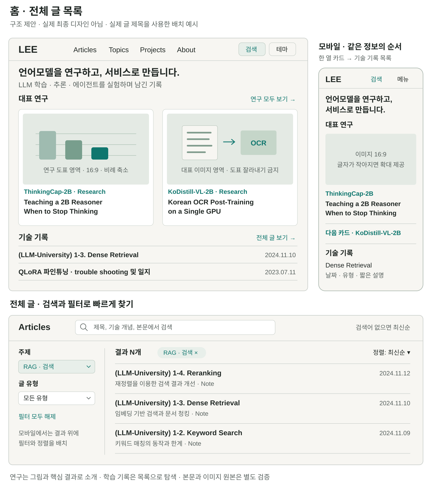
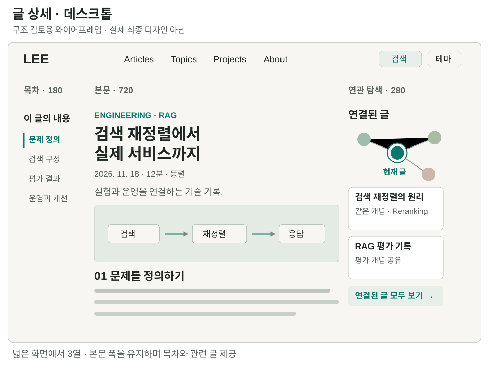
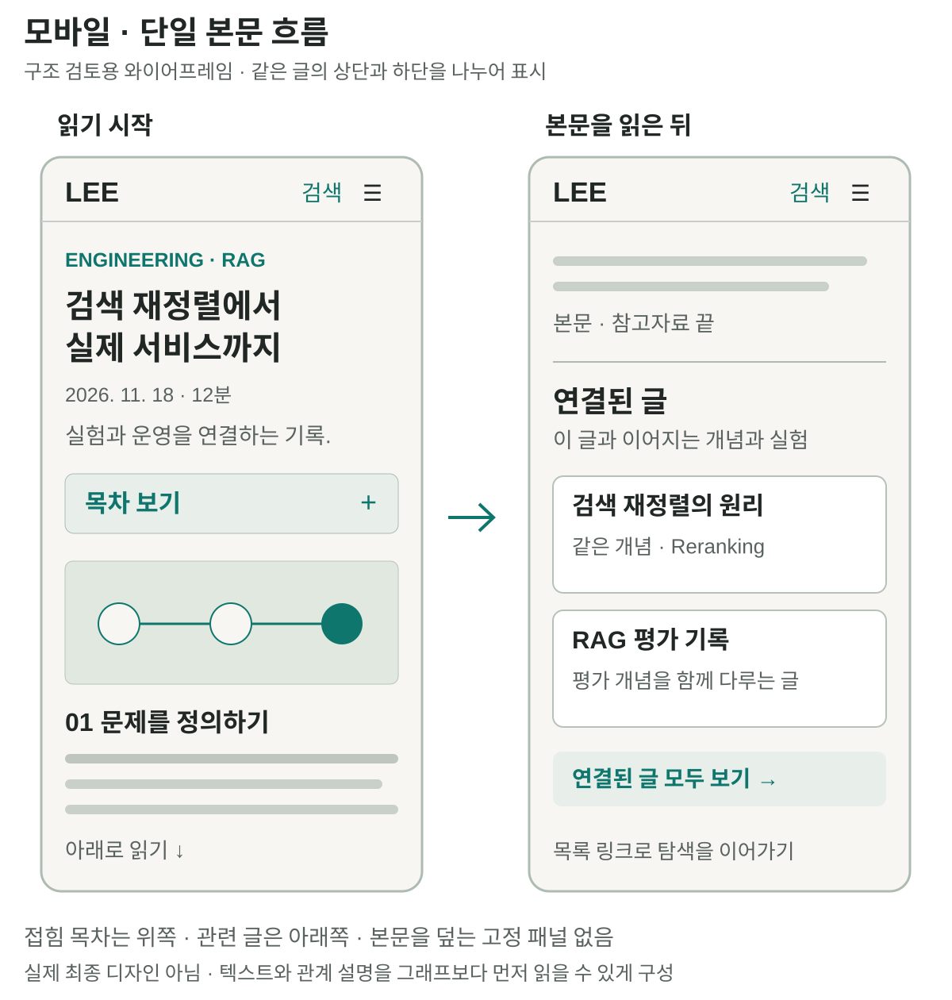
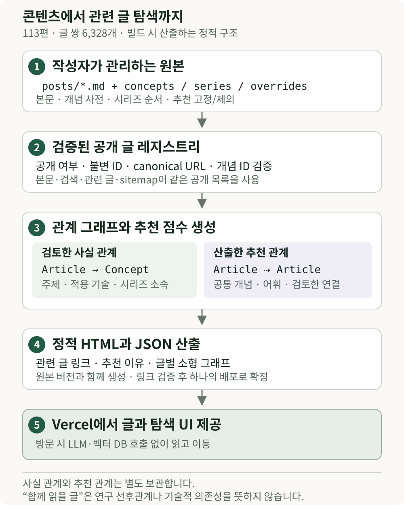

# 기술블로그 UI/UX 및 지식 기반 관련 글 탐색 리팩토링 계획

작성일: 2026-11-18 · 대상: `DONGRYEOLLEE1.github.io` · 상태: 구현 기준 v1.3, Alignment 실측·역할별 산세리프·아카이브 탐색 반영

이 문서는 로컬 저장소의 코드·게시글·설정, 운영 홈페이지의 DOM, 사용자가 첨부한 참고 화면 9개와 공식 문서를 확인해 작성했다. 구현 범위는 개인 기술블로그의 프론트엔드 재구축, 기존 콘텐츠와 주소의 이전, 개념 관계에 근거한 관련 글 자동 생성, Vercel 배포 준비까지다. 계획 수립 후 이 기준으로 실제 구현을 진행했다. 현재 파일별 대응과 검증 상태는 [구현 상태](implementation-status.md), 계정 연결과 운영 주소 전환은 [배포 안내](vercel-deployment.md)를 기준으로 확인한다.

## 1. 권장하는 최종 모습

블로그를 **읽기 좋은 개인 연구·개발 아카이브**로 재구축한다. Anthropic Alignment 페이지에서 확인한 크림색 배경, 절제된 검정 활자, 역할별 글자 위계, 실제 콘텐츠 이미지와 관련 글 탐색을 기본으로 삼는다. 한글·영문 제목과 UI는 Pretendard Variable 산세리프로 통일하고 크기·굵기·행간·자간을 컴포넌트별로 구분한다. 상세 수치는 [디자인 시스템](blog-design-system.md)에 둔다. 장식 슬로건과 임의 도식 커버는 사용하지 않는다. 밝은 테마와 어두운 테마는 동일한 레이아웃을 공유한다.

기술 구성은 **Astro + TypeScript + 정적 콘텐츠 생성 + Vercel**을 우선 권장한다. 개별 글은 HTML로 미리 생성하고, 검색·테마·작은 그래프에만 필요한 브라우저 동작을 추가한다. 기존 Markdown을 원본으로 유지하면서 검증된 글 목록과 경량 개념 사전을 만든다. 글이 추가·수정되면 관련 글을 다시 계산해 정적 데이터로 배포한다. 독자가 글을 열 때 LLM이나 임베딩 API를 호출할 필요는 없다.

| 결정 항목 | 권장안 | 선택 이유 |
|---|---|---|
| 프론트엔드 | Astro 정적 사이트, TypeScript | 113편의 글과 도해가 중심이며 개인화·로그인·실시간 데이터 요구가 없음 |
| 콘텐츠 원본 | 기존 `_posts/*.md` 보존 | 먼저 화면과 데이터 흐름을 교체하고 원문 대량 변경을 줄임 |
| 지식 모델 | Article·Concept·Series·Project와 명시적 관계 | 기존 태그만으로 구별할 수 없는 기술 개념과 글의 역할을 표현 |
| 관련 글 생성 | 빌드 이전에 계산하고 검증된 산출물 배포 | 재현 가능하며 서버 운영 없이 자동 갱신 가능 |
| 첫 출시 추천 | 개념·본문 어휘·내부 링크 기반 | 의미 있는 기준선을 먼저 확보하고 임베딩 효과를 나중에 비교 |
| 상세 화면 | 본문 + 목차 + 우측 관련 탐색 | 긴 글 읽기와 다음 글 발견을 함께 지원 |
| 검색 | Pagefind 검증 후 채택 | 정적 HTML에서 인덱스를 만들 수 있으며 별도 검색 서버가 필요 없음 |
| 전체 지식 지도 | 후속 단계 | 먼저 글별 관련 탐색과 주제 페이지의 유용성을 검증 |
| 운영 주소 | 소유한 도메인을 최종 운영 주소로 권장 | 기존 `github.io` 주소는 Vercel에 직접 연결할 수 있는 소유 도메인이 아님 |

Astro는 Vercel에 정적 사이트로 배포할 수 있다. 실시간 기능이 필요해질 때 서버 렌더링을 검토하면 되며, 첫 출시에는 그 의존성을 추가하지 않는다. [S2]

## 2. 조사 범위와 근거의 신뢰도

| 근거 | 확인한 범위 | 해석 시 주의점 |
|---|---|---|
| 로컬 Git 저장소 | HEAD `03b0b2c`, 추적 파일, 미추적 작업, 템플릿·스타일·콘텐츠·배포 설정 | 실제 GitHub Pages 설정 화면과 Vercel 계정 설정은 조사 대상에 포함되지 않음 |
| 콘텐츠 감사 | `_posts/*.md` 113편의 YAML 및 주요 본문 문법 | `_posts`의 전체 항목 115개 중 나머지 2개는 이미지 파일임 |
| 운영 홈페이지 | `https://dongryeollee1.github.io/`의 제목·내비게이션·글 링크·description | 전체 글의 HTTP 크롤링이나 실제 기기 성능 측정은 수행하지 않음 |
| 첨부 이미지 1~3 | Anthropic의 글 상단, 우측 미니 그래프와 관련 글 카드 | 서버 측 추천 방식이나 온톨로지 사용 여부는 이미지로 확인할 수 없음 |
| 첨부 이미지 4~9 | QVAC·PrismML·BottleCap·Aleph Alpha의 목록·상세 디자인 | 정적 화면에서 확인할 수 없는 hover·반응형·검색 동작은 새로 설계하는 제안임 |
| Alignment 공식 페이지 | 1440px·390px 뷰포트의 계산 스타일, 그리드, 선택 색상, 카드 관계 팝오버 | 소개의 세리프와 목록의 산세리프를 구별. 공개 UI로 내부 온톨로지를 추정하지 않음 |
| 공식 문서 | Astro·Next.js·Vercel·Pagefind·W3C·web.dev·Pretendard | 구현 착수 시 의존성 버전과 실제 호스팅 설정을 다시 고정해야 함 |

현재 작업 트리에는 `.omc/`, `img/.DS_Store`, `scripts/`가 미추적 상태로 존재한다. 이를 기존 사용자 작업으로 취급한다. 계획 수립 중에는 이 파일들을 수정하거나 정리하지 않았다. 후속 구현에서도 이번 변경과 섞어서 삭제·덮어쓰기·일괄 커밋하지 않는다.

## 3. 현재 저장소 진단

### 3.1 콘텐츠와 분류 현황

| 항목 | 확인 결과 | 설계에 미치는 영향 |
|---|---|---|
| 게시글 | 113편, 2022-01-04~2026-11-13 | 전체 이전과 전수 링크 검사가 가능한 규모 |
| 기존 카테고리 | PaperReview 40 / Developing 28 / NLP 17 / python 15 / Finetuning 7 / CV 3 / Research 3 | 형식·도메인·기법이 섞여 있어 새 정보 구조 필요 |
| 고유 태그 | 80개 | 그대로 개념 사전으로 사용하기에는 정규화와 의미 검토 필요 |
| 논문 리뷰 태그 | PaperReview 40편 모두 `paper-review` 한 종류 | 논문별 주제 개념을 본문 기준으로 보완해야 함 |
| 공개 설정 | `published: true` 77편, 필드 없음 36편, false 0편 | 필드 없는 기존 글도 공개 글로 이전해야 함 |
| 제목 누락 | 2편 | 새 콘텐츠 검증 전에 보완 필요 |
| 명시적 날짜 / 경로 | date 4편 / permalink 3편 | 파일명만으로 공개 URL을 새로 추정하면 위험 |
| 소개문 | subtitle 40편, excerpt 4편, description 0편 | 목록·검색·OG에 사용할 짧은 설명을 별도 보완 |
| 대표 이미지 메타데이터 | image·cover 모두 없음 | 모든 글에 대표 이미지를 요구하면 불필요한 작업 증가 |
| 추적 파일 | 695개, 약 57.7MB | 정적 블로그에 적합한 크기이며 대규모 CMS 이전 필요성 낮음 |
| 이미지·자산 | img 약 44.1MB / assets 약 12.3MB | 기존 공개 경로를 보존하고 용도별 최적화 |
| Markdown 이미지 참조 | 로컬 363회 / 외부 115회, 외부 30호스트 | 외부 이미지 생존 여부와 게시 URL 기준 상대경로 검증 필요 |

위 이미지 수치는 Markdown 참조를 조사한 값이다. HTML 이미지까지 포함한 완전한 자산 총수나 HTTP 응답 성공 수치와 같지 않다. 단순 소스 경로 검사에서는 로컬 참조 누락이 없었으나, 이것만으로 배포 후 이미지가 정상 표시된다고 판단할 수 없다.

### 3.2 우선 해결할 구조적 문제

| 우선순위 | 발견 내용과 근거 | 개선 방향 |
|---|---|---|
| P0 | `_layouts/post.html:51`이 `sample:4`로 Related Articles를 무작위 생성 | 공개 글 레지스트리와 의미 있는 추천 결과를 사용하도록 교체 |
| P0 | BFCL·LangGraph 글의 `title`이 YAML null | 원문으로 제목을 보완하고 필수 필드 검증 |
| P0 | 명시적 연구 경로와 날짜·카테고리 기반 기존 경로 공존 | 기존 빌드·sitemap·실제 응답에서 URL manifest 확정 |
| P0 | Liquid `post_url`·`relative_url` 구문이 본문에 존재 | 허용한 구문만 명시적으로 변환하고 잔여 구문 검출 |
| P1 | 기본 본문 14px, 전체 wrapper 920px | 한국어 긴 글과 우측 탐색을 위한 새 그리드·타이포 정의 |
| P1 | 800px 이하에서 기존 목차 sidebar가 사라짐 | 모바일 상단 접힘 목차로 이동 |
| P1 | 기본 description이 테마 안내 문구, favicon 비어 있음 | 개인 블로그 소개·OG·언어 메타데이터 정비 |
| P1 | 운영 sitemap에서 origin 뒤 이중 `/` 경로가 관찰됨 | URL 결합과 XML escaping을 고치고 sitemap만으로 원본 경로를 확정하지 않음 |
| P1 | 테마 자동 전환이 OS 설정이 아닌 시간대 기준 | 시스템 / 밝게 / 어둡게 선택과 지속 저장 |
| P1 | 실제 수식과 `use_math` 값 불일치, 중복 MathJax 경로 | 본문 문법 기준 감지와 단일 렌더링 체계 |
| P1 | 카테고리·태그 페이지 위주의 메뉴 | 글·주제·프로젝트·소개 중심으로 목적 분리 |

운영 홈페이지에서도 `Home | LEE` 제목, ABOUT·ARCHIVES·CATEGORIES·HOME·TAGS 메뉴와 테마 기본 description을 확인했다. 따라서 일부 브랜치에만 남은 설정 문제로 볼 수 없다. 다만 전체 글의 화면 상태는 후속 대표 글 렌더링 검증에서 확인해야 한다.

## 4. 첨부 화면에서 가져올 디자인 원칙

| 참고 화면 | 관찰한 요소 | 적용할 부분 | 개인 블로그에 맞게 바꿀 부분 |
|---|---|---|---|
| 1. Anthropic 글 상단 | 큰 제목, 넓은 이미지, 우측 게시일·팀·주제 | 글 제목과 메타데이터의 분리, 충분한 본문 폭 | Team 대신 글 유형·수정일·기술 개념 표시 |
| 2~3. Anthropic 관련 글 | 작은 연결 그래프, 선택 글 카드, View more | 우측 관계 탐색의 핵심 패턴 | 관계 이유를 한 줄로 표시하고 키보드·터치 동작 명세 |
| 4. QVAC 목록 | 대표 글 1개, 이어지는 카드, 청록 강조 | 홈의 대표 연구 배치와 액션 색상 | 네온 효과·기업용 대형 메뉴는 가져오지 않음 |
| 5. QVAC 상세 | breadcrumb, 날짜·읽기 시간, 요약, 커버 | 상세 상단 정보 순서 | 단일 저자 블로그에서 저자 행을 간결하게 유지 |
| 6. PrismML 목록 | 얇은 선 그리드, 제목 중심 카드 | 썸네일 없는 글도 완성도 있게 보이는 목록 | 회사 공지 배너·구독 폼은 운영 요구가 생길 때 검토 |
| 7. BottleCap 목록 | 시리즈마다 일관된 썸네일 | 본인 프로젝트·연구 결과의 시각적 묶음 | 기존 학습 기록 전체에 새 커버를 강제하지 않음 |
| 8~9. Aleph Alpha 목록 | 여백, 큰 2열 이미지, 단순한 위계 | 연구·프로젝트 목록의 이미지 비율과 호흡 | 흐린 회색 본문과 지나친 상단 여백은 축소 |

2026-11-18 Alignment 페이지를 직접 확인했다. 큰 소개는 약 40.56px/400의 세리프지만 일반 카드 제목은 약 16.35px/700의 산세리프, 대표 글은 약 21.35px/700의 산세리프다. 일반 카드는 메타데이터·정사각 이미지·제목 순서의 4열이며 기본 카드에 긴 발췌를 반복하지 않는다. 390px 뷰포트에서는 카드가 1열이고 소개 25px, 카드 제목 15px, 메타데이터 13px로 역할 차이를 유지한다. 이는 참고 사이트의 관찰값이며 우리 블로그의 적용값과 구별한다. 스크롤 진입 애니메이션의 일시적인 투명도는 최종 스타일로 해석하지 않는다. [S13]

Anthropic 공식 글에서도 Topics와 Related articles 영역은 확인된다. 하지만 공개 화면은 추천 계산 방식의 증거가 아니다. 이 계획의 온톨로지는 동렬님의 블로그에 맞춰 설계하는 방식이며, Anthropic의 내부 구현을 복원했다는 의미가 아니다. [S1]

## 5. 방문자가 해야 하는 일과 성공 기준

| 방문 상황 | 기대하는 행동 | 성공 판단 |
|---|---|---|
| 검색으로 오래된 문제 해결 글에 도착 | 코드·환경·작성일을 확인하고 해결 방법 읽기 | 본문이 곧바로 보이고 코드·수식·이미지가 깨지지 않음 |
| 최신 연구 결과를 보러 방문 | 핵심 결과와 코드·모델 링크 확인 | 홈에서 대표 연구로 이동하고 재현 가능한 자원에 도달 |
| RAG·Agent·경량화 등 주제를 학습 | 입문·구현·실험 글을 이어 읽기 | 주제와 시리즈 순서가 날짜와 별개로 이해됨 |
| 작성자를 확인하려 방문 | 연구 방향과 직접 만든 프로젝트 파악 | 소개·프로젝트·GitHub·Hugging Face 연결이 명확함 |
| 긴 글을 모바일로 읽기 | 목차로 이동하고 하단 관련 글 열기 | sidebar를 없애도 동일한 탐색 기능에 접근 가능 |

핵심 결과는 외형 변경만으로 판단하지 않는다. 관련 글의 이유가 납득되는지, 113편이 모두 접근 가능한지, 새 글 하나를 작성할 때 운영 부담이 얼마나 늘어나는지를 함께 본다. 체류 시간이나 클릭 수는 보조 지표이며 읽기 품질 자체를 대신하지 않는다.

## 6. 정보 구조와 경로 정책

| 화면 | 신규 경로 제안 | 주요 역할 | 첫 출시 |
|---|---|---|---|
| 홈 | `/` | 정체성, 대표 연구, 최근 글, 주요 프로젝트 | 포함 |
| 전체 글 | `/articles/` | 검색·주제·글 유형 필터, 최신순 목록 | 포함 |
| 글 상세 | 기존 각 글의 canonical path 유지 | 본문·목차·연관 탐색·시리즈 | 포함 |
| 주제 목록 | `/topics/` | 주요 기술 주제 진입 | 포함 |
| 주제 상세 | `/topics/[conceptId]/` | 개념 설명, 연결 글·인접 개념 | 포함 |
| 시리즈 상세 | `/series/[seriesId]/` | 명시적 순서의 연속 읽기 | 포함 |
| 프로젝트 목록·상세 | `/projects/`, `/projects/[projectId]/` | 코드·모델·실험 결과와 글 묶기 | 목록과 검증된 대표 프로젝트부터 |
| 소개 | `/about/` | 작성자 소개, 관심사, 외부 프로필 | 포함 |
| 검색 | `/search/?q=...` | 공유 가능한 검색 결과 | 포함 |
| 전체 지식 지도 | `/explore/` | 주제·글 간 광역 탐색 | 후속 |
| 호환 경로 | `/archives.html`, `/categories.html`, `/tags.html`, `/about.html` | 기존 즐겨찾기·외부 링크 보존 | 포함 |

상단 메뉴는 `글 · 주제 · 프로젝트 · 소개`와 검색·테마 제어로 제한한다. 제목은 한국어를 기본으로 하고 GitHub·Hugging Face 링크는 소개와 푸터에서 제공한다. 화면 시안에서 영문 메뉴가 더 적합하다면 전체 메뉴를 함께 바꾸되 페이지마다 혼용하지 않는다.

필터는 예를 들어 `/articles/?topic=rag&type=implementation&page=2`처럼 URL에 반영한다. 같은 필터의 복수 값은 OR, 서로 다른 필터 축은 AND로 결합한다. 필터를 바꾸면 첫 페이지로 돌아가고, 뒤로 가기 시 조건·페이지·목록 위치를 복원한다. 글 목록은 크롤링 가능한 페이지 링크를 기본으로 제공한다.

기존 태그의 `#fragment` 링크를 신형 주제 페이지로 옮길 때 서버는 fragment를 받지 못한다. 이전 태그 페이지를 호환 안내 페이지로 남기거나 작은 클라이언트 매핑으로 처리한다. 단순 경로 리다이렉트만으로 모든 태그 링크가 자동 복원된다고 가정하지 않는다.

## 7. 화면별 상세 설계

### 7.1 홈과 글 목록

홈 상단에는 작성자의 연구·개발 방향을 설명하는 한두 문장과 대표 연구 하나를 배치한다. 첫 화면을 큰 빈 히어로로 채우지 않고 바로 글이나 프로젝트에 도달하게 한다. 대표 연구는 최신순 자동 선택보다 작성자가 `featured`로 지정한다. 아직 메타데이터가 없는 프로젝트나 결과를 자동으로 만들어 넣지 않는다.

연구 아카이브는 넓은 화면에서 4열까지 사용하는 간결한 카드형을 기본으로 한다. 카드 순서는 유형·날짜와 관계 탐색 버튼, 선택적 정사각 이미지, 제목이다. 실제 도표는 contain으로 축·범례를 보존하고 사진만 cover를 허용한다. 대표 영역의 16:9 이미지는 아카이브의 1:1 미디어와 별도 역할로 관리한다. 제목은 최대 3줄까지 허용하되 접근 가능한 링크 이름은 전체 원문을 유지한다. 이미지가 없는 글은 구분선·제목으로 성립하게 만들며 빈 커버를 붙이지 않는다.

전체 글에는 카드형·목록형 보기 전환을 제공한다. 목록형은 제목·짧은 설명·날짜·유형을 보여주며 같은 결과의 q·주제·유형·정렬·페이지를 유지한다. 보기 선택은 view=grid/list로 주소에 반영한다. 카드의 관계 탐색 버튼은 폭 약 320px의 팝오버에서 요약·미니 그래프·연결 글을 펼친다. 카드 제목은 일반 글 링크로 유지하고 팝오버에는 Escape·바깥 클릭·닫기·초점 복귀를 제공한다. 선택과 실제 글 이동은 구분한다.

전체 글에서는 결과 수, 적용 중인 필터, 모두 해제, 관련도·최신순 정렬을 제공한다. 검색어가 없을 때 기본 정렬은 최신순이다. 검색 결과가 없으면 검색어 수정과 주제별 탐색을 제시하며, 로딩 중·인덱스 오류·결과 없음 상태를 서로 구별한다.

### 7.2 글 상세

상단 순서는 breadcrumb, 글 유형·게시일·읽기 시간, 제목, 짧은 요약, 선택적 대표 이미지다. 메타데이터는 12px/450, 한글 H1은 42px/650, 영문 H1은 44px/650, 요약은 16px/400으로 구분한다. 모바일 H1은 두 언어 모두 30px이다. 한국어 본문은 18px/400·행간 1.85, 영어 본문은 17px/400·행간 1.8을 적용한다. 선택 색상은 본문·코드·입력창까지 공통으로 제공한다. 영어 연구 글은 본문 언어를 영어로 표시하고, 한국어 글과 동일한 레이아웃을 사용한다. 수정일은 실제 내용 변경을 의미할 때만 표시하며 빌드 날짜로 일괄 갱신하지 않는다.

본문에는 heading anchor, 코드 복사, 가로 스크롤 표·코드, 이미지 원본 확대, 출처 링크를 제공한다. 코드·표가 전체 페이지의 가로 넘침을 만들지 않게 컨테이너 안에서 스크롤한다. 복사 결과는 짧은 상태 문구로 알리고, 모든 코드 줄을 줄 번호·단어 단위로 포커스 가능한 요소로 만들지 않는다.

본문 아래에는 시리즈 이전·다음 글, 관련 글, 작성자·프로젝트 연결을 순서대로 배치한다. 같은 카드를 우측과 하단에서 과도하게 반복하지 않도록 하단은 최대 3~5개로 제한한다. 댓글은 현재 활성 공급자가 확인되지 않으므로 필수 기능으로 잡지 않는다. 필요 시 도입 여부를 별도 결정한다.

### 7.3 주제·시리즈·프로젝트

주제 페이지는 주제명·짧은 정의, 선택적 대표 글, 역할 필터, 연결 글 아카이브 순서다. 이름은 40px/650, 카드 제목은 18px/650, 메타데이터는 12px/450로 구별하며 전체 글의 간결한 그리드·설명형 목록 계약을 재사용한다. 긴 위키보다 짧은 개념 설명과 연결 글이 중심이다. `Reranking` 페이지라면 개념 정의, 선행해서 읽을 검색 글, 실제 구현 사례를 구분한다. 작성자가 확인한 관계만 학습 순서로 표시하고 단순 유사도를 선행조건으로 바꾸지 않는다.

시리즈는 명시적 순번을 따른다. 예를 들어 LLM University의 Semantic Search → Keyword Search → Dense Retrieval → Reranking을 날짜 정렬과 별도로 관리한다. 프로젝트는 목적·핵심 결과·한계·코드·모델 링크와 관련 글을 담는다. ThinkingCap·LoCAL·KoTraj 등은 실제 저장소·모델·글의 대응 관계를 확인한 후 등록한다.

### 7.4 검색 경험

검색은 검색 아이콘과 `⌘K` 또는 `Ctrl+K`로 열 수 있게 하되, 별도의 `/search/` 주소도 제공한다. 대화상자를 사용하면 열기 전 포커스를 저장하고 닫을 때 복원하며 Escape로 닫는다. 쿼리 입력은 약 150~250ms 지연 후 처리하고, 결과 제목·본문 일부·주제·날짜를 보여준다.

Pagefind는 정적 HTML을 대상으로 인덱스를 만들 수 있다. 다만 현재 문서의 언어 지원 표에서 한국어 stemming은 지원하지 않으므로 조사·띄어쓰기·한영 별칭 검색을 직접 검증해야 한다. 한국어와 영어 인덱스를 어떻게 함께 검색할지도 시제품 단계에서 확인한다. `RAG/검색증강생성`, `QLoRA/큐로라`, `reranking/재정렬`, 라이브러리 이름과 오류 문자열 등 30개 검색 시나리오로 평가한다. [S5, S6]

Pagefind 기본 동작은 HTML의 `lang`에 따라 언어별 인덱스를 만들고 현재 페이지와 같은 언어만 검색한다. 따라서 한국어 검색 화면에서 영문 연구 글도 찾는 요구는 기본 설정만으로 충족되지 않는다. 단일 인덱스 강제 언어 설정과 언어별 인덱스 통합 검색을 시제품에서 비교하고 한 가지를 확정한다. 실제 본문 `lang`을 검색 편의 때문에 거짓으로 바꾸지는 않는다. 첫 출시 통과 조건은 한국어 페이지에서 `ThinkingCap`, `Korean OCR`, `QLoRA`를 검색했을 때 언어와 관계없이 대응하는 공개 글을 찾는 것이다. [S6]

제목·개념 별칭은 가중 검색에 반영하되 관련 글 카드·상단 메뉴·푸터·base64 문자열은 본문 검색 대상에서 제외한다. 한국어 검색이 목표 수준에 미달하면 같은 레지스트리에서 별칭·문자 n-gram 기반의 소형 대체 인덱스를 만드는 방안을 비교한다. 별도 검색 서버 도입은 첫 대안으로 삼지 않는다.

## 8. 디자인 시스템과 반응형 규칙

### 8.1 초기 디자인 토큰

| 토큰 | 밝은 테마 | 어두운 테마 | 적용 |
|---|---|---|---|
| 배경 | #FAF9F5 | #1D1D1B | 전체 페이지 |
| 표면 | #FAF9F5 | #242421 | 관련 글·메뉴·대화상자 |
| 본문 | #141413 | #F0EFE8 | 제목·본문 |
| 보조 글자 | #67665F | #B2B0A7 | 날짜·캡션 |
| 포커스 강조 | #2C6659 | #9FCABB | 포커스·선택된 제어의 얇은 표시 |
| 경계선 | #D4D1C8 | #4E4C45 | 카드·그리드 구획 |
| 텍스트 선택 배경 | #D6EAE4 | #315E53 | 드래그한 문서·입력·코드 |
| 텍스트 선택 글자 | #122F29 | #F4FAF7 | 밝게 약 11.44:1, 어둡게 약 6.95:1 대비 |
| UI 글꼴 | Pretendard Variable 자체 호스팅 | 동일 | 한글·영문 제목·본문·버튼. 명조 fallback 제거 |
| 코드 글꼴 | SFMono-Regular·Consolas·Liberation Mono | 동일 | 시스템 모노스페이스 |
| 간격 | 4 / 8 / 12 / 16 / 24 / 32 / 48 / 64px | 동일 | 컴포넌트와 페이지 여백 |

| 글자 역할 | 데스크톱 크기 / 굵기 / 행간 / 자간 | 모바일 크기 / 굵기 / 행간 / 자간 |
|---|---|---|
| 홈 소개 | 36px / 450 / 1.45 / -0.02em | 26px / 450 / 1.5 / -0.02em |
| 화면 제목 | 40px / 650 / 1.2 / -0.025em | 30px / 650 / 1.2 / -0.025em |
| 대표 글 제목 | 30px / 650 / 1.3 / -0.02em | 26px / 650 / 1.35 / -0.02em |
| 글 카드 제목 | 18px / 650 / 1.45 / -0.01em | 17px / 650 / 1.45 / -0.01em |
| 상세 H1 한글·영문 | 한글 42px·영문 44px / 650 / 1.2 / -0.025em | 모두 30px / 650 / 1.25 / -0.025em |
| 한글 본문 | 18px / 400 / 1.85 / -0.005em | 17px / 400 / 1.85 / -0.005em |
| 영문 본문 | 17px / 400 / 1.8 / 0 | 17px / 400 / 1.85 / 0 |
| 날짜·유형·읽기 시간 | 12px / 450 / 1.5 / +0.01em | 동일 |

일반 본문과 강조는 각각 400과 600을 사용하고 제목 전체를 전역 700으로 강제하지 않는다. 메뉴·검색·본문 H2·H3·캡션·관계 이유의 나머지 값은 [디자인 시스템 §3](blog-design-system.md#3-폰트와-역할별-토큰)을 따른다. 공식 글꼴 배포본의 OFL 라이선스를 확인하고, 자체 호스팅·부분 집합의 한글/라틴 글리프 포함 여부를 검증한다. [S14]

본문 링크는 밑줄 등으로 구별한다. 선택 색상은 문서의 ::selection과 입력창·textarea·코드·문법 강조 요소, Firefox 선택 스타일에 적용한다. 텍스트 선택을 막지 않고 원문 복사를 유지한다. 선택 배경과 포커스 강조는 서로 다른 토큰으로 관리한다.

### 8.2 반응형 상세 레이아웃

| 화면 폭 | 그리드 | 목차 | 관련 탐색 |
|---|---|---|---|
| 1440px 이상 | 좌측 약 180px + 본문 최대 720px + 우측 약 280px, 전체 최대 약 1360px | 좌측 sticky | 우측 sticky |
| 1120~1439px | 본문 최대 720px + 간격 32px + 우측 약 280px, 좌우 최소 24~32px | 제목 아래 접힘 영역 | 우측 유지 |
| 768~1119px | 최대 720px 단일 본문 | 본문 상단 접힘 영역 | 본문 하단 카드 |
| 767px 이하 | 단일 본문, 좌우 약 20px | 접힘 목차, 현재 절 표시 선택 가능 | 하단 카드 우선, 그래프는 선택적으로 펼침 |
| 화면 높이 650px 미만 | 폭 규칙을 따르되 읽기 공간 우선 | 긴 sticky 해제 가능 | 위젯 높이를 줄이거나 sticky 해제 |

연구 아카이브는 1440px 이상 4열·간격 16px, 1120~1439px 3열·간격 16px, 768~1119px 2열·간격 20px, 767px 이하 1열이다. 상세 화면의 목차·본문·관련 영역 규칙과 별도로 적용한다. 목록형은 넓은 화면에서 메타데이터 140px와 제목·설명 영역으로 나누고 모바일에서 한 열로 합친다.

본문과 rail의 간격은 콘텐츠 너비가 모자라면 먼저 줄이고, 본문을 지나치게 좁히기 전에 단일 열로 전환한다. 큰 figure는 본문 안에서 선명하게 표시하고 원본 확대를 제공한다. 우측 rail을 덮는 full-bleed 이미지는 초기 범위에서 사용하지 않는다.

헤더는 약 64px 높이로 고정하거나 sticky를 사용하고, 목차·본문 anchor에는 헤더 높이만큼 scroll margin을 적용한다. 목차의 현재 절은 IntersectionObserver로 갱신한다. 스크롤 이벤트마다 모든 heading 위치를 다시 계산하는 기존 구조는 교체한다.

아래 이미지는 확정 시각 디자인이 아닌 구조 검토용 와이어프레임이다.

## 9. 우측 관련 글 위젯의 동작 명세

| 요소·상태 | 동작 |
|---|---|
| 초기 표시 | 현재 글과 관련 글 3~5개의 안정적인 배치. 선택 카드는 가장 관련 있는 글 또는 현재 글 정보로 시작 |
| 현재 글 표시 | 외곽 링과 `현재 글` 문구. 색만으로 구별하지 않음 |
| 노드 hover·focus | 해당 글의 제목·날짜·관계 이유를 프리뷰. 페이지 이동과 본문 스크롤 변경 없음 |
| 노드 click·Enter·터치 | 해당 노드를 선택해 프리뷰 유지. 이동은 프리뷰 제목 또는 명시적인 읽기 링크로 수행 |
| 카드 이동 | 일반 링크로 글 상세 이동. 새 탭 열기와 브라우저 기본 동작 지원 |
| 선의 의미 | 현재 글에서 추천한 글로의 연결. 상호 추천·상호 인용을 의미하지 않으며 장식용 관계선을 추가하지 않음 |
| 더 보기 | 현 글의 연결 목록으로 이동하거나 목록 확장. 전체 지도 미출시 시 `/explore/`로 보내지 않음 |
| 관련 글 1~2개 | 있는 수만 표시. 빈 자리를 무관한 글로 채우지 않음 |
| 관련 글 없음 | 위젯을 간소화하고 `이 주제의 글` 같은 별도 탐색을 제공. 최근 글을 관련 글이라고 부르지 않음 |
| JS 비활성·오류 | HTML 관련 글 목록과 링크는 계속 이용 가능 |
| 화면 축소 | 우측 위젯을 본문 아래로 이동. 중요한 정보가 사라지지 않음 |
| 모션 감소 | force simulation과 자동 순환을 사용하지 않고 전환 모션 축소 |

그래프의 목적은 관계를 읽는 것이다. 1차 구현은 SVG 기반 고정 배치로 충분하다. 점을 계속 움직이거나 드래그하게 만드는 시뮬레이션은 추가 비용에 비해 읽기 방해가 클 수 있다. 작은 노드에는 실제 클릭 영역을 넓게 주고, 동일한 목적의 텍스트 링크를 제공한다.

유사도 점수가 대칭이어도 최종 top-k 선택과 pin·exclude는 글마다 달라진다. A에서 B를 추천한다고 B에서도 A를 추천하는 것은 아니다. 그래프 제목과 설명은 `이 글에서 이어 읽기`처럼 이 방향성을 드러내며, 이웃 글끼리의 관계를 계산하지 않았다면 서로 선으로 잇지 않는다.

스크린리더에서는 그래프를 중복해서 모두 읽게 하기보다 요약과 동등한 링크 목록을 제공한다. preview가 바뀔 때 초점을 강제로 옮기지 않으며, hover에만 의존하는 정보는 만들지 않는다. 노드의 선택과 링크 이동을 분리하는 규칙은 데스크톱·키보드·터치에서 일관되게 유지한다.

## 10. 온톨로지, 지식 그래프, 추천 결과의 구분

이 프로젝트에서 온톨로지는 **어떤 객체와 관계를 허용하는지 정한 규칙**이다. 지식 그래프는 그 규칙에 따라 실제 글·개념·시리즈를 연결한 데이터다. 관련 글은 이 데이터를 이용해 계산한 탐색 결과다.

예를 들어 `Reranking`이라는 Concept를 정의하고, 한 글은 이를 설명하고 다른 글은 책등 OCR의 검색 과정에 적용했다고 기록할 수 있다. 두 글이 관련 있다는 추천은 가능하지만, 뒤의 글이 앞의 글을 바탕으로 연구되었다고 자동으로 결론 내릴 수는 없다. 유사한 글이라는 사실과 연구의 선후관계는 다르다.

| 객체 | 역할 | 핵심 속성 |
|---|---|---|
| Article | 게시글의 불변 식별 단위 | id, sourcePath, canonicalPath, title, language, publicationState, contentType |
| Concept | 기술 주제와 기법의 정규 개념 | id, ko/en label, aliases, description, broaderIds |
| Series | 글의 명시적 학습·연재 순서 | id, title, orderedArticleIds가 소속·순서의 원본 |
| Project | 직접 수행한 프로젝트와 결과 묶음 | id, name, code/model/demo URLs. 연결 글은 Article.projectIds의 역색인 |

처음에는 YAML/JSON과 스키마 검증으로 구현한다. RDF·OWL·SPARQL·Neo4j를 도입해야 온톨로지가 되는 것은 아니다. SKOS의 선호 이름·별칭·상위 개념 구조를 참고하되, 별도 매핑과 검증 없이 SKOS 표준 호환을 선언하지 않는다. [S7]

## 11. 콘텐츠 모델과 개념 사전

### 11.1 Article 필드 계약

| 필드 | 필수 여부 | 정책 |
|---|---|---|
| id | 필수 | URL·제목과 독립적인 영구 ID. 한 번 부여하면 파일명 변경 후에도 유지 |
| sourcePath | 필수 | 기존 `_posts/…md` 위치. Article ID와 별도로 기록 |
| canonicalPath | 필수 | 기존 공개 경로를 manifest에서 가져오며 자동 slug 정규화로 바꾸지 않음 |
| title | 필수 | 비어 있는 값 금지. 기존 누락 2편은 원문 확인 후 보완 |
| description | 필수 | 목록·검색·OG용 1~2문장. 기존 subtitle/excerpt는 검토 후 재사용 |
| publishedAt | 필수 | 기존 명시 date 또는 파일명에서 복원, 원래 의미 보존 |
| updatedAt | 선택 | 실제 내용 변경일만 수동 또는 변경 기록에 근거해 입력 |
| language | 필수 | `ko` 또는 `en` 등 실제 본문 언어 |
| publicationState | 필수 | draft/published/unlisted/archived 등 명시 정책. 첫 이전 시 기존 113편 공개 상태 보존 |
| contentType | 필수 | paper-review / implementation / research / troubleshooting / note 중 하나 |
| conceptRefs | 필수 | 개념 ID와 역할 about/applies. 최소 1개, 보통 3~5개 권장 |
| seriesId·order | 선택·파생 | Series.orderedArticleIds에서 계산. Article 쪽에 중복 수동 입력하지 않음 |
| projectIds | 선택 | 실제 프로젝트 대응이 확인된 경우만 부여 |
| hero | 선택 | src, alt, 크기, caption·credit. 기본값으로 본문 첫 이미지를 무조건 사용하지 않음 |
| featured | 선택 | 홈 대표 연구 선정 |
| legacyCategories·legacyTags | 이전 시 보존 | 호환 페이지와 마이그레이션 추적에 사용 |
| redirectFrom·legacyHeadingIds | 필요 시 | 이전 경로·fragment 호환 |
| relatedPins·relatedExcludes | 선택 | 수동 추천 통제. 유효한 공개 Article ID만 참조 |

처음부터 113편의 front matter를 일괄 고치는 대신 `content/article-metadata.yml` 등의 sidecar에서 ID·설명·정규 개념을 보완할 수 있다. 우선순위는 검증된 sidecar 값, 기존 front matter, 허용된 이전용 fallback 순서로 정한다. 동일 필드를 두 곳에서 편집하지 않도록 새 작성 규칙을 문서화한다. 이후 원본을 이동한다면 별도 PR에서 수행한다.

시리즈 순서는 `series.yml`의 orderedArticleIds에서 한 번만 편집하고, 첫 출시에는 글 하나당 시리즈 하나만 허용한다. 프로젝트 소속은 Article.projectIds에서 한 번만 편집한다. 시리즈별·프로젝트별 글 목록과 Article의 seriesId/order는 정규화 단계가 역으로 생성한다. 관계를 양쪽 파일에 중복 기록해 불일치시키지 않는다.

첫 출시에서는 `published`만 페이지·목록·검색·추천·sitemap·RSS에 포함하고 `draft`는 공개 산출물에서 제외한다. `unlisted`와 `archived`는 확장 가능한 상태 이름으로만 남기며, 직접 접근·검색 노출 정책을 별도 확정하기 전에는 사용하지 않는다. 이전 시 `published` 필드가 없는 기존 36편은 기존 Jekyll의 의미대로 공개 글로 처리한다.

### 11.2 개념 사전 초기 구성

| 축 | 초기 개념 예시 | 주의점 |
|---|---|---|
| Agent | tool-use, multi-agent, agent-memory, context-engineering, agent-evaluation | agent라는 단어만 나온 글을 전부 핵심 주제로 분류하지 않음 |
| RAG·검색 | semantic-search, keyword-search, dense-retrieval, reranking, rag-evaluation | retrieval head와 문서 retrieval 구별 |
| 학습·효율화 | peft, lora, qlora, quantization, distillation, reasoning-efficiency | 논문 이름·모델 이름·기법의 관계를 구분 |
| 추론·서빙 | vllm, kv-cache, batching, speculative-decoding, on-device-inference | 환경·버전은 글의 적용 조건으로 보조 기록 |
| 비전·멀티모달 | object-detection, korean-ocr, vlm, onnx-runtime, browser-inference | OCR 공통 주제와 동일 모델 사용은 별개 |
| 엔지니어링 | python-typing, async-python, deployment, debugging | 기술 오류 문자열과 라이브러리 명을 검색·추천 입력에서 보존 |

초기 사전은 실제 글을 읽고 대략 30~50개에서 시작한다. 단순히 기존 태그 80개를 모두 Concept로 바꾸지 않는다. PaperReview 40편의 주제 보완은 필수 작업이다. `paper-review`는 contentType으로 옮기고, `NLP` 같은 넓은 분류는 직접 추천 점수를 강하게 만들지 않는다.

`Object Detection`과 `ObjectDetection`은 같은 Concept의 별칭으로 처리한다. `tying`처럼 오타가 확인된 값은 원문을 확인한 후 `typing`으로 정규화한다. 영문 대소문자·띄어쓰기·한국어 별칭도 같은 사전에서 관리하되 동음이의어를 무조건 합치지 않는다.

### 11.3 관계 타입

| 관계 | 방향 | 생성 주체 | 의미 |
|---|---|---|---|
| about | Article → Concept | 작성자 확인 | 글의 핵심 주제 |
| applies | Article → Concept | 작성자 확인 | 글에서 해당 방법을 적용 |
| broader | Concept → Concept | 작성자 관리 | 더 넓은 개념. 계층 순환 금지 |
| partOf | Article → Series | 작성자 관리 | 연재 소속과 순서 |
| project | Article → Project | 작성자 관리 | 실제 프로젝트 소속 |
| cites | Article → Article | 실제 내부 링크에서 추출 | 연결 또는 인용이며 선행조건을 뜻하지 않음 |
| buildsOn | Article → Article | 명시적 수동 입력만 | 기술·연구의 선후관계 |
| related | Article → Article | 추천 파이프라인 | 탐색용 파생 결과. 사실 관계와 분리 |

## 12. 실제 게시글에 적용한 관련 탐색 예시

| 현재 글 | 연결할 글 | 카드의 관계 이유 | 설정 근거 |
|---|---|---|---|
| LLM University 1-3. Dense Retrieval | 1-4. Reranking | 같은 시리즈의 다음 글 | 제목과 내용의 연속성. 명시적 Series로 등록 |
| LLM University 1-4. Reranking | Evaluation Pitfalls in an In-Browser Book-Spine Reader | 검색 재정렬을 실제 서비스에 적용한 사례 | 책등 인식 글의 BM25·재정렬·오매칭 평가 부분 |
| KoDistill-VL-2B: Korean OCR Post-Training on a Single GPU | In-Browser Book-Spine Reader | 한국어 OCR을 다루는 다른 접근 | 공통 Korean OCR 개념. 같은 모델 사용이나 후속 연구로 표시하지 않음 |
| QLORA - Efficient Finetuning of Quantized LLMs | QLoRA 파인튜닝 trouble shooting 및 일지 | 같은 기술의 구현·문제 해결 기록 | 동일 QLoRA Concept, 글 유형은 서로 다름 |
| 사내 LLM 추론 서버 구축기 | 원조 speculative decoding·DFlash 논문 리뷰 | 추측 디코딩의 이론과 구현을 함께 살펴볼 글 | 공통 speculative-decoding 개념과 서빙 글 본문의 실제 post_url 링크 |
| Full Attention Strikes Back…의 retrieval head | 일반 RAG 문서검색 글 | 단어 하나만으로 연결하지 않음 | retrieval의 기술적 의미가 다르므로 평가용 오추천 사례로 등록 |

이 표는 확인한 본문에 근거한 초기 설계 예시다. 점수 계산 결과나 모든 연결이 이미 검증되었다는 뜻은 아니다. 최종 관계는 Article ID로 저장하고 제목 문자열이나 게시 날짜로 연결하지 않는다. PEFT new features처럼 같은 제목을 가진 서로 다른 글도 존재한다.

책등 OCR 글의 재정렬은 RapidFuzz·규칙 기반이고 LLM University 글은 Cohere rerank를 다룬다. 공통 상위 개념인 검색 재정렬로 연결할 수 있지만 같은 모델·같은 구현으로 설명해서는 안 된다. 추천 이유가 구체적일수록 그 표현을 뒷받침할 관계 데이터도 함께 요구한다.

## 13. 관련 글 자동 생성 알고리즘

### 13.1 먼저 적용할 제외·우선순위 규칙

추천 대상은 사이트가 사용하는 동일한 공개 레지스트리에서 가져온다. 현재 글, 공개하지 않는 글, 삭제 글, 아직 공개 시점이 되지 않은 글은 후보에서 제외한다. 기존 사이트의 `future: true` 정책은 이전 시 명시적으로 기록하고, 향후 예약 발행 정책과 구분한다. 현재 확인된 113편에는 조사일 이후 날짜의 글이 없으므로 첫 이전에서는 이를 이유로 제외되는 글이 없어야 한다.

수동 exclude를 먼저 적용하고 그다음 유효한 pin을 배치한다. pin도 비공개·삭제 글을 노출할 수 없다. 시리즈 이전·다음은 독립된 영역으로 제공하고 일반 추천 슬롯을 모두 차지하지 않게 한다. 과거의 기반 개념 글은 오래되었다는 이유만으로 제거하지 않되, 문제 해결 글에는 게시일·환경 차이를 확인할 수 있게 한다.

### 13.2 첫 출시 점수안

일반 관련 글의 초기 점수는 다음 신호로 구성한다. 수치는 검증 전 시작값이며 측정된 최적값이 아니다.

| 신호 | 초기 가중치 | 계산·역할 |
|---|---|---|
| C: 구체적 공통 Concept | 0.65 | IDF 가중 Jaccard. about/applies 역할 가중치와 상위 개념 감쇠 반영 |
| L: 어휘 관련도 | 0.20 | 정제한 제목·설명·heading·본문의 TF-IDF cosine을 0~1로 사용 |
| I: 실제 내부 연결 | 0.10 | 본문 링크에 근거한 연결. 링크 방향은 별도 reason에 기록 |
| P: 같은 프로젝트 | 0.05 | 확인된 projectId 일치. 존재하지 않는 프로젝트 소속을 추론하지 않음 |

초기식은 `S = 0.65C + 0.20L + 0.10I + 0.05P`다. 역할별 Concept 가중치와 IDF에는 상한을 두어 희귀 오기재 하나가 점수를 지배하지 않게 한다. 같은 넓은 상위 개념만 공유하면 후보 적격성의 충분한 근거로 보지 않는다. 어휘만 높은 경우도 기술 용어와 본문 맥락을 평가해 별도 최소 기준을 통과해야 한다.

구현의 시작 설정은 다음과 같이 고정한다. 아래 값은 추천 성능을 측정한 결과가 아니며 개발용 평가 자료에서 조정한 뒤 버전으로 관리한다.

| 구성 | 시작 설정과 계산 계약 |
|---|---|
| 직접 개념의 역할 | about=1.0, applies=0.8. 한 글에서 둘 다 있으면 최대값 한 번만 사용 |
| 상위 개념 | 직접 개념에서 1홉만 확장하고 역할값에 0.25를 곱함. 여러 경로로 도달하면 최대값만 사용. 직접 부여값이 있으면 그것을 우선 |
| 개념의 희소성 | `idf(c) = min(3, 1 + ln((N+1)/(df(c)+1)))`. N은 공개 글 수, df는 위 확장을 적용한 뒤 해당 개념을 가진 공개 글 수 |
| C의 정확한 계산 | 모든 개념에 대해 `idf × min(역할값A, 역할값B)`를 합한 값을 `idf × max(역할값A, 역할값B)`의 합으로 나눔. 분모가 0이면 0 |
| L의 정규화 | Unicode NFC·영문 소문자화·공백 정리. 사전 별칭은 가장 긴 구문부터 단어 경계와 함께 정규화하고 API·함수·오류 식별자는 유지 |
| L의 특징 | 영문·식별자 단어와 한국어 어절/글자 2~3-gram을 별도 TF-IDF 공간으로 계산해 합친 후 cosine 산출. 제목 3, 설명·heading 2, 본문 1의 시작 가중치. 코드 전문·base64 제외 |
| 내부 연결 I | A→B 또는 B→A의 실제 본문 내부 링크가 있으면 1, 없으면 0. 방향·원문 위치는 evidence로 별도 보존 |
| 프로젝트 P | 검증된 projectId를 하나 이상 공유하면 1, 아니면 0 |

상위 개념 확장으로만 얻은 공통점에는 “둘 다 QLoRA를 적용했다” 같은 직접 관계 이유를 붙이지 않는다. 한영 별칭 정규화는 사전에 있는 개념의 연결을 돕는 범위이며 번역 임베딩과 같지 않다. TF-IDF의 정확한 토큰화·특징 결합 설정은 버전으로 고정하고 한글·영문·오류명 사례로 검증한다.

각 신호가 없는 글은 해당 값을 0으로 두며 후보마다 임의로 가중치를 다시 정규화하지 않는다. 최소 임계값과 후보 적격성은 검증 세트에서 정한다. 최대 5개를 반환하되 품질 기준 미달이면 0개도 허용한다. 같은 프로젝트·시리즈·거의 동일한 제목이 결과를 독점하지 않도록 다양성을 조정한다. 동점은 불변 Article ID로 정렬해 동일 입력에서 결과가 흔들리지 않게 한다.

추천 이유는 가장 강한 근거 코드에서 템플릿으로 만든다. 예를 들어 `shared-concept:reranking`은 “검색 재정렬을 함께 다룹니다”, `application-of:reranking`은 “재정렬을 적용한 구현 사례”처럼 표시한다. 실제 about/applies 관계가 있을 때만 역할을 표현한다. LLM이 관계 설명을 자유롭게 생성하도록 두지 않는다.

글별 추천 산출물은 대상 Article ID, 최종 점수, 신호별 점수, reasonCode, evidence의 개념·링크 위치·방향, pin 여부를 포함한다. 카드 제목과 URL은 이 산출물에 중복 저장한 문자열보다 동일 registry에서 조회한다. 이를 통해 제목이나 주소 변경 후 오래된 추천 카드가 남는 문제를 줄인다.

### 13.3 다국어 임베딩은 비교 후 보완

첫 추천 품질이 부족하거나 한영 교차 연결을 보완할 필요가 있을 때 임베딩을 추가한다. 후보 식은 `0.45C + 0.30E + 0.15L + 0.05I + 0.05P`로 두고 기존 점수와 비교한다. E는 선택 모델의 유사도를 평가 자료에 맞춰 정규화한 값이다. raw cosine을 확률로 해석하거나 다른 모델의 임계값을 그대로 재사용하지 않는다.

문서는 heading 단위로 나누고 제목·요약·핵심 단락을 입력에 포함한다. 코드 전문과 base64는 제외하되 라이브러리·함수명·오류명은 보존한다. 문서 한 곳의 우연한 유사도가 전체 추천을 결정하지 않도록 상위 여러 chunk의 집계와 공통 Concept를 함께 사용한다. 글 앞 4,000자만 넣는 방식은 긴 연구 글 후반의 핵심 실험을 놓칠 수 있다.

LLM은 초기 개념 후보를 제안하는 편집 보조로만 사용할 수 있다. 제안은 사람이 검토해 원본 데이터로 반영한 뒤에만 공개된다. 방문 시점의 추론, 실시간 크롤링, 외부 글 자동 수집, GraphRAG 질의응답은 첫 출시 범위에 포함하지 않는다.

## 14. 기존 `build_graph.py` 초안의 활용 방안

미추적 `scripts/build_graph.py`는 임베딩·TF-IDF로 글별 이웃과 전체 edge를 계산하려는 초안이다. 현재 템플릿에는 연결되어 있지 않으며 설명에 등장하는 `_data/graph_edges.json`, `assets/graph-data.json`도 확인되지 않았다. 타입과 관계 의미가 없는 유사도 그래프이므로 이 초안만으로 온톨로지가 구축되었다고 보지 않는다.

| 확인된 항목 | 위험 | 정식 구현에서의 처리 |
|---|---|---|
| 실제 NUL 바이트 3개 | 그대로 Python 소스로 실행할 수 없음 | 기존 파일 보존 후 별도 구현에서 문법 검증 |
| 정규식 front matter 파싱 | YAML null·다중행·목록 처리를 잘못할 수 있음 | 프론트와 같은 검증된 parser 및 스키마 사용 |
| 앞 4,000자 입력·동일 범위 hash | 본문 후반 변경이 갱신에서 빠짐 | 전체 정제 본문·메타데이터·처리 버전으로 digest 생성 |
| backend와 model 기본값 혼용 | API에 로컬 모델명을 보내거나 메타데이터 불일치 | backend별 모델 설정과 실제 요청 모델 기록 |
| 환경에 따른 auto fallback | 로컬·CI에서 추천의 의미가 달라짐 | lexical/semantic 모드를 명시하고 CI에서 고정 |
| 첫 추천 강제 포함 | 무관한 글도 최소 1개 노출 | 신뢰 기준 미달이면 0개 |
| 각 글 top-k의 union | 특정 노드에 edge가 과도하게 모일 수 있음 | 추천 목록과 화면용 degree 제한 별도 설계 |
| 공개 상태 필터 없음 | 향후 draft·삭제 글 노출 가능 | 단일 공개 레지스트리만 입력으로 사용 |

재사용 후보는 정제 아이디어·배치 계산 구조·캐시 의도다. 프론트까지 같은 TypeScript 파이프라인으로 통일하면 parser 중복을 줄일 수 있다. Python 임베딩 도구가 필요하면 별도 오프라인 단계로 분리하고 `uv`로 의존성과 실행을 관리한다. 기존 초안을 자동 수정하거나 기존 사용자의 실험 파일로 덮어쓰지 않는다.

## 15. 데이터 흐름과 갱신·장애 정책

| 단계 | 입력 | 산출물 | 실패 시 동작 |
|---|---|---|---|
| 원본 수집·정규화 | Markdown, sidecar, 개념·시리즈·프로젝트 사전 | canonical article registry, 정제 본문, 호환 URL 목록 | 필수 값·ID·URL 충돌은 배포 차단 |
| 공개 상태 검증 | registry와 발행 정책 | 실제 공개 대상 집합 | 화면·검색·그래프가 서로 다른 공개 대상을 사용하면 배포 차단 |
| 특징 추출 | 제목·설명·본문 AST, 선택적 임베딩 cache | 어휘 특징·관계 근거 | semantic 실패를 조용히 다른 모드로 바꾸지 않음 |
| 추천·그래프 계산 | 공개 집합과 특징, overrides | 글별 related JSON·graph JSON, 평가 보고 | 기준 미달 추천은 비움. 잘못된 ID는 배포 차단 |
| 페이지·검색 생성 | 동일 registry와 추천 산출물 | HTML, Pagefind, sitemap, RSS, OG | 콘텐츠 fingerprint 불일치 시 배포 차단 |
| Preview·배포 | 검증된 단일 산출물 | Vercel deployment | 오류 배포를 운영 주소로 승격하지 않음 |

일반 글 수정으로 API 호출을 강제하지 않는다. 개념·어휘 기반 추천은 Node 빌드에서 재현 가능하게 계산한다. 임베딩을 도입하면 로컬 또는 별도 CI에서 변경 글만 다시 임베딩하고 결과를 검증한 후 Vercel 빌드가 사용할 산출물을 제공한다. 모델 다운로드와 대량 추론을 Vercel 배포의 필수 실행 단계로 두지 않는다.

새 글만 임베딩해도 모든 기존 글의 추천 순위는 달라질 수 있으므로 추천 점수와 top-k는 전체 공개 집합에서 재계산한다. 113편의 무방향 글 쌍은 6,328개이므로 전수 비교가 충분히 가능한 규모다. 화면에서 모든 쌍을 브라우저로 보내는 것은 별개의 문제이며 필요하지 않다.

산출물에는 `schemaVersion`, 콘텐츠 전체 digest, vocabulary/scorer/preprocessor/chunker 버전, mode, model·revision·dimension, 생성 기준 source commit을 기록한다. source commit은 산출물 자신을 포함하는 최종 commit과 구분하고 입력 기준을 가리킨다. 캐시 key에는 전체 정제 본문뿐 아니라 제목·개념·언어·모델·처리 버전을 포함한다.

오프라인 임베딩 단계가 실패하면 해당 변경의 semantic 배포를 보류하거나 명시적 lexical 모드로 검증해 배포한다. 마지막 정상 산출물을 재사용할 때도 새 공개 집합과 digest가 일치하는지 검증한다. 삭제·비공개 글이 남아 있는 오래된 추천 파일을 그대로 배포하지 않는다. 브라우저에는 글별 필요한 이웃 정보만 제공하고 임베딩 벡터·키·원문 중복 데이터는 제공하지 않는다.

## 16. 프론트엔드 기술 선택과 저장소 구조

### 16.1 프레임워크 비교

| 후보 | 이 프로젝트에서의 장점 | 부담 | 판단 |
|---|---|---|---|
| Astro 정적 생성 | Markdown·콘텐츠 검증·HTML 중심, 작은 기능에만 JS 추가 | 복잡한 앱 UI가 늘면 별도 island 설계 필요 | 우선 권장 |
| Next.js App Router | React 생태계, 향후 로그인·개인화·서버 기능 확장 | 콘텐츠 블로그에서 필요 없는 서버·캐시 설계를 고려할 가능성 | React 중심 확장이 확정되면 대안 |
| Jekyll 유지·테마 교체 | 기존 렌더링·URL 호환이 쉬움 | 전면 프론트 재구성과 타입 검증·탐색 기능의 장기 구조 개선에 제약 | 임시 개선에는 가능하나 이번 목표의 우선안은 아님 |

Astro Content Collections는 로더와 스키마를 통해 여러 콘텐츠의 형태를 검증할 수 있다. Next.js도 Markdown·MDX를 지원하므로 Vercel을 사용한다는 이유만으로 특정 프레임워크를 선택할 필요는 없다. 여기서는 콘텐츠 비중과 운영 단순성을 기준으로 Astro를 택한다. [S3, S4]

패키지는 구현 착수 시점의 안정 버전을 확인하고 lockfile로 고정한다. Node·pnpm 버전도 CI·로컬·Vercel에서 맞춘다. CSS는 공통 토큰과 컴포넌트 스타일을 사용하고, 작은 그래프는 SVG로 구현한다. 전체 지도에 복잡한 상호작용이 필요해지면 React island 등 필요한 부분만 도입한다.

### 16.2 제안하는 파일 책임

| 경로 | 책임 |
|---|---|
| `_posts/` | 기존 글 원본 유지 |
| `content/article-metadata.yml` | ID·설명·언어·개념·대표 이미지의 보완 메타데이터 |
| `content/knowledge/concepts.yml` | 정규 개념·별칭·설명·상위 개념 |
| `content/knowledge/series.yml` | 시리즈와 글 순서 |
| `content/knowledge/projects.yml` | 검증된 프로젝트 링크·글 연결 |
| `content/knowledge/overrides.yml` | 수동 pin·exclude·명시적 관계 |
| `src/content.config.ts` | 콘텐츠 스키마와 loader |
| `src/layouts/` | 기본·글 상세·목록 레이아웃 |
| `src/components/article/` | 제목·본문·목차·코드·figure·시리즈 |
| `src/components/knowledge/` | 관련 카드·미니 그래프·주제 링크 |
| `src/lib/content/` | 원본 정규화·ID·URL·공개 상태·본문 AST |
| `src/lib/knowledge/` | 개념 검증·추천·reason 생성 |
| `tools/content/`, `tools/knowledge/` | 정식 파이프라인 명령. 기존 미추적 scripts와 분리 |
| `generated/` | registry·정규화 콘텐츠·글별 추천·manifest. 원본이 아님 |
| `public/img/`, `public/assets/` | 기존 공개 자산 경로의 보존용 복사·매핑 |
| `public/`의 XML·검증 파일 | RSS·robots·사이트 검증 경로 |
| `docs/` | 설계·작성 규칙·이전 결과·운영·복구 안내 |

같은 저장소의 별도 리팩토링 브랜치에서 새 프론트를 준비한다. Vercel Root Directory는 저장소 루트로 두어 기존 글을 함께 읽게 한다. 기존 Jekyll 파일은 Preview 기간 보존하고, 새 파이프라인에서 읽지 않는 파일을 자동으로 공개하지 않게 한다. 최종 이전 완료 후에만 legacy 파일의 이동·정리를 별도 변경으로 수행한다.

정규화 콘텐츠와 관련 산출물을 Git에 포함할지 CI artifact로 전달할지는 한 방식으로 고정한다. 첫 운영에서는 작은 추천·manifest 산출물은 검토 가능한 형태로 보관하고, 임베딩 캐시·vector·빌드 디렉터리는 공개 저장소와 브라우저 번들에서 분리한다. 어떤 방식을 택하든 배포할 원본과 산출물의 digest 일치를 검사한다.

## 17. 콘텐츠 이전과 렌더링 호환성

### 17.1 이전 전에 만들 기준 manifest

각 글의 ID, 원본 경로, 기존 공개 URL, canonical, 제목·날짜, heading ID, 이미지·다운로드·내부 링크, 본문 언어를 기록한다. 실제 Jekyll 빌드 결과를 우선 사용하고 sitemap 및 운영 응답과 비교한다. 현재 설정의 `baseurl`과 workflow의 `jekyll_baseurl: '/jekyll-theme-yat'`가 다르므로 설정 문자열만으로 URL을 확정하지 않는다.

운영 sitemap에서는 origin 뒤 이중 `/`가 붙은 주소를 확인했다. 따라서 sitemap 자체도 검증 대상이며 절대적인 기준으로 삼지 않는다. `&` 같은 문자가 들어간 실제 글 경로의 XML escaping과 전체 항목 파싱 성공도 검사한다. fragment는 HTTP 요청에 포함되지 않으므로 기존 본문·목차와 별도로 대조한다.

manifest 작성 후에는 113편의 글과 각 자산을 새 출력에 대응시킨다. 기존 글 주소를 `/articles/[new-slug]/`로 일괄 바꾸는 작업은 첫 출시에서 하지 않는다. 신규 정보 구조와 기존 글 상세 주소는 동시에 유지할 수 있다.

연구 글 3편도 trailing slash가 같지 않다. Spine Reader의 permalink는 후행 `/`가 없고 KoDistill·ThinkingCap에는 있다. 전역 trailingSlash 옵션으로 경로를 모두 바꾸기 전에 실제 응답·canonical·정적 출력 경로를 대조한다. 필요한 정규화는 manifest의 명시적 단일 이동으로 처리하고 자동 slash redirect와 사용자 redirect가 반복되지 않는지 확인한다.

### 17.2 본문 변환 규칙

| 기존 형태 | 이전 정책 | 확인할 실제 사례 |
|---|---|---|
| 일반 Markdown·GFM 표·코드 | Markdown AST 기반 변환, 빌드 시 코드 강조 | fenced code가 있는 63편과 Python 예제 |
| Liquid `relative_url` | 허용된 정적 경로 표현만 실제 공개 경로로 치환 | KoDistill·ThinkingCap의 이미지·CSV |
| Liquid `post_url` | 대상 sourcePath를 Article ID·canonicalPath로 변환 | 사내 LLM 추론 서버 구축기 본문 304행 |
| raw HTML | 필요한 표·figure·details·anchor를 허용 목록으로 보존 | 기존 HTML 혼합 글 |
| 본문 style·script | 직접 실행·전역 적용하지 않고 필요한 기능을 공통 renderer와 범위 제한 스타일로 옮김 | ThinkingCap의 style·MathJax 3 script |
| 수식 | 실제 AST에서 감지, KaTeX 우선 비교 후 미지원 문법 검토 | ThinkingCap 및 기존 수식 포함 글 |
| Kramdown heading ID | `{#related}` 같은 명시 ID를 지원하거나 명시 변환하고 결과 HTML ID를 대조 | Book-Spine Reader·ThinkingCap의 section anchor |
| 본문 H1 | 제목과 동일한 중복 H1은 제거하고, 다른 H1·하위 heading은 계층과 앵커를 보존하며 정규화 | 본문 H1이 있는 39편. 단순 문자열 치환으로 모든 heading을 변경하지 않음 |
| `#h-...` 목차 링크 | 예전 heading ID alias 또는 호환 fragment 처리 | 기존 article-menu와 hashlocate 동작 |
| 상대 이미지 | 게시 URL 기준 해석 후 공개 절대경로로 매핑 | developing_daily6의 `image.png` |
| data URL 이미지 | 원본 파일로 분리하고 URL로 교체 | Few-shot 글의 약 29.6만 자 base64 |
| 외부 이미지 | 생존·출처를 검사하고 필요할 때 권리를 확인해 로컬화 | 115개 참조, 30개 외부 호스트 |

기존 글 전체를 MDX로 일괄 해석하지 않는다. 일반 기술 글의 중괄호·HTML·Liquid가 JSX 구문과 충돌할 수 있다. 기존 `.md`는 검증된 Markdown pipeline으로 읽고, 향후 대화형 데모가 필요한 새 글만 명시적으로 MDX를 허용하는 방식이 안전하다.

이미지는 대소문자 확장자와 한글·공백 경로를 보존해 매핑한다. 파일이 로컬에 존재한다는 확인과 브라우저에서 정상 주소로 로드된다는 확인을 분리한다. 고해상도 도표는 정보 손실이 없는 버전을 유지하고, 카드용 파생 이미지와 본문 원본의 용도를 나눈다.

수식은 metadata의 `use_math:true`만 믿고 전편에 런타임 스크립트를 넣지 않는다. 기존 109편에 이 값이 설정되어 있지만 실제 수식 감지 결과는 훨씬 적다. KaTeX의 지원 범위가 맞지 않는 식은 MathJax 단일 체계를 대안으로 검토하며, 최종 선택은 대표 수식의 시각 비교 후 확정한다.

## 18. Vercel 배포와 도메인 전환

### 18.1 가장 먼저 구분할 주소 문제

`dongryeollee1.github.io`는 GitHub가 제공하는 주소다. 이를 사용자가 소유한 도메인처럼 Vercel의 DNS로 옮길 수는 없다. **호스팅 이전과 운영 주소 변경은 별개의 결정**이다. Vercel에 새 사이트를 띄우는 일은 바로 진행할 수 있지만, 기존 주소에서 새 주소로 이동시키는 방법은 별도 설계가 필요하다. GitHub Pages는 소유한 사용자 도메인 연결을 지원한다. [S8]

| 운영 선택 | 장점 | 처리해야 할 일 |
|---|---|---|
| 소유 도메인 + Vercel | 장기적으로 호스팅과 주소를 분리 | 도메인 선택·DNS·인증서·기존 github.io 이전 안내 |
| `vercel.app` 주소로 먼저 공개 | 도메인 구매 없이 검증 가능 | 나중에 최종 도메인으로 한 번 더 이전할 수 있음 |
| 기존 GitHub Pages 유지 + Vercel Preview만 사용 | 공개 주소 전환을 미룰 수 있음 | 운영·미리보기의 두 환경 역할을 명확히 관리 |

계획의 기본안은 소유 도메인을 최종 주소로 쓰고, 확정 전에는 Vercel Preview에서 개발·검증하는 것이다. 도메인 선택은 실제 운영 전환 직전에 필요한 결정이며 콘텐츠·디자인 구현을 막는 선행 조건은 아니다.

### 18.2 Preview와 production 설정

| 항목 | 권장 설정 |
|---|---|
| Git 연결 | 리팩토링 브랜치·PR에 Preview 생성, 명시한 운영 브랜치만 production |
| Framework | Astro preset, 저장소 루트 |
| 설치·빌드 | 고정 pnpm 버전과 frozen lockfile, 정규화·추천 검증 후 Astro build·검색 인덱스 생성 |
| 출력 | 정적 `dist/` |
| 환경 변수 | production origin을 한 곳에서 주입. 임베딩 키는 브라우저 노출 prefix 금지, 첫 배포에는 불필요 |
| Preview 검색 노출 | noindex와 필요 시 접근 제한. robots Disallow만으로 noindex를 대신하지 않음 |
| Production SEO | 운영 주소의 absolute canonical·sitemap·RSS·OG URL을 중앙 생성 |
| 정적 헤더 | 해시 자산 장기 캐시, HTML·feed는 과도한 영구 캐시 회피 |
| 배포 승격 | 내용·경로·화면·추천 검증을 통과한 Preview 산출물 |

Astro의 정적 배포에는 서버 렌더링 adapter가 필수가 아니다. Vercel 고유 서버 기능이나 이미지 기능을 추가한다면 해당 기능의 현재 요구 조건을 확인한다. [S2]

### 18.3 기존 주소와 링크 보존

같은 운영 도메인 안에서 바뀐 경로는 Vercel의 redirect 설정으로 처리하고 실제 308 또는 선택한 영구 이동 상태와 Location을 검사한다. 이 설정은 Vercel로 들어온 요청에만 적용되며 GitHub Pages에 도착한 요청을 대신 처리하지 못한다. [S9]

이전 `github.io` 주소는 기존 글별 경로를 유지한 연결 페이지 또는 기존 본문 유지 방식으로 운영한다. GitHub Pages의 정적 HTML에서 canonical·meta refresh·안내 링크를 제공하는 것은 가능하지만 서버의 HTTP 301/308과 같지 않다. 첫 검증 기간에는 원본을 보존하고, 전환 후에는 새 주소로 연결하는 글별 bridge 페이지를 생성하는 방안을 권장한다. 모든 글을 새 홈페이지 한 곳으로 보내지 않는다.

bridge가 fragment를 전달한다면 고정된 새 운영 origin과 검증된 경로에만 연결하고 기존 `location.hash`를 보존한다. URL query를 임의의 외부 redirect 대상으로 쓰지 않는다. RSS는 HTML처럼 이동시키지 않고 이전 `/feed.xml`을 새 absolute 글 주소가 포함된 유효한 feed로 유지하는 방식을 검토한다.

기존 Google·Naver 검증 파일, `/feed.xml`, `/sitemap.xml`, `/robots.txt`, 404와 각 연구 자산·CSV 주소도 이전 범위다. 기존 workflow는 새 production이 정상임을 확인하기 전에 삭제하지 않는다. 최종적으로 Jekyll 운영용인지 이전 주소 bridge 배포용인지 역할을 바꾸고, 두 파이프라인이 같은 운영 산출물을 덮어쓰지 않도록 정리한다.

## 19. SEO·메타데이터·접근성·성능

### 19.1 검색 노출과 메타데이터

사이트 이름·작성자·설명·favicon·기본 OG를 개인 브랜드에 맞게 정의한다. 글의 canonical은 기존 front matter의 하드코딩된 `github.io` 값 대신 선택한 운영 origin과 canonicalPath에서 생성한다. `BlogPosting` 또는 적합한 Article 구조화 데이터와 breadcrumb를 제공하고, 날짜는 원래 게시일·실제 수정일을 사용한다.

페이지 언어는 실제 본문 언어를 반영한다. 한글 UI 안의 영문 연구 글도 해당 글의 언어를 올바르게 표시한다. 실제 번역본이 없는 서로 다른 글에 hreflang 연결을 만들지 않는다. 무수히 생기는 검색·필터 URL은 canonical/noindex 정책을 정하고, 검색 결과와 주제 상세의 역할을 구별한다. 삭제·이전 URL은 manifest에 따라 404·410·redirect 중 실제 정책을 적용한다.

### 19.2 접근성 완료 기준

| 점검 항목 | 완료 조건 |
|---|---|
| 키보드 | 검색·메뉴·테마·목차·관련 글 전체 접근, 명확한 focus, 순환·가둠 오류 없음 |
| Sticky 요소 | 포커스와 anchor가 헤더·rail에 가려지지 않음 |
| 작은 제어 | 주요 아이콘·버튼은 설계 목표 44×44px 이상. WCAG AA의 24×24px 및 예외 기준과 구분 |
| 그래프 | 색상 외 현재 노드 표시, HTML 링크 대체 경로, hover·드래그 의존 없음 |
| 확대·reflow | 200% 확대와 320 CSSpx 폭에서 본문 접근 가능. 표·코드의 필요한 스크롤은 내부로 제한 |
| 이미지·수식 | 의미 있는 alt·caption, 장식 이미지는 중복 낭독 방지, 필요한 수식 접근성 확인 |
| 테마 | OS 기본값·명시 선택 저장, 초기 깜박임 최소화, 다크 테마 figure와 코드 대비 확인 |
| 모션·대화상자 | reduced motion 반영, Escape·초점 복원·닫기 버튼 지원 |

W3C의 Target Size Minimum AA는 예외 조건을 포함한 24×24 CSSpx 기준이며, 여기서 제안한 44px은 사용 편의를 위한 설계 목표다. Focus Not Obscured 기준은 sticky UI가 키보드 초점을 가리지 않는지 확인할 근거로 사용한다. [S10, S11]

### 19.3 성능 예산

| 항목 | 초기 목표 | 측정 방법·제약 |
|---|---|---|
| LCP / INP / CLS | p75 기준 2.5초 이하 / 200ms 이하 / 0.1 이하 | 공식 Core Web Vitals 기준. 실사용 자료가 충분할 때 평가 [S12] |
| 일반 글 초기 JS | 압축 전송 기준 약 60KB 이내 목표 | 검색 미개방·전체 지도 제외 상태에서 측정 |
| 미니 그래프 추가 자원 | 약 15KB 이내 목표 | 본문 내용과 전체 임베딩 전송 금지 |
| 커버·목록 이미지 | 적정 크기 파생본, 가능하면 150~250KB 이내 | 도표 선명도에 따라 예외 기록, 원본은 별도 제공 |
| 본문 이미지 | 크기 예약, 화면 아래 lazy load | CLS와 선명도 함께 확인 |
| 웹폰트 | Pretendard Variable 자체 호스팅, 용량·OFL·실제 글리프 검증 | 불필요한 전체 CJK preload를 피하고 사용한 부분 집합과 글리프 누락 확인 |
| 검색 | 열었을 때 필요한 인덱스 로드 | 첫 화면 자원에 전체 인덱스를 포함하지 않음 |
| 반복 빌드 | 기능 기준선 측정 후 목표 설정 | 새 글마다 외부 API 대량 호출이나 모델 전체 다운로드를 강제하지 않음 |

Lighthouse 점수와 Core Web Vitals 실사용 평가는 구별한다. 배포 전에는 동일한 기기·네트워크 조건에서 대표 글의 lab 수치를 비교하고, 공개 후 충분한 자료가 모이면 field p75를 확인한다. 위 숫자는 아직 측정하지 않은 목표다.

## 20. 관련성 평가와 품질 검증

### 20.1 추천 평가 자료

주제·시기·언어·유형이 다른 글 30개를 고른다. 각 글에 대해 무작위·태그·개념·선택적 semantic 방식의 top5를 합집합으로 모아 중복을 제거한 뒤 전부 평가한다. 네 방식이면 최대 20개이며, 무작위 기준선은 이 평가에서는 seed 하나로 고정한다. 후보가 적절하지 않으면 정답을 억지로 채우지 않는다. 작성자는 각 쌍을 0=무관, 1=약함, 2=관련, 3=강한 관련으로 평가하고 이유를 짧게 남긴다. 이후 새 비교 방식이 pool 밖의 글을 반환하면 추가 평가한 뒤에만 지표를 비교하며, 미평가 글을 0점으로 취급하지 않는다.

source 글 10개는 가중치·임계값 개발용, 20개는 보류 평가용으로 나눈다. 동일 source의 후보를 양쪽으로 나눠 생기는 누수를 피한다. 기존 무작위 방식은 seed를 고정하고 필요하면 여러 seed 평균을 사용한다. 같은 보류 자료에서 정규화 태그·개념·hybrid를 비교한다.

| 지표 | 정의·사용 목적 | 첫 출시 목표 |
|---|---|---|
| P@3 | 적합 후보가 3개 이상 있는 source에서 상위 3개 중 relevance ≥2 비율 | 0.80 이상을 초기 목표로 설정 |
| nDCG@5 | 0~3 relevance를 gain=`2^relevance−1`로 바꾸고 로그 할인. 동일 판정 pool의 이상적 순위를 기준으로 계산 | 정규화 태그 기준선보다 개선 |
| 적합 추천 coverage | 사람이 적합 후보가 있다고 판단한 source 중 최소 1개 이상 추천한 비율 | 초기 목표 90%, 부족 원인 함께 기록 |
| 유효 링크·공개 상태 | 잘못된 ID·삭제·비공개 글 노출 | 0건 |
| 사실 관계 오류 | 단순 유사도를 선행 연구·동일 모델로 잘못 표현 | 0건 |
| 언어별 품질 | 한글→영문, 영문→한글 연결의 수동 평가 | 특정 언어에서 일관된 실패가 없어야 함 |

적합 후보가 3개 이상 있는 source의 P@3는 분모를 항상 3으로 두며 반환하지 않은 슬롯은 성공으로 세지 않는다. 추천이 1~2개이거나 적합 후보 자체가 부족한 경우도 precision@returned와 반환 개수·coverage를 함께 보고한다. IDCG가 0인 source는 nDCG 평균에서 제외하고 개수를 보고한다. 적합 후보가 없다고 판정된 source는 빈 추천 비율과 무관한 추천 발생 건수를 별도로 기록한다. 평가 자료 밖에 좋은 후보가 더 있을 수 있으므로 점수는 현재 pooling 범위의 판단이라는 한계를 명시한다. 클릭률은 후속 운영 지표로 볼 수 있지만 관련성 평가를 대신하지 않는다.

### 20.2 화면·콘텐츠·배포 검증

| 검증 영역 | 검사 내용 | 통과 기준 |
|---|---|---|
| 콘텐츠 전수 | 113편 ID·제목·날짜·공개 상태·경로 대응 | 누락·충돌·빈 제목 0건 |
| 내부 링크 | 글·주제·시리즈·자산·CSV·compat URL | 의도하지 않은 404·redirect loop 0건 |
| 기존 fragment | 명시 anchor와 기존 `h-` 링크 | 표본·알려진 외부 deep link의 목적 절 이동 확인 |
| 본문 호환 | raw HTML·Liquid·표·수식·코드·base64 변환 | 변환되지 않은 Liquid·실행 script 0건, 의미 손실 없음 |
| 화면 | 375 / 768 / 1280 / 1440px, light·dark, 4/3/2/1열 | 본문 가림·페이지 가로 넘침·rail 겹침 없음 |
| 글꼴·선택 | 실제 Pretendard 로드, 역할별 계산 스타일, 본문·입력·코드 선택 | 대체 명조·가짜 볼딩·글리프 누락 없음, 선택 글자 가독성과 원문 복사 유지 |
| 아카이브 탐색 | 카드·목록 전환, 관계 팝오버, 긴 제목·이미지 없음 | 조건·페이지 유지, 키보드·터치 사용, 닫기 후 초점 복귀 |
| 실제 기기 | Safari·Chromium, 가능하면 iPhone/iPad | 터치·확대·검색·목차·뒤로 가기 확인 |
| 지식 데이터 | ID 참조·broader 순환·시리즈 중복 순서·pin/exclude 충돌 | 잘못된 관계와 비공개 참조 0건 |
| 재현성 | 같은 입력·버전으로 두 번 생성 | 추천·순서·digest 일치 |
| SEO·feed | canonical·noindex·OG·sitemap·RSS·검증 파일 | 운영·Preview 정책 일치, feed 파싱 성공 |
| 장애 | 그래프 JS 실패·검색 인덱스 실패·semantic 실패 | 본문과 HTML 링크 유지, 잘못된 산출물의 운영 배포 차단 |

대표 렌더링 글은 Book-Spine Reader, KoDistill, ThinkingCap, 사내 LLM 추론 서버, Few-shot base64 글, QLoRA 문제 해결, Python typing, 제목 누락 2편을 포함한다. 보기 좋은 최신 글만 검사하지 않고 과거 글의 특이 문법을 함께 통과시킨다.

자동 테스트는 의미 있는 경계에 집중한다. 잘못된 공개 상태의 노출, 주소 보존, 변환 손실, 잘못된 관계와 재현성은 자동 검증한다. 단순 스타일 값이나 구현 코드를 그대로 반복하는 테스트는 늘리지 않고, 시각 검토와 실제 탐색 시나리오로 확인한다.

## 21. 구현 순서와 작업 단위

| 단계 | 작업 | 주요 산출물 | 선행 조건·종료 기준 | 예상 작업일 |
|---|---|---|---|---|
| 0. 기준 확정 | 원본 상태·현재 URL·대표 렌더링·배포 구조 기록 | inventory, URL manifest, 이전 기준 | 113편 대응과 기존 사용자 작업 보존 확인 | 1~2일 |
| 1. 콘텐츠 계층 | ID·스키마·정규화·Liquid·자산·제목 보완 | public registry, 호환 renderer | 대표 특이 글 렌더링과 필수 값 검증 통과 | 3~5일 |
| 2. 화면 시안 | 홈·목록·상세·모바일·테마 토큰 확정 | 컴포넌트 명세, 시안 | 본문 폭·관련 rail·모바일 동작 검토 | 2~3일 |
| 3. 프론트 구현 | 공통 레이아웃·페이지·검색·SEO·이미지 | Vercel Preview | 주요 탐색 흐름과 반응형 확인 | 4~6일 |
| 4. 지식 탐색 | 개념 보완·시리즈·점수·카드·미니 그래프 | concepts, related JSON, 평가 결과 | PaperReview 등 기존 글 주제 보완, 무작위 추천 제거 | 4~6일 |
| 5. 이전 검증 | 전수 경로·링크·콘텐츠·접근성·성능 | QA 보고와 수정 | 필수 출시 기준 통과 | 3~5일 |
| 6. 운영 전환 | 도메인·bridge·feed·workflow·복구 준비 | production 배포와 운영 문서 | 정상 Preview와 복구 산출물 확보 | 1~2일 |

단순 합계는 약 18~29 작업일이며, 시안과 콘텐츠 개념 보완을 일부 병행할 수 있다. 전담 1인 기준 약 4~6주를 초기 범위로 잡는다. 기존 글의 설명·개념 보완에 들이는 편집 시간과 특이 수식·외부 이미지 상태에 따라 늘어날 수 있다. 임베딩·전체 지도·고급 프로젝트 상세는 이 범위와 분리한다.

PR은 콘텐츠 기반과 URL 보존, 디자인 토큰·공통 레이아웃, 페이지·검색·SEO, 개념·추천 데이터, 관련 탐색 UI, 운영 전환 순서로 나누는 것이 좋다. 서로 의존하는 PR에는 기준 registry·schema 버전을 명시하고, 단순히 파일 개수로 변경을 쪼개지 않는다. 공개 전환 PR에서만 기존 배포 workflow의 역할을 바꾼다.

## 22. 출시 범위와 후속 확장

| 구분 | 포함할 기능 | 판단 |
|---|---|---|
| 첫 출시 필수 | 113편 보존, 새 레이아웃·모바일·테마, 전체 글·주제·시리즈·소개, 기본 프로젝트 목록 | 블로그 전체 리팩토링의 최소 완성 범위 |
| 첫 출시 필수 | 개념 사전, 자동 관련 글, 관계 이유, 우측 미니 그래프, 하단 링크 | 사용자가 요청한 탐색 기능의 핵심 |
| 첫 출시 필수 | 검색, canonical·RSS·sitemap, Vercel Preview, URL·도메인 전환 계획 | 발견 가능성과 안전한 이전 |
| 검증 후 도입 | 다국어 semantic hybrid | 기존 방식 대비 보류 평가에서 개선할 때 |
| 후속 | 전체 `/explore/`, 상세 프로젝트 페이지 확대, 학습 경로 큐레이션 | 글별 탐색이 안정된 후 |
| 범위 밖 | 로그인·개인화 추천·실시간 LLM·챗봇·Neo4j 운영·GraphRAG | 현재 콘텐츠 규모와 읽기 목적에 대한 필요성 확인 안 됨 |

“온톨로지 자동화”는 사람이 아무 메타데이터도 관리하지 않는다는 뜻으로 정의하지 않는다. 작성자는 글의 핵심 개념과 명시 관계를 관리하고, 시스템은 그 관계를 이용해 관련 글과 화면용 그래프를 자동으로 갱신한다. 이 경계가 있어야 추천 이유가 안정되고 잘못된 사실 관계를 통제할 수 있다.

## 23. 운영·복구와 완료 조건

새 글 작성 시에는 Markdown 원문과 제목·설명·유형·개념을 입력하고 Preview를 확인하면 된다. ID는 도구가 한 번 부여해 유지한다. 시리즈·프로젝트·수동 pin은 필요한 경우만 추가한다. 작성자가 매번 그래프 edge를 직접 그리거나 API를 수동 호출할 필요가 없어야 한다.

운영 전환 전에 기존 Jekyll의 기준 commit·배포 산출물과 Vercel의 정상 deployment를 기록한다. 문제가 생기면 우선 새 운영 도메인을 직전 정상 Vercel deployment로 되돌린다. GitHub Pages는 해당 배포 또는 bridge를 되돌릴 수 있게 별도 보존한다. DNS 이전의 복구는 전파·캐시 때문에 즉시 완료된다고 약속할 수 없으므로 배포 rollback과 구별한다.

| 출시 승인 항목 | 필요한 증거 |
|---|---|
| 콘텐츠 보존 | 113편 대응 manifest와 본문·자산 검사 결과 |
| 사용 경험 | 데스크톱·모바일·다크 테마의 주요 화면과 실제 탐색 시나리오 확인 |
| 의미 있는 추천 | 무작위 추천 제거, 추천 이유, 평가 자료·지표·오추천 수정 기록 |
| 접근성 | 키보드·포커스·대체 링크·대비·reflow 검토 결과 |
| 배포 정합성 | 동일 공개 registry에서 HTML·검색·그래프·RSS·sitemap 생성 |
| 주소 전환 | 최종 origin, 기존 글별 연결 방식, fragment·feed 처리, 검증 파일 보존 |
| 복구 가능성 | 직전 정상 deployment·기존 Pages 산출물·복구 절차 |
| 작성 지속성 | 새 글 한 편을 실제로 추가해 관련 글까지 자동 갱신하는 작성 흐름 검증 |

구현 착수 시 확정할 결정은 최종 운영 도메인, 초기 시각 시안, 실제 프로젝트 등록 범위다. 최신 시각 기준은 [화면 목업](preview/index.html), 파일 기반 관계 계산과 GraphRAG의 구분은 [온톨로지 구현안](blog-ontology-architecture.md)에 정리했다. 이들은 계획의 기본안으로 진행하면서 구체 화면·데이터가 준비된 시점에 검토할 수 있다. 첫 배포를 막아야 하는 것은 미정인 장식 요소보다 콘텐츠 누락·잘못된 주소·비공개 노출·근거 없는 관계다.

## 부록 A. 주요 로컬 근거

줄 번호는 조사 시점 기준이다. 구현 중 파일이 바뀌면 의미 있는 코드 위치와 경로를 기준으로 다시 확인한다.

| 경로·위치 | 확인 내용 |
|---|---|
| `_layouts/post.html:46~56` | 무작위 Related Articles |
| `_sass/yat.scss:5~9`, `assets/css/main.scss:36` | 기본 14px, 콘텐츠 폭 920px |
| `_sass/yat/_layout.scss:694~702` | 작은 화면에서 sidebar 숨김 |
| `_layouts/framework.html:5~34` | 본문·sidebar 공통 구조 |
| `_includes/sidebar/article-menu.html:18~34, 87~119` | 런타임 TOC 생성, scroll 기반 heading 측정 |
| `_includes/extensions/hashlocate.html:3` | 기존 `h-` fragment 처리 |
| `_includes/extensions/theme-toggle.html:20~23, 55` | 시간대 자동 테마와 sessionStorage |
| `_config.yml:45~52, 185~209` | 기본 설명·빈 favicon·댓글 설정·플러그인 |
| `_includes/head.html:6~16` | SEO·feed·전역 외부 폰트·아이콘·코드 자원 |
| `_includes/views/post-header.html:21` | tags URL의 후행 공백 |
| `.github/workflows/build-jekyll.yml:6,23~31` | master 트리거·gh-pages 배포·baseurl 잔여 설정 |
| `_posts/2025-08-14-BFCL-reasoning-option.md:3` | title null |
| `_posts/2025-07-30-langgraph-expression-format.md:3` | title null |
| `_posts/2026-11-13-in-browser-spine-reader.md:6~10, 235~282` | 명시 URL·영문 연구 글·검색 재정렬 사례 |
| `_posts/2026-10-19-kodistill-vl-2b.md:6~10,28` | 명시 URL·OCR·Liquid 이미지 |
| `_posts/2026-11-05-thinkingcap-2b.md:6~7,447~453` | 명시 URL·본문 MathJax script |
| `_posts/2026-11-11-inner-llm-inference-server.md:304` | Liquid post_url 두 링크 |
| `_posts/2023-03-30-Few-shot_learning_In_AI.md:49` | 긴 base64 이미지 |
| `_posts/2023-07-29-developing_daily6.md:33` | 게시 URL 기준 재검증이 필요한 상대 이미지 |
| `_posts/2023-06-14-Typing.md:5` | 태그 오타 `tying` |
| `_posts/2024-11-10-dense-retrieval.md`, `_posts/2024-11-12-reranking.md` | 초기 시리즈·개념 연결 예시 |
| `scripts/build_graph.py` | 미추적 유사도 그래프 초안, 실행·수정하지 않음 |

## 부록 B. 공식 참고 자료

아래 자료는 기능·배포·접근성 판단의 근거이며, 제품 버전을 확정한 목록은 아니다. 조회일은 2026-11-18이다.

| ID | 자료 | 이 문서에서 사용한 범위 |
|---|---|---|
| S1 | [Anthropic: The components of agent memory](https://www.anthropic.com/research/components-of-agent-memory) | 실제 Topics·Related articles 화면 확인. 내부 추천 알고리즘 근거로 사용하지 않음 |
| S2 | [Astro: Deploy to Vercel](https://docs.astro.build/en/guides/deploy/vercel/) | 정적 배포와 on-demand adapter 구분 |
| S3 | [Astro: Content collections](https://docs.astro.build/en/guides/content-collections/) | 콘텐츠 loader·스키마·빌드 시 데이터 모델 |
| S4 | [Next.js: Markdown and MDX](https://nextjs.org/docs/app/guides/mdx) | Next.js 대안의 콘텐츠 지원 |
| S5 | [Pagefind](https://pagefind.app/) | 정적 HTML 인덱스·검색 API |
| S6 | [Pagefind: Multilingual search](https://pagefind.app/docs/multilingual/) | 언어별 검색과 한국어 stemming 지원 여부 |
| S7 | [W3C: SKOS Reference](https://www.w3.org/TR/skos-reference/) | 개념 이름·별칭·계층의 참고 모델 |
| S8 | [GitHub: Custom domains and GitHub Pages](https://docs.github.com/en/pages/configuring-a-custom-domain-for-your-github-pages-site/about-custom-domains-and-github-pages) | GitHub 기본 주소와 소유 도메인 구분 |
| S9 | [Vercel: Redirects](https://vercel.com/docs/routing/redirects) | Vercel 요청에 대한 경로·도메인 redirect |
| S10 | [W3C: Target Size Minimum](https://www.w3.org/WAI/WCAG22/Understanding/target-size-minimum.html) | 24px AA 기준과 예외 |
| S11 | [W3C: Focus Not Obscured Minimum](https://www.w3.org/WAI/WCAG22/Understanding/focus-not-obscured-minimum.html) | sticky UI와 키보드 포커스 |
| S12 | [web.dev: Web Vitals](https://web.dev/articles/vitals) | LCP·INP·CLS 평가 기준과 field 측정 |
| S13 | [Anthropic: Alignment](https://www.anthropic.com/research/team/alignment) | 역할별 타이포·4열 카드·모바일·선택 색·관계 팝오버 실측. 내부 추천 방식의 근거로 사용하지 않음 |
| S14 | [Pretendard 공식 저장소](https://github.com/orioncactus/pretendard) | 변수 산세리프 배포·OFL 라이선스·자체 호스팅 기준 |
