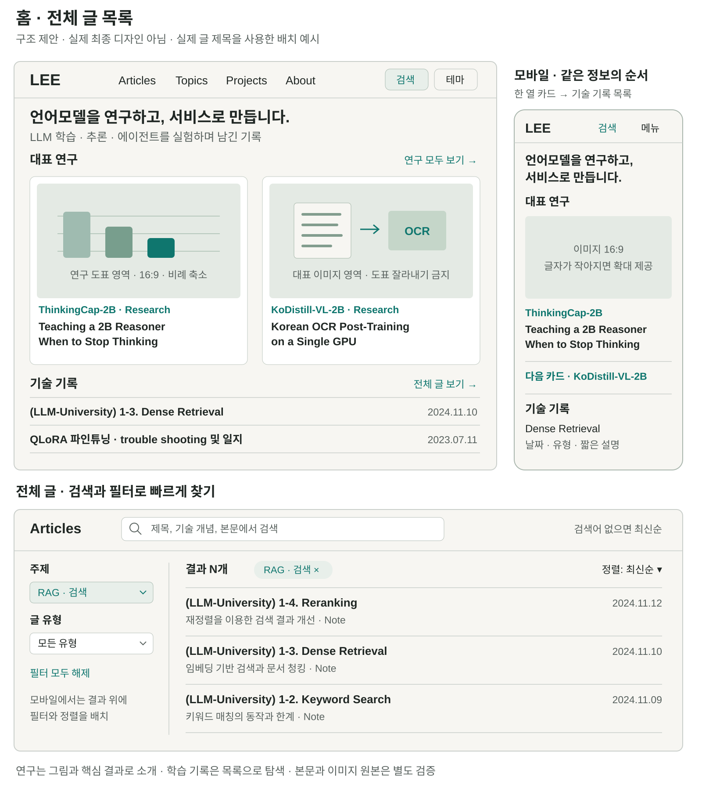
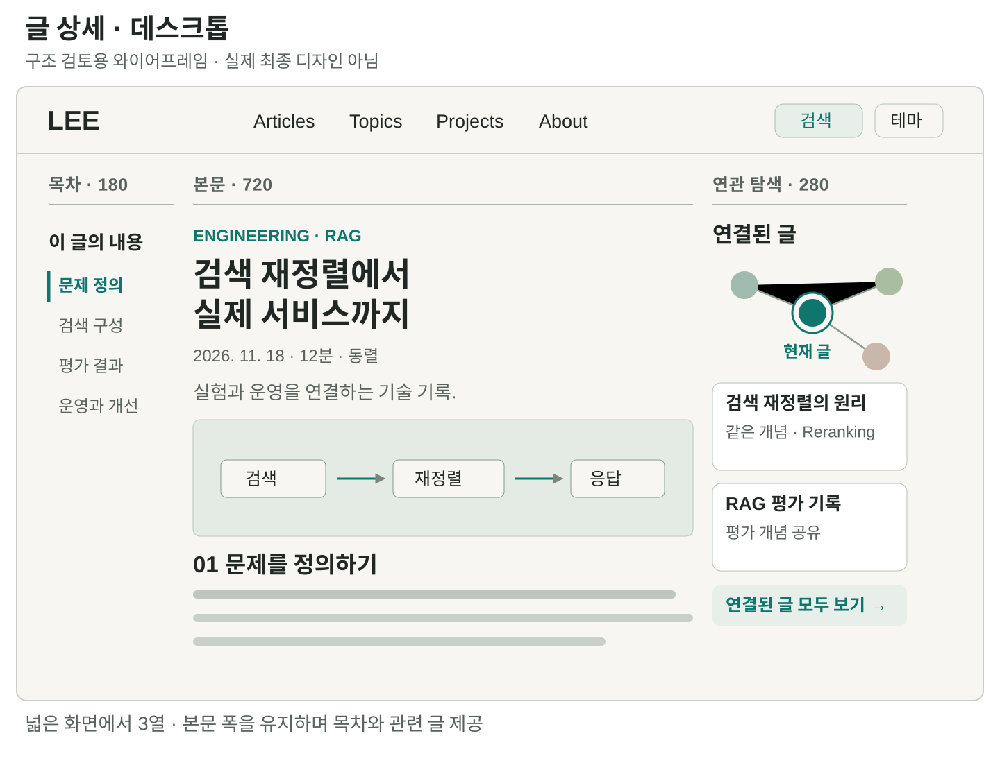
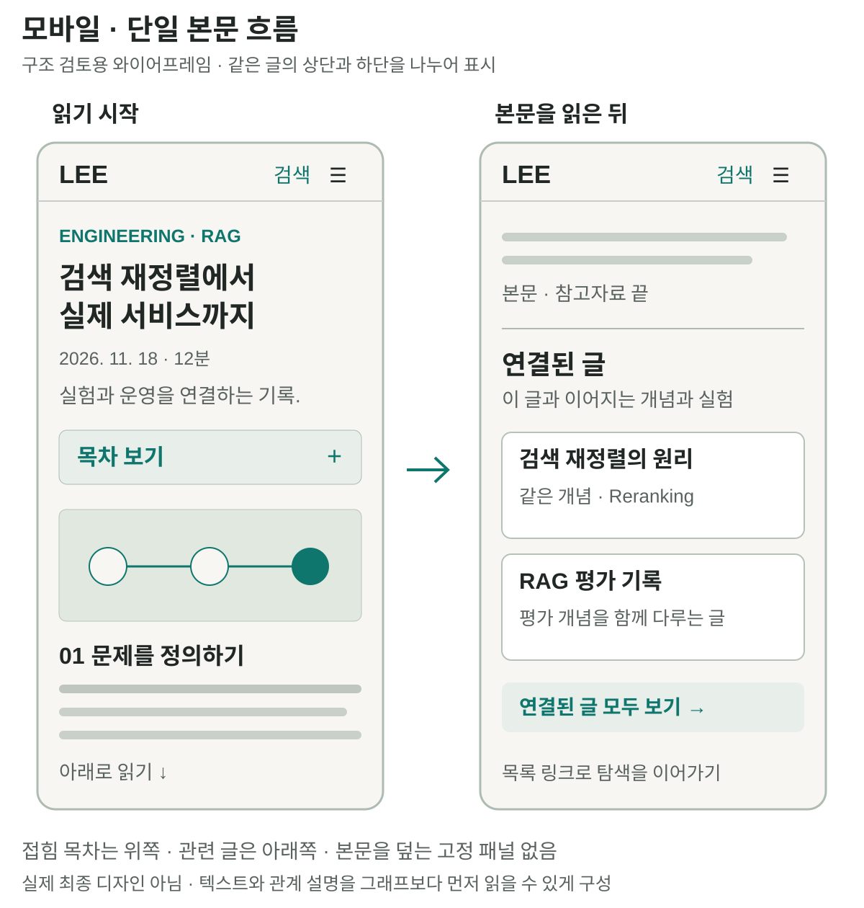

# 기술블로그 리팩토링 화면설계서

작성일: 2026-11-18 · 버전: 1.2 · 대상: DONGRYEOLLEE1.github.io · 문서 상태: 구현 전 화면·동작 기준안

## 1. 문서 사용법과 화면 가정

이 문서는 [리팩토링 계획서](blog-refactoring-plan.md)를 실제 화면으로 구체화한 별도 설계서다. 디자인을 적용한 뒤 방문자가 무엇을 보고, 어떤 제어를 누르며, 그 결과 어디로 이동하는지 화면·기능 단위로 정의한다. 아래 화면은 구현 완료를 가정한 설계이며 현재 서비스에 이미 구현되어 있다는 뜻은 아니다.

화면 식별자는 `SCR-00`부터 부여한다. 각 화면의 기능에는 `H-01`, `D-01` 같은 고유 ID를 부여하며 구현 작업·디자인 검토·버그 보고에서 같은 ID를 사용한다. `ST-`는 공통 상태, `FLOW-`는 방문 시나리오, `QA-`는 완료 확인 항목이다. 이 ID와 내부 기술 용어는 문서에서만 사용하고 블로그 화면에 표시하지 않는다.

최종 화면은 Anthropic Alignment 페이지의 컴포넌트 구조를 참고한 크림색 배경, 검정 활자, 얇은 구분선과 실제 연구 이미지다. 한글·영문은 Pretendard Variable 산세리프로 통일하고 소개·대표 글·카드·상세·메타데이터의 크기·굵기·행간·자간을 [디자인 시스템](blog-design-system.md)에 따라 구분한다. 장식 슬로건·임의 커버 도식·색상 카드 중심의 시안은 사용하지 않는다. 연구는 도표와 결과 중심의 카드로, 일반 기술 기록은 제목과 설명 중심의 목록으로 보여준다. 다크 테마는 동일한 정보와 동작을 유지한다. 상단 메뉴의 기본 언어는 한국어이며 실제 영문 글의 제목·본문은 원문대로 표시한다.

| 구분 | 이 문서의 확정 수준 |
|---|---|
| 정보 구조·기능·전환 | 첫 구현의 기본 계약. 변경 시 관련 기능·검수 항목을 함께 갱신 |
| 문구·배치·노출 수 | 일관된 초기안. 실제 데이터와 기기에서 확인한 후 조정 가능 |
| 도형·색·간격 | 화면을 상상할 수 있게 하는 디자인 기준. 완성된 픽셀 시안은 별도 구현 단계에서 검토 |
| 예시 콘텐츠 | 실제 저장소의 ThinkingCap·KoDistill·LLM University 등을 사용. 설명은 화면용 초안이며 게시 전 작성자가 검토 |
| 수치·추천 결과 | `N개`, `약 N분`은 실제 데이터로 계산할 자리. 임의의 성능·추천 점수·조회 수를 표시하지 않음 |
| 출시 범위 | 공통 화면·글·주제·시리즈·검색·프로젝트 목록이 기본. 검증된 프로젝트 상세는 조건부, 전체 지식 지도는 후속 |

## 2. 화면·기능 인덱스

### 2.1 화면 인덱스

| 화면 ID | 화면 이름 | 진입 경로·조건 | 주요 목적 | 출시 범위 |
|---|---|---|---|---|
| [SCR-00](#screen-00) | 공통 프레임 | 모든 페이지 | 메뉴·검색·테마·푸터를 일관되게 제공 | 첫 출시 |
| [SCR-01](#screen-01) | 홈 | `/` | 작성자의 연구와 최근 글 발견 | 첫 출시 |
| [SCR-02](#screen-02) | 전체 글 | `/articles/` | 검색·주제·유형으로 글 찾기 | 첫 출시 |
| [SCR-03](#screen-03) | 글 상세 | 각 글의 기존 canonical 경로 | 긴 글·코드·수식·도표 읽기 | 첫 출시 |
| [SCR-04](#screen-04) | 관련 글 탐색 | 상세 화면 우측·하단 | 연결 이유를 확인하고 이어 읽기 | 첫 출시 |
| [SCR-05](#screen-05) | 주제 목록 | `/topics/` | 기술 개념별로 탐색 시작 | 첫 출시 |
| [SCR-06](#screen-06) | 주제 상세 | `/topics/[conceptId]/` | 한 개념의 설명·관련 글·인접 개념 탐색 | 첫 출시 |
| [SCR-07](#screen-07) | 시리즈 상세 | `/series/[seriesId]/` | 정해진 순서로 연재 읽기 | 첫 출시 |
| [SCR-08](#screen-08) | 프로젝트 목록 | `/projects/` | 직접 수행한 연구·개발 결과 탐색 | 첫 출시 |
| [SCR-09](#screen-09) | 프로젝트 상세 | `/projects/[projectId]/` | 목적·결과·자료·관련 글을 함께 확인 | 검증된 대표 프로젝트부터 |
| [SCR-10](#screen-10) | 소개 | `/about/` | 연구 방향·작성자·외부 프로필 확인 | 첫 출시 |
| [SCR-11](#screen-11) | 검색 대화상자 | 검색 버튼·단축키 | 현재 글을 떠나기 전 빠른 검색 | 첫 출시 |
| [SCR-12](#screen-12) | 전체 검색 결과 | `/search/?q=...` | 검색 결과의 필터·페이지 이동·공유 | 첫 출시 |
| [SCR-13](#screen-13) | 이미지 확대 | 본문 figure의 확대 버튼 | 도표와 이미지 원본 읽기 | 첫 출시 |
| [SCR-14](#screen-14) | 찾을 수 없는 페이지 | 유효하지 않은 경로 | 검색·목록으로 탐색 회복 | 첫 출시 |
| [SCR-15](#screen-15) | 이전 주소 호환 화면 | 기존 `.html`·태그 fragment·이전 origin | 저장한 링크를 새 글로 연결 | 이전 시 포함 |
| [SCR-16](#screen-16) | 전체 지식 지도 | `/explore/` | 주제·글의 넓은 관계 탐색 | 후속. 첫 메뉴에 노출하지 않음 |

### 2.2 기능 인덱스

아래 표는 기능 명세의 진입점이다. 각 화면의 상세 표에서 개별 ID를 바로 찾을 수 있다. 같은 역할이 여러 화면에서 재사용되면 공통 계약을 참조하고 화면마다 다른 동작만 추가한다.

| 기능 범위 | 화면 | 기능군 |
|---|---|---|
| [G-01](#g-01)~[G-11](#g-11) | [SCR-00 공통 프레임](#screen-00) | 메뉴·전역 검색·테마·모바일 메뉴·푸터·텍스트 선택 |
| [H-01](#h-01)~[H-08](#h-08) | [SCR-01 홈](#screen-01) | 대표 연구·최근 글·주제·프로젝트 |
| [A-01](#a-01)~[A-14](#a-14) | [SCR-02 전체 글](#screen-02) | 검색 제출·주제·유형·조건 해제·정렬·페이지·복원·보기 전환·관계 팝오버 |
| [D-01](#d-01)~[D-15](#d-15) | [SCR-03 글 상세](#screen-03) | 제목·메타데이터·목차·복사·수식·도표·시리즈 |
| [R-01](#r-01)~[R-10](#r-10) | [SCR-04 관련 글 탐색](#screen-04) | 노드·프리뷰·관계 이유·선택·이동·대체 목록 |
| [T-01](#t-01)~[T-07](#t-07) | [SCR-05 주제 목록](#screen-05) | 이름·별칭 찾기·영역·개념 카드 |
| [TD-01](#td-01)~[TD-08](#td-08) | [SCR-06 주제 상세](#screen-06) | 정의·핵심 주제/적용 역할·연결 글·인접 개념·페이지 |
| [S-01](#s-01)~[S-05](#s-05) | [SCR-07 시리즈 상세](#screen-07) | 연재 소개·첫 글·번호 목차·현재 위치 |
| [P-01](#p-01)~[P-06](#p-06) | [SCR-08 프로젝트 목록](#screen-08) | 카드·대표 이미지·코드·모델·연결 글 |
| [PD-01](#pd-01)~[PD-07](#pd-07) | [SCR-09 프로젝트 상세](#screen-09) | 목적·자료·결과·조건·한계·관련 글 |
| [B-01](#b-01)~[B-06](#b-06) | [SCR-10 소개](#screen-10) | 이름·관심사·대표 항목·외부 프로필·선택 연락 |
| [Q-01](#q-01)~[Q-09](#q-09) | [SCR-11 검색 대화상자](#screen-11) | 단축키·입력·빠른 결과·전체 결과·닫기 |
| [QS-01](#qs-01)~[QS-09](#qs-09) | [SCR-12 전체 검색 결과](#screen-12) | 검색 확정·조건·정렬·일치 문맥·페이지·URL |
| [V-01](#v-01)~[V-06](#v-06) | [SCR-13 이미지 확대](#screen-13) | 맞춤·원본 크기·캡션·닫기·원본 링크 |
| [E-01](#e-01)~[E-05](#e-05) | [SCR-14 없는 페이지](#screen-14) | 오류 안내·검색·전체 글·주제 복구 |
| [L-01](#l-01)~[L-06](#l-06) | [SCR-15 이전 주소 호환](#screen-15) | 글별 이동·fragment·이전 메뉴·태그·feed |
| [X-01](#x-01)~[X-06](#x-06) | [SCR-16 전체 지식 지도](#screen-16) | 개념 찾기·범례·선택·중심 변경·목록 보기 |

자주 찾는 기능은 [텍스트 선택](#g-11), [카드·목록 전환](#a-13), [카드 관계 팝오버](#a-14), [목차](#d-06), [코드 복사](#d-08), [관련 노드 선택](#r-03), [관계 이유](#r-06), [검색 입력·한글 조합](#q-03), [전체 검색 필터](#qs-03), [목록 복원](#a-10), [원본 이미지](#v-03), [이전 절 주소](#l-03)다.

## 3. 모든 화면에 적용할 약속

### 3.1 주소·필터·뒤로 가기

| 항목 | 화면 동작 계약 |
|---|---|
| 글 주소 | 기존 canonical 경로를 사용. 새 메뉴 구조를 이유로 기존 글을 모두 `/articles/새슬러그/`로 옮기지 않음 |
| 목록의 조건 | `q`는 검색어, `topic`은 주제 ID, `type`은 글 유형, `sort`는 latest/relevance, `page`는 페이지 번호, `view`는 grid/list 보기 |
| 주제 전용 조건 | 주제 상세의 `role`은 about/applies. 전체 역할은 생략하고 잘못된 값은 전체로 정정. 역할 변경 시 page=1 |
| 복수 선택 | 같은 키를 반복. `topic=rag&topic=reranking`은 두 주제 중 하나, 주제와 유형을 함께 고르면 두 축을 모두 만족 |
| 검색어 제출 | 전체 글·전체 검색·주제 이름 찾기는 입력 중인 초안과 제출된 검색어를 분리. Enter 또는 검색 버튼으로 제출해야 목록·결과 수·URL이 함께 바뀜 |
| 검색어 길이 | 앞뒤 공백을 제거한 뒤 최대 200자. 초과 시 입력 아래에 수정 안내를 표시하고 이동·잘라내기를 수행하지 않음 |
| 한국어 입력 | 조합 중 Enter는 조합 완료만 수행. 조합 완료 전 검색 확정·페이지 이동을 수행하지 않음 |
| 기본 정렬 | 전체 글·전체 검색 결과에 적용. 검색어가 없으면 최신순, 있으면 관련도순. 명시적으로 바꾸면 URL에 보존. 주제 목록·시리즈는 각 화면의 편집·연재 순서 사용 |
| 정렬 제한 | 전체 글·전체 검색에서 검색어가 없으면 관련도순 항목을 제공하지 않음. relevance만 주소에 들어오면 최신순으로 정정 |
| 페이지 크기 | 전체 글·주제 상세 12개, 전체 검색 결과 10개. 시리즈는 순서가 중요하므로 전체 연재 목록을 제공 |
| 조건 변경 | 필터·검색어·정렬을 변경하면 page=1. 선택 해제 칩도 같은 규칙 적용 |
| 보기 전환 | view=grid/list. 보기만 바꾸면 q·topic·type·sort·page 유지. 공유 URL과 뒤로 가기에 반영하며 모두 해제는 보기 유지 |
| 주소 기록 | 검색 제출·필터 선택·페이지 변경은 방문 기록에 한 번 추가. 기본값 보완·잘못된 값 제거는 현재 기록을 정정 |
| 뒤로 가기 | 조건·페이지·선택 제어·결과를 동일하게 복원. 같은 탭에서 글을 읽고 돌아오면 기존 목록 위치도 복원 |
| 새 탭·공유 URL | 목록 조건은 복원하되 임의의 이전 스크롤 위치는 적용하지 않음 |
| 유효하지 않은 조건 | 없는 주제·유형은 제외하고 `일부 조건을 사용할 수 없어 해제했어요.` 안내. 주제 경로 자체가 없는 경우는 SCR-14 |
| 범위를 벗어난 페이지 | 결과가 있으면 마지막 유효 페이지로 정정. 결과가 없으면 1페이지의 결과 없음 상태. 변경된 URL을 반복 기록하지 않음 |
| 기본값의 주소 표현 | 기본 정렬·page=1·빈 q는 생략 가능. 복사한 주소와 화면 상태가 같은 결과를 나타내야 함 |
| 필터 없는 페이지 탐색 | 전체 글의 기본 페이지는 `/articles/page/2/` 같은 정적 페이지 링크도 제공. JavaScript 실패 시에도 공개 글을 차례로 찾을 수 있게 함 |
| 필터가 있는 페이지 탐색 | `/articles/?topic=rag&type=implementation&page=2` 등 조건을 포함한 주소로 상태 유지. JavaScript가 없으면 필터 안내와 기본 목록 링크 제공 |

예를 들어 전체 글에서 `Reranking` 주제와 `학습 노트` 유형을 고르면 두 조건을 만족하는 글만 남는다. 그 상태에서 글을 열고 뒤로 돌아오면 같은 조건과 읽던 목록 위치로 복귀한다. 글의 제목 링크는 일반 링크이므로 새 탭 열기·주소 복사도 그대로 동작한다.

### 3.2 화면 문구와 콘텐츠 표시

| 항목 | 표시 규칙 |
|---|---|
| 사이트 이름·메뉴 | 워드마크 동렬, 메뉴는 `글 · 주제 · 프로젝트 · 소개`. 영문 메뉴와 페이지별 혼용하지 않음 |
| 글 유형 | research=연구, paper-review=논문 리뷰, implementation=구현기, troubleshooting=문제 해결, note=학습 노트 |
| 날짜 | 목록·카드는 `2026.11.05`, 상세는 `2026년 11월 5일`. 화면과 보조 설명의 의미가 같아야 함 |
| 수정일 | 실제 내용 수정 이력이 있는 경우만 `수정 ...` 표시. 재배포일을 수정일로 표시하지 않음 |
| 읽기 시간 | 본문 기준 추정값을 `약 N분`으로 표시. 계산할 수 없는 경우 생략 |
| 글 언어 | 영문 글은 필요 시 `EN`과 보조 설명 `영문 글` 표시. 원문 제목을 자동 번역해 원래 제목을 대체하지 않음 |
| 카드 제목 | 완전한 원문 제목 사용. 목록은 가능한 줄바꿈, 연구 카드는 최대 3줄. 전체 제목은 접근 가능한 링크 이름으로 보존 |
| 카드 요약 | 사람이 확인한 1~2문장. 간결한 카드형은 기본적으로 요약을 생략하고 목록형·검색 결과에서 표시. 본문 첫 문장을 무조건 자르거나 임의 결과 수치를 생성하지 않음 |
| 썸네일 없음 | 여백·구분선·타이포로 성립하는 카드. 모든 과거 글에 임의 커버나 같은 기본 이미지를 붙이지 않음 |
| 연구 도표 | 아카이브 카드는 1:1, 홈 대표·프로젝트의 넓은 미디어는 16:9 역할로 구별. 도표는 contain으로 보존하고 의미 있는 축·범례를 자르지 않음. 사진만 cover 허용 |
| 개수 | 현재 공개 글과 유효한 연결만 계산. 임시 숫자·추천 정확도·가짜 조회 수를 표시하지 않음 |
| 빈 값 | 빈 날짜 행·비활성 외부 링크·빈 프로젝트 카드를 만들지 않고 해당 요소 생략 |
| 관계 문구 | `같은 주제`, `적용 사례`, `본문에서 연결한 글` 등 근거 있는 표현. 유사도만으로 `선행 연구`, `후속 연구`를 만들지 않음 |
| 공급자·처리 상태 | 검색·추천의 기술 공급자명과 처리 버전은 방문자 화면에 노출하지 않음. 오류는 사용자가 취할 수 있는 행동으로 설명 |

### 3.3 배치·테마·접근성

| 화면 조건 | 공통 배치 |
|---|---|
| 1440px 이상 | 최대 약 1360px 프레임. 상세는 목차 180px·본문 720px·관련 영역 280px 중심 |
| 1120~1439px | 본문+우측 관련 영역. 목차는 제목 아래 접힘 영역으로 이동 |
| 768~1119px | 본문 한 열. 관련 영역은 하단으로 이동. 목록 필터는 위쪽 접힘 영역 사용 가능 |
| 767px 이하 | 좌우 약 20px, 헤더 약 56~64px. 카드·목록 한 열, 터치 제어의 실제 목표 영역 확보 |
| 낮은 화면·확대 | 전체 영역을 가리는 sticky 해제. 목차·메뉴·관련 글은 내부 스크롤 또는 일반 문서 흐름으로 접근 가능 |
| 글꼴·글자 역할 | 한글·영문 UI는 Pretendard Variable 자체 호스팅. 상세 H1 한글 42px/650·영문 44px/650, 카드 18px/650, 메타데이터 12px/450. 모바일 제목은 각각 30px·17px·12px |
| 본문 글자 | 한글 데스크톱 18px/400·행간 1.85·자간 -0.005em, 영문 17px/400·1.8·자간 0. 모바일 두 언어 17px·행간 1.85. 나머지는 디자인 시스템 §3 참조 |
| 연구 아카이브 | 1440px 이상 4열·간격 16px, 1120~1439px 3열·16px, 768~1119px 2열·20px, 767px 이하 1열. 상세 그리드와 별도 계약 |
| 텍스트 선택 | 밝게 배경 #D6EAE4·글자 #122F29, 어둡게 #315E53·#F4FAF7. 본문·입력·코드 전체 선택과 원문 복사 유지 |
| 테마 | 시스템·밝게·어둡게. 사용자가 고른 값은 같은 브라우저에서 유지. 시스템 선택 때만 OS 변화 반영 |
| 포커스 | 모든 제어에 보이는 포커스. 숨겨진 메뉴·접힌 패널에 초점이 들어가지 않음 |
| 링크와 버튼 | 이동은 링크, 같은 화면 상태 변경은 버튼. 카드 안 주제 링크를 또 다른 링크로 감싸지 않음 |
| 모달 대화상자 | 검색·이미지 확대는 배경 조작 차단, 열기 전 초점 기억, Escape·닫기 버튼, 닫은 후 초점 복원. 대화상자를 중첩하지 않음 |
| 카드 관계 팝오버 | 비모달 확장 영역으로 한 번에 하나만 열림. 버튼의 열린 상태·이름, Escape·바깥 클릭·닫기·초점 복귀를 제공하고 뷰포트 밖 잘림 방지 |
| 애니메이션 | 최소 전환만 사용. 모션 감소 설정에서 불필요한 이동·자동 순환 없음 |
| 표·코드 | 내부 가로 스크롤. 페이지 전체가 옆으로 밀리지 않음. 키보드로도 숨은 내용을 확인 가능 |
| 비스크립트 상태 | 본문·일반 메뉴 링크·기본 목록·주제·관련 글 링크를 제공. 검색·확대 같은 부가 동작은 대체 경로 안내 |

### 3.4 공통 상태 이름

| 상태 ID | 상태 | 방문자가 보는 것 | 복구·다음 행동 |
|---|---|---|---|
| ST-01 | 정상 | 실제 콘텐츠와 활성 제어 | 일반 탐색 |
| ST-02 | 입력 전 | 검색어 안내·주요 주제. 빈 결과라는 표현은 쓰지 않음 | 입력·주제 선택 |
| ST-03 | 처리 중 | 해당 영역의 짧은 진행 안내. 다른 본문까지 가리지 않음 | 완료를 기다리거나 다른 메뉴 사용 |
| ST-04 | 결과 없음 | 적용한 검색어·조건과 `조건에 맞는 글이 없어요.` | 검색어 수정·필터 해제·주제 이동 |
| ST-05 | 부가 기능 오류 | 본문은 유지하고 해당 기능만 안내 | 다시 시도·대체 링크 사용 |
| ST-06 | 콘텐츠 미존재 | 찾을 수 없는 페이지 | 검색·전체 글·홈 |
| ST-07 | 데이터 일부 없음 | 없는 메타데이터·이미지·링크만 생략 또는 대체 표시 | 나머지 콘텐츠 탐색 |
| ST-08 | JavaScript 사용 불가 | 정적 본문과 기본 링크. 동작하지 않는 제어는 숨김 또는 대체 안내 | 기본 목록·원본 이미지·주제 탐색으로 이동 |

## 4. SCR-00 공통 프레임

모든 페이지는 중앙의 동렬 워드마크, 왼쪽 메뉴, 오른쪽 검색·테마 제어로 시작한다. 모바일에서는 메뉴를 접고 워드마크와 필수 제어를 유지한다. 메뉴는 얇은 하단 선으로 본문과 구분한다. 글 상세를 스크롤해도 헤더는 읽는 공간을 과도하게 차지하지 않는 높이로 남는다. 콘텐츠 끝에는 소개·외부 프로필·RSS·맨 위로 이동이 있는 간결한 푸터가 보인다.

| 기능 ID | 요소·배치 | 표시·조건 | 사용자 동작과 결과 |
|---|---|---|---|
| G-01 | 동렬 워드마크·헤더 중앙 | 모든 페이지에서 동일한 텍스트·크기 위계 | 홈 링크로 이동. 이미지 로고를 못 읽어도 사이트 이름 식별 |
| G-02 | 기본 메뉴·헤더 왼쪽 | 글·주제·프로젝트·소개. 현재 상위 영역은 밑줄과 현재 페이지 의미로 표시 | 각 목록으로 이동. 글 상세는 글 메뉴, 주제 상세는 주제 메뉴 활성 |
| G-03 | 전역 검색 버튼 | 아이콘과 접근 가능한 이름 `검색 열기`. 넓은 화면에 단축키 힌트 | SCR-11 열기. 스크립트 실패 때는 `/search/` 링크와 대체 탐색 제공 |
| G-04 | 테마 선택 | 현재 모드 이름, 시스템·밝게·어둡게의 단일 선택 | 선택 즉시 전체 화면 갱신. 닫은 후 테마 버튼으로 초점 복귀 |
| G-05 | 모바일 메뉴 버튼 | 좁은 화면에서 일반 메뉴를 대체. 검색 버튼은 별도 유지 | `메뉴`를 누르면 헤더 아래 패널. 같은 버튼·Escape·다른 링크 선택으로 닫힘 |
| G-06 | 본문 바로가기 | 키보드 탐색 시작 시 헤더 앞에 표시 | 선택하면 현재 페이지의 main 제목 또는 main 영역으로 초점 이동 |
| G-07 | breadcrumb | 홈 이외 세부 화면에서 필요한 상위 경로만 | 상위 화면 일반 링크. 마지막 현재 항목은 링크가 아니며 긴 글 제목 전체를 반복하지 않음 |
| G-08 | 푸터 | 작성자명·소개·GitHub·Hugging Face·RSS. 검증된 외부 URL만 노출 | 각 자료 열기. 외부 링크 아이콘만으로 목적지를 숨기지 않음 |
| G-09 | 현재 위치·페이지 제목 | 브라우저 제목은 `화면 또는 글 제목 · 동렬` | 탭 전환·공유·보조기기에서 어떤 페이지인지 구별 |
| G-10 | 맨 위로 | 푸터의 텍스트 링크. 읽는 중 화면을 가리는 부유 버튼은 기본 범위에서 제외 | 문서 시작의 제목 위치로 이동. 모션 감소 설정 반영 |
| G-11 | 텍스트 선택 색상 | 밝게 #D6EAE4/#122F29, 어둡게 #315E53/#F4FAF7의 배경/글자. 제목·본문·입력·코드 및 문법 강조 요소에 공통 적용 | 드래그·키보드 선택 시 가독성 유지. 선택을 막거나 원문 복사를 바꾸지 않음. Firefox도 동일 의미 |

모바일 메뉴는 모달 대신 헤더 아래 펼침 패널로 시작한다. 메뉴를 열어도 문서가 옆으로 밀리지 않으며 버튼의 펼침 상태와 패널의 표시 상태가 일치한다. 검색을 열면 메뉴·테마 팝업을 먼저 닫아 중복된 초점 영역을 만들지 않는다.

| 상태 | 구체 동작 |
|---|---|
| 테마 값 저장 실패 | 현재 페이지에서는 선택을 적용. 저장 실패를 이유로 본문을 막거나 경고 팝업을 띄우지 않음 |
| 운영체제 다크 변경 | 시스템 모드만 따라감. 사용자가 고른 밝게·어둡게 선택을 덮어쓰지 않음 |
| 헤더 고정·앵커 이동 | 제목과 키보드 초점이 헤더 뒤에 완전히 가려지지 않게 위치 조정 |
| 모바일 메뉴 열린 상태에서 화면 확장 | 데스크톱 메뉴로 전환하고 임시 펼침 상태 정리. 숨은 버튼에 초점을 남기지 않음 |
| 외부 프로필 정보 없음 | 해당 링크 생략. 클릭할 수 없는 회색 버튼이나 `#` 링크를 만들지 않음 |

## 5. SCR-01 홈

### 5.1 완성 화면 가정

첫 화면은 중앙 작성자 이름과 좌우 내비게이션, 크림색 배경의 소개 문장으로 시작한다. 소개는 36px/450·행간 1.45·자간 -0.02em, 첫 구절만 650이며 모바일에서는 26px·행간 1.5다. 대표 영역은 최신 책등 인식 연구의 실제 실험 이미지와 원문 제목·설명을 나란히 배치한다. 대표 제목은 30px/650, 보조 글 제목은 20px/650로 구분한다. 그 아래 연구 아카이브는 메타데이터·정사각 실제 이미지·18px/650 제목을 중심으로 넓은 화면에서 4열까지 연결한다. 일반 최근 기록은 커버를 반복하지 않는 제목·설명 목록을 사용한다.

색상 배지와 임의 영문 슬로건을 제거하고 콘텐츠 자체의 제목·사진·글자 위계로 구분한다. 모바일에서는 같은 순서로 한 열 배치한다. 아래 구조도는 초기 기능 배치 참고이며 최종 시각 방향은 [최신 목업](preview/index.html)을 기준으로 한다.

### 5.2 화면 영역과 기능

| 기능 ID | 요소·배치 | 표시·조건 | 사용자 동작과 결과 |
|---|---|---|---|
| H-01 | 작성자 소개·본문 첫 영역 | Pretendard 36px/450의 소개와 관심사 보조 문장. 모바일 26px. 첫 구절만 650 | `소개 보기` 링크는 SCR-10. 큰 장식 이미지로 첫 콘텐츠를 밀어내지 않음 |
| H-02 | 대표 연구 카드 | 주요 글 1편과 보조 글 3편. 주요 제목 30px/650, 보조 제목 20px/650, 설명 16px/400·메타데이터 12px/450. 주요 글은 실제 이미지로 표현 | 제목 또는 대표 이미지에서 기존 글 경로의 SCR-03으로 이동 |
| H-03 | 연구 카드 보조 정보 | `연구`, `EN`, 핵심 주제 2~3개. 결과 수치를 넣으려면 본문과 평가 조건 검토 필요 | 주제는 SCR-06 링크. 카드 전체 링크와 겹쳐 클릭되지 않게 분리 |
| H-04 | 최근 글 목록 | 최신 공개 글 6개. 제목·설명·날짜·유형. 대표 연구도 실제 최신 글이면 포함 가능 | 제목은 SCR-03. 최근 목록에서는 커버를 다시 반복하지 않음 |
| H-05 | `전체 글 보기` | 최근 글 제목 옆 또는 목록 끝에 한 번 | 조건 없는 SCR-02로 이동. 이전 방문의 숨은 필터를 자동 적용하지 않음 |
| H-06 | 주요 주제 | 실제 글이 연결된 핵심 개념 최대 6개. 이름·짧은 설명·공개 글 수 | 선택 주제의 SCR-06으로 이동. 상위 주제와 하위 개념을 모두 같은 태그 구름에 섞지 않음 |
| H-07 | 주요 프로젝트 | 검증된 프로젝트 최대 3개. 이름·목적·연결 자료 | 상세가 있으면 SCR-09. 없으면 명시적으로 `관련 글`·`코드` 같은 실제 목적 링크 제공 |
| H-08 | 섹션별 더 보기 | 연구는 `연구 글 보기`, 주제는 `주제 모두 보기`, 프로젝트는 `프로젝트 모두 보기` | 각각 `/articles/?type=research`, SCR-05, SCR-08로 이동 |

ThinkingCap 카드의 표시 예시는 `ThinkingCap-2B`와 원문 제목 `Teaching a 2B Reasoner When to Stop Thinking`이다. KoDistill 카드는 `KoDistill-VL-2B: Korean OCR Post-Training on a Single GPU`를 사용한다. 글 읽기 시간·주제 수·대표 지정 순서는 새 메타데이터를 검토한 뒤 표시하며 현재 문서에서 임의로 확정하지 않는다.

### 5.3 상태·반응형·완료 기준

| 상황 | 표시·복구 규칙 |
|---|---|
| 대표 연구 1개 | 빈 두 번째 카드를 두지 않고 넓은 단일 카드로 구성 |
| 대표 연구 없음 | 대표 영역 생략. 최근 글부터 시작하며 최신 글을 임의의 대표 연구로 지정하지 않음 |
| 커버 실패 | 카드 크기 급변 방지. 제목·설명·읽기 링크는 유지하고 반복 재요청 아이콘을 표시하지 않음 |
| 주제·프로젝트 일부 없음 | 검증된 항목만 노출. 홈 전체를 준비 중 화면으로 바꾸지 않음 |
| 모바일 | 카드 한 열, 본문 문구 우선, 이미지 뒤 제목으로 읽기 순서 일치. 필수 설명을 hover 안에 숨기지 않음 |
| 완료 확인 | 최초 화면에서 글 제목과 읽기 링크가 보임. 첫 연구 카드·최근 글·주제·프로젝트 중 하나씩 실제 이동 가능 |

## 6. SCR-02 전체 글

### 6.1 완성 화면 가정

상단에 `전체 글` 제목과 `연구와 구현, 문제 해결 과정을 모았습니다.`라는 설명이 보인다. 검색 입력과 주제·글 유형 필터 아래에는 결과 수, 적용된 조건 칩, 정렬이 놓인다. 처음에는 전체 공개 글을 최신순 카드형으로 보여준다. 각 카드는 메타데이터·관계 탐색 버튼, 선택적 정사각 이미지, 제목 순서이며 긴 요약을 반복하지 않는다. 카드형·목록형 전환은 결과 수와 정렬 옆에 둔다. 목록형에서는 이미지 대신 제목·1~2문장 설명·유형·게시일·주제 링크를 보여준다.

예를 들어 주제 `Reranking`을 고르면 LLM University의 재정렬 학습 글과 개념 연결을 검토한 적용 사례가 보인다. `논문 리뷰`를 추가했을 때 결과가 없다면 입력한 조건과 해제 버튼을 보여준다. 결과 수는 현재 데이터에서 계산하고 이 문서의 예시를 숫자로 고정하지 않는다.

### 6.2 화면 영역과 기능

| 기능 ID | 요소·배치 | 표시·조건 | 사용자 동작과 결과 |
|---|---|---|---|
| A-01 | 화면 제목·설명 | 전체 글의 목적과 현재 전체 공개 글 수 | 제목은 한 번만 H1. 필터 변화는 아래 결과 영역에 반영 |
| A-02 | 글 검색 입력 | placeholder `제목, 기술 개념, 본문에서 검색`과 검색 버튼 | Enter·검색 버튼으로 q 확정. 결과·개수·주소를 함께 바꾸고 첫 페이지로 이동 |
| A-03 | 주제 필터 | 공개 글이 있는 정규 개념. 복수 선택·선택 해제 가능. 개념 검색은 항목이 많을 때 제공 | 같은 축 OR로 적용. 상위 주제 선택 시 하위 개념 포함 여부를 항목 옆 설명으로 표시 |
| A-04 | 글 유형 필터 | 연구·논문 리뷰·구현기·문제 해결·학습 노트의 복수 선택 | 같은 축 OR, 주제 축과 AND. 날짜와 별개로 유형을 선택 |
| A-05 | 적용된 조건 칩 | 주제·유형·제출된 검색어를 실제 라벨로 표시 | 칩별 제거 버튼은 해당 조건만 해제하고 page=1. 아이콘의 이름에 해제할 조건 포함 |
| A-06 | `모두 해제` | 현재 검색어·필터가 있을 때만 | q·topic·type·정렬을 기본값으로 되돌리고 첫 페이지 표시. view와 화면의 다른 탐색 기록은 유지 |
| A-07 | 결과 수·정렬 | `N개의 글`, 검색어 없음=최신순, 검색어 있음=관련도순·최신순 | 정렬 변경은 기존 q·필터 유지하고 첫 페이지로 이동 |
| A-08 | 글 카드·목록 | 카드형은 메타데이터 12px/450→선택적 1:1 미디어→제목 18px/650. 목록형은 제목·14px/400 설명·유형·게시일·주제 최대 3개. 모바일 제목 17px | 제목은 SCR-03. 주제는 SCR-06. 없는 이미지는 가짜 커버 없이 텍스트 카드로 표시. 카드 안 중첩 링크 없음 |
| A-09 | 페이지 탐색 | 12개 단위, 이전·다음·현재 페이지·필요한 인접 페이지. 한 페이지면 생략 | 선택 페이지와 URL 동기화. 사용자 선택에 한해 결과 제목으로 스크롤·초점 안내 |
| A-10 | 목록 복원 | 같은 탭에서 목록→글→뒤로 가기 | 제출한 q·필터·정렬·페이지와 목록 위치 복원. 앞서 누른 글을 찾기 쉽게 유지 |
| A-11 | 모바일 필터 접기 | `필터 N개` 버튼과 펼침 영역. q·결과 수는 접어도 보임 | 체크 선택은 즉시 반영. 별도 적용 버튼과 즉시 적용을 혼용하지 않음. `필터 접기`로 닫아도 선택 유지 |
| A-12 | 목록 주소 공유 | 브라우저 주소에 확정된 조건과 보기만 | 복사한 URL을 새 탭에서 열어 같은 조건·정렬·페이지·보기 표시. 저장된 이전 로컬 필터로 덮어쓰지 않음 |
| A-13 | 카드형·목록형 전환 | 결과 수·정렬 옆에 두 선택 버튼과 현재 선택 표시. grid/list 두 가지이며 연구는 카드형, 전체 글·일반 기록은 목록형이 기본 | view만 바꾸고 q·topic·type·sort·page 유지. URL 공유·뒤로 가기로 같은 보기 복원. 목록형은 넓은 화면에서 메타데이터 140px 열과 내용 열, 모바일은 한 열 |
| A-14 | 카드 관계 탐색 버튼·팝오버 | 메타데이터 행의 더 보기 버튼. 폭 336px에서 글 요약·미니 그래프·연결 글 제목·관계 이유 제공. 화면 경계에서 위치 조정 | 버튼으로 열기·닫기, Escape·바깥 클릭·닫기 제공. 열린 이름·상태를 알리고 닫으면 트리거로 초점 복귀. 그래프 선택과 글 링크 이동은 분리. R-01~10과 같은 검증된 관계 사용 |

주제 목록의 상위 개념을 선택하면 검증된 하위 개념을 포함해 조회하는 것을 기본으로 한다. 예를 들어 `RAG·검색`은 연결된 검색 개념을 함께 포함하지만 `retrieval`이라는 문자열이 있다는 이유로 attention-head 연구를 포함하지 않는다. 주제별 글 수와 필터 결과는 같은 포함 규칙을 사용한다.

### 6.3 상태·반응형·완료 기준

| 상태·상황 | 화면 표현 | 사용자 행동·기대 결과 |
|---|---|---|
| 최초 진입 | 기본 목록 즉시 표시, 조건 없음, 최신순 | 검색·필터 없이도 모든 글을 페이지로 탐색 |
| 제출 전 입력 | 입력란은 초안, 결과 제목·숫자는 마지막 제출 조건 기준 | 제출하면 한 번에 갱신. 초안만으로 다른 결과의 개수를 표시하지 않음 |
| 계산·검색 대기 | 결과 영역의 `글을 찾고 있어요.`. 기존 결과를 유지한다면 갱신 중임을 명시 | 중복 클릭을 강요하지 않음. 마지막으로 확정한 요청만 반영 |
| 결과 없음 | `조건에 맞는 글이 없어요.`와 적용 조건 | A-06의 `모두 해제`로 검색어·필터를 초기화하거나 검색어를 수정. 최근 글을 검색 결과처럼 섞지 않음 |
| 잘못된 필터 URL | 유효한 나머지 조건으로 표시, 수정 안내 한 번 | 주소 정정 후 새로고침해도 같은 결과 |
| 잘못된 보기 URL | view가 grid/list가 아니면 기본 카드형으로 정정 | 나머지 검색어·필터·정렬·페이지 유지. 방문 기록을 반복 추가하지 않음 |
| 카드 관계 없음·오류 | 검증된 관계가 없으면 연결 글 없음 안내. 부가 데이터 오류 때는 카드의 제목·본문 이동 유지 | 임의의 최신 글을 관계로 채우지 않음. 닫기와 원래 카드로 초점 복귀 가능 |
| 검색 기능 오류 | 해당 검색 영역 오류와 다시 시도. 탐색 가능한 기본 목록·주제 링크 유지 | 오류를 결과 0개로 표시하지 않음 |
| 375px 폭·확대 | 검색과 필터를 위쪽 한 열로 배치, 제목 자연 줄바꿈 | 페이지 전체 가로 넘침 없이 모든 제어 사용 |
| JavaScript 없음 | 기본 페이지 링크와 정적 글 목록 | 현재 글을 읽거나 다음 기본 목록으로 이동. 필터가 적용된 것처럼 표시하지 않음 |

완료 기준은 필터 교집합의 정확성, 주제·유형 해제, 현재 조건·보기의 공유, 한글 입력 제출, 페이지 이동 후 복원이다. 카드형의 4/3/2/1열, 목록형의 설명, 관계 팝오버의 키보드·터치·닫기 후 초점 복귀를 함께 확인한다. 목록 이미지가 없는 과거 글도 제목과 설명만으로 읽기 좋게 보여야 한다.

## 7. SCR-03 글 상세

독자가 검색이나 목록에서 글을 연 직후부터 본문을 끝내고 다음 글로 이동할 때까지의 화면이다. 주소는 글별로 확정한 기존 공개 경로를 유지한다. 한국어 기술 기록과 영어 연구 글은 같은 틀을 사용하며 실제 본문 언어에 맞게 표시한다.

### 7.1 완성 화면 가정과 정보 순서

LLM University의 Reranking 글을 열면 상단에 `글 > LLM University` 경로와 게시일·글 유형·읽기 시간이 먼저 보인다. 제목 아래에는 해당 글의 짧은 설명과 `Reranking` 등의 검증된 주제가 놓인다. 본문을 읽는 동안 넓은 화면의 왼쪽에는 목차, 오른쪽에는 `이 글에서 이어 읽기`가 보인다. 본문 끝에서는 같은 시리즈의 이전 글인 Dense Retrieval과 다른 관련 글을 발견할 수 있다. 표시하는 요약·주제는 이전 작업에서 확인한 값을 사용하며 이 예시를 임의의 성능·실험 결과로 채우지 않는다.

| 위에서 아래 순서 | 실제로 보이는 영역 | 배치 의도 |
|---|---|---|
| 1 | 공통 헤더와 breadcrumb | 어디에 있는지 알리고 목록·시리즈로 돌아갈 경로 제공 |
| 2 | 글 유형, 게시일, 선택적 수정일, 읽기 시간 | 오래된 기술 기록의 시점을 본문 전에 확인 |
| 3 | 제목, 짧은 설명, 주제 링크, 선택적 대표 이미지 | 글의 내용과 읽을 이유를 먼저 파악 |
| 4 | 목차·본문·관련 탐색 | 본문을 중심으로 탐색 도구 배치 |
| 5 | 시리즈 이동, 관련 글 목록, 작성자·연결 프로젝트 | 글을 끝낸 뒤의 다음 행동 제공 |
| 6 | 공통 푸터 | 외부 프로필과 RSS 연결 |

### 7.2 기능 명세

| ID | 요소·배치 | 표시·조건 | 사용자 동작과 결과 |
|---|---|---|---|
| D-01 | breadcrumb, 제목 위 | 기본 `글`; 시리즈가 있으면 시리즈명 추가 | 글은 전체 글 목록, 시리즈명은 해당 시리즈 상세로 이동 |
| D-02 | 글 메타데이터 | 12px/450·행간 1.5·자간 +0.01em. 게시일 항상 표시, 수정일은 실제 변경 기록이 있을 때만 표시 | 날짜를 읽어 적용 시점 판단. 빌드 날짜를 수정일로 표시하지 않음 |
| D-03 | 제목과 설명 | H1은 한글 42px·영문 44px/650·행간 1.2·자간 -0.025em. 모바일은 두 언어 30px·1.25. 설명은 16px/400·행간 1.75, 모바일 15px | 제목 전체가 줄바꿈되어 보이며 긴 영문 제목도 페이지를 넘치지 않음 |
| D-04 | 주제 링크 | 검증된 핵심 개념 3~5개를 우선 표시 | `Reranking` 선택 시 해당 주제 상세로 이동. 글 유형은 주제와 다른 표현으로 표시 |
| D-05 | 선택적 대표 이미지 | 이미지가 있는 글만 제목 아래 표시. 도표는 비율 유지 | 확대 가능한 이미지 선택 시 SCR-13 열기. 없는 글은 빈 프레임 없이 본문 시작 |
| D-06 | 목차 | 본문 heading이 2개 이상일 때 제공. H2·H3까지 기본 노출 | 항목 선택 시 해당 절로 이동하고 URL fragment 반영. 현재 절은 글자·표시선으로 구별 |
| D-07 | 본문 heading의 링크 | heading 옆에 절 링크 복사 제어 제공. 초점·hover에도 노출 | 선택한 절의 주소를 복사. 복사 성공은 `절 링크를 복사했어요`로 알림 |
| D-08 | 코드 블록 | 코드 언어와 복사 버튼을 상단에 배치 | 복사는 화면 강조 표시가 아닌 원문 코드만 저장. 긴 코드는 블록 내부에서 가로 스크롤 |
| D-09 | 표와 수식 | 표 제목·수식 설명이 있으면 함께 표시 | 넓은 표·수식은 필요한 영역 안에서 스크롤. 본문 전체가 가로로 밀리지 않음 |
| D-10 | 본문 figure·caption | 이미지 비율, alt, 출처·캡션 유지 | 이미지 확대는 SCR-13. 출처와 다운로드는 목적이 명확한 별도 링크 |
| D-11 | 코드·모델·데이터 링크 | 원문에 실제로 연결된 자료만 표시 | `코드 보기`, `모델 보기`, `결과 CSV 다운로드`처럼 대상을 표시하고 일반 링크 동작 지원 |
| D-12 | 글 주소 복사 | 제목 영역의 작은 액션 | 현재 글의 정식 주소를 복사. 절 복사와 구별하고 미리보기 전용 호스트를 공유 주소로 쓰지 않음 |
| D-13 | 시리즈 이전·다음 | 시리즈 글에서만 본문 뒤 표시 | 명시된 연재 순서로 이동. 첫 글의 이전·마지막 글의 다음은 빈 버튼으로 만들지 않음 |
| D-14 | 하단 관련 글 | SCR-04와 동일한 추천 목록 사용 | 넓은 화면에서는 간결한 제목·이유 목록, 좁은 화면에서는 주 탐색 카드. 같은 카드 세트를 두 번 크게 반복하지 않음 |
| D-15 | 작성자와 연결 프로젝트 | 작성자 소개 링크와 검증된 프로젝트만 표시 | 소개 또는 프로젝트 상세로 이동. 등록된 프로젝트 상세가 없으면 외부 코드·모델 링크로 직접 이동 |

### 7.3 크기별 배치

| 화면 조건 | 목차 | 본문 | 관련 영역 |
|---|---|---|---|
| 1440px 이상 | 왼쪽 약 180px, sticky | 최대 720px | 오른쪽 약 280px, sticky |
| 1120~1439px | 제목 아래 접힘 목차 | 최대 720px | 오른쪽 유지 |
| 768~1119px | 본문 시작 전 접힘 목차 | 단일 열 | 본문 아래로 이동 |
| 767px 이하 | `목차 펼치기` 제어 | 좌우 약 20px, 본문 17px | 하단 카드, 그래프는 선택적으로 펼침 |
| 높이 650px 미만 | 필요한 경우 sticky 해제 | 본문 가시 공간 우선 | 긴 rail을 독립적인 좁은 스크롤 상자로 가두지 않음 |

### 7.4 상태와 예외

| 상태 | 화면 반응 | 복구·검증 조건 |
|---|---|---|
| 본문 로드 완료 | 제목·본문은 첫 HTML에서 읽을 수 있음 | 검색·그래프 준비를 기다리게 하지 않음 |
| 목차 대상 없음 | 목차 영역 생략 | 비어 있는 사이드바 제목이나 펼치기 버튼 없음 |
| 클립보드 실패 | 주소 복사는 `주소를 복사하지 못했어요`와 선택 가능한 주소, 코드 복사는 `코드를 복사하지 못했어요. 코드 내용을 직접 선택해 주세요`를 제공 | 성공 알림을 잘못 표시하지 않음. 본문 선택·브라우저 복사는 계속 가능 |
| 이미지 로드 실패 | 확보한 비율 안에 대체 설명과 원본 링크 표시 | 깨진 이미지가 빈 공간 전체를 지배하지 않으며 본문 계속 읽기 가능 |
| 예전 절 주소 진입 | 보존한 앵커로 목적 절 이동 | 헤더가 heading을 가리지 않음. 매핑 없는 절은 글을 유지하고 맨 위로 갑자기 재이동하지 않음 |
| 키보드 탐색 | 목차·복사·주제·확대·자료 링크 접근 | 복사 알림이나 목차 현재 절 갱신이 초점을 빼앗지 않음 |
| 터치 탐색 | hover 없이 모든 제어 접근 | heading 링크·복사 제어가 터치에서 사라지지 않음 |

완료 판단은 ThinkingCap의 수식·명시 앵커, Book-Spine Reader의 긴 표·이미지, QLoRA 기록의 코드 블록을 실제 화면에 넣어 수행한다. 긴 코드와 200% 확대에서도 제목·본문·목차를 사용할 수 있어야 한다.

## 8. SCR-04 관련 글 탐색

글 상세의 보조 화면이다. 독자는 현재 글의 개념을 설명하는 글, 실제 적용 사례, 같은 프로젝트의 다른 글을 연결 이유와 함께 찾아본다. 영역 제목은 `이 글에서 이어 읽기`이며, 점수나 온톨로지 내부 용어 대신 이해 가능한 관계 이유를 보여준다.

### 8.1 완성 화면 가정

Reranking 글을 읽는 동안 작은 그래프의 중앙에는 `현재 글`이 있고 주변에는 실제 추천 기준을 통과한 글만 놓인다. 주변 글을 선택하면 아래 프리뷰가 바뀌고, `글 읽기`를 눌렀을 때 이동한다. 책등 OCR 글을 추천한다면 이유는 `검색 재정렬을 적용한 사례`로 표시할 수 있다. Cohere와 RapidFuzz·규칙 기반의 차이를 무시하고 `같은 모델을 사용한 후속 연구`라고 쓰지는 않는다.

### 8.2 기능 명세

| ID | 요소·배치 | 표시·조건 | 사용자 동작과 결과 |
|---|---|---|---|
| R-01 | 영역 제목과 설명 | `이 글에서 이어 읽기`, 짧은 관계 안내 | 추천이 현재 글을 기준으로 계산된 결과임을 파악 |
| R-02 | 현재 글 노드 | 중앙에 외곽 링과 `현재 글` 표시 | 선택 시 프리뷰를 현재 글의 제목·주제로 되돌림. 프리뷰에 `현재 읽는 글`을 표시하고 이동 링크는 숨김 |
| R-03 | 추천 글 노드 | 최대 5개, 고정 배치. 동일 입력이면 배치 유지 | hover·focus 시 일시 프리뷰, click·Enter·Space·터치 시 선택을 확정. 선택만으로 페이지 이동 없음 |
| R-04 | 그래프 연결선 | 현재 글에서 추천한 글까지만 연결 | 주변 글끼리의 관계, 상호 인용, 연구 선후관계를 장식선으로 암시하지 않음 |
| R-05 | 선택 글 프리뷰 | 제목 전체·게시일·글 유형·관계 이유 | 제목 링크 또는 `글 읽기`로 대상 글 이동. 다른 노드로 바뀌어도 초점을 강제로 옮기지 않음 |
| R-06 | 관계 이유 | 근거가 확인된 짧은 한 문장 | `같은 QLoRA 기술의 구현 기록`처럼 표시. 임의의 일치율·확률·추천 퍼센트 없음 |
| R-07 | `관련 글 모두 보기` | 추천이 있을 때 표시 | 현재 글의 하단 `관련 글` 절로 이동. 미출시 전체 지도 페이지로 보내지 않음 |
| R-08 | 동등한 텍스트 목록 | 추천 제목·이유·일반 링크를 HTML로 제공 | 그래프를 조작하지 않아도 이동 가능. 중복 낭독을 줄이고 그래프 선택 제어와 실제 링크 목적을 구별 |
| R-09 | 모바일 `관계 그래프 보기` | 기본은 하단 카드 목록 | 선택 시 그래프를 펼침. 닫아도 선택한 프리뷰를 임의의 다른 글로 바꾸지 않음 |
| R-10 | 연결 주제 탐색 | 추천이 적거나 없을 때 검증된 주제 링크 제공 | `Reranking 주제의 글 보기`로 이동. 최신 글을 관련 글이라고 대체 표시하지 않음 |

### 8.3 프리뷰 상태 전이

초기 선택은 현재 글로 고정한다. 일시 프리뷰와 확정 선택을 구별해 마우스가 지나갔다는 이유로 사용자의 선택을 잃지 않게 한다. 키보드 초점이 놓인 노드가 있으면 그 노드의 프리뷰가 포인터 hover보다 우선한다. 노드·연결 간격·프리뷰 카드는 하나의 위젯 영역으로 취급한다. 노드에서 프리뷰 링크로 포인터나 Tab을 옮기는 동안 마지막 일시 프리뷰를 유지하며, 포인터와 키보드 초점이 모두 위젯 밖으로 나갈 때만 확정 선택으로 복원한다. 프리뷰 링크에 초점이 있는 동안 hover로 링크 목적지를 바꾸지 않는다.

| 상태·입력 | 프리뷰 | 입력 종료 후 |
|---|---|---|
| 최초 진입 | 현재 글 | 주변 노드를 선택할 때까지 유지 |
| 노드 A hover, 그래프 내부에 키보드 초점 없음 | A의 일시 프리뷰 | 포인터가 카드로 옮겨도 유지. 포인터와 초점이 모두 위젯 밖이면 확정 선택으로 복원 |
| 노드 B focus | B의 일시 프리뷰 | 프리뷰 링크로 Tab 이동해도 유지. 포인터와 초점이 모두 위젯 밖이면 확정 선택으로 복원 |
| A click·Enter·Space·터치 | A를 확정 선택 | 다른 hover가 끝나도 A로 돌아옴. 이 선택 자체는 이동·스크롤 없음 |
| 선택 프리뷰의 `글 읽기` | 대상 글로 이동 | 새 글에서는 새 현재 글 기준으로 초기화 |
| 창 크기 변경 | 동일한 확정 선택 유지 | rail이 하단으로 옮겨져도 결과·순서를 다시 무작위 생성하지 않음. 숨겨진 복제 제어에 Tab으로 접근할 수 없어야 함 |

### 8.4 비어 있음·실패·접근성

| 조건 | 표현 | 수용 기준 |
|---|---|---|
| 추천 3~5개 | 현재 글과 해당 개수만 배치 | 강제로 슬롯을 채우거나 자동 순환하지 않음 |
| 추천 1~2개 | 실제 개수로 간소화한 그래프와 목록 | 연결선·카드가 빈 자리를 표현하지 않음 |
| 추천 0개 | `아직 연결할 관련 글이 없어요`와 주제 링크 | 빈 그래프·모든 글 보기 버튼만 덩그러니 남기지 않음 |
| 그래프 동작 실패·JS 꺼짐 | 정적 관련 글 제목·이유 목록 유지 | 본문·일반 링크를 계속 이용할 수 있음 |
| 모션 감소 | 정적 배치와 짧거나 없는 전환 | 노드 이동 시뮬레이션·깜박임 없음 |
| 키보드·스크린리더 | 노드 이름과 선택 상태, 실제 글 링크 구별 | 본문 읽는 동안 프리뷰 내용을 계속 자동 낭독하지 않음 |

넓은 화면의 하단 관련 목록은 같은 추천 결과를 간결하게 확인하는 자리다. 좁은 화면에서는 이 목록이 주 탐색 화면이 된다. 추천을 서로 다른 기준으로 다시 뽑아 우측과 하단이 모순되게 보이게 하지 않는다.

## 9. SCR-05 주제 목록

| 항목 | 화면 정의 |
|---|---|
| 주소 | `/topics/`; 주제 이름 찾기 사용 시 `/topics/?q=검색어` |
| 진입 | 상단 `주제`, 홈의 주제 바로가기, 검색 결과의 `주제로 찾아보기` |
| 목표 | 기술 이름을 아는 방문자가 해당 개념과 연결된 글로 이동 |
| 첫 화면 | 제목 `주제별로 읽기`, 안내 `관심 있는 기술에서 다음 글을 찾아보세요.`, 주제 찾기 입력창, 주요 기술 영역과 개념 목록 |
| 첫 출시 | 포함. 전체 지식 지도가 없어도 이 화면에서 모든 공개 주제에 접근 가능 |

상단에는 길게 설명하는 소개 대신 바로 선택할 수 있는 개념을 보여준다. `LLM 학습·효율화`, `추론·서빙`, `RAG·검색`, `Agent`, `비전·멀티모달`, `엔지니어링`은 목록을 읽기 위한 구획 이름이다. 구획 안의 `QLoRA`, `Dense Retrieval`, `Reranking`, `한국어 OCR` 등이 실제 이동 단위다. 공개 글이 연결된 개념만 기본 목록에 보여주며, 구획이나 개념의 존재를 글 수보다 과장해 보이지 않게 한다.

| ID | 요소·배치 | 표시·조건 | 사용자 동작과 결과 |
|---|---|---|---|
| T-01 | 제목과 안내, 본문 상단 | H1 `주제별로 읽기`. 공개 개념 수는 계산된 경우에만 `주제 N개`로 표시 | 설명 자체는 클릭 영역이 아니며 제목 다음 제어로 자연스럽게 이동 |
| T-02 | 주제 찾기, 제목 아래 | 라벨 `주제 이름 찾기`, 예시 `Reranking, 한국어 OCR`. 입력은 개념 이름·확인한 별칭만 대상으로 함 | Enter·찾기 버튼으로 제출한 뒤 해당 개념만 남김. URL의 q를 갱신하며 한글 조합·200자 제한은 공통 규칙 적용. 지우면 전체 복원 |
| T-03 | 주요 영역 바로가기 | 실제 아래 구획과 일치하는 짧은 텍스트 링크. 클릭 대상을 큰 pill로 반복하지 않음 | `RAG·검색` 선택 시 같은 화면의 해당 구획 제목으로 이동. 머리글에 가리지 않게 위치 보정 |
| T-04 | 개념 카드, 구획별 2~3열 | 개념명, 1문장 설명, 연결된 공개 글 수. `Reranking`의 설명안은 `검색 후보를 다시 정렬해 더 적합한 문서를 앞에 배치합니다.` | 카드 제목 또는 주요 링크로 `/topics/reranking/` 이동. 카드 안에 중첩 링크를 만들지 않음 |
| T-05 | 별칭, 개념명 아래 | 의미 구별에 필요한 경우만 `재정렬 · Rerank`처럼 표시. 별칭은 별도 주제로 중복 생성하지 않음 | `재정렬`로 찾아도 같은 Reranking 카드가 보이고 이동 목적지는 하나로 유지 |
| T-06 | 결과 수와 초기화 | 찾기 입력이 있을 때 `‘검색어’에 해당하는 주제 N개`, `검색어 지우기` 표시 | 지우기 후 입력창에 초점 유지. 결과 수 변경은 짧게 낭독하며 카드 전체를 매번 읽지 않음 |
| T-07 | 전체 글 연결, 목록 끝 | `찾는 주제가 없다면 전체 글에서 검색해보세요.`와 `전체 글 검색` 링크 | `/search/?q=현재검색어`로 이동. 빈 검색어이면 `/search/`로 이동 |

| 상태 | 화면 표시와 복구 |
|---|---|
| 정상 | 글이 연결된 주제를 안정적인 편집 순서와 개념명 순서로 보여줌. 새로고침할 때 임의 재배열하지 않음 |
| 검색 결과 없음 | `일치하는 주제가 없습니다.`와 검색어 지우기·전체 글 검색을 제공. 추천과 검색 결과를 섞어 빈 결과를 감추지 않음 |
| 주제 준비 없음 | `주제를 정리하고 있습니다. 전체 글에서 먼저 찾아보세요.`와 전체 글 링크 표시. 빈 카드·빈 숫자 배지 제거 |
| 입력 기능 오류·JS 비활성 | 원래의 전체 주제 링크 목록은 유지. 동작하지 않는 입력창 대신 전체 글 연결 제공 |

모바일에서는 구획·카드를 한 열로 바꾸고 주요 영역 바로가기는 여러 줄로 줄바꿈한다. 가로로 숨겨진 주제를 스와이프로만 찾게 하지 않는다. 키보드에서는 제목 링크 하나로 카드에 진입하고, 스크린리더의 링크 이름은 개념명을 포함한다. 완료 조건은 별칭으로 찾아도 같은 개념에 도달하고, 결과가 없는 경우 전체 글로 이어질 수 있으며, 필터 없이 모든 공개 주제를 읽을 수 있는 것이다.

## 10. SCR-06 주제 상세

| 항목 | 화면 정의 |
|---|---|
| 주소 | `/topics/[conceptId]/`; 예시 `/topics/reranking/` |
| 진입 | SCR-05 개념 카드, 글의 주제 링크, 관련 글의 공통 개념 링크 |
| 목표 | 개념을 짧게 이해하고 설명 글·적용 글·연결된 시리즈로 이어 읽기 |
| 첫 화면 | `주제 / Reranking`, H1 `Reranking`, 한국어 이름 `검색 재정렬`, 개념 설명, 연결 역할 선택, 연결 글 |
| 첫 출시 | 포함. 개념 설명과 연결 이유가 핵심이며 큰 그래프는 필수 아님 |

예를 들어 Reranking 화면은 상단의 두세 문장으로 검색 결과를 다시 정렬하는 목적을 설명하고, 아래에서 `(LLM-University) 1-4. Reranking` 같은 학습 글과 책등 인식 글의 적용 사례를 구별해 보여준다. 책등 글이 Cohere 모델을 사용했다는 뜻으로 표현하지 않는다. 등록된 관계에 따라 `주제로 다룬 글` 또는 `적용 사례`라는 라벨을 표시한다. about 관계는 핵심 주제라는 뜻이므로 모든 about 글을 입문 설명 글로 부르지 않는다. 처음 읽기 좋은 설명 글은 TD-05에서 별도로 편집 선정한다.

| ID | 요소·배치 | 표시·조건 | 사용자 동작과 결과 |
|---|---|---|---|
| TD-01 | 경로 안내와 주제명 | `주제` 링크, 현재 개념명, 정의·별칭. 개념 이름이 길어도 한 줄 말줄임을 강제하지 않음 | `주제` 선택 시 SCR-05 이동. 현재 이름은 현재 위치로 표시 |
| TD-02 | 짧은 개념 설명 | 검토된 설명 2~3문장. 본문처럼 길게 확장하지 않고 용어의 쓰임을 구별 | 설명 중 확인한 인접 개념 링크는 각각의 주제 상세로 이동 |
| TD-03 | 연결 글의 역할 선택 | `전체`, `주제로 다룬 글`, `적용 사례`와 각 결과 수를 표시. 0개인 역할도 선택할 수 있으며 빈 결과 안내 제공 | 선택 상태는 `/topics/reranking/?role=applies`처럼 URL에 반영. 전체는 role 생략, 주제로 다룬 글은 about, 적용 사례는 applies. 두 역할이 있으면 전체 수에는 한 번만 셈. 선택 후 목록 시작으로 초점을 강제 이동하지 않음 |
| TD-04 | 연결 글 아카이브 | A-08·A-13·A-14의 카드·목록·관계 확장을 재사용. 제목 18px/650, 메타데이터 12px/450. `주제로 다룬 글` 또는 `적용 사례`. 두 역할이 있으면 배지 두 개 표시. 개수는 실제 공개 글 기준 | 제목 선택 시 해당 글의 보존된 주소로 이동. 뒤로 가기 시 선택 역할과 위치 복원 |
| TD-05 | 추천 읽기 순서, 목록 위 선택 영역 | 작성자가 확인한 순서가 있을 때만 `처음 읽는다면` 문구와 시작 글 1~3개 표시 | 각 글을 직접 열거나, 명시적 시리즈가 있으면 `시리즈 순서로 읽기`로 SCR-07 이동 |
| TD-06 | 연결 개념, 글 목록 아래 | 실제 상위·인접 개념을 `넓은 주제`, `함께 살펴볼 주제`로 구분. 연결만으로 필수 선행조건이라 부르지 않음 | `Dense Retrieval` 선택 시 해당 주제로 이동. 이전 글 목록과 의미가 다른 영역임을 제목으로 구분 |
| TD-07 | 전체 글에서 더 찾기 | `전체 글에서 ‘Reranking’ 검색` 링크. 주제 연결 글 목록과 본문 검색의 차이를 짧게 안내 | `/search/?q=Reranking`으로 이동. 아직 주제로 편집하지 않은 언급도 검색에서 찾을 수 있음 |
| TD-08 | 목록 정렬·페이지 이동 | 연결 글은 최신순 12개/페이지. 역할·개념은 그대로 유지 | 역할 변경 시 첫 페이지. 이전·다음은 role·page를 보존하며 명시적 페이지 이동에만 목록 제목으로 초점·스크롤 이동 |

| 상태 | 화면 표시와 복구 |
|---|---|
| 역할 필터 결과 없음 | `이 분류의 글은 아직 없습니다.`와 `전체 연결 글 보기` 제공. 개념 정의와 다른 역할 글은 유지 |
| 연결 글 없음 | 공개 주제 목록에서는 제외. 이전에 공유된 유효 주제 URL은 짧은 정의와 전체 글 검색을 제공하며, 연관 없는 최신 글을 연결 글로 채우지 않음 |
| 정의 미완성 | 공개 전에 설명을 보완하는 것이 기본. 임시 문구·작성 메모를 그대로 방문자에게 노출하지 않음 |
| 존재하지 않는 개념 | SCR-14의 404 흐름으로 전환. 검색어처럼 보이는 경로 이름을 임의로 새 주제로 만들지 않음 |

모바일에서는 개념 설명, 역할 선택, 글 목록, 연결 개념 순서를 그대로 유지한다. 탭이 넘치면 줄바꿈하거나 선택 제어로 바꾸며 선택값은 텍스트로 드러낸다. 완료 조건은 핵심 주제로 다룬 글과 적용 사례를 구별할 수 있고, 필터 링크를 공유하거나 뒤로 돌아와도 같은 목록을 보며, 상위 개념만으로 허위 학습 순서가 표시되지 않는 것이다.

## 11. SCR-07 시리즈 상세

| 항목 | 화면 정의 |
|---|---|
| 주소 | `/series/[seriesId]/`; 예시 `/series/llm-university-search/`는 최종 시리즈 ID 확정 후 사용 |
| 진입 | 글 상단·하단의 시리즈 이름, 주제 상세의 `시리즈 순서로 읽기` |
| 목표 | 날짜와 관계없이 작성자가 정한 연속 학습 순서를 확인 |
| 첫 화면 | 시리즈 이름, 한두 문장 목적, `첫 글부터 읽기`, 번호가 있는 전체 목차 |
| 첫 출시 | 확인된 시리즈에 한해 포함. 별도 시리즈 전체 목록 화면은 첫 출시 필수 아님 |

LLM University 검색 시리즈라면 `Semantic Search → Keyword Search → Dense Retrieval → Reranking` 순서로 번호와 글 제목을 함께 표시한다. 번호는 게시일 역순으로 만들지 않는다. 시리즈 소개의 예시는 “검색 방식의 차이를 이해하고 재정렬까지 이어서 살펴봅니다.”이며, 실제 범위와 순서는 기존 글 대응을 확인한 뒤 고정한다.

| ID | 요소·배치 | 표시·조건 | 사용자 동작과 결과 |
|---|---|---|---|
| S-01 | 시리즈 제목과 설명 | 제목, 목적, 실제 공개 글 수. 자동 계산하지 않은 전체 학습 시간을 숫자로 표시하지 않음 | 제목 다음 주요 액션 또는 전체 목차로 이동 |
| S-02 | 첫 글부터 읽기 | 공개 가능한 첫 글이 있을 때 표시 | 시리즈의 첫 글 주소로 이동. 과거 방문 여부에 따라 자동으로 다른 글을 열지 않음 |
| S-03 | 번호가 있는 글 목차 | 순번, 전체 제목, 짧은 설명, 게시일·글 유형. 수정일로 순서 변경하지 않음 | 각 제목에서 해당 글로 이동. 시리즈 목차로 돌아오는 링크를 글 상세에서 제공 |
| S-04 | 현재 위치 | 글 상세에서 시리즈로 왔다는 위치 정보를 전달한 경우 해당 글 행에 `보고 있던 글` 표시 | 표시가 없어도 목차 전체 이용 가능. 방문 기록이나 진도율로 오해할 문구는 사용하지 않음. 글 상세의 시리즈 링크는 `#article-불변ID` fragment로 현재 행을 가리키며 유효하지 않은 fragment는 무시 |
| S-05 | 연결 주제 | 시리즈에 실제 포함된 주요 개념을 짧게 제시 | Reranking·Dense Retrieval 등을 선택하면 SCR-06으로 이동 |

| 상태 | 화면 표시와 복구 |
|---|---|
| 공개 글 한 편 | 유효한 시리즈 소개와 해당 글을 표시. 다음 글을 예측해서 빈 링크를 만들지 않음 |
| 중간 글 비공개·삭제 | 공개 가능한 연결만 표시하되 학습 순서의 의미가 끊기면 편집 검토. 방문자에게 비공개 글 제목이나 내부 메모를 노출하지 않음 |
| 연결 글 없음 | 공개 목록과 연결 CTA를 제거. 이미 공유된 주소에는 `현재 읽을 수 있는 글이 없습니다.`와 주제·전체 글 링크 제공 |
| 잘못된 시리즈 주소 | SCR-14로 이동. 비슷한 시리즈를 자동으로 현재 주소에 대입하지 않음 |

모바일에서는 번호와 제목을 한 행의 시작에 배치하고 날짜는 아래로 내린다. 각 목차 항목의 키보드 링크 이름에는 순번과 제목이 포함된다. 로그인과 방문 기록을 쓰지 않는 첫 출시에서 완료 체크박스·학습 진도·이어 읽기 저장을 기본 기능으로 넣지 않는다. 완료 조건은 Dense Retrieval에서 Reranking으로 이동하는 순서가 시리즈 목차와 글의 이전·다음 제어에서 일치하는 것이다.

## 12. SCR-08 프로젝트 목록

| 항목 | 화면 정의 |
|---|---|
| 주소 | `/projects/` |
| 진입 | 상단 `프로젝트`, 홈 프로젝트 영역, 소개의 `프로젝트 보기` |
| 목표 | 직접 만든 결과물의 목적과 공개 자원을 빠르게 파악 |
| 첫 화면 | H1 `프로젝트`, 짧은 소개, 확인된 대표 프로젝트 카드 |
| 첫 출시 | 목록 포함. 상세가 준비되지 않은 항목은 검증된 소개 글 또는 외부 자원으로 연결 |

카드는 목적을 먼저 설명하고 이름과 링크를 나열하는 데 그치지 않는다. ThinkingCap은 검토된 프로젝트 연결을 기준으로 대표 카드에 넣을 수 있다. KoDistill처럼 연구 글이 존재하더라도 별도의 프로젝트로 등록할지는 자원·소속 관계를 확인한 후 결정한다. LoCAL·KoTraj 등의 이름은 관련 자료를 확인해 등록하며, 아직 준비하지 않은 항목을 모형 데이터로 채우지 않는다.

| ID | 요소·배치 | 표시·조건 | 사용자 동작과 결과 |
|---|---|---|---|
| P-01 | 제목과 소개 | `프로젝트`, 설명안 `직접 만들고 검증한 모델과 도구를 모았습니다.` | 상단에서 바로 카드로 이어지며 큰 빈 소개 영역을 두지 않음 |
| P-02 | 대표 프로젝트 카드 | 이름, 목적 1~2문장, 검증된 이미지, 관련 기술, 주요 링크. 검증하지 않은 성능 숫자·진행 상태 배지는 생략 | 제목의 목적지가 내부 상세면 `프로젝트 소개`, 글이면 `연구 글 읽기`로 행동을 구별 |
| P-03 | 대표 이미지 | 16:9. 도표는 비례 축소하고 내용 잘라내기 금지. 이미지 없는 항목은 제목 중심 카드 | 의미 있는 이미지에는 대체 설명 제공. 장식 이미지와 제목이 같은 정보를 반복 낭독하지 않음 |
| P-04 | 공개 자원 링크 | 있는 자원만 `코드`, `모델`, `데모`로 표시. 아이콘 단독 사용 금지 | 검증된 외부 주소로 이동. 새 창을 열도록 구현하면 링크 이름 또는 보조 안내에서 명시 |
| P-05 | 연결 글 | 확인된 프로젝트 소속 글이 있을 때 `관련 글 N편` 또는 대표 글 제목 표시 | 내부 상세가 있으면 글 목록 절로 이동. 없으면 대표 글로 직접 이동하며 목적지 라벨을 일치시킴 |
| P-06 | 프로젝트 정렬 | 작성자 선정 순서로 고정. 이름뿐인 동일 카드나 최근 글 순서로 임의 변경하지 않음 | 필터가 필요할 만큼 항목이 늘기 전까지 별도 복합 필터를 넣지 않음 |

| 상태 | 화면 표시와 복구 |
|---|---|
| 상세 미준비 | 활성화된 `프로젝트 상세` 버튼을 만들지 않고 `연구 글 읽기` 또는 실제 외부 자원 링크만 제공 |
| 외부 자원 없음 | 해당 버튼 자체를 숨김. 비활성 버튼을 여러 개 늘어놓지 않음 |
| 이미지 실패 | 카드 높이와 제목·설명·링크는 유지. 깨진 이미지 아이콘 대신 의도한 기본 표면 표시 |
| 공개 프로젝트 없음 | `공개 프로젝트를 정리하고 있습니다.`와 `연구 글 보기`를 제공. 임의 프로젝트 카드 생성 금지 |

데스크톱은 2열, 모바일은 1열로 구성한다. 카드 전체 클릭과 코드·모델 링크가 중첩되지 않게 제목 링크와 자원 링크의 클릭 영역을 분리한다. 완료 조건은 모든 액션에서 실제 자원 또는 공개 글을 열 수 있고, 상세 미준비 항목에도 유효한 다음 행동이 있는 것이다.

## 13. SCR-09 프로젝트 상세

| 항목 | 화면 정의 |
|---|---|
| 주소 | `/projects/[projectId]/`; 예시 `/projects/thinkingcap/`는 검증된 상세를 공개할 때 활성화 |
| 진입 | 프로젝트 카드, 연결 글의 프로젝트 링크 |
| 목표 | 목적·핵심 결과·조건·한계를 이해하고 코드·모델·설명 글로 이동 |
| 첫 화면 | `프로젝트 / ThinkingCap`, 이름, 한두 문장 목적, 주요 공개 자원, 대표 도표 |
| 첫 출시 | 선택. 검증된 대표 프로젝트부터 공개하고 나머지 상세는 후속 |

이 화면은 블로그 글을 다시 길게 복사하는 페이지가 아니다. 상단에는 결과물의 정체성과 실행 가능한 자원, 아래에는 읽을 글과 근거를 배치한다. 성능을 표시한다면 어떤 모델·측정 조건의 결과인지 가까이 적고, 원문 실험 설명으로 연결한다. 조건이 없는 단독 숫자, 아직 확인하지 않은 비교 우위, 보유하지 않은 데모를 화면 가정에 넣지 않는다.

| ID | 요소·배치 | 표시·조건 | 사용자 동작과 결과 |
|---|---|---|---|
| PD-01 | 제목과 목적 | 프로젝트 이름, 해결하려는 문제, 결과물 종류. 게시글 날짜와 프로젝트 갱신일을 혼동하지 않음 | `프로젝트` 경로 안내는 SCR-08로 이동 |
| PD-02 | 주요 자원, 제목 아래 | 검증된 `코드 보기`, `모델 보기`, `데모 열기`. 없는 액션은 생략 | 각 공개 자원으로 직접 이동. 같은 링크를 이름만 바꿔 반복하지 않음 |
| PD-03 | 대표 결과·도표 | 설명, 측정 조건, 출처가 있는 실제 도표 또는 화면. 숫자는 원문과 대응될 때만 사용 | 도표를 확대하거나 `실험 설명 읽기`로 해당 글·절 이동 |
| PD-04 | 접근과 적용 범위 | 무엇을 만들었는지, 어떤 환경을 가정하는지 짧은 절로 설명 | 기술 개념 링크를 통해 해당 주제 상세로 이동 |
| PD-05 | 한계와 재현 자료 | 확인한 한계·재현 조건·라이선스 연결. 비공개 환경이나 보유하지 않은 기능을 약속하지 않음 | `재현 방법`은 실제 문서의 해당 절로 이동 |
| PD-06 | 관련 글 | 연구 소개, 구현, 평가처럼 실제 글의 역할을 라벨로 제시 | 각 제목으로 글 상세 이동. 프로젝트 소속 글만 표시하며 일반 유사 글과 구분 |
| PD-07 | 관련 기술·목록 복귀 | 실제 프로젝트에 연결된 주제와 `다른 프로젝트 보기` | 주제 상세 또는 프로젝트 목록으로 이동 |

| 상태 | 화면 표시와 복구 |
|---|---|
| 데모 없음·중단 | 데모 CTA를 제거하거나 확인된 중단 안내로 대체. 동작하지 않는 실행 버튼 유지 금지 |
| 결과 도표 없음 | 목적·방법·자료 중심 구조로 구성. 빈 차트나 임의 성능 막대를 만들지 않음 |
| 관련 글 없음 | 관련 글 영역을 생략하고 자원 링크와 프로젝트 목록으로 이어짐 |
| 상세 비공개·미생성 | 카드에서 해당 경로를 링크하지 않음. 임의 접근은 SCR-14. 목록 카드의 대체 목적지는 계속 유지 |

모바일에서도 제목, 자원, 핵심 결과, 접근, 한계, 관련 글 순서를 유지한다. 이미지 확대와 표의 가로 스크롤은 글 상세와 같은 제어를 쓴다. 완료 조건은 모든 주요 주장이 근거 글 또는 자원으로 이어지고, 프로젝트 목록의 카드 설명과 상세의 목적·링크가 일치하는 것이다.

## 14. SCR-10 소개

| 항목 | 화면 정의 |
|---|---|
| 주소 | `/about/` |
| 진입 | 상단 `소개`, 글 하단 작성자, 푸터 |
| 목표 | 작성자의 관심사와 기록의 성격을 이해하고 글·프로젝트·외부 프로필로 이동 |
| 첫 화면 | 작성자 이름 `동렬`, 역할 `AI Engineer`, 관심 방향을 설명하는 짧은 문장, 공개 프로필 링크 |
| 첫 출시 | 포함. 이력서·연락 폼·회사 정보 공개를 필수로 요구하지 않음 |

문구 예시는 “언어모델의 학습과 추론, 에이전트를 만들고 실험합니다. 이 블로그에는 구현 과정과 논문을 읽으며 남긴 기록을 정리합니다.”다. 이는 소개문 초안이며 최종 공개 이름과 어조는 작성자의 선택을 반영한다. 확인하지 않은 경력 기간·근무 조직·이메일·실험 성과를 소개문에 추가하지 않는다.

| ID | 요소·배치 | 표시·조건 | 사용자 동작과 결과 |
|---|---|---|---|
| B-01 | 이름·역할·짧은 소개 | 텍스트 중심. 프로필 사진은 원본·공개 의사를 확인한 경우에만 사용 | 소개를 읽은 뒤 글·프로젝트 또는 공개 프로필로 이동 |
| B-02 | 관심 분야 | `LLM 학습·추론`, `AI Agent`, `평가와 실험` 등 작성자가 확인한 범위. 수치화한 숙련도 바는 사용하지 않음 | 공개 글이 연결된 주제는 해당 주제로 링크. 연결이 없으면 일반 텍스트 |
| B-03 | 대표 글·프로젝트 | 작성자가 고른 공개 항목을 2~3개까지 간결하게 표시. 홈 전체를 복제하지 않음 | 실제 글·공개 프로젝트 상세로 이동. 상세 미준비이면 목적지를 글로 명확히 표시 |
| B-04 | 외부 프로필 | 검증된 GitHub·Hugging Face 주소. 외부 서비스 이름을 텍스트로 표시 | 프로필로 이동. 페이지에서 팔로어·다운로드 수를 추정해 표시하지 않음 |
| B-05 | 블로그 안내 | 글의 날짜·버전·실험 조건을 확인하도록 짧게 설명. 작성자의 기록이라는 성격 전달 | 안내 뒤의 `전체 글 보기`는 SCR-02로 이동 |
| B-06 | 연락 경로, 선택 | 작성자가 공개하기로 한 연락 수단이 있을 때만 표시 | 검증된 링크 사용. 입력을 보낼 곳이 없는 문의 폼이나 작동하지 않는 전송 버튼 생성 금지 |

| 상태 | 화면 표시와 복구 |
|---|---|
| 사진 없음·실패 | 이름과 소개만으로 레이아웃이 완성되도록 배치. 대체 인물 이미지 생성 금지 |
| 대표 항목 미선정 | 대표 영역을 생략하고 전체 글·프로젝트 연결만 제공 |
| 외부 프로필 일부 없음 | 확인한 항목만 표시. 미완성 프로필을 예상 주소로 연결하지 않음 |
| 연락 수단 미공개 | 연락 영역 생략. 연락이 불가능하다는 오류나 경고를 표시할 필요 없음 |

모바일은 소개문과 액션을 한 열로 정리하고, 프로필 사진이 있더라도 첫 화면을 전부 차지하지 않게 한다. 스크린리더 링크 이름은 `GitHub 프로필`, `Hugging Face 프로필`처럼 목적지를 명확히 한다. 완료 조건은 방문자가 작성자의 관심 분야와 블로그의 성격을 이해하고, 최소 한 개의 유효한 글·프로젝트·공개 프로필로 이동할 수 있는 것이다.

## 15. SCR-11 검색 대화상자

### 화면 가정과 진입

독자가 Reranking 글을 읽다가 헤더의 검색 버튼을 누르면 본문 위에 검색 대화상자가 열린다. 상단에는 `글 검색` 제목, `제목, 기술 개념, 본문에서 검색` 입력창, 닫기 버튼을 둔다. `QLoRA`를 입력하면 아래에 논문 리뷰와 문제 해결 글이 같은 결과 목록으로 나타난다. 제목 아래에는 검색어가 등장한 본문 일부와 글 유형·날짜를 보여주며, 실제 검색 결과 수를 바탕으로 하단의 `전체 결과 보기` 문구를 갱신한다. 이 예시는 예상 배치이며 순위·개수는 실제 검색 결과로 결정한다.

대화상자는 현재 읽는 화면을 유지한 채 빠르게 글 하나를 찾는 용도다. 이 안에서 입력하는 동안 현재 글의 URL과 스크롤 위치는 바뀌지 않는다. 처음 열 때 입력창으로 초점을 이동하고, 닫으면 검색을 열었던 버튼 또는 직전 유효한 초점 위치로 돌아간다. 같은 페이지에서 다시 열면 마지막 입력을 복원하되 페이지를 이동한 뒤의 검색 기록을 영구 보관하지 않는다.

### 기능 명세

| ID | 요소·배치 | 표시·조건 | 사용자 동작과 결과 |
|---|---|---|---|
| Q-01 | 헤더 검색 버튼·단축키 | 버튼에는 `검색` 이름과 데스크톱 단축키 힌트를 표시 | 클릭 또는 유효한 `⌘K`·`Ctrl+K`로 연다. 일반 입력창·textarea·contenteditable·선택 제어에 초점이 있거나 한글 조합 중이면 전역 단축키를 가로채지 않음 |
| Q-02 | 대화상자 제목·닫기 | 상단 고정 영역. 닫기 아이콘의 접근 가능한 이름은 `검색 닫기` | 닫기 또는 조합 중이 아닌 Escape로 닫고 초점·본문 스크롤 복원. 바깥 배경 클릭으로 닫을 수 있으나 대화상자 내부 드래그·스크롤을 배경 클릭으로 오판하지 않음 |
| Q-03 | 검색 입력창 | 눈에 보이는 `검색어` 레이블과 안내 문구. 공백만 있는 입력은 빈 값으로 처리. 최대 200 Unicode 문자 | 입력이 안정된 뒤 약 200ms 후 검색. 한글 조합 중에는 검색·Enter 이동을 보류하고 조합 완료 후 최신 문자열로 검색. 입력을 URL에 즉시 반영하지 않음. 길이 초과 시 `검색어는 200자 이내로 입력해 주세요`를 표시하고 자동 절단·검색·이동하지 않음 |
| Q-04 | 입력 지우기 | 검색어가 있을 때만 입력창 오른쪽에 표시 | 누르면 입력·결과·오류를 초기화하고 입력창 초점 유지. `검색어 지우기` 이름 제공 |
| Q-05 | 빠른 결과 목록 | 관련도순 최대 6개. 제목·본문 일부·유형·날짜·필요 시 언어 표시 | 제목은 실제 글 링크. 클릭·Enter·새 탭 열기가 일반 링크처럼 동작. 카드 여백 클릭 처리 때문에 링크·선택 텍스트의 기본 동작을 막지 않음 |
| Q-06 | 검색어 강조·일치 문맥 | 제목 또는 짧은 본문 일부에서 실제 일치하는 구간만 강조 | 결과를 읽기 쉽게 돕는 표시이며 유사도나 정답 확률을 표시하지 않음. 검색어로 입력한 HTML은 텍스트로 보여주고 실행하지 않음 |
| Q-07 | 전체 결과 보기 | 검색어가 있고 검색이 성공했을 때 목록 아래 표시 | `/search/?q=...`로 이동. 확정한 검색어를 올바르게 인코딩하며 공백·한글·`+`·`&`가 검색어 일부로 유지. 대화상자의 입력창에서 조합 중이 아닌 Enter를 누르면 같은 전체 결과로 이동 |
| Q-08 | 결과 상태·재시도 | 결과 영역 안에서 검색 중·없음·실패를 구별 | 검색 실패 시 `검색 결과를 불러오지 못했습니다`와 `다시 시도` 제공. 버튼은 현재 입력값으로 재시도하며 이미 보고 있던 본문에는 영향 없음 |
| Q-09 | 키보드·낭독 안내 | 입력창 아래에 `Enter 전체 결과 · Esc 닫기`의 짧은 힌트 | 입력창에서 아래 화살표를 누르면 첫 결과 링크로 실제 초점 이동. 결과 링크에서 Enter는 해당 글 열기. Tab은 입력·지우기·결과·전체 결과·닫기를 순서대로 이동하며 대화상자 안에서 순환 |

Enter의 의미는 초점 위치로 구분한다. 입력창에 초점이 있으면 전체 검색 결과로 가고, 개별 결과 링크에 초점이 있으면 해당 글로 간다. 첫 결과를 자동 선택해 입력창의 Enter가 의도치 않게 첫 글을 여는 동작은 사용하지 않는다. 방향키 이동을 보조로 제공하더라도 Tab과 일반 링크만으로 같은 기능을 사용할 수 있어야 한다.

### 상태와 화면 문구

| 상태 | 독자에게 보이는 화면 | 처리·전환 |
|---|---|---|
| 최초·빈 입력 | `어떤 내용을 찾고 있나요?`와 `QLoRA, Reranking, ThinkingCap처럼 검색해 보세요` | 추천처럼 보이는 임의의 글을 넣지 않으며 입력을 기다림 |
| 한글 조합·입력 대기 | 입력 문자를 그대로 유지. 직전 결과가 있으면 이전 검색어의 결과임을 명확히 함 | 조합 완료·입력 지연 종료 전에는 새 결과로 취급하지 않고 Enter 이동을 막음 |
| 검색 중 | 입력창은 계속 편집 가능. 결과 영역에 `검색 중…` | 결과 영역에 처리 중임을 표시하며 포커스를 이동하지 않음 |
| 정상·결과 있음 | 최대 6개와 `전체 결과 보기` | 실제 전체 개수를 알 수 있으면 함께 표시. 페이지에 보이는 6개를 전체 개수로 표시하지 않음 |
| 정상·결과 없음 | `“입력한 검색어”에 맞는 글이 없습니다`와 검색어 수정 안내 | 실패 문구·재시도 버튼 대신 검색어 수정·주제 탐색 링크 제공 |
| 느린 검색 | 2초 이상 지연되면 `검색이 평소보다 오래 걸리고 있습니다` | 닫기·입력 수정은 계속 가능. 최신 요청의 검색 중 상태만 유지 |
| 검색 실패 | `검색 결과를 불러오지 못했습니다`와 `다시 시도` | 연결 또는 로딩 문제가 해결되면 현재 값으로 재시도. 글 수가 0개라고 안내하지 않음 |
| 이전 응답이 뒤늦게 도착 | 최신 검색어의 결과·상태를 그대로 유지 | 예를 들어 `RAG` 다음에 `QLoRA`를 입력했다면 늦은 RAG 응답이 QLoRA 결과를 덮어쓰지 않음 |
| 대화상자 닫힌 뒤 응답 | 읽고 있던 본문만 보임 | 닫힌 대화상자를 다시 열거나 페이지를 이동시키지 않음 |

### 반응형·접근성·완료 기준

넓은 화면에서는 최대 약 720px의 대화상자를 화면 상단 여유 공간 아래에 배치하고 결과 영역만 내부 스크롤한다. 모바일에서는 화면 폭에 맞는 시트로 표시한다. 가상 키보드가 올라와도 입력창·닫기 버튼이 보이고 결과 영역이 남은 높이에서 스크롤되어야 한다. 검색을 열 때 본문 스크롤을 잠그고, 닫을 때 기존 위치를 복원한다. 키보드 때문에 결과 마지막 링크와 전체 결과 버튼이 가려지지 않도록 하단 여백을 둔다.

대화상자 제목과 입력창 레이블을 보조기술에서 식별할 수 있어야 한다. 뒤쪽 본문으로 초점이 빠져나가지 않게 하며, 완료된 최신 검색의 결과 개수나 실패를 한 번 알린다. 각 입력 문자나 중간 응답을 모두 낭독하지 않는다. 동작을 위한 JavaScript를 사용할 수 없을 때 헤더의 검색 진입점은 SCR-12의 일반 검색 페이지로 이동해야 한다.

| 확인 시나리오 | 통과 조건 |
|---|---|
| 글 중간에서 열고 닫기 | 읽던 절의 스크롤 위치와 검색을 열었던 제어의 초점 복원 |
| 한글로 `재정렬` 입력·조합 중 Enter | 조합을 완성하며 글 또는 전체 결과로 이동하지 않음 |
| `RAG` 직후 `QLoRA` 입력 | 화면 제목·결과·링크가 모두 최종 검색어와 일치 |
| 키보드만으로 결과 선택 | 첫 결과 강제 이동 없이 원하는 링크를 찾아 열고 대화상자에서 빠져나올 수 있음 |
| 입력창에서 Enter | 입력한 검색어를 보존한 전체 결과 URL로 이동 |
| 모바일 가상 키보드·검색 실패 | 닫기·수정·재시도 제어를 사용할 수 있고 본문 위치가 유실되지 않음 |

## 16. SCR-12 전체 검색 결과

### 화면 가정과 진입

`/search/?q=QLoRA`에 들어오면 페이지 제목 `검색`, 검색어가 입력된 검색 폼, 결과 수와 적용한 조건, 정렬, 결과 목록 순서로 보인다. 넓은 화면에서는 목록 왼쪽에 주제·글 유형 필터를 두고 모바일에서는 검색 폼 아래의 `필터` 버튼에서 조건을 펼친다. 개별 결과는 제목, 일치 문맥, 날짜·글 유형·주제로 구성하며 한 페이지에 최대 10개를 표시한다. 대표 이미지가 없는 오래된 글도 같은 정보 위계로 검색할 수 있게 한다.

예를 들어 QLoRA 논문 리뷰와 troubleshooting 글은 같은 검색 결과에서 내용·형식을 비교할 수 있다. 한국어 UI에서 `ThinkingCap`, `Korean OCR`를 검색해도 영어로 작성된 대응 글을 찾을 수 있어야 한다. 실제 반환 순위와 개수는 데이터에 따르며 화면 예시의 글을 검색 결과에 강제로 고정하지 않는다.

### 기능 명세

| ID | 요소·배치 | 표시·조건 | 사용자 동작과 결과 |
|---|---|---|---|
| QS-01 | 페이지 제목·검색 폼 | `검색` 제목 아래 명시적 검색어 레이블·검색 버튼. 최대 200 Unicode 문자 | 입력은 임시 값으로 유지하고 Enter 또는 `검색`으로 확정. 한글 조합 중 Enter는 제출하지 않음. 확정 시 q를 갱신하고 첫 페이지로 이동. 200자 초과는 입력 아래 오류를 보여주며 자동 절단·제출·이동하지 않음 |
| QS-02 | 결과 요약 | 확정 검색어와 필터를 반영한 실제 `결과 N개` | 새 결과가 준비되기 전에는 이전 개수를 새 검색어의 개수로 표시하지 않음. 결과 수 변경을 적절히 알리고 목록을 자동 낭독하지 않음 |
| QS-03 | 주제·글 유형 필터 | 현재 데이터에서 지원하는 선택지와 선택 상태 | 같은 축의 복수 선택은 OR, 주제와 유형 등 다른 축은 AND. 변경 즉시 결과·URL 갱신, page=1. 예를 들어 QLoRA 검색에 `논문 리뷰`를 선택하면 해당 형식으로 좁힘 |
| QS-04 | 적용 조건·해제 | 선택한 주제·유형을 이름과 해제 버튼으로 표시 | 개별 제거 또는 `필터 모두 해제`. 모두 해제는 검색어를 유지하고 필터만 제거. 검색어까지 지우는 제어는 별도로 구분 |
| QS-05 | 정렬 | 검색어가 있을 때 `관련도순` 기본, `최신순` 선택 | 확정한 검색어·필터를 유지하며 순서만 변경하고 첫 페이지로 이동. 최신순도 검색에 일치한 글 안에서 정렬 |
| QS-06 | 결과 행 | 제목·일치 문맥·날짜·유형·주제, 최대 10개/페이지 | 제목은 기존 canonical path를 가리키는 일반 링크. 주제 링크는 해당 주제 상세로 이동하며 제목 링크와 중첩하지 않음 |
| QS-07 | 페이지 이동 | 페이지가 2개 이상일 때 이전·번호·다음 표시 | q·필터·정렬을 보존한 URL로 이동. 현재 페이지는 구별하고 마지막 페이지의 다음은 제공하지 않음. 명시적 페이지 이동 시 결과 영역 제목으로 초점·스크롤 이동 |
| QS-08 | 검색 상태·재시도 | 초기·검색 중·결과 없음·오류를 다른 문구로 표시 | 검색 오류는 동일한 확정 조건으로 재시도. 검색어 또는 필터를 잃지 않으며 사용자가 조건을 바꾸면 최신 조건을 우선 |
| QS-09 | 공유·뒤로 가기 | 검색 상태를 URL로 복원 가능한 페이지 | URL을 복사하거나 직접 열면 같은 확정 검색어·선택 조건·페이지를 재현. 글에서 뒤로 돌아오면 조건·페이지·목록 위치를 복원하고 목록 맨 위로 강제 이동하지 않음 |

### 주소·상태 계약

| 항목 | 정의 | 예시·예외 |
|---|---|---|
| q | 확정한 검색어. 앞뒤 불필요 공백은 정리하되 내부 문자열 의미 보존 | `q=QLoRA`, 한글·공백·`C++` 등은 검색어가 손상되지 않도록 인코딩 |
| topic | 정규 주제 ID, 복수 값은 키를 반복 | `topic=rag&topic=reranking`은 둘 중 하나를 만족 |
| type | 지원하는 글 유형 ID, 복수 값은 키를 반복 | `type=paper-review&type=troubleshooting`은 두 유형 중 하나 |
| sort | `relevance` 또는 `latest` | 검색어가 있는 기본값은 relevance. 기본값은 URL에서 생략 가능하나 복원 결과는 같아야 함 |
| page | 1 이상의 페이지 번호 | 누락·잘못된 값은 1. 결과 범위를 넘는 번호는 유효한 마지막 페이지로 정리하고 변경을 안내 |
| 임시 입력과 확정 값 | 입력 중인 값은 폼에만 보관, 제출한 값이 결과·주소의 기준 | 주소는 QLoRA인데 입력만 RAG로 바꿨다면 제출 전 결과를 RAG 검색 결과로 표시하지 않음 |
| 브라우저 이력 | 검색 제출·필터·정렬·페이지 이동은 pushState, 잘못된 URL의 자동 정리는 replaceState | 한 글자 입력마다 이력을 추가하지 않음. 뒤로 가기는 이전 조건·페이지를 복원 |
| 알 수 없는 조건 | 지원하지 않는 값은 조건으로 실행하지 않고 적용되지 않았음을 안내 | 임의의 topic ID를 화면 이름이나 경로로 그대로 노출하지 않음 |

독자는 검색어가 없는 `/search/`에서도 검색 폼을 사용할 수 있다. 이때 `검색어를 입력해 주세요`와 주제 탐색 링크를 보여주고 전체 글을 검색 결과인 것처럼 모두 나열하지 않는다. 전체 글을 날짜순으로 둘러보는 진입은 SCR-02에 남긴다. 검색어가 비면 결과 필터·정렬·페이지는 적용하지 않고 새 검색어 제출 시 첫 페이지에서 시작한다.

### 상태·모바일·완료 기준

| 상태 | 화면 표현 | 독자가 할 수 있는 일 |
|---|---|---|
| 확정 검색 진행 | 검색 조건을 유지한 채 `검색 중…`, 결과 개수는 확정 전 상태 | 입력·필터 수정 또는 다른 화면 이동 가능 |
| 필터로 0개 | `선택한 조건에 맞는 글이 없습니다` | 필터 해제로 같은 검색어의 결과 확장 |
| 검색어 자체가 0개 | `“검색어”에 맞는 글이 없습니다` | 다른 단어·한영 별칭 검색 또는 주제 탐색 |
| 실패·지연 | 오류와 0개를 구분하고 재시도, 느린 경우 대기 안내 | 현재 입력·조건 유지, 다시 시도 가능 |
| JavaScript 사용 불가 | `현재 검색을 이용할 수 없어요. 전체 글이나 주제로 찾아보세요.`와 정적 링크. 제출해도 동작하지 않는 검색 폼은 비활성화하거나 대체 안내로 교체 | `/articles/`의 기본 목록과 `/topics/`로 이동. 입력한 q가 주소에 있으면 실행 결과 대신 검색 요청 문구로만 표시 |
| 한영 혼합 결과 | 본문 언어와 무관하게 같은 목록, 필요한 경우 `EN`과 `영문 글` 보조 설명 표시 | 한국어 검색 화면에서 영어 연구 글 열기 |
| 작은 화면 | 필터 펼침 영역과 적용 조건, 정렬, 한 열 결과 | 필터를 닫아도 적용 상태 확인. 텍스트·주제 이름을 읽을 수 있고 페이지 가로 넘침 없음 |

필터 변경은 결과 영역만 갱신하고 사용자의 초점을 필터에서 빼앗지 않는다. 결과 수와 현재 조건의 변경을 알리되 반복적인 낭독은 억제한다. 느린 검색 중 이전 결과를 잠시 남길 경우 `이전 검색 결과`임을 명확히 하고 새 조건이 적용된 것처럼 표시하지 않는다. 최신 요청보다 오래된 응답은 결과·오류·로딩 상태 어느 것도 덮어쓸 수 없다.

| 확인 시나리오 | 통과 조건 |
|---|---|
| 조건이 포함된 URL 직접 열기 | 검색어·주제·유형·정렬·페이지와 표시 결과가 일치 |
| 복수 주제와 유형 선택 | 같은 축 OR·다른 축 AND가 화면 결과·개수에 동일하게 적용 |
| 2페이지에서 조건 변경 | 첫 페이지로 돌아가고 결과 개수·현재 페이지 표시 갱신 |
| 결과 글 열기 후 브라우저 뒤로 | 동일 조건·페이지·읽던 목록 위치 복원 |
| `ThinkingCap`·`Korean OCR` 검색 | 한국어 UI에서 대응하는 영어 공개 글에 접근 |
| 특수문자·한글 조합 | 주소 재진입 후 검색어 보존, 조합 중 의도치 않은 제출 없음 |
| 오류 후 재시도 | 필터·검색어가 사라지지 않고 실제 0개와 실패를 구별 |
| 모바일 키보드·확대 | 검색·정렬·필터·페이지 제어에 접근하고 버튼이나 본문이 가려지지 않음 |

## 17. SCR-13 이미지 확대

본문의 도표·구조도처럼 작은 글자를 읽어야 하는 이미지를 크게 보는 화면이다. 예를 들어 ThinkingCap의 실험 그림을 선택하면 밝기 테마와 별개로 원본 색을 유지한 이미지가 중앙에 놓이고, 캡션과 닫기·원본 보기 제어가 함께 나타난다.

| ID | 요소·배치 | 표시·조건 | 사용자 동작과 결과 |
|---|---|---|---|
| V-01 | 진입 제어 | 확대 가능한 본문 이미지와 `이미지 확대` 이름 | 선택 시 현재 읽기 위치를 보존하고 확대 화면 열기. 장식 아이콘은 확대 대상으로 만들지 않음 |
| V-02 | 중앙 이미지 | 처음에는 가용 화면 안에 전체 이미지 맞춤 | 그림 비율·선명도 유지. 다크 테마에서도 원본 색·투명 배경의 가독성 보장 |
| V-03 | `원본 크기`·`화면에 맞춤` | 원본이 화면보다 클 때 제공 | 원본 크기로 전환 후 필요한 방향으로 스크롤. 되돌리면 이미지 전체가 다시 보임 |
| V-04 | 제목·캡션·출처 | 원문 정보가 있을 때 표시 | 긴 캡션은 별도 스크롤 가능. 이미지 위 필수 제어를 가리지 않음 |
| V-05 | 닫기, 상단 고정 제어 | 항상 화면 안에 표시 | 클릭·Escape로 닫고 진입한 이미지 제어로 초점과 읽기 위치 복원 |
| V-06 | `원본 열기` | 실제 원본 주소를 제공할 때 | 일반 링크로 원본 접근. 외부 출처·다운로드 링크와 목적 구별 |

| 상태·환경 | 화면 반응 | 확인할 결과 |
|---|---|---|
| 큰 원본 로드 중 | 기존 저해상도 이미지 또는 로딩 안내 유지 | 빈 검은 화면과 무응답 상태로 보이지 않음 |
| 원본 실패 | `이미지를 크게 불러오지 못했어요` 안내. 이미 보이는 본문 이미지는 유지하고 실제 가능한 재시도·원본 링크·닫기 제공 | 본문 이미지가 정상이라면 기존 표시를 유지 |
| 모바일 | 이미지·닫기·배율 제어를 작은 화면 안에 배치 | 두 손가락 제스처에만 의존하지 않고 버튼·기본 확대를 함께 이용 가능 |
| 키보드 | 대화상자 안에서 초점 순환, 닫기 접근 | 배경 본문으로 Tab이 빠지지 않고 닫은 후 위치 복원 |
| JS 미사용 | 이미지의 일반 원본 링크 이용 | 확대 기능 없이도 도표 원본을 열 수 있음 |

확대는 본문 이미지 단위로 작동한다. 첫 출시에서는 전체 글을 넘기는 이미지 갤러리·슬라이드 쇼를 추가하지 않는다. 배경을 누르는 동작으로 닫기를 제공하더라도 이미지 자체를 스크롤하거나 제어하는 입력이 닫기로 처리되지 않아야 한다.

## 18. SCR-14 찾을 수 없는 페이지

없는 주소로 들어왔을 때 공통 헤더 아래에 `페이지를 찾을 수 없어요.`라는 제목이 보인다. 바로 아래에 `주소가 바뀌었거나 더 이상 공개하지 않는 글일 수 있어요.`와 검색·전체 글·홈 진입을 제공한다. 긴 오류 코드나 사이트 내부 오류 내용을 독자에게 보여주지 않는다.

| 기능 ID | 요소·배치 | 표시·조건 | 사용자 동작과 결과 |
|---|---|---|---|
| E-01 | 오류 제목·설명 | 읽을 수 없는 페이지임을 분명히 표현. 공통 메뉴는 정상 표시 | 오류 상황을 이해하고 대체 탐색 선택 |
| E-02 | 검색 폼 | `찾으려던 내용 검색`과 입력·검색 버튼 | 확정한 q를 SCR-12로 전달. 한글 조합·200자·인코딩 규칙 동일 |
| E-03 | 주요 복구 링크 | `전체 글 보기`, `홈으로` | 실제 정상 페이지로 이동. 실패한 주소로 다시 요청하지 않음 |
| E-04 | 주제 탐색 | `주제로 찾아보기` 링크 | SCR-05로 이동. 없는 글과 이름이 비슷하다는 이유로 다른 글에 강제 이동하지 않음 |
| E-05 | 오래된 링크의 복구 | 정확한 이전 경로 매핑이 있으면 이 오류 화면보다 먼저 SCR-15 정책 적용 | 정확한 매핑이 없는 경우에만 오류 화면 유지. 모든 없는 글을 홈으로 보내지 않음 |

존재하지 않는 글·주제·시리즈·미생성 프로젝트 상세는 같은 복구 틀을 사용한다. 검색 결과 0개나 주제에 연결 글이 없는 상태는 정상적인 빈 결과이므로 이 화면으로 전환하지 않는다. 직접 없는 주소를 요청했을 때의 HTTP 응답도 404여야 하며, 오류 모양만 보여주는 정상 응답으로 처리하지 않는다.

모바일에서는 제목·설명·검색 폼·복구 링크 순서로 한 열 배치한다. 완료 기준은 존재하지 않는 주소에서 한 번의 검색 또는 링크 선택으로 유효한 탐색에 도달하고, 오류 경로를 통해 비공개 글의 제목·내용이 노출되지 않는 것이다.

## 19. SCR-15 이전 주소 호환 화면

이 화면은 정상적인 새 사이트 방문 중 자주 보이는 페이지가 아니라 이전 즐겨찾기·검색 결과·공유 링크를 복구하는 접점이다. 새 운영 도메인의 경로 변경, GitHub Pages의 이전 주소, `.html` 목록 주소, 태그 fragment를 구분한다. 주소가 바뀌어도 독자가 찾은 글이나 주제로 도달하는 것이 목표다.

### 19.1 완성 화면 가정과 기능

이전 GitHub Pages 글 주소를 열었을 때는 `이 글의 새 주소로 이동합니다.`와 대상 글 제목, `새 주소에서 읽기` 링크가 보인다. 정확히 대응하는 글이 확인되면 짧은 안내 후 새 글로 이동한다. 자동 이동이 동작하지 않아도 링크를 직접 열 수 있다. 대상은 새 홈페이지 한 곳이 아니라 해당 글의 정식 주소다.

| 기능 ID | 요소·배치 | 표시·조건 | 사용자 동작과 결과 |
|---|---|---|---|
| L-01 | 글별 이동 안내 | 이전 origin의 글별 연결 페이지. 정확한 대상 글 제목과 새 운영 주소 | 자동 이동하거나 명시적 `새 주소에서 읽기` 링크. 대상이 없으면 SCR-14와 유사한 복구 안내 |
| L-02 | 자동 이동 실패의 대체 링크 | 스크립트·자동 이동 비활성에서도 일반 링크 유지 | 같은 대상 글을 직접 열 수 있음. 버튼이 이동한 척하면서 빈 화면을 만들지 않음 |
| L-03 | 절 위치 보존 | 보존 가능한 기존 fragment가 있을 때 함께 전달 | ThinkingCap의 `#tldr` 같은 절로 이동. 대상에 없는 절이면 글 본문은 계속 열림 |
| L-04 | 이전 태그·카테고리 링크 | `/tags.html#...`, `/categories.html#...`의 유효한 기존 항목 | 정확한 개념 매핑이 있으면 해당 주제로 안내. 없으면 기존 항목 이름과 새 주제·전체 글 탐색 제공 |
| L-05 | 이전 메뉴 주소 | `/archives.html`, `/about.html` 등 | 전체 글·소개 등 실제 대응 화면으로 단일 이동. 언어·주소 정규화가 반복 이동을 만들지 않음 |
| L-06 | 이전 feed와 검색 자원 | `/feed.xml`·사이트 검증 파일·기존 자산 URL | feed는 유효한 새 글 주소를 담은 feed로 제공. XML에 HTML 이동 안내 화면을 반환하지 않음 |

### 19.2 주소별 처리 구분

| 요청 상황 | 방문자 경험 | 구현·검수 경계 |
|---|---|---|
| 같은 새 운영 origin에서 경로만 변경 | 별도 안내 화면 없이 대상 경로 도착 | 실제 영구 이동 응답과 단일 이동 확인 |
| 이전 GitHub Pages origin의 글 | 연결 안내 또는 보존된 원문에서 새 글로 진입 | 정적 페이지의 자동 이동은 서버 301·308과 같지 않음. 이 차이를 이전 검수에서 구분 |
| 이전 주소의 fragment | 가능한 목적 절 유지 | fragment는 서버가 받지 못하므로 호환 화면·클라이언트 매핑으로 별도 처리 |
| 없는 매핑 | 찾을 수 없는 페이지와 검색·목록 제공 | 비슷한 제목으로 잘못 연결하지 않음 |
| 새 호스트를 포함한 임의 쿼리 | 임의 외부 주소로 이동하지 않음 | 운영자가 확정한 origin·경로 매핑만 목적지로 허용 |
| 후행 slash 차이 | 하나의 정식 주소 도착 | 자동 slash 보정과 사용자 이동 규칙이 서로 반복되지 않음 |

완료 기준은 글 링크뿐 아니라 연구 이미지·CSV·이전 태그 절·RSS를 실제로 열어 도착점을 대조하는 것이다. 도메인이 아직 정해지지 않아도 화면 구현은 진행할 수 있지만 외부 이동 URL은 운영 전환 전에 한 곳에서 확정해야 한다.

## 20. SCR-16 전체 지식 지도

이 화면은 후속 확장 명세다. 첫 출시에서는 헤더·푸터·관련 글의 더 보기에서 `/explore/`를 연결하지 않는다. 현재 글의 미니 그래프와 주제 페이지가 유용하다는 검증 후, 전체 관계를 탐색할 실제 필요가 있을 때 구현한다.

### 20.1 완성 화면 가정

상단에 `지식 지도`와 개념 찾기, 가운데에 선택한 주제 주변의 개념·글, 옆에 선택 대상의 설명과 글 링크가 보인다. 처음부터 모든 글과 모든 관계선을 한 화면에 펼치지 않고 주요 주제에서 시작해 선택한 주제의 주변으로 좁힌다. 그래프를 쓰기 어려운 방문자는 같은 대상과 연결을 목록으로 볼 수 있다.

| 기능 ID | 요소·배치 | 표시·조건 | 사용자 동작과 결과 |
|---|---|---|---|
| X-01 | 개념 찾기 | 확인한 개념명·별칭으로 검색 | 개념 선택 시 그 개념을 중심으로 주변 관계 표시. 이름이 같은 글과 개념을 구별 |
| X-02 | 범례·관계 의미 | 개념·글 노드를 도형·텍스트로 구분. 선은 `다루는 주제`, `적용` 등의 실제 관계만 | 색을 못 구별해도 대상 종류와 의미 이해 |
| X-03 | 현재 중심의 관계 그래프 | 선택 개념과 관련 개념·공개 글만 제한된 범위로 표시 | 노드 선택은 프리뷰, 별도 링크가 실제 이동. 모든 노드가 자동으로 움직이지 않음 |
| X-04 | 선택 정보 패널 | 개념 정의 또는 글 제목·설명·관계 이유 | 개념은 SCR-06, 글은 SCR-03으로 이동 |
| X-05 | 주변으로 이동·초기화 | `이 개념 중심으로`, `주요 주제로 돌아가기` | 중심을 교체하며 무제한 노드 누적 방지. 이전 중심은 브라우저 기록으로 복원 가능 |
| X-06 | 목록 보기·화면 제어 | 동등한 링크 목록, 확대·축소·초기 위치 제어 | 드래그 없이 키보드·터치 버튼으로 이용. 모바일은 목록 우선 |

지도에서 선이 없다는 이유만으로 두 글이 무관하다고 선언하지 않는다. 현재 공개한 관계 범위만 보여준다는 짧은 설명을 둔다. 그래프 오류 시 목록으로 계속 탐색할 수 있어야 하며, 이 화면의 실패가 글 상세나 기본 관련 글을 막지 않아야 한다.

## 21. 실제 방문 시나리오와 화면 연결

이 표는 구현된 화면을 순서대로 눌러 검토하는 기준이다. 아래 글·주제 연결은 편집 검토 후 실제로 등록된 경우에만 사용한다. 각 시나리오에서 이동은 일반 링크로도 가능해야 하며 새 탭을 막지 않는다.

| 시나리오 ID | 출발·방문 목적 | 화면 흐름 | 관찰할 결과 |
|---|---|---|---|
| FLOW-01 | 검색으로 ThinkingCap에 도착해 연구 결과 읽기 | SCR-03 → 본문 `TL;DR` → SCR-13 → 닫기 → 원문 계속 읽기 | 수식·고정 앵커·도표 선명도 정상, 닫은 뒤 읽던 위치와 초점 복원 |
| FLOW-02 | Reranking을 학습하고 적용 사례 보기 | SCR-05 → SCR-06 → 설명 글 SCR-03 → SCR-04 → 적용 사례 SCR-03 | 개념 설명과 적용 사례를 구별. 그래프 노드 선택만으로 이동하지 않음 |
| FLOW-03 | QLoRA 문제 해결 글 찾기 | SCR-11에서 QLoRA 입력 → SCR-12 → 문제 해결 필터 → 글 SCR-03 → 뒤로 | q·유형·페이지·목록 위치 복원. 논문 리뷰를 문제 해결로 잘못 분류하지 않음 |
| FLOW-04 | 한국어 UI에서 영어 연구 찾기 | SCR-00 검색 → ThinkingCap 또는 Korean OCR → SCR-12 → 영문 글 SCR-03 | 언어 때문에 검색 결과에서 누락되지 않고 원문 언어 그대로 읽음 |
| FLOW-05 | 검색 시리즈 순서대로 읽기 | SCR-07 → Dense Retrieval SCR-03 → 다음 Reranking SCR-03 → 시리즈 SCR-07 | 날짜순과 무관하게 명시한 순서 일치. 현재 위치 안내는 진도 저장으로 오해하지 않음 |
| FLOW-06 | 대표 프로젝트의 자원 확인 | SCR-01 → SCR-08 → 준비된 SCR-09 또는 명시된 연구 글·외부 자원 | 미준비 상세로 이동하지 않음. 코드·모델·데모의 라벨과 목적지 일치 |
| FLOW-07 | 모바일에서 긴 글 읽기 | SCR-03 → 목차 펼치기 → 절 이동 → 하단 SCR-04 | 목차·현재 글·관련 글 모두 사용 가능. 우측 영역이 사라져 기능이 소실되지 않음 |
| FLOW-08 | 키보드로 관련 글 발견 | SCR-03 → SCR-04 노드 focus → 선택 확정 → 글 읽기 링크 | 일시 프리뷰·확정 선택 구별, 예상치 못한 초점 이동·자동 이동 없음 |
| FLOW-09 | 잘못된 필터·없는 검색어 | SCR-02 또는 SCR-12에 잘못된 조건 → 정정 안내 → 0개 → 조건 해제 | 잘못된 조건·결과 없음·검색 오류를 다른 상태로 표현 |
| FLOW-10 | 이전 즐겨찾기에서 유입 | 기존 글·절 URL → SCR-15 → 새 SCR-03의 같은 절 | 정식 글·가능한 fragment 보존, 홈 한 곳으로 모든 유입을 보내지 않음 |
| FLOW-11 | 이미지·그래프·검색 중 하나 실패 | SCR-03의 해당 부가 기능 실패 | 본문과 정적 링크 유지. 검색 실패가 글 0개로 표시되지 않음 |
| FLOW-12 | 화면 크기·테마 전환 | 글 중간에서 테마 변경·창 축소 → 하단 관련 영역 | 문서·선택한 관련 글·읽던 위치 유지, 다크 도표 원본 색 보존 |

## 22. 기능과 데이터·검수의 대응

### 22.1 화면에 필요한 데이터

이 표는 구현자가 어떤 값을 준비해야 하는지 확인하는 용도다. 필드 이름과 상태 코드를 독자 화면에 노출하는 것은 아니다. 페이지마다 독립된 임시 글 목록을 만들어 서로 다른 제목·주소·공개 상태를 보여주지 않도록 한다.

| 화면·기능 | 필요한 값 | 값이 없거나 잘못됐을 때 |
|---|---|---|
| H-02·A-08·QS-06 | 글 ID·정식 경로·제목·검토한 설명·유형·게시일·언어 | 빈 제목·없는 경로는 공개 전 수정. 대표 이미지·수정일처럼 선택 값은 생략 |
| H-06·T-04·TD-04 | 개념 ID·이름·별칭·짧은 정의·연결된 공개 글 | 없는 개념을 클릭 가능한 태그로 만들지 않음. 카운트와 실제 목록의 포함 규칙 일치 |
| D-06·D-07 | 본문 heading·최종 앵커·기존 앵커 대응 | 비어 있는 목차 제거. 같은 앵커가 두 절에 생기지 않도록 공개 전 검증 |
| D-08·D-09·D-10 | 코드 원문·수식·이미지 크기·alt·캡션·출처 | 렌더링 특이 문법은 이전 검토. 실패한 이미지가 본문 이동·읽기를 막지 않음 |
| R-03·R-05·R-08 | 동일 추천 목록·대상 ID·근거·선택 상태 | 잘못된 대상은 공개 차단. 0~2개도 유효한 결과이며 임의 글로 채우지 않음 |
| D-13·S-03 | 확정된 시리즈 순서·공개 글 연결 | 글 상세와 시리즈 목차가 다른 순서를 쓰지 않음 |
| P-02·PD-02·D-15 | 확인한 프로젝트·내부 상세의 공개 여부·코드·모델·데모 URL | 없는 링크 생략. 글·프로젝트·자원을 이름만 바꿔 같은 목적지로 반복하지 않음 |
| Q-05·QS-02 | 최신 검색어에 대응하는 결과·실제 개수·처리 상태 | 늦은 이전 응답 제외. 0개와 로딩 실패 구별 |
| L-01·L-03·L-04 | 이전 경로·새 정식 경로·유효한 fragment 매핑 | 추측 이동 금지. 없으면 복구 화면 제공 |

### 22.2 화면별 완료 확인

| 검수 ID | 관련 기능 | 확인 조건 | 완료 증거 |
|---|---|---|---|
| QA-01 | G-01~11 | 공통 헤더·메뉴·검색·테마·푸터·선택 색상이 일관됨 | 본문·입력·코드 선택, 원문 복사, 데스크톱·모바일·키보드 확인 |
| QA-02 | H-01~08 | 홈에서 연구·최근 글·주제·프로젝트 실제 목적지로 이동 | 임의 데이터·빈 카드·죽은 링크 없음 |
| QA-03 | A-02~14 | 검색·OR/AND 필터·정렬·페이지·보기 전환·관계 팝오버 | 동일 URL과 뒤로 가기 시 결과·보기 일치, 팝오버 키보드·터치·초점 복귀 |
| QA-04 | D-01~15 | 113편을 새 레이아웃으로 읽을 수 있고 특이 문법 보존 | 제목·본문·이미지·자료·앵커의 대응 확인 |
| QA-05 | R-01~10 | 0·1·2·5개 추천, hover·focus·선택·이동이 명세대로 동작 | 우측·하단 동일 결과, 무작위 추천·사실 관계 과장 없음 |
| QA-06 | T-01~07·TD-01~08 | 이름·별칭·역할·상위 주제 포함 규칙·페이지 이동 검증 | 개수와 실제 글 목록 일치, 빈 역할에서 복구 가능 |
| QA-07 | S-01~05 | 첫 글·중간·마지막 글의 연재 순서 일치 | 시리즈·상세의 이전·다음 비교 |
| QA-08 | P-01~06·PD-01~07 | 조건부 상세·자료 링크·이미지·검증된 설명 | 미준비 상세 미노출, 외부 자원 직접 확인 |
| QA-09 | B-01~06 | 소개에 승인되지 않은 개인·회사 정보 없음 | 공개 이름·문구·프로필·선택 연락 경로 확인 |
| QA-10 | Q-01~09·QS-01~09 | 한글 조합·빈 q·200자·특수문자·지연·실패·한영 검색 | 결과·입력·URL 불일치 없음, 대화상자 초점 복원 |
| QA-11 | V-01~06 | 확대·원본·닫기·모바일·실패·키보드 사용 | 닫기 후 읽던 위치 복원, 원본 비율·색 보존 |
| QA-12 | E-01~05·L-01~06 | 없는 주소·예전 글·태그 fragment·메뉴·feed | 응답·도착 URL·가능한 절 위치 일치 |
| QA-13 | 전체 | 320·375·768·1280·1440px, 밝게·어둡게, 200% 확대, 실제 Pretendard 로드 | 본문 가림·가로 넘침·sticky 겹침·명조 fallback 없음. 역할별 크기·굵기·행간·자간 계산값 확인 |
| QA-14 | 전체 첫 출시 | JavaScript 또는 부가 기능 일부 실패 | 본문·정적 목록·주제·관련 글 일반 링크 계속 이용 |
| QA-15 | X-01~06 | 후속 기능이 미구현인 첫 출시 | 헤더·더 보기·카드에 미출시 지도 링크 없음 |

QA-04의 113편은 조사 시점의 기준이다. 구현 중 새 공개 글이 추가되면 같은 완료 조건으로 대상 집합을 갱신한다. 체크 항목은 스타일 수치의 구현 반복보다 실제 방문자가 목적을 달성하는 흐름을 우선한다.

## 23. 이번 설계에서 구체화한 결정과 변경 관리

### 23.1 구현 기본값

| 결정 | 이번 화면설계의 기본값 | 계획서와의 관계 |
|---|---|---|
| 메뉴 언어 | 동렬 워드마크와 한국어 메뉴 | 계획서의 한국어 기본안을 구체화. 기존 구조도 영문 메뉴는 배치 참고로만 사용 |
| 홈 연구 노출 | 주요 글 1편·보조 글 3편, 최근 글 6개 | 대표 선정·썸네일 선택 원칙을 유지하면서 노출 수 확정 |
| 목록 크기 | 전체 글·주제 상세 12개, 검색 결과 10개 | 계획서에 없던 화면 운영값 추가 |
| 글꼴·위계 | 한글·영문 Pretendard Variable, 역할별 크기·굵기·행간·자간 | Alignment의 소개 세리프와 목록 산세리프를 구분해 관찰하고 우리 화면은 산세리프로 재설계 |
| 아카이브 | 4/3/2/1열 카드형과 설명형 목록 전환 | A-13의 보기 URL·조건 유지, A-14의 관계 확장 명시 |
| 선택 색상 | 밝게 #D6EAE4/#122F29, 어둡게 #315E53/#F4FAF7 | G-11, 문서·입력·코드까지 공통 적용 |
| 검색 확정 | 목록·전체 검색은 제출 시 확정, 대화상자만 입력 후 빠른 프리뷰 | URL·결과·검색어 불일치 방지 기준 추가 |
| 그래프 초기 상태 | 현재 글 선택, hover/focus는 일시 프리뷰, click은 선택 확정 | 계획서에서 선택 가능했던 초기 상태를 한 가지로 고정 |
| 그래프의 이동 | 프리뷰 제목·글 읽기 링크에서만 실제 이동 | 터치·키보드·마우스의 두 단계 동작을 일치 |
| 상세 하단 | 시리즈 → 간결한 관련 목록 → 작성자·프로젝트 | 우측과 하단을 같은 추천으로 구성하고 카드 중복 축소 |
| 프로젝트 상세 | 준비된 경우만 공개 | 목록은 첫 출시, 모든 프로젝트 상세를 동시에 만들지는 않음 |
| 전체 지도 | 첫 출시 메뉴에서 제외 | 글별 탐색·주제 페이지 검증 후 별도 단계 |
| 비스크립트 상태 | 본문·기본 목록·정적 링크는 계속 제공 | 고급 검색이 동작하는 것처럼 보이게 하지 않고 대체 탐색 명시 |

### 23.2 구현 중 작성자가 확인할 항목

| 항목 | 먼저 준비할 구체 결과 | 결정 전 사용할 기본안 |
|---|---|---|
| 최종 운영 도메인 | Preview에서 글별 실제 주소·공유 링크·이전 안내 검토 | 문서의 경로 구조 유지, origin은 중앙 설정으로 분리 |
| 홈 대표 연구 | ThinkingCap·KoDistill 카드의 실제 설명·도표 배치 | 두 글을 구조 확인 예시로 사용하고 최종 featured는 편집 데이터로 관리 |
| 공개 프로필·소개문 | SCR-10의 실제 문장과 검증된 외부 링크 | 이름 동렬·AI Engineer·관심 분야의 최소 소개 |
| 개념·시리즈 연결 | Reranking·QLoRA 등 실제 글의 개념 역할과 연재 순서 | 데이터 확인 전에도 화면 구조는 구현하고 미검증 관계는 공개하지 않음 |
| 대표 프로젝트 | 프로젝트별 공개 자료·관련 글·상세의 준비 여부 | 준비되지 않은 상세 링크 대신 실제 공개 글·자원으로 연결 |
| 시각 마감 | 실제 한국어 긴 제목·영문 연구·도표를 넣은 밝은/어두운 화면 | 디자인 시스템의 산세리프·본문 폭·선택 색상·얇은 선을 기준으로 적용 |

이 항목들은 모든 문서 작업을 멈추는 선행 질문이 아니다. 화면과 데이터를 구체적으로 만든 뒤 해당 부분만 검토할 수 있도록 남긴 결정 지점이다. 변경이 필요하면 화면 ID, 영향받는 기능 ID, 변경된 문구·조건·전환, 연결된 QA를 함께 갱신한다.

### 23.3 관련 파일

| 파일 | 용도 |
|---|---|
| [blog-refactoring-plan.md](blog-refactoring-plan.md) | 기술 선택·추천 설계·콘텐츠 이전·배포 단계의 근거 |
| [blog-design-system.md](blog-design-system.md) | Alignment 관찰과 우리 적용 구분, 역할별 글자·선택 색상·아카이브 계약 |
| [blog-refactoring-plan.html](blog-refactoring-plan.html) | 기존 종합 계획의 읽기용 버전 |
| [home-and-index.svg](assets/blog-refactor/home-and-index.svg) | 홈·전체 글·모바일 목록의 구조 참고 |
| [article-desktop.svg](assets/blog-refactor/article-desktop.svg) | 데스크톱 본문·목차·관련 탐색 배치 |
| [article-mobile.svg](assets/blog-refactor/article-mobile.svg) | 모바일 본문·목차·하단 관련 탐색 배치 |

구조도는 배치 이해를 돕는 참고이며, 문구·동작·상태는 본 화면설계서를 기준으로 구현한다. 이 문서와 종합 계획 사이에 구현 중 충돌이 발견되면 데이터 보존·주소·공개 상태 원칙을 유지하면서 두 문서의 관련 절을 함께 정리한다.
