# 리팩토링 예상 화면과 동작 미리보기

작성일: 2026-11-18 · 실제 글 10편·검토된 개념 12개를 사용하는 디자인·동작 목업

[인터랙티브 미리보기](preview/index.html)를 브라우저에서 열면 메뉴 이동, 글 읽기, 주제·유형 필터, 보기 전환, 검색 대화상자, 관련 글 팝오버, 이미지 확대, 모바일 메뉴와 다크 테마를 직접 확인할 수 있다. HTML 파일 하나에 실제 Pretendard 변수 글꼴·라이선스·스타일·스크립트·연구 이미지 3개를 포함했으므로 별도 설치나 서버 실행 없이 열 수 있다.

본문은 원문 전체가 아닌 화면 확인용 발췌·요약이다. 관련 글은 개념·about/applies 관계·시리즈 순서를 입력으로 빌드할 때 실제 계산한 결과다. 원문에서 핵심 개념을 자동 추출하는 과정은 아직 구현하지 않았으며 이번 입력 데이터는 사람이 검토했다. 실제 리팩토링에서는 113편 전체의 콘텐츠·주소·앵커를 이전하고, 화면설계서의 전체 기능과 추천 파이프라인을 구현한다.

## 화면 인덱스

| 기능 | 확인할 모습·동작 | 화면 |
|---|---|---|
| 홈 | Pretendard 역할별 글자 위계, 실제 대표 연구와 최근 글 | [화면 보기](#home) |
| 전체 글 | 간결한 카드·설명형 목록 전환, 검색·필터·카드 관계 확장 | [화면 보기](#articles) |
| 글 상세 | 큰 제목, 목차·본문·관련 글의 3열 | [화면 보기](#article) |
| 관련 글 | 노드 선택 → 관계 이유 → 별도 글 링크 | [화면 보기](#related) |
| 검색 | QLoRA 논문 리뷰·문제 해결 글을 함께 찾기 | [화면 보기](#search) |
| 주제 | 개념 목록에서 시작해 주제·적용 사례로 이어 읽기 | [화면 보기](#topics) |
| 프로젝트 | 실제 코드·모델·연구 글 연결 | [화면 보기](#projects) |
| 소개 | 작성자의 관심사와 대표 글·외부 프로필 | [화면 보기](#about) |
| 모바일·다크 | 같은 내용과 기능을 다른 화면 조건에서 유지 | [화면 보기](#responsive) |

## 홈

Anthropic Alignment 페이지의 실제 컴포넌트를 다시 확인한 뒤 한글·영문을 Pretendard Variable로 바꾸고 글자 역할을 분리했다. 홈 소개는 36px/450, 대표 제목은 30px/650, 아카이브 제목은 18px/650, 날짜는 12px/450다. 실제 책등 인식 이미지를 대표 글에 배치하고 연구 아카이브는 메타데이터·정사각 이미지·제목 순서로 4열까지 연결한다. 장식 슬로건·임의 도식 커버·강조색 카드 배치는 사용하지 않는다.

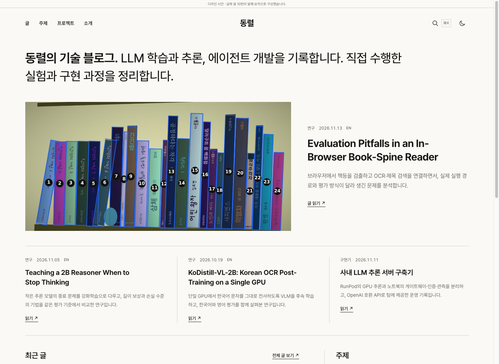

## 전체 글

검색·주제·글 유형을 조합해 글을 좁히고 카드형·목록형으로 같은 결과를 볼 수 있다. 카드형은 정사각 이미지와 제목 중심, 목록형은 제목과 설명 중심이다. 더 보기 버튼은 카드에 붙은 관계 팝오버를 열며 기본 화면에 긴 요약·태그를 쌓지 않는다. 목업은 10편의 예시 글을 사용하며 전체 공개 글 수처럼 표시하지 않는다.

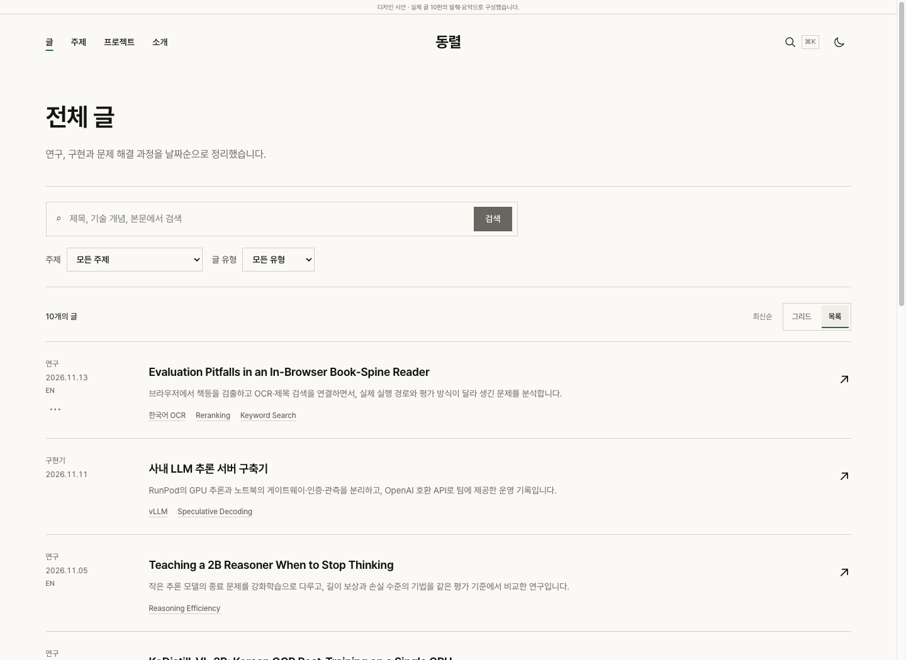

연구 필터는 카드형이 기본이며, 전체 글과 일반 기록은 설명형 목록이 기본이다. 보기 전환과 조건 해제 후에도 선택한 보기 방식을 유지한다. 관련 글이 있는 카드만 관계 탐색 버튼을 제공하며, 버튼이 없는 카드도 이미지와 제목의 시작선을 맞춘다. 사진은 정사각 틀을 채우고 연구 도표는 원본 전체를 보존한다.

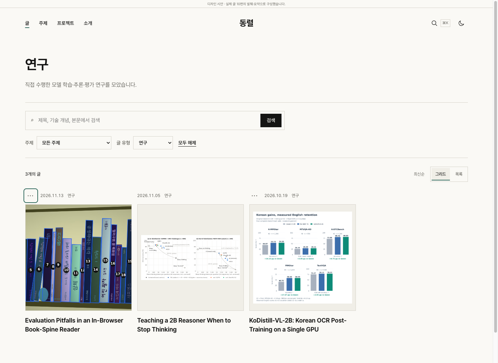

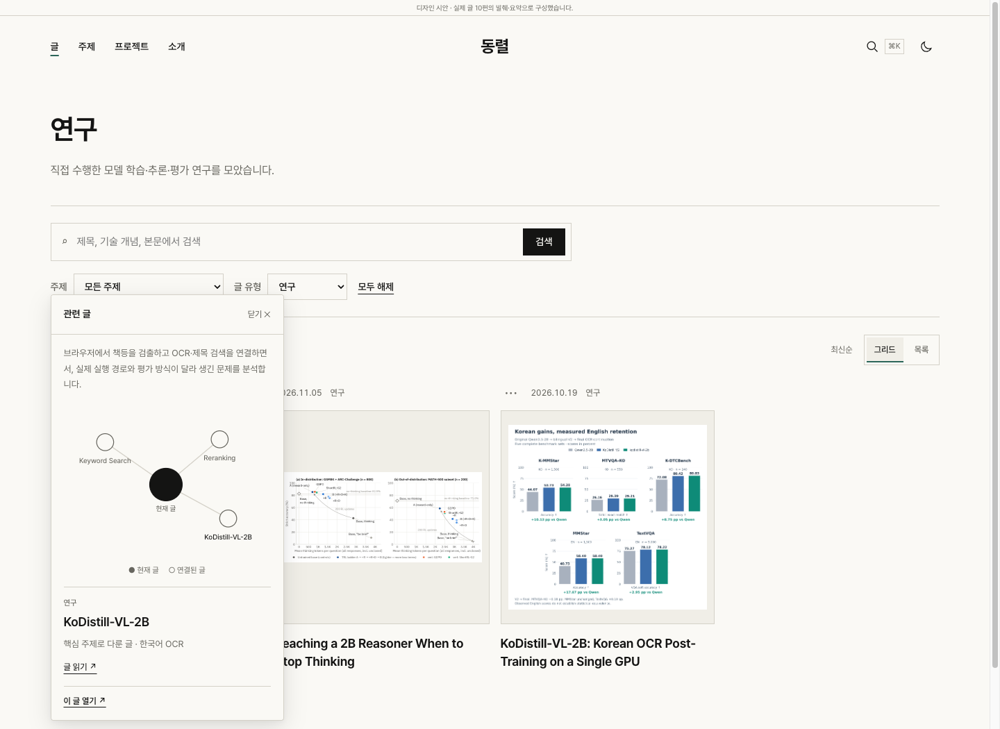

## 글 상세

본문을 중심으로 왼쪽 목차와 오른쪽 관련 탐색을 배치한다. 긴 영문 제목, 한국어 설명, 본문 도식이 같은 위계 안에서 보인다.

## 관련 글 탐색

주변 노드에 포인터나 초점을 놓으면 내용을 미리 보고, 누르면 선택이 유지된다. 실제 글로 이동하는 동작은 프리뷰의 `글 읽기` 링크에서 수행한다. Reranking과 책등 OCR 글은 검색 재정렬의 개념과 적용 사례로 연결하며 같은 모델을 사용했다는 의미로 설명하지 않는다.

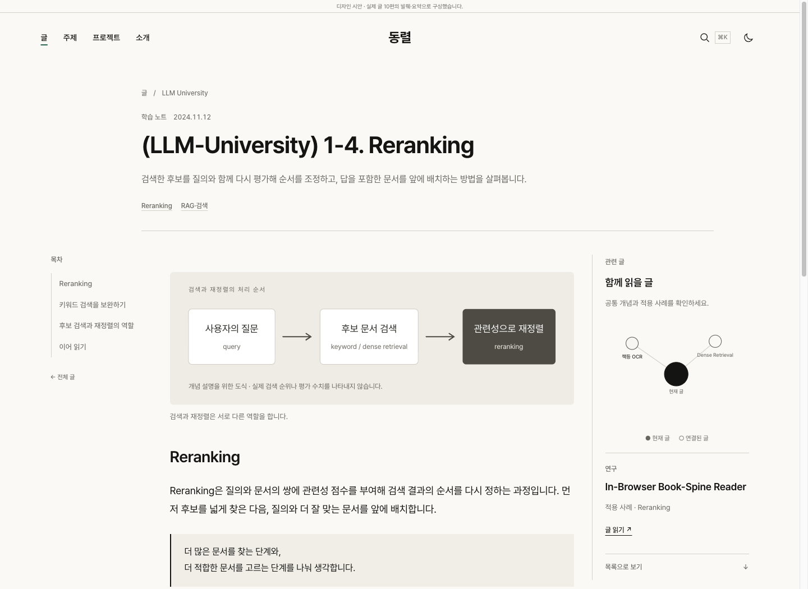

## 검색

검색 버튼과 ⌘K·Ctrl+K로 열 수 있다. `QLoRA`를 입력하면 실제 논문 리뷰와 문제 해결 기록이 함께 나온다. Enter로 전체 결과에 이동하거나 개별 제목을 직접 열 수 있다.

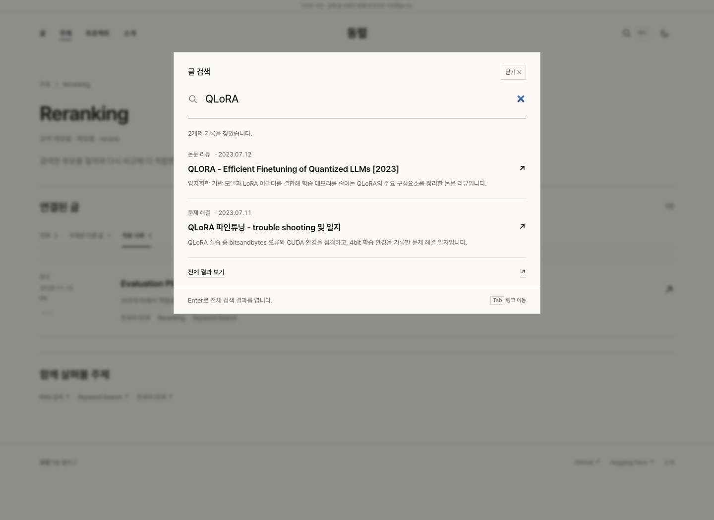

## 주제 탐색

주제 이름과 별칭으로 개념을 찾는다. 주제 상세에서는 `주제로 다룬 글`과 `적용 사례`를 나누고, 연결 이유를 확인하며 다음 글로 이동한다.

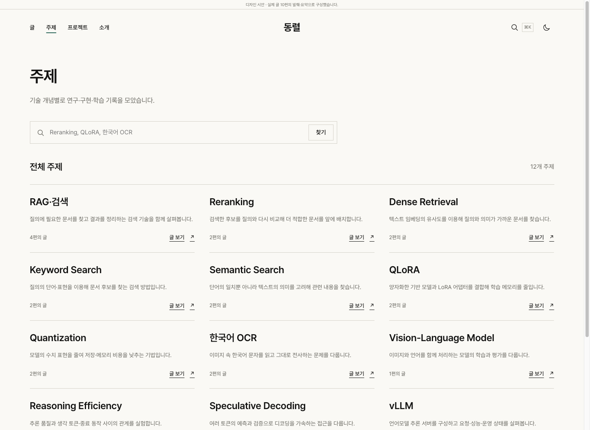

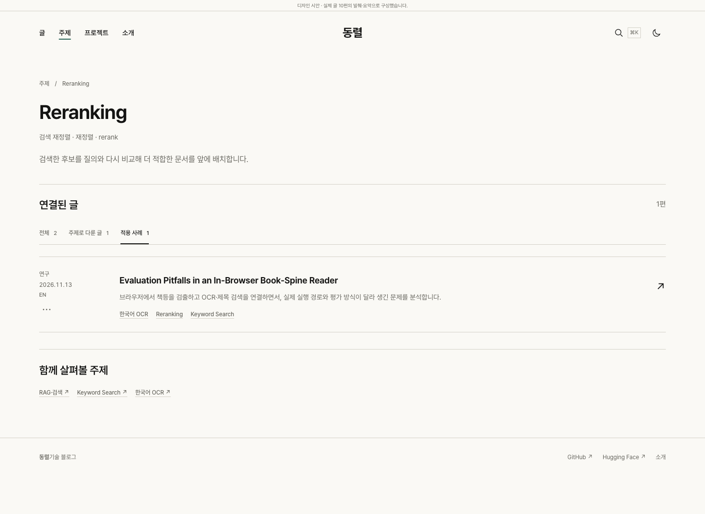

## 프로젝트

ThinkingCap·KoDistill의 목적, 연구 글, 검증된 공개 자료를 함께 배치한다. ThinkingCap 공개 모델은 B 변형임을 링크 이름으로 구분한다.

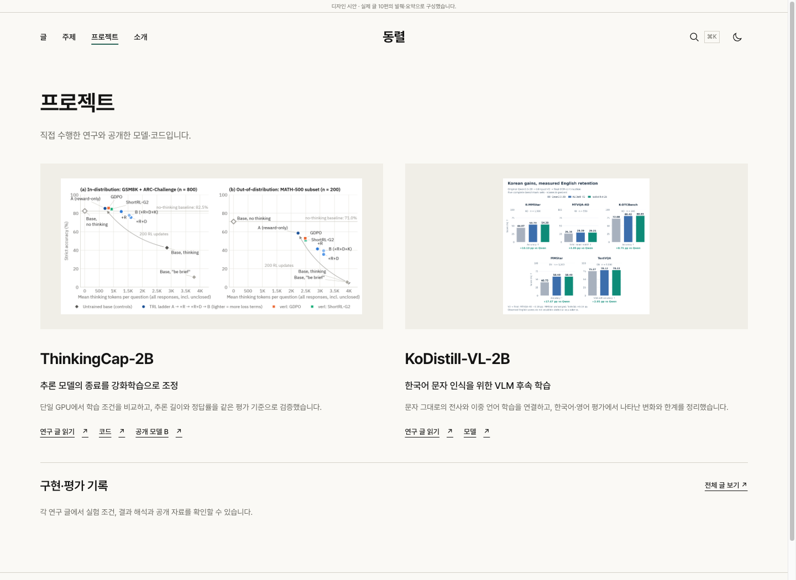

## 소개

작성자의 연구 방향과 대표 글, 공개 프로필을 간결하게 보여준다.

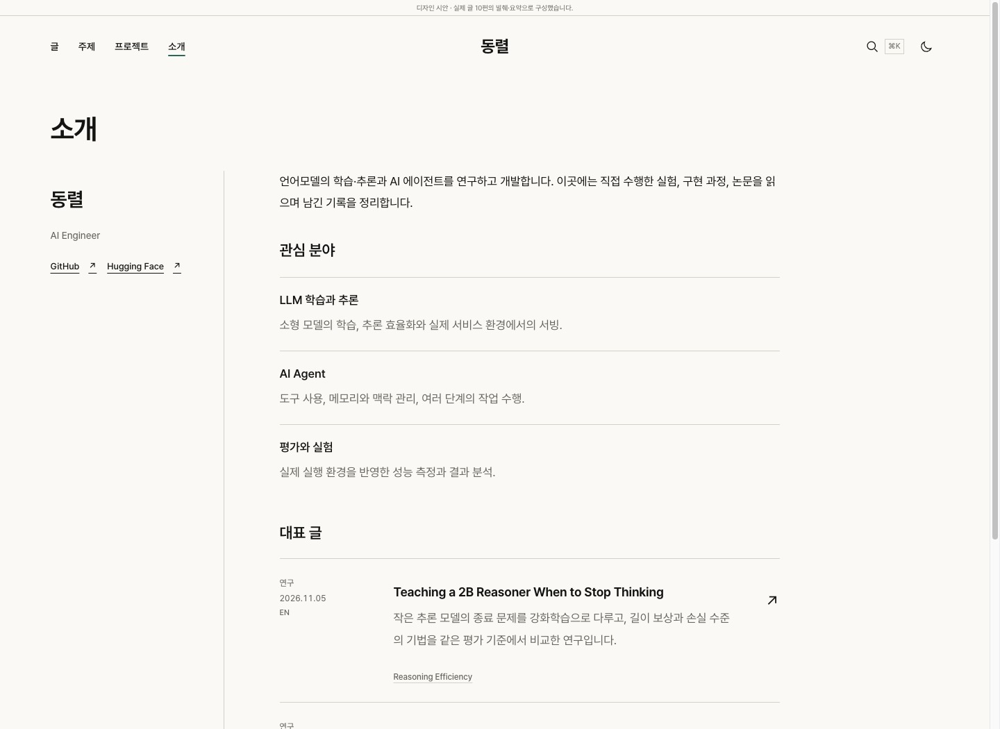

## 모바일과 다크 테마

모바일에서는 카드와 본문을 한 열로 배치하고 메뉴를 접는다. 소개는 26px, 상세 제목은 30px, 카드 제목은 17px로 조정하고 메타데이터는 12px를 유지한다. 텍스트 드래그 선택은 밝은 테마 #D6EAE4/#122F29, 어두운 테마 #315E53/#F4FAF7로 본문·코드·입력창에 적용한다. 다크 테마에서는 같은 정보 구조를 유지하며 실제 연구 이미지의 색을 보존한다.

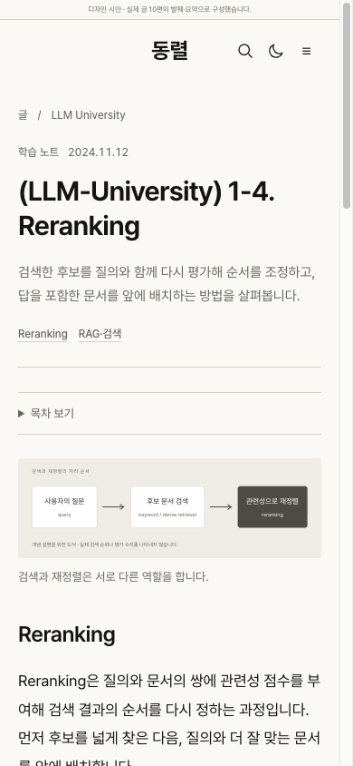

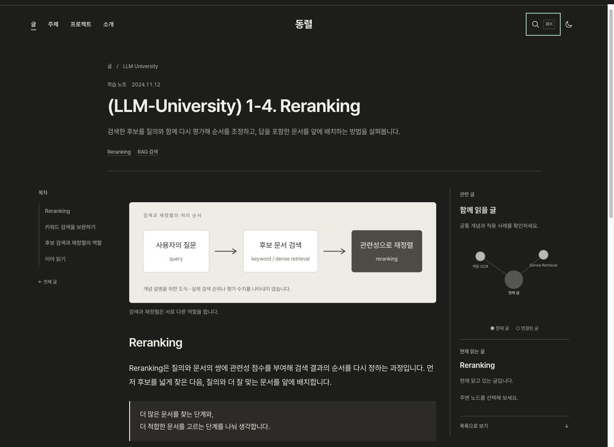

같은 본문을 선택한 밝은 테마와 어두운 테마의 실제 출력이다.

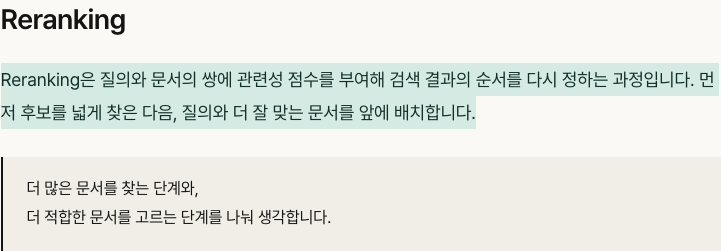

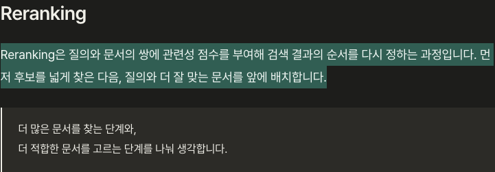

## 실제 Vercel 전환 시 코드 처리

| 범위 | 처리 방향 |
|---|---|
| `_layouts/`, `_includes/`, `_sass/`, Jekyll 테마 자원 | 새 프론트에서 대체한 뒤 제거 가능 |
| `Gemfile`, Jekyll gemspec, 기존 Jekyll 전용 설정·배포 workflow | 새 빌드·배포가 검증된 뒤 제거하거나 이전 주소 배포용으로 교체 |
| `_posts/` | 글 원본을 보존하고 새 콘텐츠 로더로 읽음. 이후 디렉터리 이동은 별도 변경 |
| `img/`, 연구 이미지·CSV·기타 공개 자산 | 실제 참조와 주소를 보존하며 새 정적 자산 경로로 이전 |
| 기존 글 경로·heading ID·검증 파일·RSS | URL 대응표와 호환 처리로 유지 |
| 새 Astro 프로젝트 | 패키지·콘텐츠 처리·정적 페이지 생성·Vercel 빌드 설정 구성 |

레거시 삭제 자체는 Vercel 전환의 선행 조건이 아니다. 같은 GitHub 저장소를 코드 저장소로 계속 사용하면서 배포만 Vercel로 옮길 수 있다. 최종 origin은 Vercel 주소 또는 소유 도메인으로 정하고 GitHub Pages의 이전 주소는 글별 연결 정책을 적용한다.

## 확인 범위

Pretendard의 45~920 변수 축과 loaded 상태를 브라우저에서 확인했다. 시안에 내장한 WOFF2는 공식 원본과 SHA-256이 같고 라이선스도 HTML에 포함한다. 320·375·390·768·1280·1440px의 홈·연구 목록·상세에서 가로 넘침이 없었으며 그리드는 1·2·3·4열로 바뀐다. 역할별 계산 스타일, 한영 본문, 밝은·어두운 선택 색상, 카드 이미지 시작선, 관련 팝오버의 화면 경계·Escape·초점 복귀, 보기 전환·조건 해제·200자 검색 제한도 확인했다.

데스크톱·모바일 화면, 예시 10편의 목록·유형 필터, 검색 결과, 주제 역할·빈 결과, 그래프의 선택·읽기 분리, 이미지 확대, 다크 테마, 검색 닫기·초점 복귀와 키보드 선택을 확인했다. 관련 글은 10편을 대상으로 실제 계산하며, 새 글 추가 후 기존 글의 추천 갱신·비공개 제외·잘못된 관계·재현성 등 10개 경계 검증을 통과했다. 정식 검색 인덱스·113편 전체의 개념 추출·전체 콘텐츠 변환·실제 Vercel 배포·레거시 삭제는 이 목업의 범위에 포함하지 않는다.

Alignment 관찰과 역할별 글자·선택 색상은 [디자인 시스템](blog-design-system.md), 상세한 화면·상태 계약은 [화면설계서](blog-screen-specification.md), 이전·추천·배포 설계는 [리팩토링 계획서](blog-refactoring-plan.md)를 기준으로 한다.

온톨로지·저장소·GraphRAG의 구분과 실제 실행 파일은 [온톨로지 구현안](blog-ontology-architecture.md)에 정리했다. 목업을 다시 만들 때는 `node docs/preview/build-preview.mjs` 한 명령으로 관련 글 생성과 HTML 생성을 함께 실행한다.
