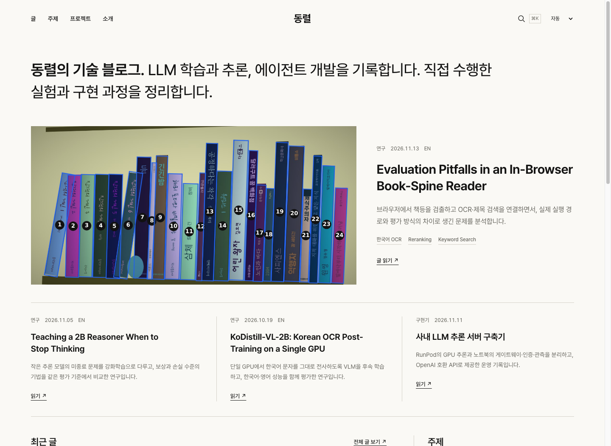
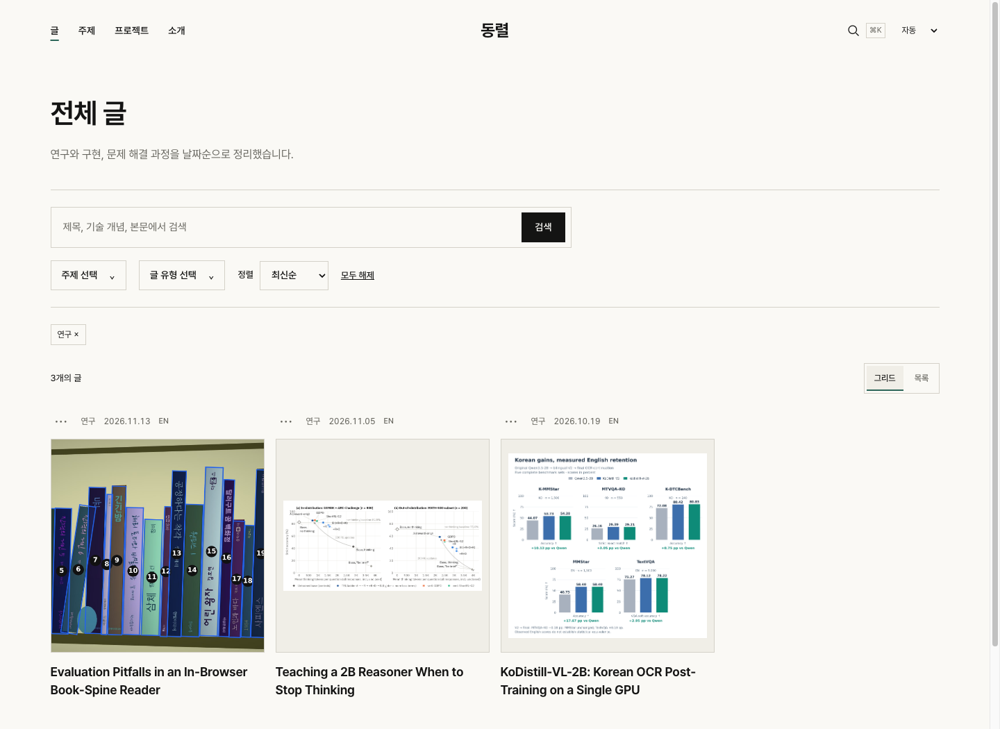
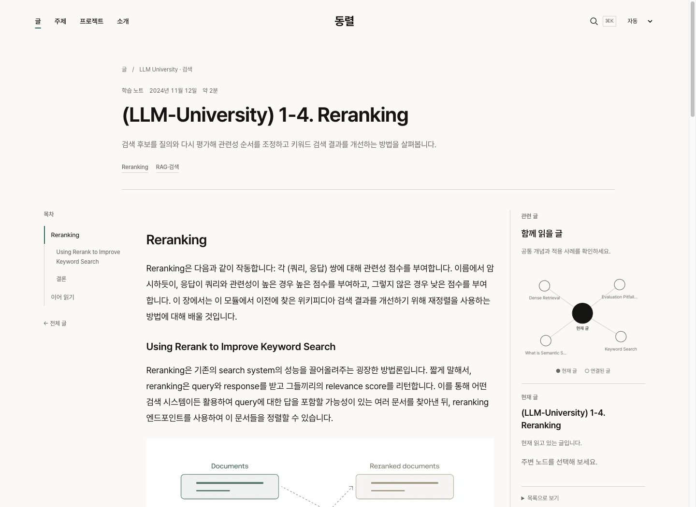
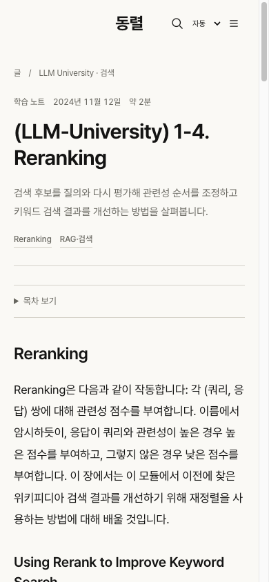

# 리팩토링 구현과 검증 상태

작성일: 2026-11-18 · 기존 Jekyll 블로그의 Astro 정적 사이트 전환

계획서와 화면설계서의 첫 출시 범위를 실제 파일에 대응시킨다. 계획서의 일정 추정이나 목업의 10편 데이터를 운영 구현의 검증 결과로 사용하지 않는다. 전수 검사는 generated/build-verification.json, 콘텐츠 이전 내역은 generated manifest와 보고서를 기준으로 확인한다.

| 기능군 | 위치 | 확인할 결과 |
|---|---|---|
| 원문·주소 보존 | tools/content, content/article-metadata.json, generated | 원문 대응·제목 보완·canonical path·기존 heading |
| 공통 프레임·글자 체계 | src/layouts, src/components, src/styles | Pretendard 실제 로드, 역할별 타이포·메뉴·테마·모바일 |
| 홈·목록·필터 | src/pages/index.astro, articles, src/scripts | 대표 글·최근 글, 공유 URL, 보기·정렬·페이지 |
| 상세 | ArticleLayout, 콘텐츠 renderer | 본문·목차·코드·수식·이미지·시리즈·정적 관련 링크 |
| 주제·시리즈·프로젝트 | src/pages/topics, series, projects | 역할·명시 순서·검증된 자료 |
| 관련 글 | tools/knowledge, content/knowledge, RelatedGraph | 공개 글의 파생 추천·이유·선택과 이동 분리 |
| 검색 | Pagefind, SearchDialog, search, src/scripts | 본문 색인, 빠른·전체 검색, 오류·빈 결과 구분 |
| 이전 메뉴 | src/lib/legacy.ts, 기존 .html 경로 | 태그·카테고리 fragment·정적 대체 링크 |
| 발견 | BaseLayout, feeds, sitemap, robots | 최종 origin, 유효 XML, Preview noindex |
| 정적 배포 | vercel.json, tools/verify-build.mjs | Vercel 빌드에서 npm 고정 설치, dist 출력, 전수 검사 |
| 기존 origin 전환 | tools/create-legacy-bridge.mjs | 최종 주소 확정 후 글별 bridge 별도 생성. 아직 배포하지 않음 |

## 확인된 검증

2026-11-18 정적 산출물 검사에서 원문 113편과 공개 글 113편의 대응, source digest, registry·URL manifest·실제 출력 경로가 일치했다. HTML 192개, 내부 링크 참조 8,266회, 로컬 자산 참조 1,357회를 검사해 오류와 경고가 모두 0건이었다. 자산 수는 고유 이미지 파일 수가 아니라 HTML에서 확인한 반복 참조 수다. RSS·sitemap은 XML 파서로 확인했고 기존 heading·별칭도 실제 DOM ID와 대조했다.

원문에 있던 ObjectDetection·R-CNN의 이전 분류 링크 두 개는 확인된 기존 글 주소로 연결을 보정하고 Vercel 영구 이동도 추가했다. 본문 script·style·iframe과 인라인 이벤트, javascript URL이 남지 않는지 검사한다. 중간 Astro 검사도 오류 없이 통과했다.

실제 정적 출력의 브라우저 확인에서 전체 113편, 연구 카드 3개, 한국어 QLoRA 검색과 영문 ThinkingCap 검색, 관련 노드 선택, Escape로 닫기와 초점 복귀를 확인했다. 실제 Vercel 도메인의 HTTP 응답과 DNS는 아래 계정 연결 단계에서 별도로 확인한다.

## 계정에서 남은 일

Vercel Import, GitHub 접근 승인, Production Branch와 최종 주소 확정, SITE_URL 설정과 재배포가 필요하다. 커스텀 도메인은 해당 프로젝트가 제시하는 DNS 값을 설정한다. 계정 작업은 로컬 빌드 성공과 구분한다. 공개 배포·CDN HTTP 상태·DNS·이전 origin 전환은 배포 후 확인한다.

Astro 빌드와 배포는 Vercel에서 진행한다. `main`은 Production으로, 그 외 브랜치의 변경은 기본적으로 Preview로 빌드한다. 기존 주소는 GitHub Pages가 `main`의 Jekyll 사이트를 내장 빌드로 게시한다.

## 후속 범위

전체 지도 /explore/, semantic hybrid, 실시간 편집, 로그인·개인화, LLM 질의응답과 GraphRAG는 첫 출시 범위에 포함하지 않는다. P@3·nDCG·체류 시간은 측정 자료 없이 달성했다고 표시하지 않는다. 개념 편집과 실제 적용 관계의 사실 확인은 자동 추천 계산과 별도다.

외부 이미지·자료의 원격 생존 상태, iOS·Safari 접근성, Core Web Vitals 실사용 p75는 로컬 HTML 검사만으로 보장하지 않는다. 원문에 있던 잘못된 링크 경고는 새 UI가 만든 경로 오류와 나누어 기록한다.

연관 글 추천 Phase 2A(2026-11-20, `feat/related-embeddings`)는 전체 공개 글을 대상으로 구현했다. 글별 관계 추출, 그래프·어휘·임베딩 후보 검색, 임베딩 기반 근거 블록 선택, LLM 재정렬, 글별 파일(`content/related/<글 ID>.json`) 저장과 증분 갱신, 키 없는 글별 빌드 검증이 `tools/knowledge`와 `tools/sync-recommendations.mjs`에 있다. 고정 모델(`openai/gpt-6-luna`, `google/gemini-embedding-2`)과 Supabase 벡터 캐시를 실제로 호출해 113편 전체에 적용했다. 110편은 모델이 고른 추천을, 근거 블록이 없는 3편은 규칙 추천을 표시한다. 검증 결과와 남은 위험은 [연관 글 그래프 구현 계획](related-articles-implementation-plan.md)에 있다.

## 최종 통합 검증

프로덕션 형태와 Vercel Preview 환경 분기를 각각 빌드해 통과했다. Preview에서는 HTML noindex와 robots 차단을 전수 확인했다. 테스트용 origin으로 118개 이전 주소 연결 페이지의 생성도 확인했으며 테스트 산출물은 제거했다. 실제 계정 배포는 수행하지 않았다.

최종 `npm test`는 콘텐츠·추천의 의미 검증 20개를 통과했고 Astro 검사는 40개 파일에서 오류·경고·힌트가 없었다. 전수 결과는 글 113편, HTML 192개, 내부 링크 참조 8,266회, 로컬 자산 참조 1,357회이며 오류·경고 모두 0건이다.

실제 dist를 브라우저에서 읽어 한글·영문 Pagefind 검색, 복수 조건과 페이지 정정, 주제 역할, 관련 글 선택·초점 복귀, 코드 원문과 클립보드 일치, ThinkingCap 이미지 11개의 확대·원본 크기·닫기, 수식 9개, 테마와 모바일 메뉴를 확인했다. Reranking 상세는 320·375·768·1280·1440px에서 가로 넘침이 없었다. 검색 파일의 일시 실패를 주입한 뒤 다시 시도로 정상 검색이 회복되는 것도 확인했다. 상세 기록은 generated/browser-verification.json에 있다.

## 실제 구현 화면

